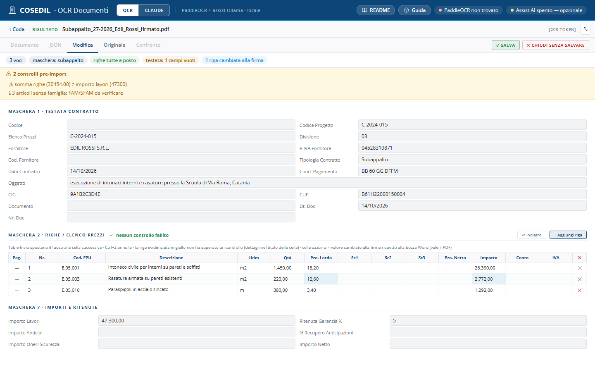
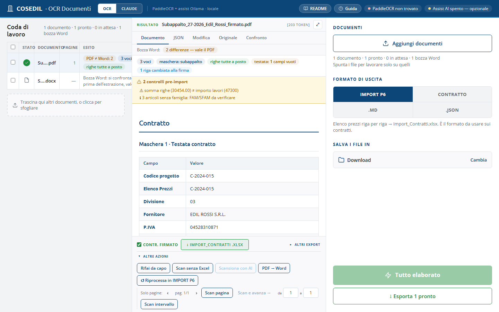

<!-- "><(((º> sabusabu <º)))>< -->
# 3. Controllare e correggere il risultato

[← Indice](README.md)

## 3.1 I controlli pre-import (riquadro giallo)

Sopra il risultato, il riquadro giallo **N controlli pre-import** elenca ciò
che non torna e che Alyante rifiuterebbe o importerebbe sbagliato:

- importo di riga diverso da quantità × prezzo;
- **somma delle righe ≠ importo dei lavori** (nell'esempio 30.454,00 contro
  47.300,00: manca una parte dell'elenco prezzi, oppure l'importo di testata è
  un altro);
- CIG, CUP o date scritti male;
- righe senza codice o senza prezzo;
- articoli senza famiglia/sottofamiglia (*FAM/SFAM da verificare*).

Ogni voce è **cliccabile** e porta alla cella da correggere.

## 3.2 Le celle rosse nell'Excel

Una cella **rossa** su PROGETTO/EPU vuol dire che il codice commessa trovato
**non è nell'elenco ufficiale** delle commesse. Due casi:

- la lettura ha sbagliato il codice → correggilo a mano;
- la commessa è nuova e non è ancora nell'elenco → chiedi di aggiornare
  l'elenco (cartella *Elenchi*, vedi il capitolo per l'amministratore) e rifai l'export.

Nessuna cella rossa = tutti i codici controllati contro le liste ufficiali.

## 3.3 La scheda Modifica

Con il formato IMPORT P6, **Modifica** apre testata, righe e importi in caselle
modificabili e allarga il pannello:

- **Maschera 1 · Testata contratto**: codice progetto, fornitore, P.IVA,
  divisione, tipologia, date, condizioni di pagamento, oggetto, CIG, CUP…
- **Maschera 2 · Righe / elenco prezzi**: una riga per voce. La riga che non
  supera un controllo è **gialla** con una barra a sinistra (il motivo è nel
  suggerimento della cella); le celle **azzurre** sono valori cambiati alla firma
  rispetto alla bozza Word. **N da rivedere — mostra solo queste** nasconde le
  righe a posto. La colonna **Pag.** apre l'originale accanto alla tabella, sulla
  pagina da cui viene la voce. **+ Aggiungi riga**, **×** per togliere una riga.
- **Maschera 7 · Importi e ritenute**: importo lavori, anticipi, oneri sicurezza,
  ritenuta di garanzia, recupero anticipazioni.

Tasti utili: **Tab** e **Invio** passano alla cella dopo, **frecce su/giù**
cambiano riga, **Ctrl+Z** (o **↶ Indietro**) annulla, **Esc** chiude senza salvare.

Finito: **✓ Salva** (oppure **✕ Chiudi senza salvare**). In modifica gli export
sono nascosti: prima si salva, poi si esporta.

## 3.4 Export e altre azioni

In fondo al pannello:

- **Contr. firmato** (spunta) e **↓ Import_Contratti .xlsx**: l'export del formato scelto;
- **Altri export**: copia, `.csv`, `.md`, `.json`, `.docx`…
- **Altre azioni**, sul file selezionato:

| Pulsante | Quando usarlo |
|---|---|
| **Rifai da capo** | rilegge il file selezionato |
| **Scan senza Excel** | legge tutto ma si ferma prima dell'Excel, per guardare il risultato |
| **Scansiona con AI** | scansioni che il motore normale non legge (serve un modello di visione installato) |
| **PDF → Word** | per PDF "nati al computer": estrae il testo senza OCR |
| **↺ Riprocessa in \<formato\>** | cambia formato senza rileggere il documento |
| **Solo pagine**: **Scan pagina**, **Scan e avanza →**, **Scan intervallo** | rilavorare una pagina o un intervallo preciso (utile sui PDF lunghi) |

[← Da contratto a Excel](02-contratto-excel.md) · [Avanti: Formati e Claude →](04-formati-e-claude.md)
