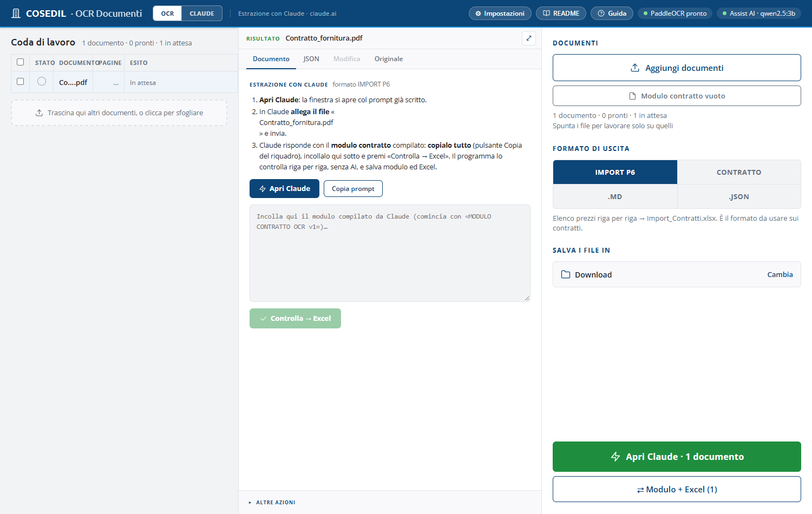
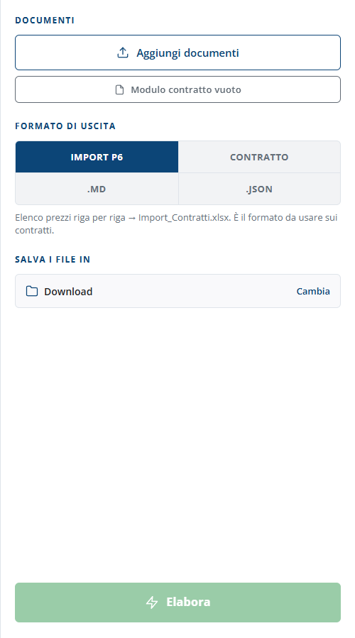
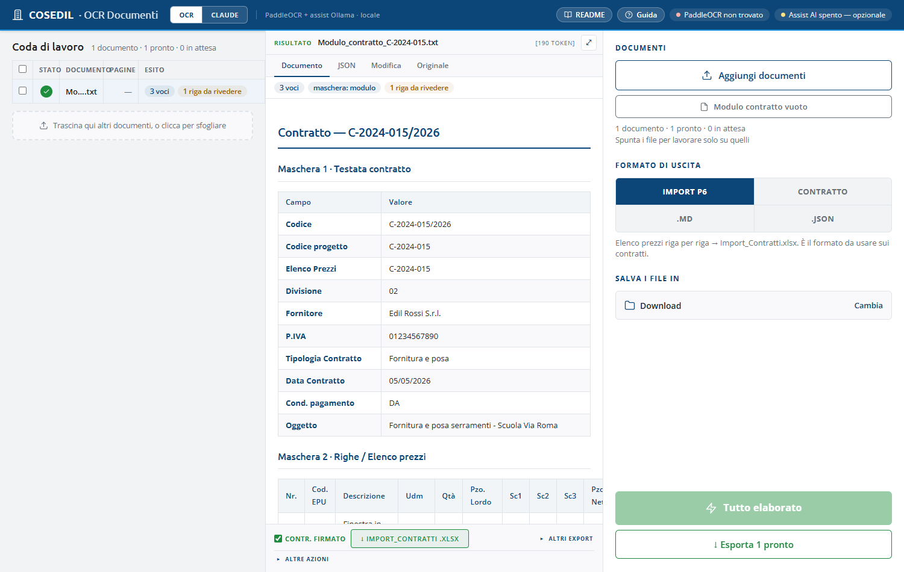
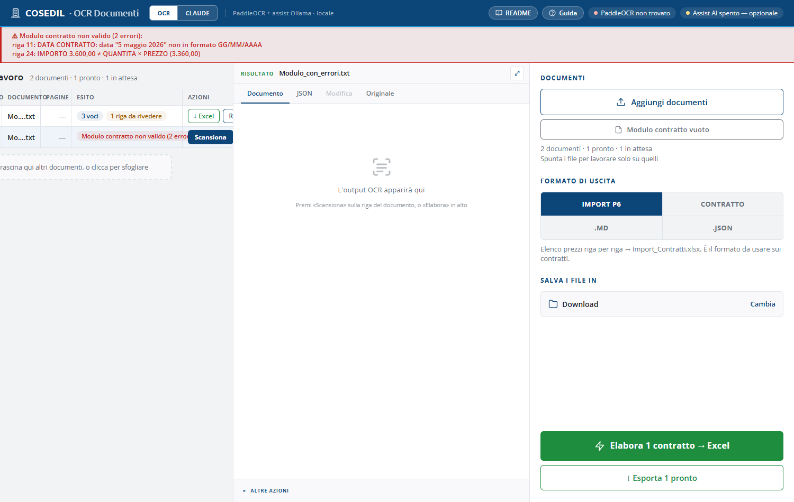
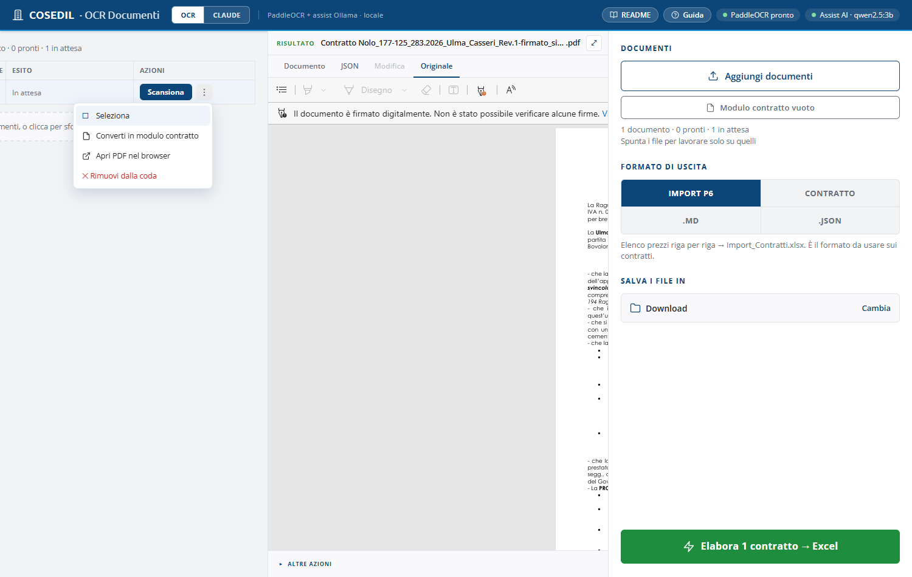
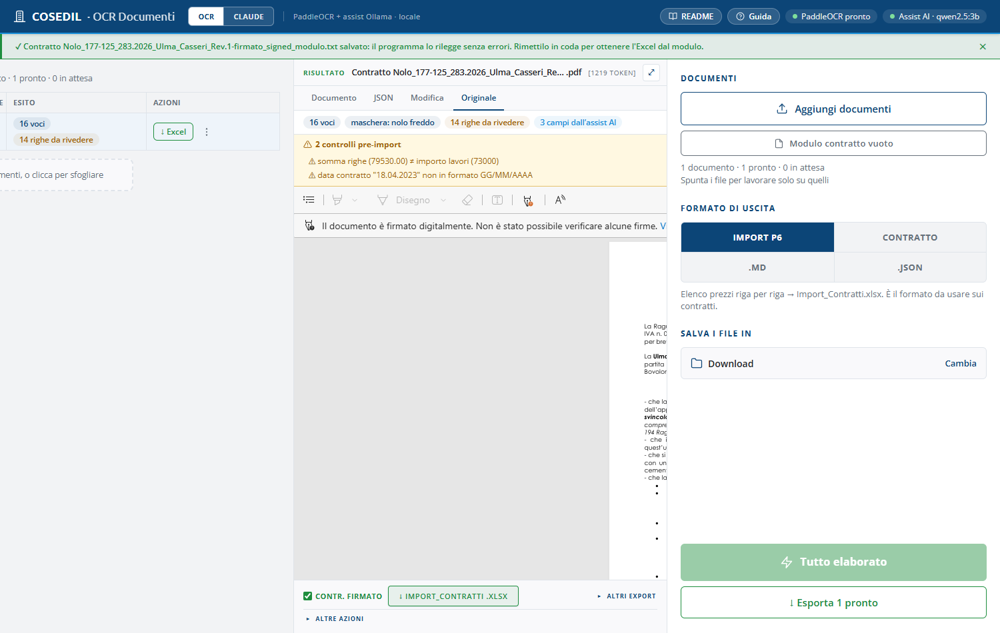

<!-- "><(((º> sabusabu <º)))>< -->
# 4. Formati di uscita, modalità Claude e modulo contratto

[← Indice](README.md)

## 4.1 I quattro formati

| Formato | Per cosa |
|---|---|
| **IMPORT P6** | contratti → elenco prezzi riga per riga → `Import_Contratti.xlsx`. È quello da usare sui contratti |
| **CONTRATTO** | solo la testata del contratto, una riga per documento |
| **.MD** | trascrizione fedele di qualsiasi documento (DDT, verbali, bolle), tabelle comprese |
| **.JSON** | testo grezzo riga per riga, per altri programmi |

Ogni documento ricorda il formato con cui è stato elaborato: selezionando la sua
riga, la barra torna a quel formato. Se un contratto non ha un elenco prezzi
riconoscibile, il programma ripiega da solo su CONTRATTO (etichetta **solo
testata**). Se hai elaborato in `.MD` per sbaglio non serve rileggere: cambia
formato e usa **↺ Riprocessa**.

## 4.2 Le regole fisse di compilazione

- **EPU = PROGETTO** sempre; DESCR. CONTRATTO = OGGETTO;
- COLL. LINEA TECNICA = 1, CONTRATTO FIRMATO = 1, NODO = 0;
- FORNITORE = partita IVA; DITTA = 2 (COSEDIL S.p.A.);
- RG/RI dalla ritenuta di garanzia: 5% → RG05 + R005, 10% → RG10 + R005;
  forniture senza ritenuta → vuoti;
- COND. PAG. in codice dall'elenco ufficiale (es. bonifico → BB, RiBa → RB);
- DIVISIONE dall'elenco ufficiale (03 subappalto, 02 fornitura…).

## 4.3 Modalità Claude

Per documenti che il motore aziendale non riesce a leggere bene, in alto si
può passare da **OCR** a **CLAUDE**: la lettura la fa Claude sul sito
claude.ai, con l'account dell'utente.

> **Attenzione:** in questa modalità il documento e la richiesta (che
> contiene anche gli elenchi ufficiali: commesse, divisioni, condizioni di
> pagamento) **escono dalla rete aziendale**. Usala solo se l'azienda lo consente.

Con il formato IMPORT P6:

1. premi **Apri Claude**: si apre claude.ai con la richiesta già scritta
   (**Copia prompt** la copia negli appunti se la finestra non si apre);
2. in Claude **allega il file** indicato e invia;
3. Claude prepara `<nome>_Import_Contratti.xlsx`: **scaricalo** dalla sua finestra;
4. torna qui e premi **Excel scaricato → fatto** per segnare il documento come fatto.

Con gli altri formati, al punto 3 si **copia la risposta** di Claude, la si
incolla nel riquadro del pannello e si preme **Elabora**. **Rifai con Claude**
riparte da capo su un documento già fatto.

## 4.4 Modulo contratto: i dati scritti a mano, letti alla lettera

Quando un contratto non si lascia leggere (scansione pessima, impaginazione mai
vista, nolo senza l'Excel allegato) oppure i dati arrivano già pronti da un altro
ufficio, si può **compilare il modulo contratto** e darlo al programma come un
documento qualsiasi. Il programma **non interpreta nulla**: niente lettura delle
scansioni, niente AI. Copia ogni valore **così come è scritto** e controlla solo che
sia nel formato giusto.

1. Premi **Modulo contratto vuoto** (sotto *Aggiungi documenti*): si scarica
   `Modulo_contratto_OCR.txt`. La versione Word, `Modulo_contratto_OCR.docx`,
   sta nella cartella `docs/modulo` del programma.
2. Aprilo (Blocco note o Word) e scrivi i valori **dopo i due punti**. Le righe
   che iniziano con `#` spiegano ogni campo e si possono lasciare.
3. Nella parte **[RIGHE]** scrivi l'elenco prezzi, una voce per riga, con le celle
   separate da `|` nell'ordine `ARTICOLO | DESCRIZIONE | UM | QUANTITA | PREZZO | IMPORTO`.
   Una cella vuota resta vuota ma il `|` ci va lo stesso. Nel Word si scrive nella tabella.
4. Salva e **trascina il file** nella pagina, come un PDF. Il formato passa da solo
   a **IMPORT P6**.
5. Premi **Elabora → Excel**: esce `<nome>_Import_Contratti.xlsx`. Nel pannello
   l'etichetta **maschera: modulo** dice che i dati vengono dal modulo.

**Le regole di scrittura**

| Cosa | Come |
|---|---|
| Numeri | all'italiana: `1.234,56` (punto per le migliaia, virgola per i decimali) |
| Date | `GG/MM/AAAA`, per esempio `05/05/2026` |
| Tipologia | una tra *Passivo a Misura, Subappalto, Fornitura e posa, Nolo a caldo, Nolo a freddo, Nolo infragruppo* |
| Partita IVA | 11 cifre (il prefisso `IT` si può lasciare) |
| CIG / CUP | 10 / 15 caratteri |
| Obbligatori | codice contratto, tipologia, data contratto, oggetto e il fornitore (nome o partita IVA) |
| Campo che il contratto non riporta | lascialo vuoto: il programma non inventa nulla |

**Se c'è un errore** il programma **non produce l'Excel**: nel riquadro rosso in alto
elenca tutti i problemi con il **numero di riga** del file. Correggi quelle righe,
salva e premi di nuovo **Scansiona** sulla riga del modulo.

Fra i controlli c'è anche il conto delle righe: se scrivi l'importo, deve essere
quantità × prezzo. Codici articolo, descrizioni e voci ripetute restano esattamente
come le hai scritte. La commessa scritta resta quella; se non è nell'elenco ufficiale
la cella esce rossa nell'Excel, come per ogni contratto. Le condizioni di pagamento
scritte a parole vengono tradotte nel codice Alyante (es. *60 gg DFFM bonifico* → `DA`).

### Da un documento al modulo compilato

Il modulo non va per forza scritto da zero: il programma può **compilarlo da solo**
partendo da un contratto qualsiasi in coda (PDF, scansione, Word).

1. Passa col mouse sui **⋮** della riga del documento e scegli **Converti in modulo
   contratto**.
2. Il programma legge il documento come sempre. Se l'hai già elaborato in IMPORT P6,
   anche corretto in *Modifica*, usa quei dati senza rileggerlo. Poi salva
   `<nome>_modulo.txt` nella cartella scelta in *Salva i file in*.
3. Apri il file e **confrontalo col documento**: i valori sono quelli letti, già nel
   formato del modulo, con date `GG/MM/AAAA` e numeri `1.234,56`. Correggi dove la
   lettura ha sbagliato.
4. Rimetti il file in coda e premi **Scansiona**: l'Excel esce dal modulo, alla lettera.

Il programma **non aggiusta** nulla di dubbio. Se un valore letto non entra nel modulo
lo segnala, così non si perde nulla:

- un valore fuori formato, come una tipologia fuori elenco o una data che non esiste,
  lascia il campo vuoto e scrive il valore letto in una riga `# DA VERIFICARE` sopra;
- una voce con importo diverso da quantità × prezzo resta com'è, segnata `# DA VERIFICARE`;
- una voce senza articolo né descrizione resta nel file come commento.

Il riquadro **verde** dice che il modulo si rilegge senza errori. Il riquadro
**rosso** elenca, con il numero di riga, cosa va completato prima di ricaricarlo.

[← Controllare e correggere](03-controllo-e-modifica.md) · [Avanti: Se qualcosa non va →](05-problemi.md)
