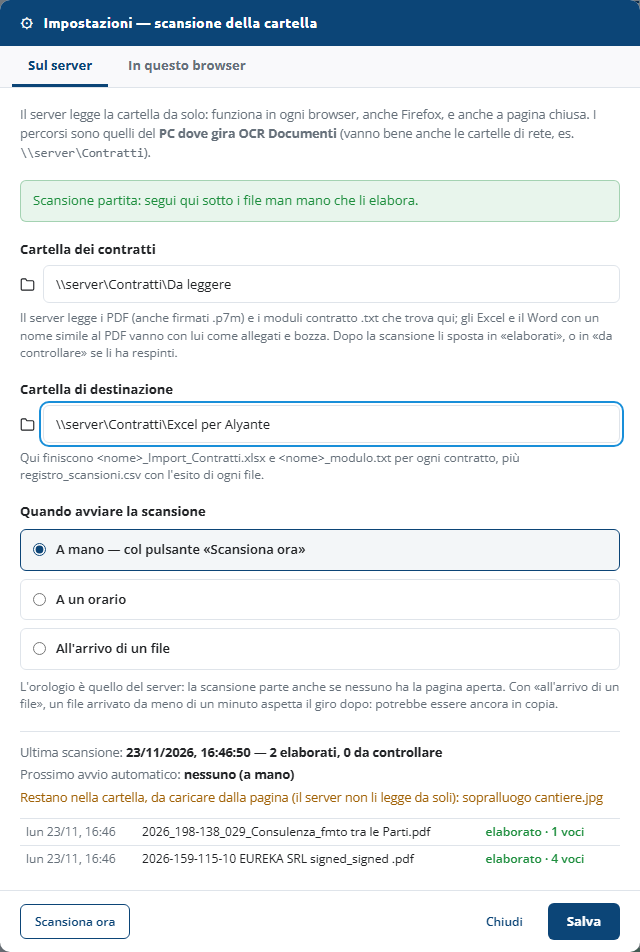
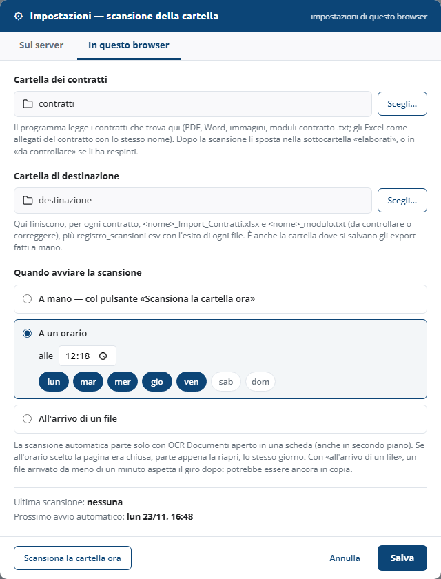

<!-- "><(((º> sabusabu <º)))>< -->
# 7. Scansione automatica di una cartella

[← Indice](README.md)

Invece di trascinare i contratti uno per uno, puoi dire al programma **in quale
cartella arrivano** e **dove mettere i risultati**: li legge da solo, a mano con un
clic, a un orario o appena arriva un file nuovo.

Premi **⚙ Impostazioni** in alto a destra. La finestra ha due schede:

| Scheda | Chi legge la cartella | Browser | Quando parte | Chi la imposta |
|---|---|---|---|---|
| **Sul server** | il server di OCR Documenti | tutti, anche **Firefox** | anche a **pagina chiusa** | l'amministratore del programma |
| **In questo browser** | la pagina, sul tuo PC | solo **Chrome** o **Edge** | solo a pagina aperta | ognuno per sé |

In Firefox la finestra si apre direttamente su **Sul server**, perché Firefox non
permette a una pagina di leggere le cartelle del PC.

## 7.1 Sul server (in ogni browser, anche a pagina chiusa)

Le cartelle sono quelle del **PC dove gira OCR Documenti** (vanno bene anche le
cartelle di rete, per esempio `\\server\Contratti\Da leggere`). Per questo le imposta
solo l'**amministratore** del programma: gli altri utenti vedono solo se la scansione è
attiva e come parte.

1. Scrivi il percorso completo della **Cartella dei contratti** e della **Cartella di
   destinazione**. Il programma controlla che esistano e che siano diverse; se c'è un
   errore lo dice in rosso (*«… non esiste sul PC dove gira OCR Documenti»*).
2. **Quando avviare la scansione**: a mano, a un orario (con i giorni) o all'arrivo di un
   file (ogni quanti minuti guardare la cartella). L'orologio è quello del server: la
   scansione parte anche se nessuno ha la pagina aperta.
3. **Salva**, oppure **Scansiona ora** per salvare e partire subito.

Sotto vedi l'avanzamento mentre lavora (*In corso: nome del contratto — OCR pagina 4/20*),
l'esito dell'ultima scansione, il prossimo avvio e gli ultimi contratti con il loro esito
e il numero di voci. La finestra si aggiorna da sola ogni pochi secondi.

**Cosa legge il server da solo**: i **PDF** (anche scansionati), i **PDF firmati
`.p7m`** e i **moduli contratto `.txt`**. Gli **Excel** e il **Word** con un nome simile
al PDF vanno con lui, come allegati e come bozza da confrontare (come nella coda). Le
**immagini**, i **Word senza PDF** e i file `.doc` restano nella cartella: la finestra li
elenca in giallo (*Restano nella cartella, da caricare dalla pagina*) e li carichi
trascinandoli nella pagina come sempre.

## 7.2 In questo browser (Chrome o Edge)

1. **Cartella dei contratti** → **Scegli…**: la cartella del tuo PC dove arrivano i
   contratti (PDF, Word, immagini, moduli contratto `.txt`). Gli Excel con l'elenco
   prezzi vengono presi insieme al contratto con lo stesso nome.
2. **Cartella di destinazione** → **Scegli…**: dove il programma scrive i risultati.
   Diventa anche la cartella dove si salvano gli export fatti a mano.
3. **Quando avviare la scansione**:
   - **A mano**: solo col pulsante **Scansiona la cartella ora**;
   - **A un orario**: scegli l'ora e i giorni (di partenza dal lunedì al venerdì);
   - **All'arrivo di un file**: il programma guarda la cartella ogni tanti minuti e
     parte appena trova un contratto nuovo.
4. Premi **Salva**. La prima volta il browser chiede il permesso sulle cartelle:
   rispondi **Consenti** (meglio *Consenti a ogni visita*, così non lo richiede più).

Le impostazioni sono **tue**: ogni utente del Portale ha le sue cartelle e il suo orario.

## 7.3 Cosa succede a ogni scansione

Per ogni contratto trovato nella cartella il programma fa lo stesso giro di
**Elabora → Excel** (nella scheda del browser lo vedi scorrere nella coda), poi:

| Dove | Cosa trovi |
|---|---|
| Cartella di destinazione | `<nome>_Import_Contratti.xlsx`, `<nome>_modulo.txt` (da controllare o correggere) e `registro_scansioni.csv`: data, ora, file, esito, numero di voci e il motivo se respinto |
| Cartella dei contratti → **elaborati** | i contratti letti, con il loro Excel di allegato e la bozza Word se c'erano |
| Cartella dei contratti → **da controllare** | i contratti che il programma ha respinto: il motivo è nel registro (e nella colonna *Esito* della coda, o tra gli ultimi esiti della scheda *Sul server*) |

L'Excel e il modulo sono **gli stessi** nelle due schede: stesso programma di lettura,
stesse celle rosse per i codici fuori elenco.

I contratti **firmati digitalmente** (`.pdf.p7m`) si leggono come gli altri (vedi
[2.5](02-contratto-excel.md#25-contratti-firmati-digitalmente-p7m)): in *elaborati*
finisce il `.p7m` originale, quello con valore legale, e nel registro la colonna delle
note riporta l'esito della firma (*Firmato .p7m — …*).

Un file `.txt` che non è un modulo contratto resta dov'è. Niente viene sovrascritto: se
in *elaborati* c'è già un file con lo stesso nome, il nuovo diventa `nome (2).pdf`.

## 7.4 La scansione automatica

**Sul server** parte da sola all'orario o all'arrivo di un file, con la pagina aperta o
chiusa. Con **all'arrivo di un file**, un file comparso da meno di un minuto aspetta il
giro dopo, perché potrebbe essere ancora in copia dallo scanner o dalla rete. Se la
cartella non si raggiunge più (disco di rete scollegato) la scheda lo scrive in rosso e
la scansione riprova al giro dopo.

**In questo browser**:

- In alto compare **Cartella · prossima gio 12:18**: la scansione automatica è attiva
  e ti dice quando parte.
- Parte **solo se OCR Documenti è aperto** in una scheda di Chrome o Edge (anche in
  secondo piano o ridotta a icona). A browser chiuso non parte: per questo c'è la scheda
  *Sul server*.
- **A un orario**: se a quell'ora la pagina era chiusa, parte appena la riapri, lo
  stesso giorno.
- **All'arrivo di un file**: come sul server, un file arrivato da meno di un minuto
  aspetta il giro dopo.
- Se in alto leggi **Cartella · in pausa**, il browser vuole di nuovo il permesso:
  apri **⚙ Impostazioni** e premi **Riattiva**.
- Se stai già elaborando altri documenti, la scansione automatica aspetta che tu finisca.
- Se in alto leggi **Server non raggiungibile — riprovo**, la scansione automatica
  aspetta che il server risponda e parte al controllo successivo (ogni 30 secondi):
  nessun contratto finisce in *da controllare* per colpa del server spento.

[← Indice](README.md)
