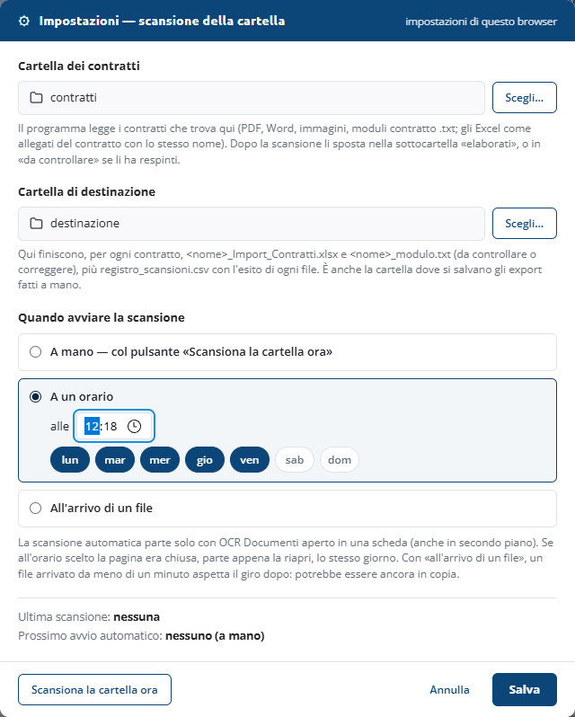

<!-- "><(((º> sabusabu <º)))>< -->
# 7. Scansione automatica di una cartella

[← Indice](README.md)

Invece di trascinare i contratti uno per uno, puoi dire al programma **in quale
cartella del tuo PC arrivano** e **dove mettere i risultati**: li legge da solo, a mano
con un clic, a un orario o appena arriva un file nuovo.

> **Serve Chrome o Edge.** Solo questi browser permettono a un programma di leggere e
> scrivere in una cartella del PC. In Firefox la finestra lo dice e i pulsanti restano
> spenti: apri OCR Documenti in Chrome o Edge.

## 7.1 Le impostazioni

Premi **⚙ Impostazioni** in alto a destra.

1. **Cartella dei contratti** → **Scegli…**: la cartella dove arrivano i contratti
   (PDF, Word, immagini, moduli contratto `.txt`). Gli Excel con l'elenco prezzi vengono
   presi insieme al contratto con lo stesso nome.
2. **Cartella di destinazione** → **Scegli…**: dove il programma scrive i risultati.
   Diventa anche la cartella dove si salvano gli export fatti a mano.
3. **Quando avviare la scansione**:
   - **A mano**: solo col pulsante **Scansiona la cartella ora**;
   - **A un orario**: scegli l'ora e i giorni (di partenza dal lunedì al venerdì);
   - **All'arrivo di un file**: il programma guarda la cartella ogni tanti minuti e
     parte appena trova un contratto nuovo.
4. Premi **Salva**. La prima volta il browser chiede il permesso sulle cartelle:
   rispondi **Consenti** (meglio *Consenti a ogni visita*, così non lo richiede più).

Le impostazioni sono **tue**: ogni utente del Portale ha le sue cartelle e il suo orario.

## 7.2 Cosa succede a ogni scansione

Per ogni contratto trovato nella cartella il programma fa lo stesso giro di
**Elabora → Excel** (lo vedi scorrere nella coda), poi:

| Dove | Cosa trovi |
|---|---|
| Cartella di destinazione | `<nome>_Import_Contratti.xlsx`, `<nome>_modulo.txt` (da controllare o correggere) e `registro_scansioni.csv`: data, ora, file, esito, numero di voci e il motivo se respinto |
| Cartella dei contratti → **elaborati** | i contratti letti, con il loro Excel di allegato e la bozza Word se c'erano |
| Cartella dei contratti → **da controllare** | i contratti che il programma ha respinto: il motivo è nel registro e nella colonna *Esito* della coda |

I contratti **firmati digitalmente** (`.pdf.p7m`) si leggono come gli altri (vedi
[2.5](02-contratto-excel.md#25-contratti-firmati-digitalmente-p7m)): in *elaborati*
finisce il `.p7m` originale, quello con valore legale, e nel registro la colonna delle
note riporta l'esito della firma (*Firma valida: …*). Un `.p7m` che non si apre resta
nella cartella e il motivo compare in alto.

Il riquadro verde in alto riassume l'esito (*1 elaborato, 0 da controllare*); se qualcosa
è stato respinto il riquadro è rosso e dice dove guardare. Un file `.txt` che non è un
modulo contratto e i file di altri tipi restano dove sono. Niente viene sovrascritto: se
in *elaborati* c'è già un file con lo stesso nome, il nuovo diventa `nome (2).pdf`.

## 7.3 La scansione automatica

- In alto compare **Cartella · prossima gio 12:18**: la scansione automatica è attiva
  e ti dice quando parte.
- Parte **solo se OCR Documenti è aperto** in una scheda di Chrome o Edge (anche in
  secondo piano o ridotta a icona). A browser chiuso non parte.
- **A un orario**: se a quell'ora la pagina era chiusa, parte appena la riapri, lo
  stesso giorno.
- **All'arrivo di un file**: un file comparso da meno di un minuto aspetta il giro
  dopo, perché potrebbe essere ancora in copia dallo scanner o dalla rete.
- Se in alto leggi **Cartella · in pausa**, il browser vuole di nuovo il permesso:
  apri **⚙ Impostazioni** e premi **Riattiva**.
- Se stai già elaborando altri documenti, la scansione automatica aspetta che tu finisca.
- Se in alto leggi **Server non raggiungibile — riprovo**, la scansione automatica
  aspetta che il server risponda e parte al controllo successivo (ogni 30 secondi):
  nessun contratto finisce in *da controllare* per colpa del server spento.

[← Indice](README.md)
