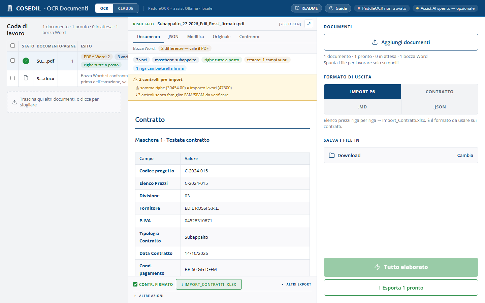

<!-- "><(((º> sabusabu <º)))>< -->
# OCR Documenti — Guida utente

OCR Documenti trasforma un **contratto** (subappalto, fornitura, nolo…) —
anche **scansionato** — nel file **`Import_Contratti.xlsx`** pronto per
l'importazione in **Alyante**: testata (fornitore, P.IVA, commessa, CIG, CUP,
condizioni di pagamento…), **elenco prezzi** riga per riga, importi e
ritenute. Sa anche trascrivere qualsiasi documento (DDT, verbali, bolle) in
testo o in JSON. La lettura avviene sui server aziendali: i documenti non
escono dalla rete (salvo la modalità *Claude*, vedi capitolo 4).

> **Nota sulle immagini.** Schermate fatte con una copia di prova, un contratto
> e degli elenchi Alyante **inventati** (commessa C-2024-015 Scuola Via Roma,
> fornitore Edil Rossi S.r.l.). Sul PC di prova il motore di lettura delle
> scansioni non era installato, per questo in alto compare *PaddleOCR non
> trovato*: il contratto d'esempio è un PDF con testo, che non ne ha bisogno.

## Come si entra

Dal **Portale** della suite Cosedil, scheda *OCR Documenti* (vedi la
[guida del Portale](../../../portale/docs/guida/README.md)).

## Capitoli

1. [La schermata e gli indicatori](01-schermata.md)
2. [Da contratto a Import_Contratti.xlsx](02-contratto-excel.md) — il flusso principale, più contratti, bozza Word + PDF firmato
3. [Controllare e correggere il risultato](03-controllo-e-modifica.md) — controlli pre-import, celle rosse, scheda Modifica, altre azioni
4. [Formati di uscita, modalità Claude e modulo contratto](04-formati-e-claude.md) — il modulo da compilare a mano quando il contratto non si legge
5. [Se qualcosa non va](05-problemi.md)
6. [Per l'amministratore di sistema](06-amministratore.md)

## Il flusso in tre passi

1. **Trascina** il PDF del contratto nella pagina (con l'eventuale Excel
   dell'elenco prezzi e la bozza Word);
2. lascia il formato **IMPORT P6** e premi **Elabora 1 contratto → Excel**;
3. apri l'Excel scaricato e controlla le **celle rosse** e il riquadro giallo
   dei **controlli pre-import**.
