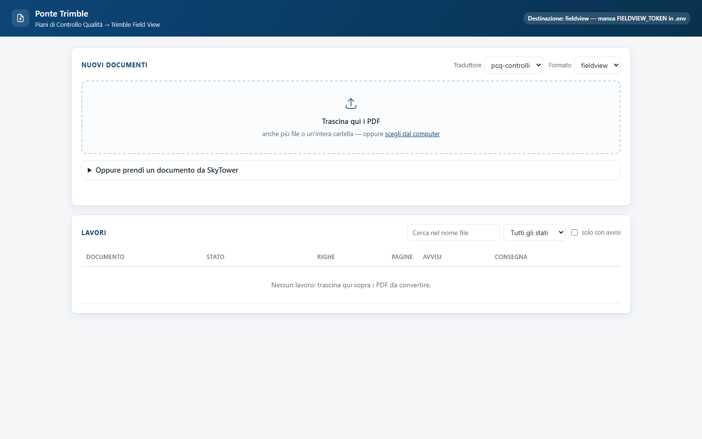
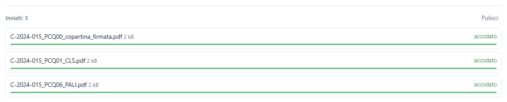
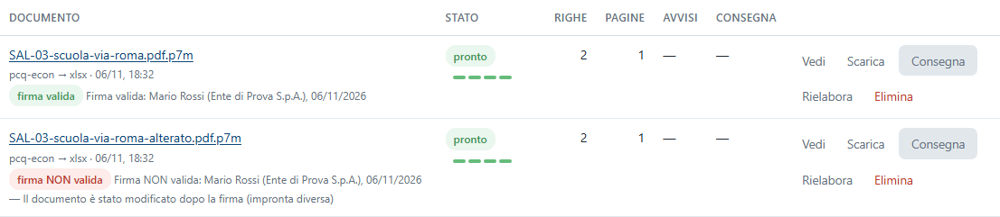
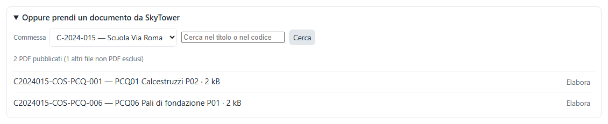
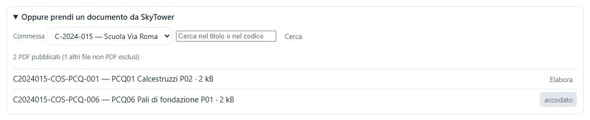
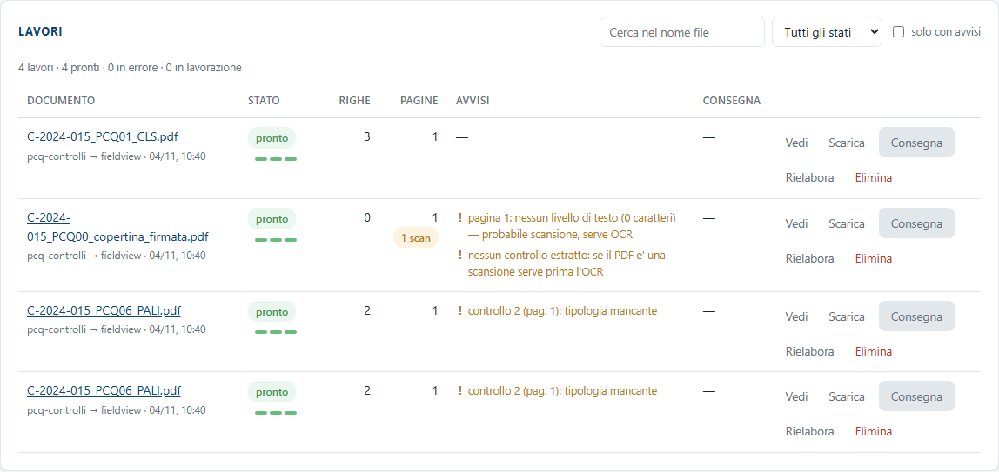
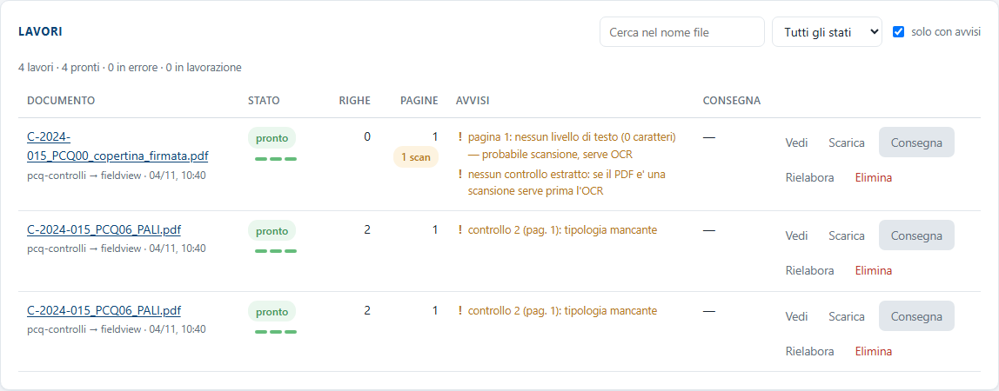
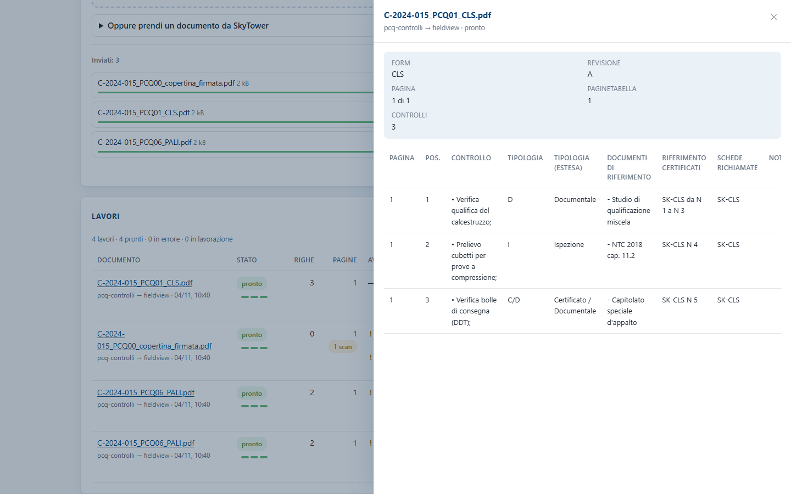
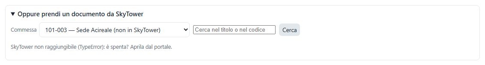

<!-- "><(((º> sabusabu <º)))>< -->
# Ponte Trimble — Guida utente

Ponte Trimble legge i **Piani di Controllo Qualità (PCQ)** in PDF e li trasforma
in un file strutturato — una riga per controllo, con posizione, tipologia,
documenti di riferimento e schede — pronto per **Trimble Field View** (o da
aprire in Excel). Serve a non ricopiare a mano i PCQ quando si prepara la
modulistica di cantiere in Field View.

## Indice

1. [Come si entra](#1-come-si-entra)
2. [Mandare i PDF](#2-mandare-i-pdf)
3. [Prendere un documento da SkyTower](#3-prendere-un-documento-da-skytower)
4. [I lavori: stato, avvisi, anteprima](#4-i-lavori-stato-avvisi-anteprima)
5. [Scaricare e consegnare a Trimble](#5-scaricare-e-consegnare-a-trimble)
6. [Se qualcosa non va](#6-se-qualcosa-non-va)
7. [Per l'amministratore di sistema](#7-per-lamministratore-di-sistema)

---

## 1. Come si entra

Si apre dal **Portale** della suite Cosedil, scheda *Ponte Trimble* (vedi la
[guida del Portale](../../../portale/docs/guida/README.md)). È **riservato agli
amministratori del Portale**: gli altri utenti non vedono la scheda e, se aprono
l'indirizzo a mano, ricevono un rifiuto.

In alto a destra c'è l'etichetta **Destinazione**: dice dove andrà il file
prodotto. Se riporta *«— manca … in .env»* la consegna automatica a Trimble non
è configurata: si può comunque convertire e **scaricare** il file (vedi il
[capitolo 5](#5-scaricare-e-consegnare-a-trimble)).

## 2. Mandare i PDF

1. In alto, nel riquadro **Nuovi documenti**, controlla i due menu:
   - **Traduttore** — chi "legge" il PDF:
     | Traduttore | Per quali documenti |
     |---|---|
     | **pcq-controlli** (predefinito) | Piani di Controllo Qualità ANAS/Cosedil (form CLS, PALI…): una riga per controllo |
     | **pcq-econ** | computi ed economici (ancora in taratura sui documenti veri) |
     | **grezzo** | qualsiasi PDF: una riga per ogni riga di testo; serve a vedere cosa legge il programma |
   - **Formato** — che file produrre:
     | Formato | Cosa esce |
     |---|---|
     | **fieldview** (predefinito) | la specifica del modulo per il Form Designer di Field View (`.fieldview.json`) |
     | **xlsx** | foglio Excel, una riga per controllo |
     | **csv** | come l'Excel, in testo separato da virgole |
     | **json** | i dati grezzi, per altri programmi |
   Le scelte restano memorizzate per la volta dopo.
2. **Trascina i PDF** nel riquadro tratteggiato **Trascina qui i PDF** — anche
   più file o un'intera cartella — oppure clicca **scegli dal computer**.
   Solo i PDF vengono accettati, anche quelli **firmati digitalmente** (file
   `.p7m`, vedi sotto); gli altri file sono ignorati con il messaggio
   *«N file ignorati: solo PDF (anche firmati .p7m)»*.
3. Sotto compare l'elenco **In invio / Inviati** con una barra per file:
   **accodato** (verde) vuol dire che il file è arrivato ed è in lavorazione.
   **Pulisci** toglie dall'elenco le righe finite.

Se un file non passa, al posto di *accodato* compare il motivo in rosso (es.
PDF troppo grande: il limite è 40 MB; al massimo 25 file per volta).

### PDF firmati digitalmente (.p7m)

Un PCQ o un SAL firmato dal direttore lavori arriva spesso come file `.p7m`: una
"busta" con dentro il PDF e la firma. Mandalo come un PDF qualunque: il
programma apre la busta, **verifica la firma** (documento non modificato,
certificato di un ente riconosciuto negli elenchi ufficiali europei e di AgID,
non revocato né scaduto, eventuale marca temporale) e poi legge il PDF come
sempre. Nella riga del lavoro c'è un passo in più (quattro trattini invece di
tre) e, sotto il nome, un bollino:

| Bollino | Significato |
|---|---|
| **firma valida** (verde) | tutto in regola |
| **firma NON valida** (rosso) | documento modificato dopo la firma, certificato revocato o scaduto…: il lavoro va avanti, ma **controlla prima di consegnare** |
| **firma da verificare** (giallo) | controllo non completato (per esempio manca la rete per la revoca): **Rielabora** lo ripete |

Accanto al bollino si legge chi ha firmato, con quale ente e quando. Il file
prodotto prende il nome del PDF contenuto (`sal.pdf.p7m` → `sal__pcq-econ.xlsx`).

## 3. Prendere un documento da SkyTower

I PCQ di solito sono già in **SkyTower**: non serve scaricarli e ricaricarli.

1. Apri **Oppure prendi un documento da SkyTower**.
2. Scegli la **Commessa** (l'elenco viene dal registro commesse della suite;
   *«(non in SkyTower)»* indica una commessa che in SkyTower non ha ancora un progetto).
3. Se vuoi, scrivi una parola in **Cerca nel titolo o nel codice** e premi **Cerca**.
4. Compaiono i **PDF pubblicati** della commessa, con codice, titolo, revisione e
   peso; i file non PDF (disegni, ecc.) sono esclusi e contati a parte. I PDF
   firmati sono segnati *«firmato .p7m»* e si elaborano come gli altri, con la
   verifica della firma.
5. Premi **Elabora** sul documento: il pulsante diventa **accodato** e il lavoro
   compare nella tabella **Lavori**, con il traduttore e il formato scelti in alto.

Si possono prendere solo i documenti **della commessa scelta**: è una regola di
sicurezza.

## 4. I lavori: stato, avvisi, anteprima

La tabella **Lavori** elenca tutti i documenti convertiti, i più recenti in alto;
sopra c'è il riepilogo (*«4 lavori · 4 pronti · 0 in errore · 0 in lavorazione»*).

| Colonna | Cosa dice |
|---|---|
| **Documento** | nome del file (clic = anteprima); sotto, traduttore → formato, data, utente |
| **Stato** | *in coda*, *in corso*, **pronto** o **errore**; i tre trattini sono i passi (lettura, traduzione, creazione del file): verdi = fatti. Per un PDF firmato `.p7m` i trattini sono quattro: il primo è l'apertura della busta con la verifica della firma |
| **Righe** | quanti controlli sono stati estratti |
| **Pagine** | pagine del PDF; l'etichetta **N scan** indica pagine scansionate, senza testo leggibile |
| **Avvisi** | cosa una persona deve controllare prima di portare il risultato in Field View |
| **Consegna** | se e quando il file è stato consegnato a Trimble |

### Gli avvisi più comuni

| Avviso | Significato e cosa fare |
|---|---|
| *pagina 1: nessun livello di testo — probabile scansione, serve OCR* | La pagina è un'immagine (tipico: la copertina firmata). Normale per la copertina; se riguarda tutto il PCQ, procurati il PDF originale (non scansionato). |
| *nessun controllo estratto: se il PDF è una scansione serve prima l'OCR* | Non è stata trovata nessuna riga: PDF scansionato o modulo diverso dal PCQ. Prova il traduttore **grezzo** per vedere cosa legge. |
| *controllo 2 (pag. 1): tipologia mancante* | Nel PDF la colonna *Tipologia* di quel controllo è vuota: completala a mano dopo. |
| *controllo N: descrizione vuota* | Manca il testo del controllo. |
| *numerazione POS. non consecutiva: …* | Manca un numero di posizione: controlla di non aver perso una riga. |
| *tabella dei controlli non riconosciuta* | La pagina non contiene la tabella POS./CONTROLLO: di solito è una pagina di legenda o di firme. |

### Cercare e filtrare

- **Cerca nel nome file** filtra mentre scrivi;
- il menu **Tutti gli stati** mostra solo *Pronti*, *In errore* o *In lavorazione*;
- **solo con avvisi** mostra solo i lavori da controllare.

### Anteprima

Clic sul nome del documento (o **Vedi**): si apre a destra il pannello con i dati
di testata (form, revisione, pagine, numero di controlli) e la tabella dei
controlli estratti (primi 200). **✕** o **Esc** chiude.

### Rielaborare ed eliminare

- **Rielabora** rifà il lavoro con il **traduttore e il formato scelti in alto**
  (es. per avere anche l'Excel dello stesso PCQ): *«Rielaborazione accodata con …»*;
- **Elimina** chiede conferma: sparisce il lavoro **e il PDF archiviato**.

## 5. Scaricare e consegnare a Trimble

- **Scarica** (solo sui lavori *pronti*) scarica il file nel formato scelto.
  Con il formato **fieldview** è la specifica da usare nel **Form Designer** di
  Field View per costruire il modello del modulo; con **xlsx** lo apri in Excel.
- **Consegna** invia il risultato alla destinazione indicata in alto a destra.
  È **grigio** finché la destinazione non è configurata dall'amministratore.
  Quando c'è più di un lavoro pronto compare anche **Consegna i pronti (N)**.

Cosa fa la consegna, secondo la destinazione:

| Destinazione | Effetto |
|---|---|
| **fieldview** | crea in Field View un **modulo** a partire da un modello già esistente. Attenzione: il file prodotto e i dati **non** vengono trasferiti, solo il modulo vuoto. Il file resta da scaricare. |
| **connect** | carica il file in una cartella di Trimble Connect. |
| **nessuna** | nessun invio: il file si scarica e basta. |

Esito: nella colonna **Consegna** compare **consegnato** (con il riferimento del
modulo o del file) oppure **errore** (passa il mouse per il motivo, scritto anche
sotto lo stato).

## 6. Se qualcosa non va

| Cosa succede | Cosa fare |
|---|---|
| Non trovo Ponte Trimble nel Portale | È riservato agli amministratori del Portale. |
| *«N file ignorati: solo PDF (anche firmati .p7m)»* | Hai trascinato file non PDF: vengono saltati, i PDF partono comunque. |
| Errore *«componente firma digitale non installato»* | Il motore della firma della suite non è ancora pronto: l'amministratore lancia `shared\firma\installa.bat` (lo fa da solo `avvia.bat` al primo avvio), poi **Rielabora**. |
| Errore *«la busta firmata contiene …: serve un PDF»* | Dentro il `.p7m` c'è un altro tipo di file (Word, Excel): serve il PDF. |
| Il lavoro va in **errore** | Leggi il motivo sotto lo stato; prova **Rielabora** o un altro traduttore. |
| **0 righe** e avviso di scansione | Il PDF è una scansione: serve il PDF originale con testo. |
| **Consegna** è grigio | La destinazione non è configurata (etichetta in alto a destra): scarica il file con **Scarica**. |
| Nel riquadro SkyTower: *«SkyTower non raggiungibile …: è spenta? Aprila dal portale.»* | SkyTower è spenta o non risponde: aprila dal Portale e riprova. Nel frattempo l'elenco commesse mostra solo il registro. |
| *«Nessun PDF pubblicato per questa commessa.»* | In SkyTower la commessa non ha PDF pubblicati (i documenti in lavorazione non compaiono). |
| *«il documento non appartiene alla commessa …»* | Il documento non è tra quelli della commessa scelta: scegli la commessa giusta. |
| In alto compare *«Traduttori scartati — …»* in rosso | Un traduttore aggiunto dall'amministratore ha un problema: gli altri funzionano; avvisa l'amministratore. |

## 7. Per l'amministratore di sistema

- **Avvio**: dal Portale (`avvia.vbs`), o `avvia.bat` / `npm start` (Node.js).
  Ascolta solo in locale; in rete ci si arriva dal Portale. Dettagli nel
  [README](../../README.md).
- **Configurazione**: file `.env` (modello in `.env.example`). `DESTINAZIONE`
  (`fieldview` | `connect` | `nessuna`), credenziali `FIELDVIEW_*` o `TRIMBLE_*`,
  `FORMATO_DEFAULT`, `TRADUTTORE_DEFAULT`, `MAX_PDF_MB`, `CONCORRENZA`.
  Le credenziali non vanno mai condivise né messe in documenti.
- **Nuovi traduttori**: un file `.js` in `src/pipeline/traduttori/` o nella
  cartella `TRADUTTORI_DIR`; si collauda con `npm run verifica-traduttore -- <file.js> [pdf]`
  e compare nel menu dopo il riavvio.
- **Dati**: cartella `data/` (o `DATA_DIR`): `lavori/` con, per ogni lavoro, il
  PDF (per i firmati anche la busta `origine.p7m`), lo stato e il file prodotto;
  log in `data/app.log`. Al riavvio i lavori rimasti a metà ripartono da soli.
- **Firma digitale**: il motore comune `shared\firma` (ambiente Python proprio,
  elenchi ufficiali scaricati e aggiornati da soli). `avvia.bat` lo installa in
  sottofondo se manca.
- **Backup**: copiare `data/` a programma fermo.
