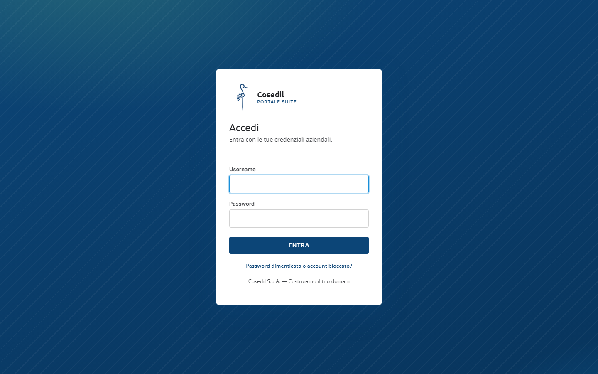
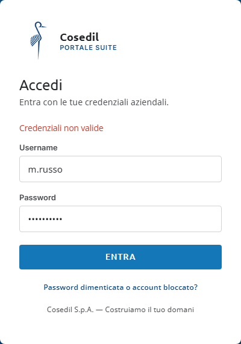
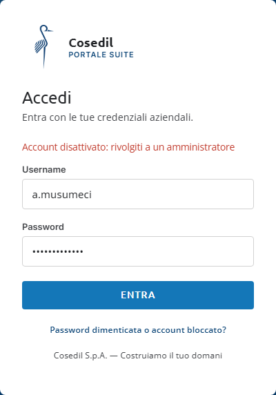
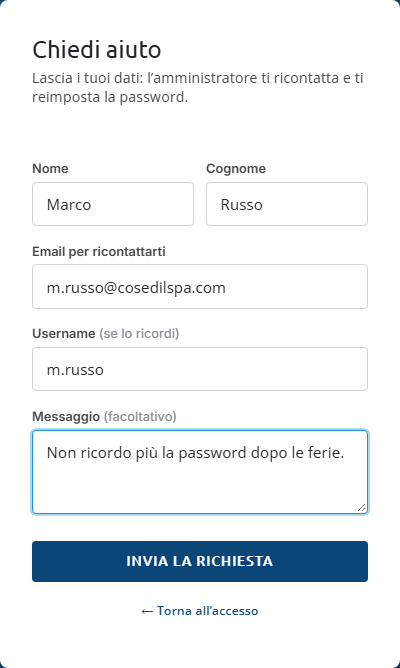
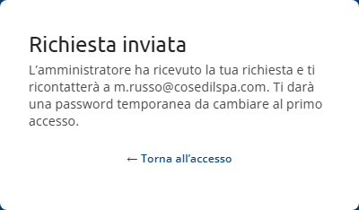
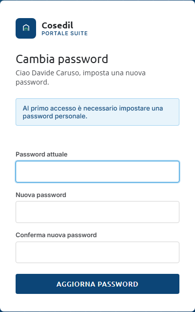
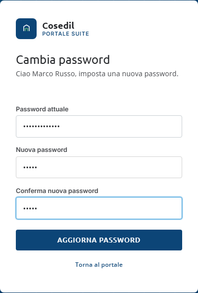

<!-- "><(((º> sabusabu <º)))>< -->
# 1. Entrare nel Portale

[← Indice](README.md) · [Capitolo successivo: la pagina iniziale →](02-pagina-iniziale.md)

## 1.1 Accedere

Apri il browser all'indirizzo del Portale che ti ha dato l'ufficio (di solito c'è già un
collegamento sul desktop o tra i preferiti). Compare la pagina **Accedi**.

1. Scrivi il tuo **Username** (per esempio `m.russo`). Maiuscole e minuscole non contano.
2. Scrivi la **Password**. Qui le maiuscole contano.
3. Premi **Entra**.

Se è tutto giusto si apre la [pagina iniziale](02-pagina-iniziale.md). Gli amministratori
arrivano invece sulla [plancia](03-plancia.md).

## 1.2 Se qualcosa non va al primo tentativo

**«Credenziali non valide»**: username o password sono sbagliati. Ricontrolla con calma
(tasto Bloc Maiusc, spazi in più, tastiera in un'altra lingua).

**«Account disattivato: rivolgiti a un amministratore»**: la password è giusta, ma il tuo
utente è stato sospeso. Solo un amministratore può riattivarlo.

**«Troppi tentativi falliti. Riprova tra N minuti.»**: dopo **15 password sbagliate** di
fila per lo stesso utente dallo stesso computer, il Portale blocca i tentativi per **15
minuti** (dallo stesso computer, oltre 50 tentativi in tutto anche su utenti diversi). È una
difesa contro chi prova password a caso. Non insistere: aspetta, oppure chiedi aiuto come
spiegato qui sotto. Sotto il messaggio compare anche il collegamento **Chiedi aiuto
all'amministratore**.

## 1.3 Password dimenticata o account bloccato

La password non si recupera da soli, ma puoi chiedere aiuto direttamente dalla pagina di
accesso, senza essere entrato.

1. Premi **Password dimenticata o account bloccato?** sotto il pulsante *Entra*.
2. Compila **Nome**, **Cognome** e **Email per ricontattarti**. **Username** (se lo ricordi)
   e **Messaggio** sono facoltativi.
3. Premi **Invia la richiesta**.

Compare la conferma **Richiesta inviata**: l'amministratore la vede subito nella sua plancia
e ti ricontatta con una password temporanea.

Con **← Torna all'accesso** ritorni alla pagina di login. Se mandi troppe richieste di
seguito il Portale risponde *«Hai già mandato diverse richieste: l'amministratore le ha
ricevute. Riprova più tardi.»*: la tua richiesta è già arrivata, non serve ripeterla.

## 1.4 Primo accesso: scegli la tua password

La prima volta che entri (e ogni volta che un amministratore ti reimposta la password) il
Portale ti porta alla pagina **Cambia password** con la nota *«Al primo accesso è necessario
impostare una password personale.»* Finché non la cambi, non puoi usare i programmi.

1. In **Password attuale** scrivi la password provvisoria che ti hanno dato.
2. In **Nuova password** e **Conferma nuova password** scrivi la tua password, **almeno 8
   caratteri** e diversa da quella provvisoria.
3. Premi **Aggiorna password**.

Messaggi possibili:

| Messaggio | Cosa fare |
|---|---|
| *La nuova password deve avere almeno 8 caratteri.* | Allungala. |
| *Le due password non coincidono.* | Riscrivila uguale nei due campi. |
| *La nuova password deve essere diversa da quella attuale.* | Scegline un'altra. |
| *Password attuale errata* | La password provvisoria (o quella vecchia) è scritta male. Anche qui valgono i 15 tentativi. |

## 1.5 Cambiare la password quando vuoi

Dalla pagina iniziale premi **Password** in alto a destra (oppure **Cambia password** nella
colonna blu a sinistra). La pagina è la stessa del primo accesso: password attuale, nuova
password due volte, **Aggiorna password**. Con **Torna al portale** esci senza cambiare
nulla.

Cambiando la password vieni scollegato dagli altri computer su cui eri entrato.

## 1.6 Uscire

Premi **Esci** in alto a destra. Esci dal Portale **e da tutti i programmi della suite, su
tutti i computer** su cui eri collegato con il tuo utente: è la cosa giusta da fare su un PC
condiviso o se pensi di aver lasciato aperto il Portale altrove.

Anche senza premere *Esci*, dopo **8 ore** la sessione scade da sola e ti viene richiesto
l'accesso.

## 1.7 Entrare nei programmi dopo il Portale

Una volta entrato nel Portale, i programmi ti riconoscono da soli:

- **Lettore DDT, Scadenzario, Magazzino, Confronto Documenti** e gli altri strumenti si
  aprono già con il tuo nome, senza un secondo accesso.
- **InCampo** e **SkyTower** hanno utenti propri. Ti riconoscono dall'**email** che
  l'amministratore ha associato al tuo utente del Portale (oppure da
  `username@cosedilspa.com`). Se l'email non coincide esattamente, ti chiedono di entrare
  con le credenziali di InCampo o di SkyTower.
- Per sicurezza, gli account con i privilegi più alti (per esempio l'amministratore di
  piattaforma di SkyTower) e chi ha attivato il secondo fattore non entrano in automatico
  dal Portale: usano la loro password (e il codice del secondo fattore).
