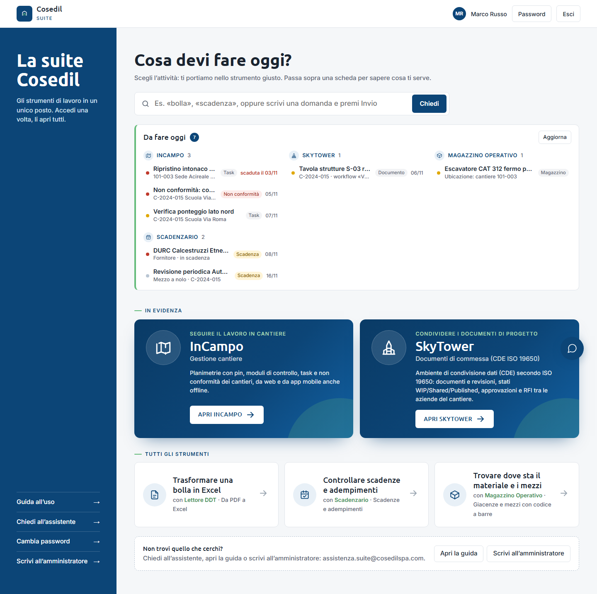
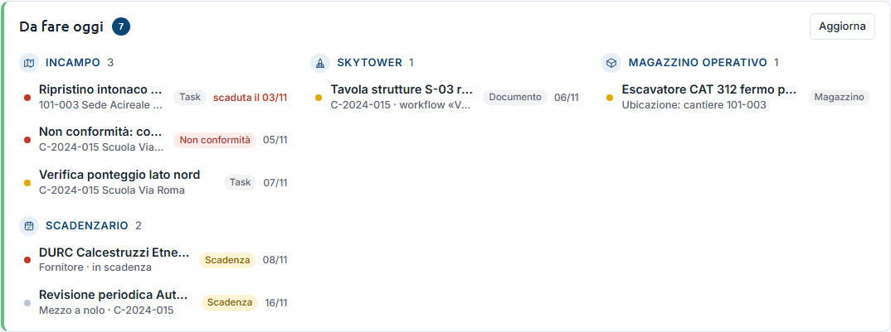
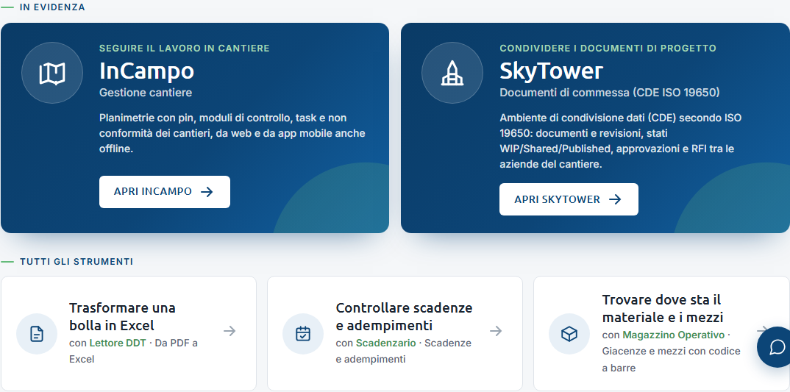
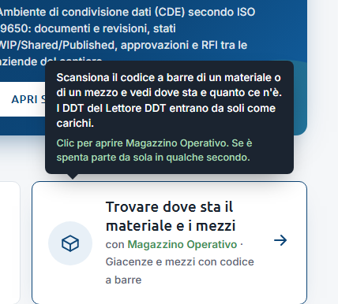
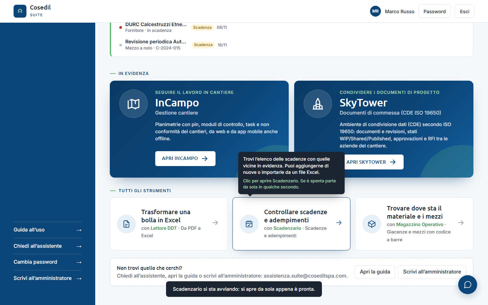
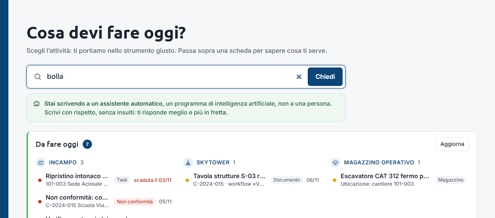
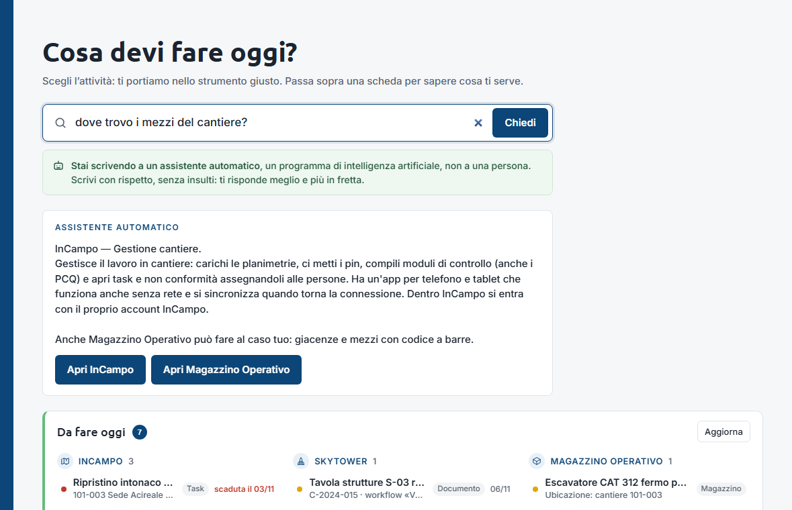
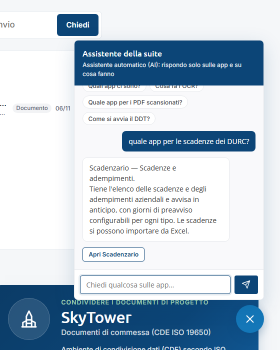
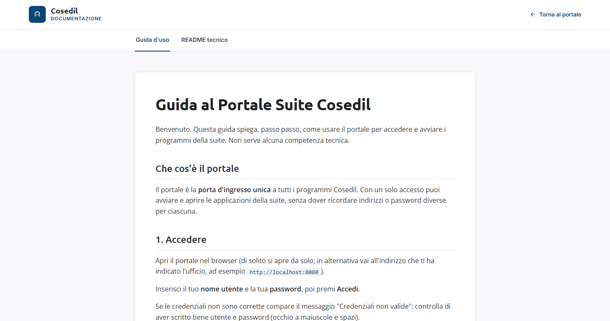

<!-- "><(((º> sabusabu <º)))>< -->
# 2. La pagina iniziale

[← Entrare nel Portale](01-entrare.md) · [Indice](README.md) · [Per gli amministratori: la plancia →](03-plancia.md)

Dopo l'accesso trovi la pagina **Cosa devi fare oggi?**. Dall'alto in basso:

1. la **barra di ricerca**, che è anche la casella per fare domande all'assistente;
2. il riquadro **Da fare oggi**, con quello che ti aspetta nei programmi;
3. i programmi **In evidenza** (InCampo e SkyTower) in schede grandi e blu;
4. **Tutti gli strumenti**, una scheda per ogni altro programma che puoi usare.

A sinistra, nella colonna blu, ci sono **Guida all'uso**, **Chiedi all'assistente**,
**Cambia password** e **Scrivi all'amministratore**. In alto a destra il tuo nome e i
pulsanti **Password** ed **Esci**.

## 2.1 Da fare oggi

Il riquadro raccoglie, in un colpo d'occhio, le cose che ti aspettano nei programmi:

- **InCampo**: i task assegnati a te e le non conformità da chiudere;
- **SkyTower**: i documenti che devi vedere o approvare;
- **Magazzino**: i mezzi fermi;
- **Scadenzario**: le scadenze vicine.

Come si legge una riga:

- il **pallino** a sinistra dice l'urgenza: rosso = alta, giallo = media, grigio = bassa;
- l'**etichetta** dice di che cosa si tratta (*Task*, *Non conformità*, *Documento*,
  *Scadenza*, *Magazzino*);
- la **data** è la scadenza; se è già passata compare in rosso come *scaduta il …*.

**Fai clic su una riga** per aprire direttamente quella cosa nel programma giusto, in una
nuova scheda del browser.

Il riquadro si riempie quando apri la pagina; il pulsante **Aggiorna** chiede di nuovo
lo stato a tutti i programmi (utile se nel frattempo hai chiuso un task). Se un programma è spento, in fondo compare *«Non raggiungibili ora: … Si aggiornano
da sole quando ripartono.»*: non è un errore, quelle voci torneranno appena il programma
riparte. Se non hai niente da fare, il riquadro non compare.

## 2.2 Aprire un programma

Ogni scheda dice **cosa puoi fare** (in grande) e **con quale programma** (in piccolo).
Basta un clic sulla scheda.

Se passi con il mouse sopra una scheda, un fumetto scuro spiega a cosa serve il programma.

Cosa succede al clic:

- se il programma è **già acceso**, si apre subito in una nuova scheda del browser;
- se è **spento**, il Portale lo accende da solo. In basso compare il messaggio
  *«Scadenzario si sta avviando: si apre da sola appena è pronta.»* e la nuova scheda del
  browser mostra *«Sto aprendo Scadenzario… la pagina si apre da sola appena è pronta.»*.
  Aspetta qualche secondo senza chiudere nulla.

Messaggi che possono comparire:

| Messaggio | Cosa vuol dire |
|---|---|
| *… ci mette più del solito. Riprova tra un minuto.* | Il programma è lento ad accendersi (succede la prima volta della giornata). Riprova. |
| *Non riesco ad aprire …* | Il Portale non è riuscito ad avviarlo. Riprova tra poco; se si ripete avvisa l'amministratore. |
| *Il portale non risponde. Riprova tra poco.* | Il Portale stesso non risponde: controlla la rete o avvisa l'amministratore. |

Se il browser blocca le finestre nuove (popup), consenti i popup per il Portale: è così che
i programmi si aprono in una nuova scheda.

## 2.3 Cercare un'attività

Scrivi una parola nella barra in alto, per esempio *bolla*, *scadenza* o *mezzi*: le schede
si filtrano mentre scrivi e restano solo quelle che c'entrano.

Appena clicchi nella barra compare un riquadro verde: *«Stai scrivendo a un assistente
automatico…»*. Se nessuna scheda corrisponde, il Portale ti suggerisce di premere **Invio**
per chiederlo all'assistente.

## 2.4 Chiedere all'assistente

Se scrivi una domanda e premi **Invio** (o il pulsante **Chiedi**), risponde l'assistente
automatico della suite. Sotto la risposta compaiono i pulsanti **Apri …** dei programmi
giusti.

Lo stesso assistente si apre anche dalla **bolla blu** in basso a destra (o da **Chiedi
all'assistente** nella colonna di sinistra). Puoi scrivere oppure toccare una delle domande
già pronte (*Quali app ci sono?*, *Quale app per i PDF scansionati?* …).

Cose da sapere:

- l'assistente conosce **solo i programmi della suite e cosa fanno**; su altro risponde che
  non sa;
- non ti dice indirizzi né numeri tecnici: i programmi si aprono dalle schede o dai suoi
  pulsanti;
- per domande sulle credenziali o troppo complicate ti propone **Scrivi
  all'amministratore**, che apre la tua posta con la domanda già scritta.

## 2.5 Guida e contatti

- **Guida all'uso** (colonna di sinistra) e **Apri la guida** (in fondo alla pagina) aprono
  la guida breve dentro il Portale.
- **Scrivi all'amministratore** apre un'email già indirizzata alla persona di riferimento.
  L'indirizzo è scritto anche nel riquadro in fondo, *Non trovi quello che cerchi?*.

