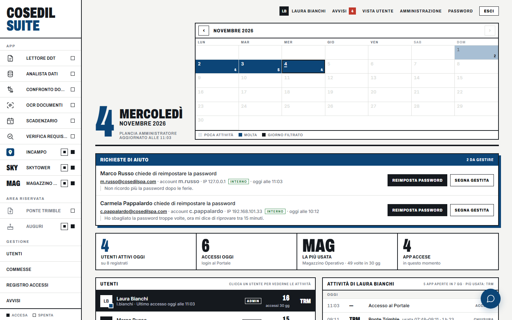
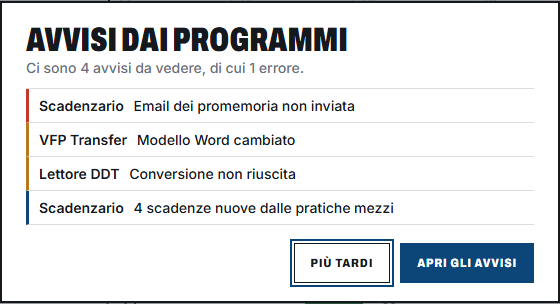
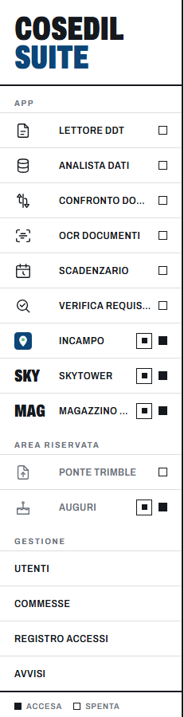
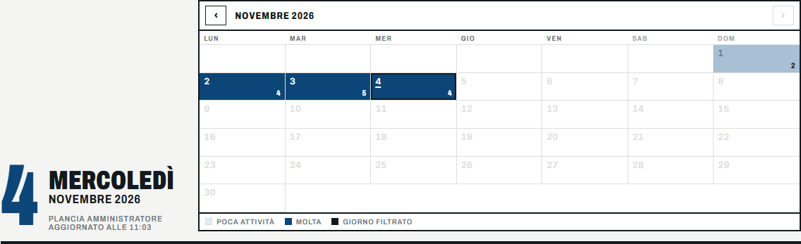
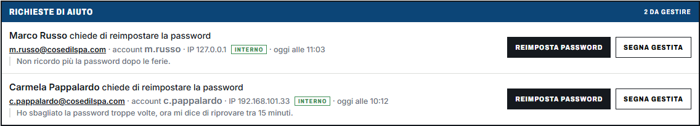
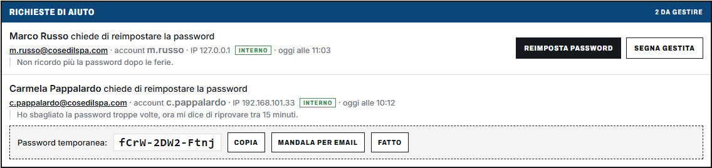
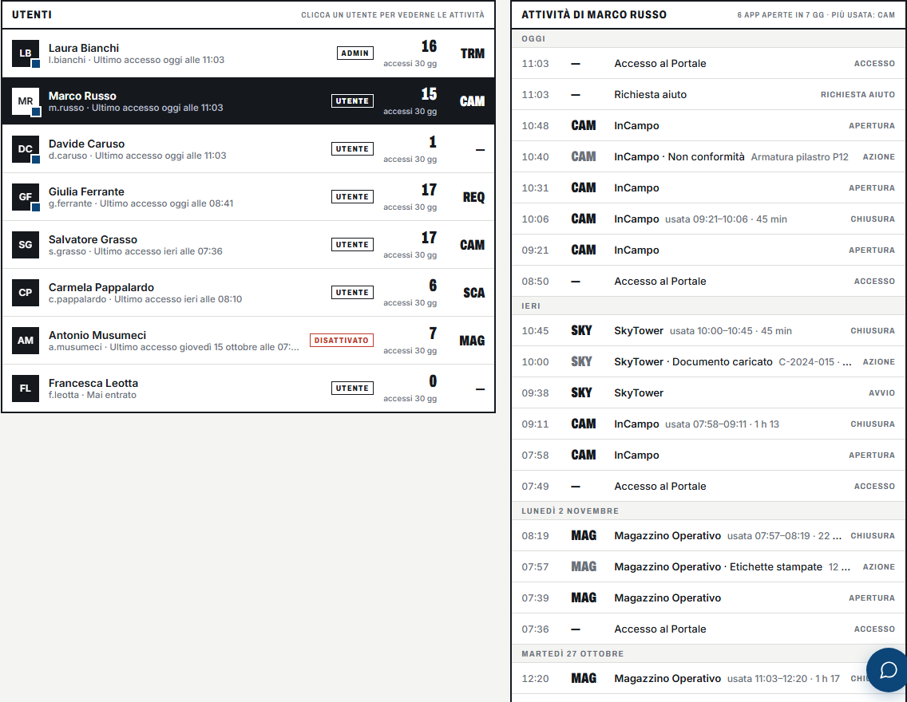
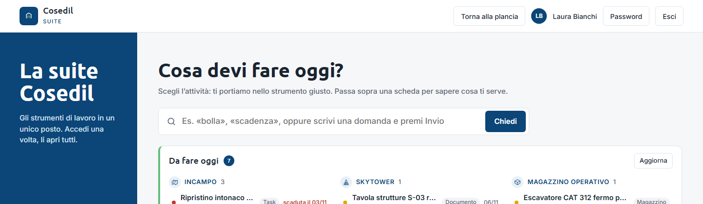

<!-- "><(((º> sabusabu <º)))>< -->
# 3. La plancia (amministratori)

[← La pagina iniziale](02-pagina-iniziale.md) · [Indice](README.md) · [Utenti e abilitazioni →](04-utenti.md)

Chi è **amministratore** del Portale, dopo l'accesso, non vede la pagina iniziale degli
utenti ma la **plancia**: lo stato dei programmi, chi sta lavorando, le richieste di aiuto
e gli avvisi.

In alto a destra:

| Voce | Cosa fa |
|---|---|
| **Avvisi** (con il numero) | Apre la pagina degli avvisi dei programmi. Il numero è rosso se c'è almeno un errore. |
| **Vista utente** | Mostra la pagina iniziale come la vede un utente normale. |
| **Amministrazione** | Apre il **Registro accessi** (vedi [capitolo 6](06-registro-e-avvisi.md)). |
| **Password**, **Esci** | Come per tutti (vedi [capitolo 1](01-entrare.md)). |

## 3.1 Gli avvisi appena entri

Se ci sono avvisi non ancora letti, appena entri si apre il riquadro **Avvisi dai
programmi** con i primi della lista (una volta per ogni accesso).

- **Apri gli avvisi** porta alla pagina degli avvisi;
- **Più tardi** chiude il riquadro: gli avvisi restano da vedere.

## 3.2 La barra dei programmi

La colonna di sinistra elenca tutti i programmi. Il quadratino a destra dice lo stato:
**pieno = Accesa**, **vuoto = Spenta** (la legenda è in fondo alla colonna).

- **Clic sul nome**: se il programma è acceso si apre in una nuova scheda; se è spento il
  Portale lo accende (la voce mostra *Avvio…*) e lo apre appena è pronto.
- **Pulsante quadrato accanto a un programma acceso** (*Ferma*): spegne il programma per
  liberare memoria sul server. Il Portale chiede conferma: *«Fermare …? Chi lo sta usando in
  questo momento perde il lavoro non salvato.»* Usalo a fine giornata o su programmi che
  nessuno sta usando.
- **Area riservata** raccoglie gli strumenti che vede solo l'amministratore (Ponte Trimble,
  Auguri).
- **Gestione** porta alle pagine [Utenti](04-utenti.md), [Commesse](05-commesse.md),
  [Registro accessi](06-registro-e-avvisi.md) e [Avvisi](06-registro-e-avvisi.md#62-gli-avvisi-dei-programmi).

## 3.3 Il calendario e i numeri del giorno

In alto c'è la data di oggi e il **calendario del mese**: i giorni con più persone al
lavoro sono più scuri, il numero in basso a destra di ogni giorno dice quante persone hanno
usato la suite. Passando con il mouse su un giorno leggi il dettaglio (utenti, accessi,
aperture di programmi, azioni).

**Clic su un giorno**: l'elenco *Attività* più in basso mostra solo quel giorno (compare il
pulsante **Tutti i giorni ×** per togliere il filtro). Con **‹ ›** cambi mese, **Oggi**
torna al mese corrente.

Sotto il calendario quattro numeri: **Utenti attivi oggi**, **Accessi oggi** (login al
Portale), **La più usata** (il programma più aperto negli ultimi 30 giorni) e **App accese**
in questo momento.

## 3.4 Le richieste di aiuto

Quando qualcuno usa *Password dimenticata o account bloccato?* dalla pagina di accesso, la
sua richiesta compare in cima alla plancia, nel riquadro blu **Richieste di aiuto**.

Per ogni richiesta vedi nome, email, se l'account esiste davvero, da quale computer è
arrivata (**Interno** = rete aziendale, **Esterno** = da fuori) e il messaggio.

- **Reimposta password**: dopo la conferma il Portale genera una **password temporanea**,
  toglie il blocco per tentativi e chiude le sessioni aperte di quell'utente. La password
  compare una volta sola, con il messaggio *«Password reimpostata e account sbloccato.»*:
  **Copia** la copia, **Mandala per email** apre la tua posta con il messaggio già pronto,
  **Fatto** toglie il riquadro (la richiesta risulta già gestita). L'utente dovrà cambiarla
  al primo accesso.
- **Segna gestita**: chiude la richiesta senza toccare la password (per esempio se hai
  risolto a voce).

Se lo username indicato non esiste, compare l'etichetta *non esiste* e manca il pulsante
*Reimposta password*: verifica chi è e, se serve, crealo dalla pagina Utenti.

## 3.5 Gli utenti e le loro attività

In basso a sinistra c'è l'elenco **Utenti**: per ognuno ruolo, ultimo accesso, quanti
accessi negli ultimi 30 giorni e la sigla del programma che usa di più. Chi è disattivato
ha l'etichetta rossa *Disattivato*; chi non è mai entrato ha *Mai entrato*.

**Clic su un utente**: a destra compare **Attività di …**, giorno per giorno: accessi al
Portale, programmi aperti o avviati, quanto tempo li ha usati (*usata 09:21–10:06 · 45
min*) e le azioni principali fatte dentro i programmi (per esempio *InCampo · Non
conformità*).

## 3.6 Vedere la pagina come un utente

**Vista utente** (in alto) mostra la pagina iniziale degli utenti, con i tuoi programmi.
Serve per controllare cosa vedono i colleghi. Per tornare premi **Torna alla plancia**.

