<!-- "><(((º> sabusabu <º)))>< -->
# 4. Utenti e abilitazioni (amministratori)

[← La plancia](03-plancia.md) · [Indice](README.md) · [Le commesse della suite →](05-commesse.md)

Dalla plancia, nella colonna di sinistra, premi **Gestione → Utenti**. Qui crei le utenze,
scegli quali programmi vede ognuno, reimposti le password e disattivi chi non deve più
entrare. Per i programmi di tutti insieme c'è la pagina **Abilitazioni** (paragrafo 4.2b).

Il profilo che dai qui (ruolo, nome, email, programmi, attivo o disattivato) vale **in tutti
i programmi della suite**. Gli **amministratori** li crea, li cambia e li elimina solo il
**proprietario della suite** (paragrafo 4.7).

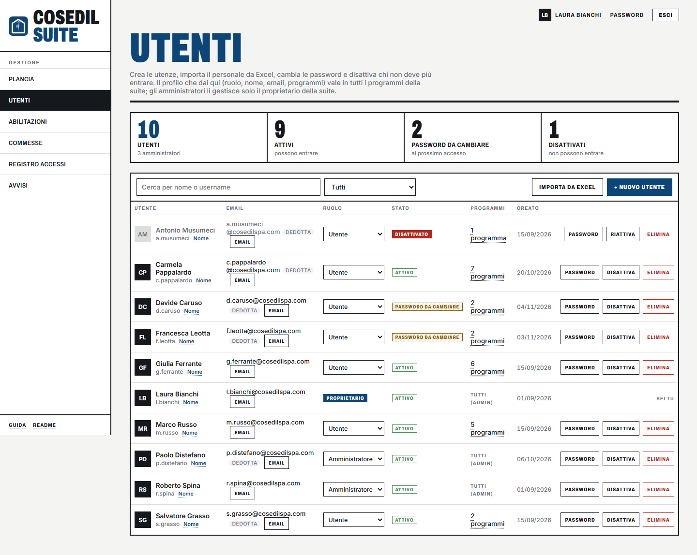

In alto quattro numeri: **Utenti** (e quanti sono amministratori), **Attivi**, **Password
da cambiare** al prossimo accesso, **Disattivati**.

Nella tabella, per ogni persona:

| Colonna | Cosa contiene |
|---|---|
| **Utente** | Nome e cognome, sotto lo username e il pulsante **Nome** per cambiarlo (paragrafo 4.8) |
| **Email** | L'email con cui InCampo e SkyTower riconoscono la persona. Se c'è scritto *dedotta* non è stata impostata e vale `username@cosedilspa.com`. Il pulsante **Email** la cambia. |
| **Ruolo** | *Utente* oppure *Admin*. Il proprietario della suite qui ha un menu per cambiarlo (paragrafo 4.8); sulla sua riga c'è *Proprietario* |
| **Stato** | *Attivo*, *Password da cambiare* (deve ancora scegliere la sua) o *Disattivato* |
| **Programmi** | Quanti programmi vede; clic per vederli e cambiarli. Per gli amministratori *Tutti (admin)*. |
| **Creato** | Data di creazione |
| (azioni) | **Password**, **Disattiva** / **Riattiva**, **Elimina**. Sulla tua riga c'è scritto *Sei tu*, su quella del proprietario *Proprietario*. |

Per trovare qualcuno usa **Cerca per nome o username**; il menu accanto filtra **Attivi**,
**Password da cambiare**, **Disattivati** o **Amministratori**.

## 4.1 Creare un utente

1. Premi **+ Nuovo utente**.
2. Compila **Nome e cognome**, **Username** (solo lettere minuscole, numeri, punto,
   trattino e trattino basso, per esempio `r.spina`) e una **Password iniziale** di almeno 8
   caratteri.
3. **Email** è facoltativa ma consigliata se la persona userà InCampo o SkyTower: deve
   essere **esattamente** quella del suo account in quei programmi.
4. Scegli il **Ruolo**: *Utente* oppure *Amministratore* (vede tutto e gestisce il Portale).
   *Amministratore* compare solo al proprietario della suite.
5. In **Programmi visibili** spunta i programmi che deve vedere. All'apertura sono già
   spuntati tutti quelli non riservati: togli quelli che non servono.
6. Premi **Crea utente**. Compare *Utente creato*.

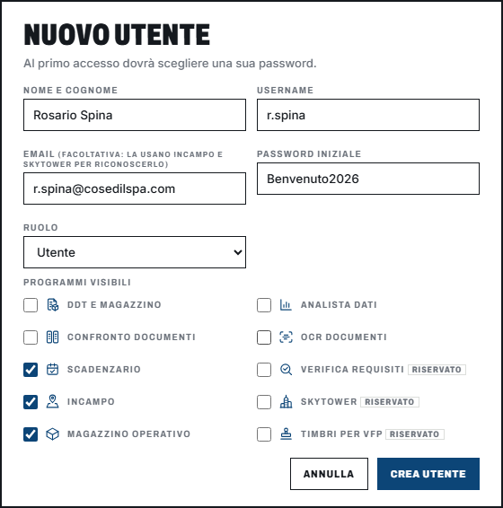

Comunica tu username e password iniziale alla persona: al primo accesso dovrà sceglierne
una sua.

Possibili messaggi: *Username già esistente*, *Username non valido: lettere minuscole,
numeri, punto, trattino e underscore (max 40)*, *Email non valida*, *La password deve
avere almeno 8 caratteri*.

## 4.2 Scegliere i programmi di una persona

Nella colonna **Programmi** fai clic su *N programmi*. Si apre **Programmi visibili**:
spunta per abilitare, togli la spunta per revocare, poi **Salva** (compare *Programmi
salvati*).

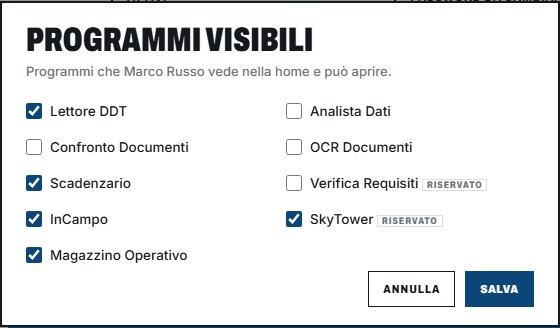

Cosa sapere:

- La modifica vale **subito**: il programma tolto sparisce dalla pagina iniziale della
  persona, e se prova ad aprirlo dall'indirizzo il programma le dice di chiedere
  l'abilitazione (al massimo dopo mezzo minuto).
- I programmi segnati **riservato** (Verifica Requisiti, SkyTower, Timbri per VFP, VFP Transfer) non si
  danno per abitudine: solo a chi ci lavora davvero.
- **VFP Transfer** ha la casella ma non la scheda nella pagina iniziale: si apre dal PC
  dell'ufficio dove è installato. La spunta decide chi può entrarci, con la password del
  Portale o dal Portale.
- Ponte Trimble e Auguri non hanno caselle: li vedono solo gli amministratori.
- Ogni modifica resta scritta nel [Registro accessi](06-registro-e-avvisi.md) come
  *Abilitazioni*, con chi l'ha fatta e quando.

## 4.2b Tutte le abilitazioni insieme: la pagina Abilitazioni

Per vedere **chi usa cosa** e cambiare i programmi di più persone in una volta, premi
**Gestione → Abilitazioni** nella colonna di sinistra. È una tabella: una riga per persona,
una colonna per programma, una casella per ogni incrocio.

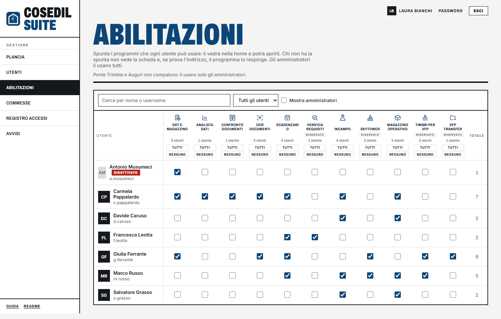

1. Spunta o togli le caselle. Quelle cambiate si colorano di **giallo** e in fondo compare
   la barra *N utenti modificati, non ancora salvati*.
2. Premi **Salva modifiche**: compare *Abilitazioni salvate per N utenti*. **Annulla**
   rimette tutto com'era.

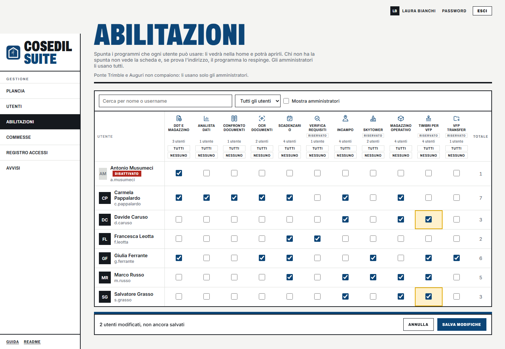

Dal salvataggio la persona trova la scheda del programma nella sua pagina iniziale, sotto
*Tutti gli strumenti* (qui *Creare un timbro per VFP*, appena data a Marco Russo):

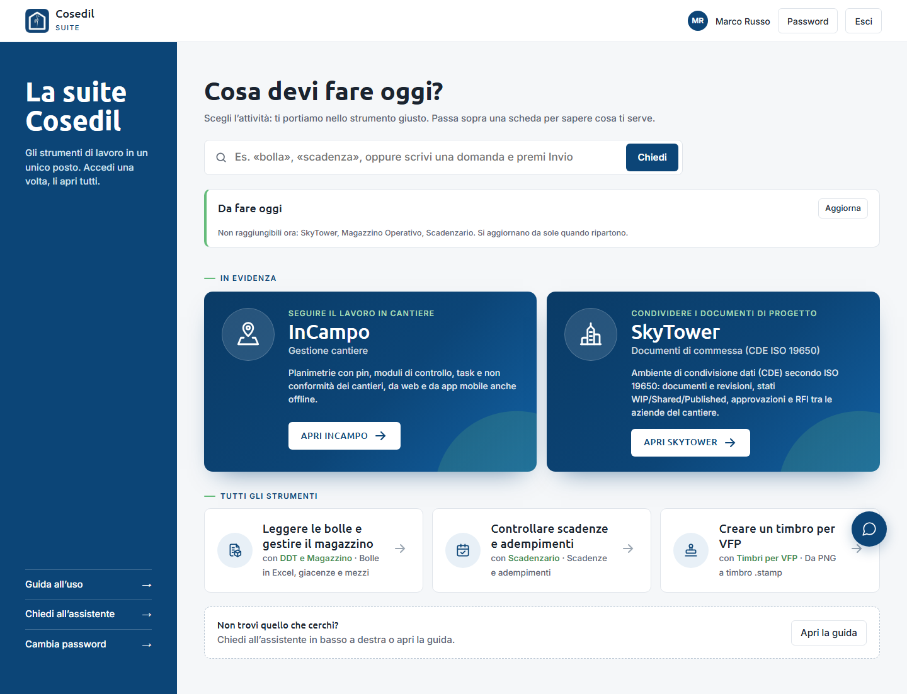

In testa a ogni colonna trovi quanti utenti hanno quel programma e due pulsanti:

- **tutti** dà il programma a **tutte le persone in elenco**;
- **nessuno** lo toglie a tutte le persone in elenco.

"In elenco" vuol dire quelle che vedi: scrivi un nome in **Cerca per nome o username** o
scegli *Solo attivi* per restringere prima di premere *tutti*.

Gli amministratori sono nascosti (usano tutti i programmi per ruolo): spunta **Mostra
amministratori** per vederli, con un ✓ grigio al posto delle caselle. Se esci dalla pagina
con modifiche non salvate il browser ti chiede conferma.

Le regole sono le stesse del paragrafo precedente: la modifica vale subito, i programmi
**riservati** vanno dati solo a chi ci lavora, ogni salvataggio resta nel Registro accessi
(una riga per persona modificata).

## 4.3 Reimpostare la password di una persona

Premi **Password** sulla sua riga. Scegli:

- **Generane una temporanea** (consigliato), oppure
- **La scelgo io** e scrivi una password di almeno 8 caratteri.

Premi **Imposta password**.

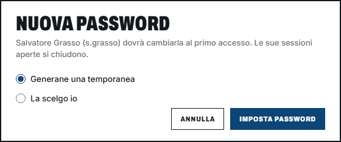

Con la password temporanea, il Portale la mostra **una volta sola**: copiala e comunicala
alla persona prima di premere **Chiudi**.

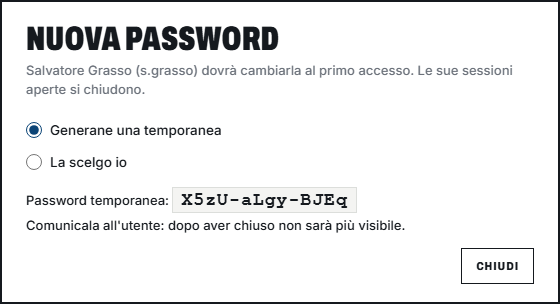

Reimpostare la password **sblocca** anche chi era bloccato per troppi tentativi e lo
**scollega** dai computer dove era entrato. Al primo accesso dovrà sceglierne una nuova.

## 4.4 Disattivare, riattivare, eliminare

- **Disattiva**: la persona non può più entrare né nel Portale né nei programmi, e viene
  scollegata subito. Il suo storico e i suoi programmi restano. È la scelta giusta per chi
  lascia l'azienda o va in pausa lunga.
- **Riattiva**: la rimette com'era.
- **Elimina**: cancella l'account per sempre (il Portale chiede conferma e suggerisce di
  usare *Disattiva* se basta impedire l'accesso).

Non puoi disattivare te stesso né l'ultimo amministratore attivo: il Portale resterebbe
senza nessuno che lo possa gestire. Il **proprietario della suite** non si disattiva e non si
elimina mai, nemmeno da solo. Disattivare, riattivare ed eliminare un **amministratore** lo
può fare solo il proprietario.

La disattivazione vale in tutti i programmi: quelli che si aprono dal Portale chiudono subito
la porta; SkyTower, InCampo, VFP Transfer e Analista Dati, che hanno account propri, la
controllano al **prossimo accesso** della persona, anche se entra con la password del
programma.

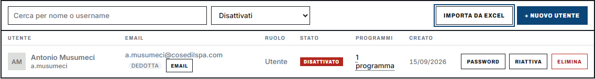

## 4.5 Importare il personale da Excel

Per caricare molte persone insieme premi **Importa da Excel**.

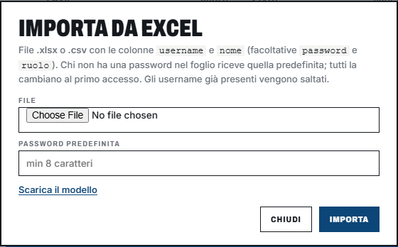

1. Premi **Scarica il modello** per avere un file già impostato.
2. Compila un foglio `.xlsx` o `.csv` con le colonne **username** e **nome** (facoltative
   **password** e **ruolo**).
3. Scegli il **File** e scrivi una **Password predefinita** (almeno 8 caratteri) per chi non
   ce l'ha nel foglio.
4. Premi **Importa**.

Il Portale dice quanti utenti ha aggiunto e quali righe ha scartato e perché (username
mancante o non valido, password troppo corta, username già esistente; per chi non è il
proprietario della suite anche le righe con ruolo *admin*: gli amministratori li crea solo
lui). Tutti gli importati
dovranno cambiare la password al primo accesso e partono con i programmi predefiniti (tutti
tranne i riservati): sistemali poi con il pulsante *N programmi*.

## 4.6 L'email per InCampo e SkyTower

InCampo e SkyTower riconoscono chi arriva dal Portale **solo se l'email coincide
esattamente** con quella del loro account. Se una persona entra nel Portale ma InCampo o
SkyTower le chiedono di nuovo le credenziali, controlla la colonna **Email**: premi
**Email** sulla sua riga e scrivi l'indirizzo giusto (lasciando vuoto torna
`username@cosedilspa.com`).

## 4.7 Amministratori: solo il proprietario della suite

Il **proprietario della suite** è un amministratore speciale: è l'unico che può

- creare un nuovo amministratore (anche dall'import Excel);
- rendere amministratore un utente o togliere il ruolo a un amministratore;
- cambiare password, email, nome e programmi di un amministratore, disattivarlo, riattivarlo
  ed eliminarlo.

Gli altri amministratori gestiscono tutti gli **utenti normali** come sempre, ma sulle righe
degli amministratori trovano i pulsanti spenti e un lucchetto accanto ad *Admin*: passando
col mouse compare *Solo il proprietario della suite gestisce gli amministratori*.

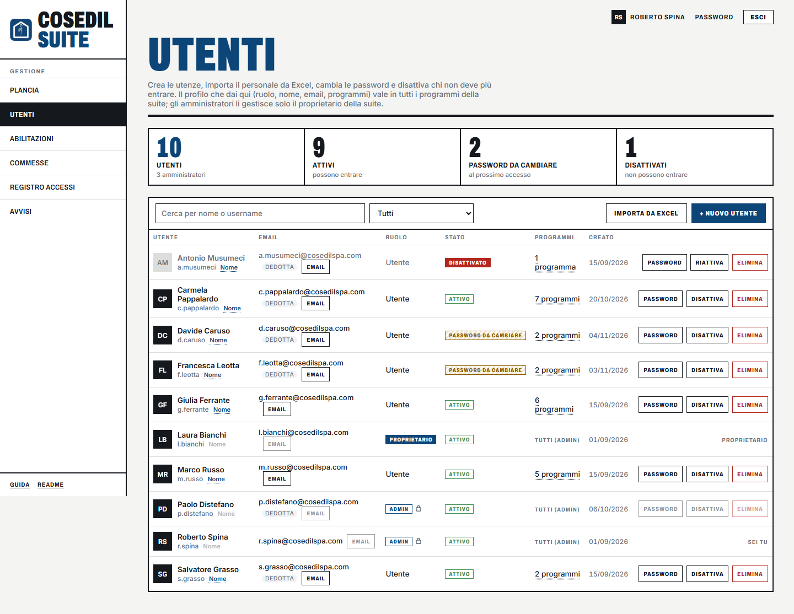

Il proprietario resta sempre amministratore: nessuno, nemmeno lui, lo può disattivare,
eliminare o far tornare utente. Chi sia lo decide chi installa il Portale (vedi
l'[appendice per l'amministratore di sistema](08-amministratore-di-sistema.md)).

Essere amministratore nel Portale vuol dire esserlo **in tutti i programmi della suite**;
toglierlo nel Portale lo toglie anche nei programmi, dal prossimo accesso della persona.

## 4.8 Cambiare ruolo e nome

**Ruolo** (solo il proprietario della suite): nella colonna **Ruolo** scegli *Utente* o
*Amministratore* dal menu della riga. Il Portale chiede conferma spiegando cosa cambia:

- chi diventa amministratore vede tutti i programmi e la gestione del Portale, ed è
  amministratore anche nei programmi della suite;
- chi torna utente perde subito la gestione del Portale e, dal suo prossimo accesso,
  l'amministrazione nei programmi.

In entrambi i casi la persona viene scollegata e rientra col ruolo nuovo. Nel Registro
accessi resta *Cambio ruolo* con chi l'ha fatto e quando.

**Nome**: premi **Nome** sotto lo username e scrivi nome e cognome. Vale subito nel Portale
e, nei programmi della suite, dopo pochi secondi o al prossimo accesso. Il nome di un
amministratore lo cambia solo il proprietario. Nel Registro accessi resta *Cambio nome*.
