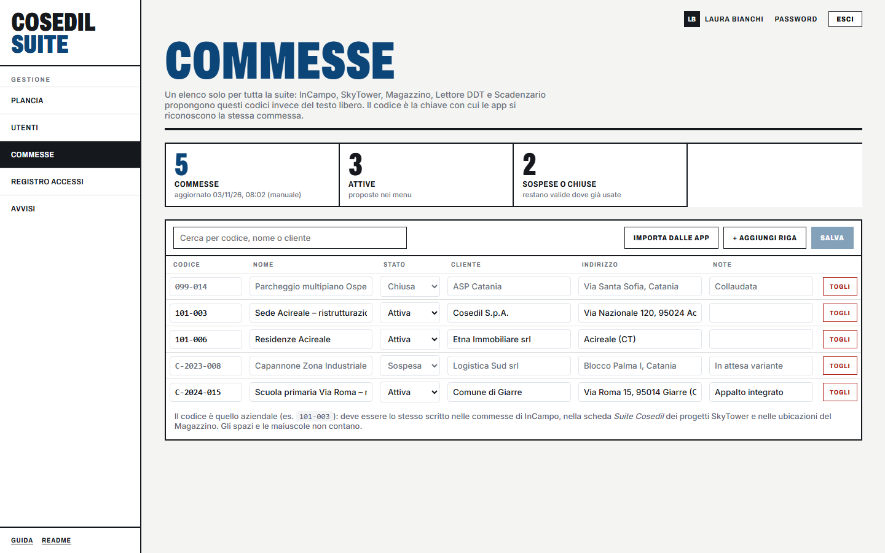
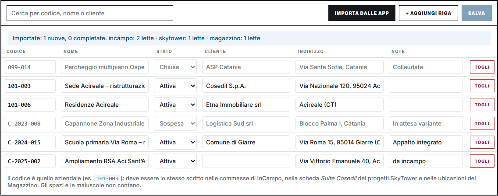

<!-- "><(((º> sabusabu <º)))>< -->
# 5. Le commesse della suite (amministratori)

[← Utenti e abilitazioni](04-utenti.md) · [Indice](README.md) · [Registro accessi e avvisi →](06-registro-e-avvisi.md)

La pagina **Commesse** (dalla plancia: **Gestione → Commesse**) tiene **un elenco solo per
tutta la suite**. InCampo, SkyTower, Magazzino, Lettore DDT e Scadenzario propongono questi
codici nei loro menu a tendina invece di farli scrivere a mano: così la commessa `101-003`
è la stessa ovunque, e i programmi si scambiano documenti e informazioni senza confondersi.

In alto tre numeri: **Commesse** (con data e origine dell'ultimo aggiornamento),
**Attive** (proposte nei menu) e **Sospese o chiuse** (non vengono più proposte, ma restano
valide dove sono già usate).

Ogni riga ha **Codice**, **Nome**, **Stato** (*Attiva*, *Sospesa*, *Chiusa*), **Cliente**,
**Indirizzo** e **Note**. Il codice è quello aziendale (per esempio `101-003` o
`C-2024-015`): spazi e maiuscole non contano.

## 5.1 Aggiungere o correggere a mano

1. Premi **+ Aggiungi riga** e compila i campi, oppure correggi direttamente una riga
   esistente.
2. Per togliere una commessa dall'elenco premi **Togli** (i programmi che usano già quel
   codice non cambiano).
3. Premi **Salva** (si accende solo se hai cambiato qualcosa).

Compare *«Registro salvato: N commesse. Le app lo leggono subito.»* Se una riga ha il codice
vuoto o uguale a un'altra, il Portale lo segnala (*«… codice vuoto o doppio: correggi prima
di salvare.»*) e non salva.

## 5.2 Importare le commesse dai programmi

**Importa dalle app** chiede a InCampo, SkyTower e Magazzino le commesse che conoscono già
e aggiunge quelle che mancano. Quello che hai scritto a mano **vince**: l'importazione
completa solo i campi vuoti.

Il messaggio dice quante commesse sono state aggiunte o completate e quante ne ha lette ogni
programma. Se un programma è spento lo dice, e le sue commesse arriveranno alla prossima
importazione. Se hai modifiche non salvate, il Portale ti avvisa che l'importazione le
scarta: salva prima.

Dopo l'importazione controlla le righe nuove (nella colonna *Note* c'è scritto da quale
programma arrivano), completa nome e cliente e premi **Salva**.

## 5.3 Dove si usa il codice

Perché tutto funzioni il codice deve essere **lo stesso** in:

- le commesse di **InCampo**;
- la scheda *Suite Cosedil* dei progetti **SkyTower**;
- le ubicazioni del **Magazzino**;
- la commessa scelta all'ingresso in **DDT e Magazzino** (il DDT finito va nella commessa giusta
  di SkyTower e i suoi materiali nel cantiere giusto del Magazzino): l'elenco è questo registro;
- le scadenze dello **Scadenzario** legate a una commessa.
