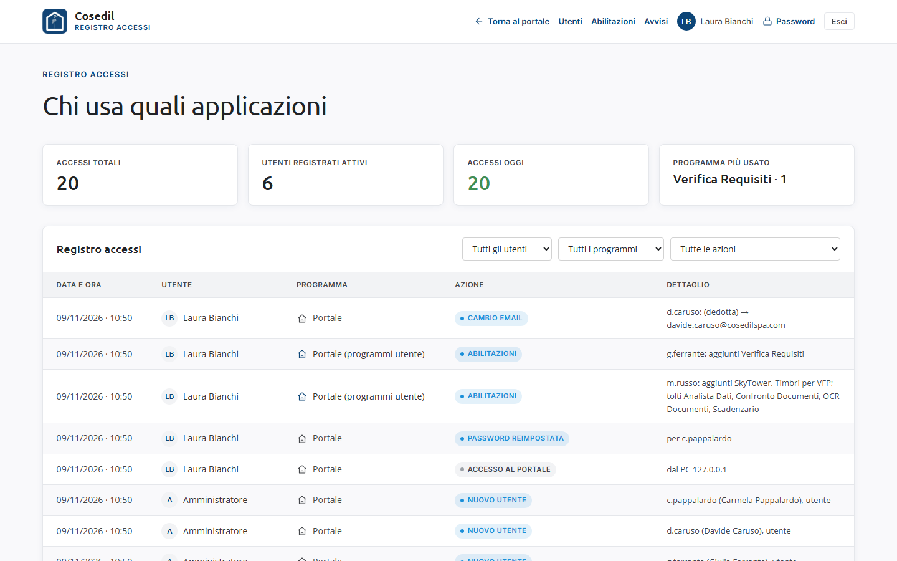
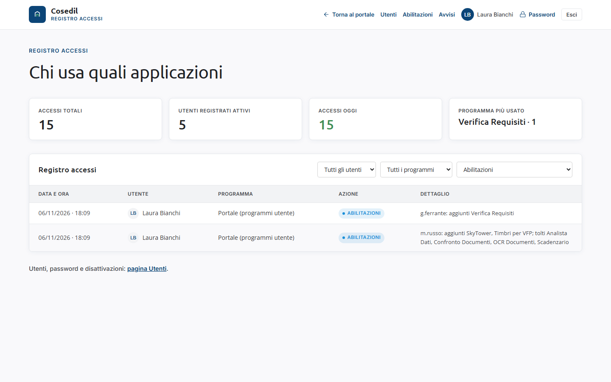
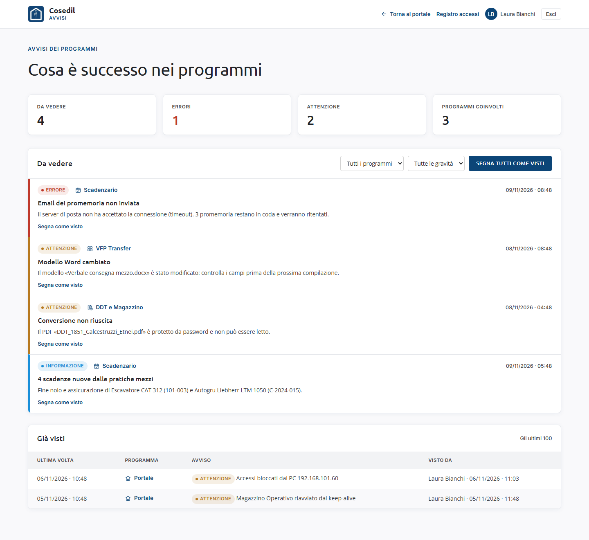

<!-- "><(((º> sabusabu <º)))>< -->
# 6. Registro accessi e avvisi (amministratori)

[← Le commesse della suite](05-commesse.md) · [Indice](README.md) · [Problemi frequenti →](07-problemi.md)

## 6.1 Il registro accessi

Dalla plancia: **Gestione → Registro accessi** (oppure **Amministrazione** in alto). La
pagina *Chi usa quali applicazioni* elenca tutto quello che succede nel Portale: chi è
entrato, quale programma ha aperto o avviato, chi ha cambiato password o abilitazioni.

In alto: **Accessi totali**, **Utenti registrati attivi**, **Accessi oggi** e **Programma
più usato**. Sotto, la tabella con **Data e ora**, **Utente**, **Programma** e **Azione**,
le più recenti in cima.

Con i tre menu filtri per **utente**, **programma** e **azione** (*Avvio*, *Apertura*,
*Login*, *Abilitazioni*). Per esempio, scegliendo *Abilitazioni* vedi quale amministratore
ha cambiato i programmi visibili di qualcuno, e quando (questa pagina non mostra a chi e
quali programmi: il dettaglio resta nel file del registro, vedi
l'[appendice](08-amministratore-di-sistema.md)):

Altre azioni che puoi incontrare: *reset-password* (password reimpostata da un
amministratore), *richiesta-aiuto* (richiesta dal login), *login-bloccato* (troppi
tentativi), *disattiva* / *riattiva*, *commesse* (modifica del registro commesse), *evento*
(un'azione fatta dentro un programma), *chiudi* (fine dell'uso di un programma),
*login-app* (accesso a SkyTower, InCampo o VFP Transfer con la password del Portale: nella
colonna Programma c'è quale; vedi [1.8](01-entrare.md#18-una-password-per-tutti-i-programmi)).

Per gli utenti e le password si torna alla pagina **Utenti** con il collegamento in fondo.

## 6.2 Gli avvisi dei programmi

I programmi della suite segnalano qui i loro problemi: un lavoro automatico fallito,
un'email non partita, scadenze nuove create in automatico, un modello Word cambiato in VFP
Transfer, un programma caduto e riacceso dal Portale, un computer bloccato per troppi
tentativi di accesso.

Ci arrivi da **Avvisi** in alto nella plancia (il numero dice quanti sono da vedere, ed è
rosso se c'è un errore) o da **Gestione → Avvisi**.

- In alto: **Da vedere**, **Errori**, **Attenzione**, **Programmi coinvolti**.
- **Da vedere** elenca gli avvisi aperti, prima gli errori (bordo rosso), poi quelli di
  attenzione (giallo), poi le informazioni (azzurro). Se lo stesso problema si ripete, non
  si moltiplica: l'avviso resta uno, con il numero di ripetizioni.
- Puoi filtrare per **programma** e per **gravità**.
- **Segna come visto** sotto un avviso lo sposta in **Già visti**, con il tuo nome e l'ora.
  **Segna tutti come visti** fa lo stesso per tutti quelli elencati (chiede conferma).
- **Già visti** conserva gli ultimi 100.

Un avviso resta aperto finché un amministratore non lo segna come visto: segnarlo non
risolve il problema, dice solo che qualcuno l'ha letto. Se c'è da intervenire su un
programma, apri la guida di quel programma.
