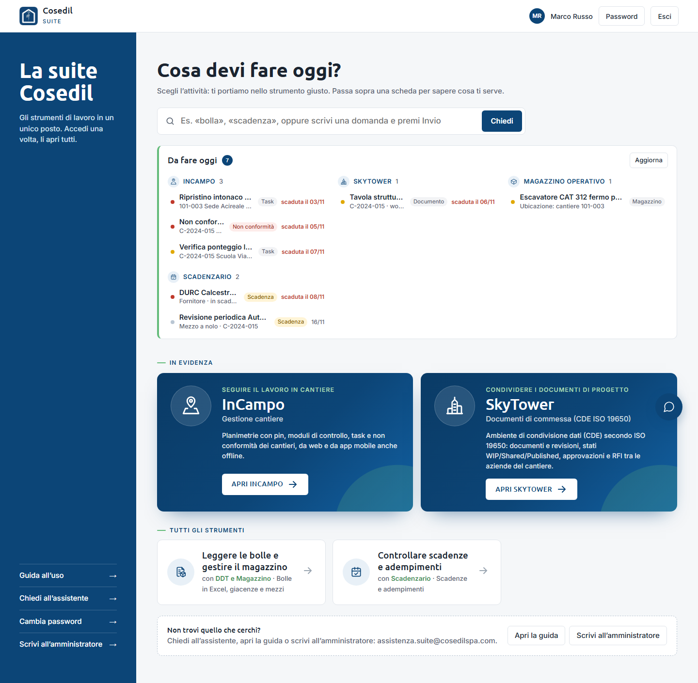

<!-- "><(((º> sabusabu <º)))>< -->
# Guida al Portale della Suite Cosedil

Il **Portale** è la porta d'ingresso di tutti i programmi Cosedil. Entri una volta sola con
il tuo nome utente e la tua password, e da lì apri InCampo, SkyTower, Magazzino,
Scadenzario, Lettore DDT e gli altri strumenti senza dover rifare l'accesso in ognuno.

## Indice

**Per tutti**

1. [Entrare nel Portale](01-entrare.md): accesso, primo accesso, password dimenticata,
   account bloccato, cambio password, uscita, una password per tutti i programmi
2. [La pagina iniziale](02-pagina-iniziale.md): *Da fare oggi*, aprire un programma, cercare
   e chiedere all'assistente

**Per gli amministratori della suite**

3. [La plancia](03-plancia.md): stato dei programmi, calendario, utenti e loro attività,
   richieste di aiuto
4. [Utenti e abilitazioni](04-utenti.md): creare utenti, scegliere i programmi visibili
   (anche tutti insieme nella pagina *Abilitazioni*), password, disattivazione, importazione da Excel
5. [Le commesse della suite](05-commesse.md): l'elenco unico dei codici commessa
6. [Registro accessi e avvisi](06-registro-e-avvisi.md): chi ha fatto cosa e cosa segnalano
   i programmi

**In caso di problemi**

7. [Problemi frequenti](07-problemi.md)
8. [Appendice per l'amministratore di sistema](08-amministratore-di-sistema.md): avvio,
   dove stanno i dati, backup

## I programmi che trovi nel Portale

| Programma | A cosa serve | Guida |
|---|---|---|
| **InCampo** | Il lavoro in cantiere: planimetrie, moduli di controllo, task e non conformità, anche da telefono | [guida di InCampo](../../../incampo/docs/guida/README.md) |
| **SkyTower** | I documenti di commessa (disegni, relazioni, revisioni e approvazioni) | [guida di SkyTower](../../../skytower/docs/guida/README.md) |
| **Magazzino Operativo** | Dove sta il materiale e dove sono i mezzi, con codice a barre | [guida del Magazzino](../../../magazzino-operativo/docs/guida/README.md) |
| **Scadenzario** | Scadenze e adempimenti: DURC, revisioni, polizze, corsi | [guida dello Scadenzario](../../../scadenzario/docs/guida/README.md) |
| **Lettore DDT** | Da una bolla in PDF a un foglio Excel | [guida del Lettore DDT](../../../lettore-ddt/docs/guida/README.md) |
| **Confronto Documenti**, **OCR Documenti**, **Analista Dati**, **Verifica Requisiti** | Confrontare due PDF, leggere documenti scansionati, fare domande sui dati, controllare i documenti contrattuali | dentro ciascun programma |
| **Timbri per VFP** | Da un'immagine PNG (firma, logo, timbro) a un file `.stamp` per le annotazioni di VFP | [README di Timbri per VFP](../../../timbri-vfp/README.md) |
| **Ponte Trimble**, **Auguri** | Strumenti riservati agli amministratori | dentro ciascun programma |

**VFP Transfer** non si apre dal Portale: ha un accesso suo (vedi la
[guida di VFP Transfer](../../../vfp-transfer-DMS/docs/guida/README.md)). I suoi avvisi però
arrivano nella pagina *Avvisi* del Portale.

## Chi vede cosa

Non tutti vedono gli stessi programmi. L'amministratore decide, persona per persona, quali
programmi compaiono nella sua pagina iniziale (vedi [Utenti e abilitazioni](04-utenti.md)).

- Un programma che non ti è stato assegnato **non compare** e non si apre nemmeno scrivendo
  l'indirizzo a mano: il programma risponde che devi chiedere l'abilitazione a un
  amministratore.
- Alcuni programmi sono **riservati** (oggi Verifica Requisiti, SkyTower e Timbri per VFP): li vede solo chi
  li ha avuti assegnati espressamente.
- Se un collega vede un programma che tu non hai, non è un guasto: chiedi l'abilitazione a
  un amministratore.

## Le immagini di questa guida

Le schermate sono state fatte su una copia del Portale con **dati inventati** (persone,
commesse, avvisi). I colori e i pulsanti sono quelli veri; nomi e numeri sono esempi.
