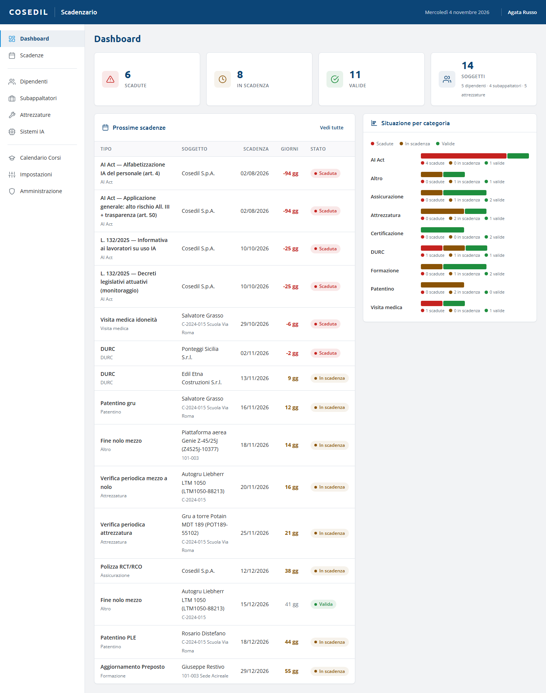

<!-- "><(((º> sabusabu <º)))>< -->
# 1. Primi passi

[← Indice](README.md)

## Come si entra

Lo Scadenzario non ha un login suo: si apre dal **Portale**, cliccando la sua scheda.
Se non hai fatto l'accesso vieni rimandato al login del Portale; se la scheda non c'è,
il tuo utente non è abilitato. Vedi la
[guida del Portale](../../../portale/docs/guida/README.md).

Lo Scadenzario contiene dati personali (codici fiscali, visite mediche): non lasciare
la pagina aperta su un computer condiviso.

## Com'è fatta la pagina

- **Barra blu in alto**: la data di oggi e il tuo nome.
- **Menu a sinistra**: **Dashboard** e **Scadenze**; poi le anagrafiche **Dipendenti**,
  **Subappaltatori**, **Attrezzature**, **Sistemi IA**; poi **Calendario Corsi**,
  **Impostazioni** e, solo per gli amministratori, **Amministrazione**.
- **Area centrale**: la vista scelta. Le conferme compaiono in basso a destra (verde se
  è andato tutto bene, rosso con il motivo se c'è un problema).

## La Dashboard

- **Quattro riquadri**: quante scadenze sono **Scadute**, **In scadenza**, **Valide** e
  quanti **Soggetti** ci sono (dipendenti, subappaltatori, attrezzature). Un clic su un
  riquadro apre l'elenco già filtrato.
- **Prossime scadenze**: le 15 più vicine (le chiuse escluse), con soggetto, cantiere,
  data, **giorni** che mancano (negativi = già scaduta) e stato. **Vedi tutte** porta
  all'elenco completo.
- **Situazione per categoria**: una barra per categoria (Formazione, DURC, Patentino…)
  divisa in scadute, in scadenza e valide, con i numeri sotto.

## Gli stati

| Stato | Colore | Quando |
|---|---|---|
| **Scaduta** | rosso | la data di scadenza è passata |
| **In scadenza** | giallo | mancano meno giorni del **preavviso** del tipo (es. 45 giorni per la visita medica, 30 per il DURC) |
| **Valida** | verde | manca ancora più del preavviso |
| **Chiusa** | grigio | rinnovata o archiviata: non genera più avvisi |

Lo stato non si scrive a mano: lo Scadenzario lo ricalcola ogni volta in base alla data
di oggi. I preavvisi si cambiano in [Impostazioni](06-impostazioni-notifiche.md).

## Chi può fare cosa

| Tutti gli utenti abilitati | Solo gli amministratori dello Scadenzario |
|---|---|
| Consultare, inserire, modificare e rinnovare scadenze | Eliminare qualsiasi cosa (dalla vista **Amministrazione**) |
| Gestire le anagrafiche, importare da Excel, scaricare le maschere | **Esporta Excel**, **Calendario (.ics)**, **Dossier AI Act** |
| Spuntare la checklist e caricare allegati | Scaricare gli allegati (gli altri ne vedono solo il nome) |
| Eseguire le notifiche | Backup, utenze, svuotare il registro notifiche |

Le esportazioni sono riservate perché contengono dati personali di tutta l'anagrafica.
