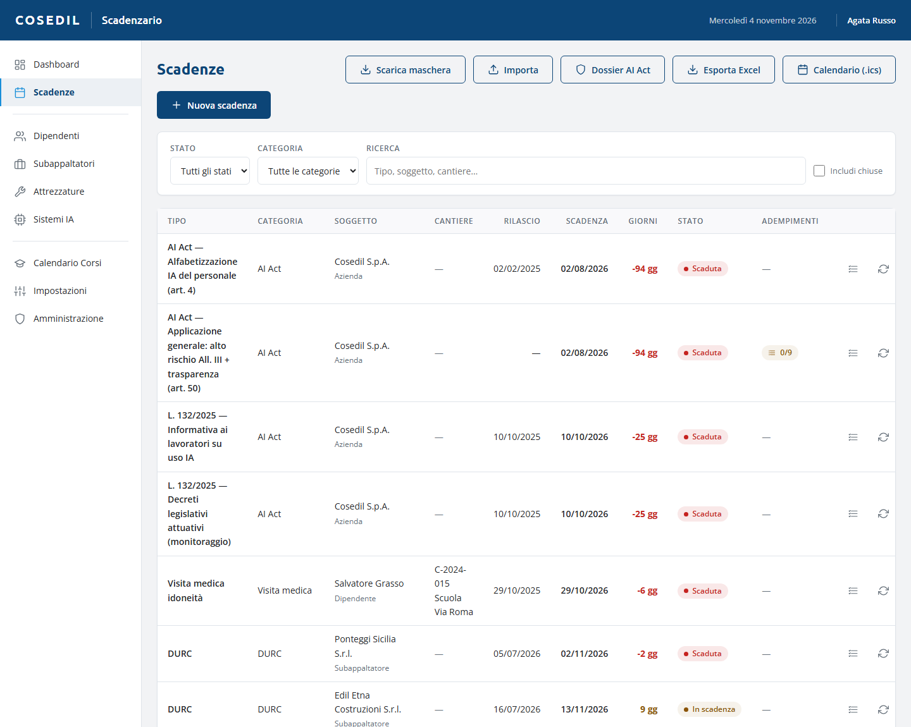
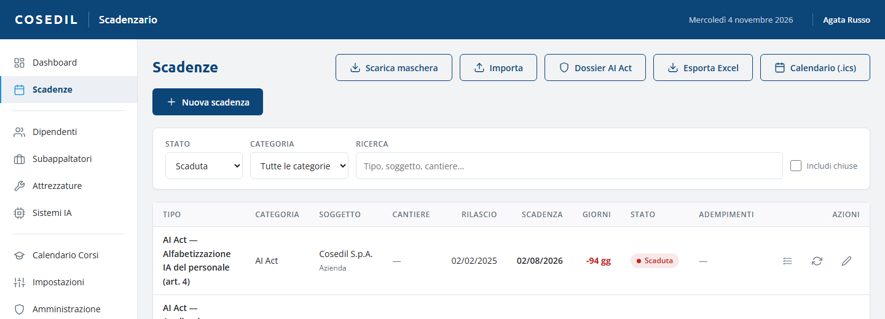
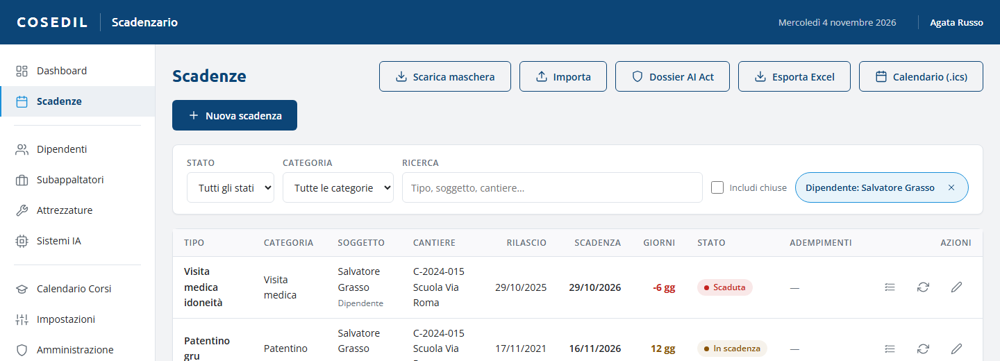
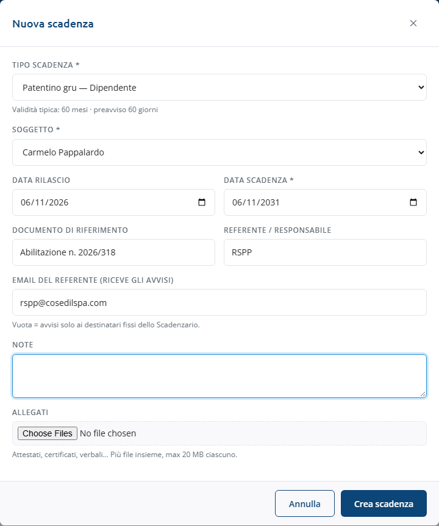
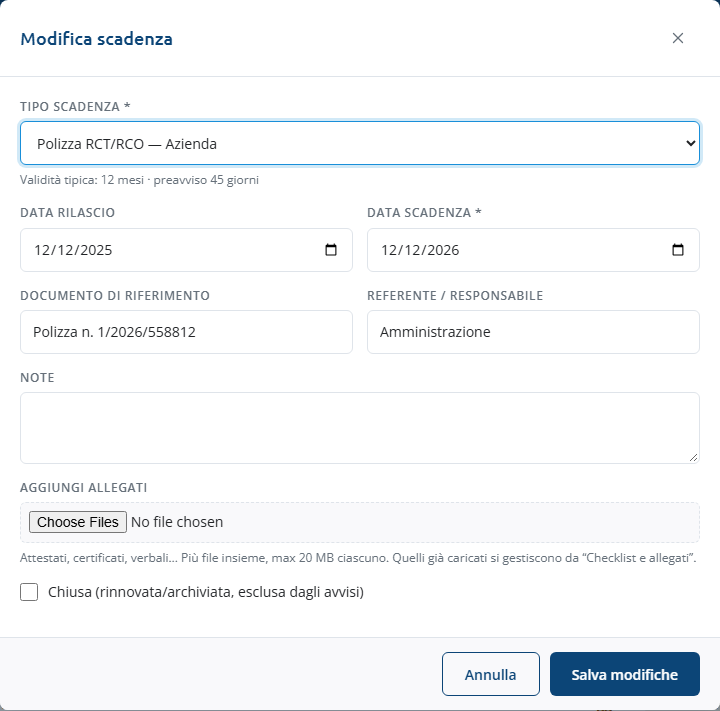
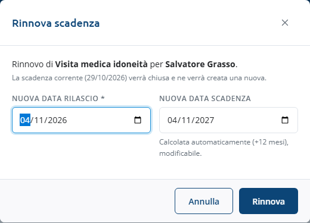
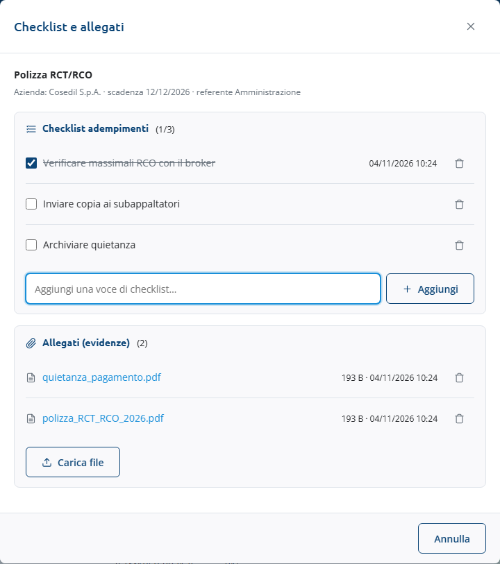
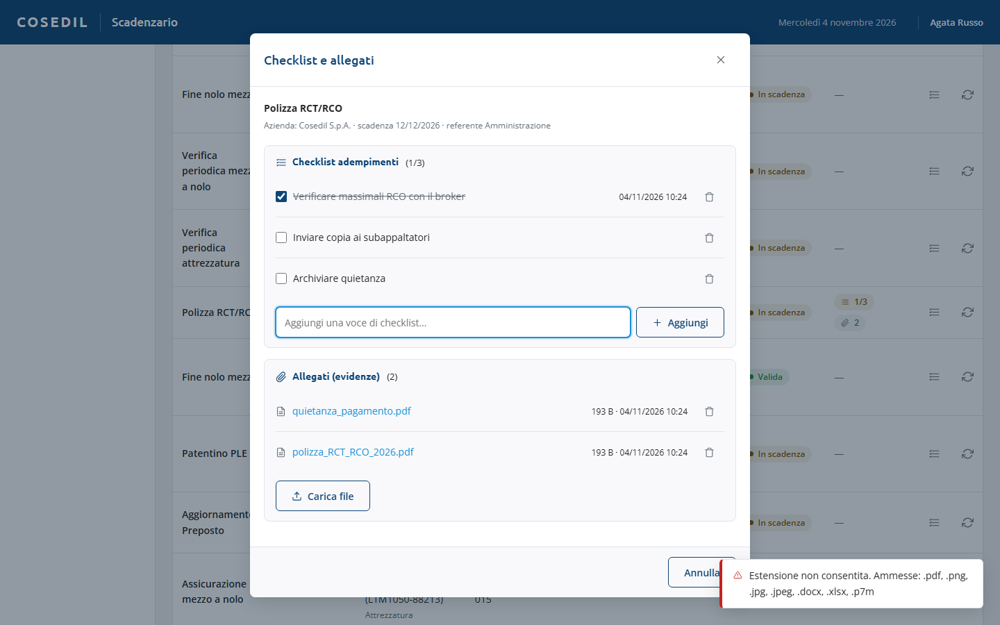

<!-- "><(((º> sabusabu <º)))>< -->
# 2. Le scadenze

[← Indice](README.md)

## L'elenco

Menu **Scadenze**.

Ogni riga mostra tipo, categoria, soggetto (con il tipo di soggetto sotto), cantiere,
data di rilascio, **data di scadenza**, **giorni** che mancano, stato e colonna
**Adempimenti** (quante voci di checklist sono fatte, es. `1/3`, e quanti allegati ci
sono, icona della graffetta).

A destra tre icone:

| Icona | Cosa fa |
|---|---|
| elenco puntato | **Checklist e allegati** |
| frecce in cerchio | **Rinnova** (non c'è sulle scadenze chiuse) |
| matita | **Modifica** |

Se la tabella è più larga dello schermo, le icone sono in fondo a destra: scorri la
tabella orizzontalmente.

### Filtri

- **Stato**: Tutti, Scaduta, In scadenza, Valida, Chiusa;
- **Categoria**: Formazione, Visita medica, Patentino, DURC, Attrezzatura,
  Assicurazione, Certificazione, AI Act, Altro;
- **Ricerca**: tipo, soggetto, cantiere;
- **Includi chiuse**: mostra anche le scadenze già rinnovate o archiviate.

Dalle anagrafiche (colonna **Scadenze**) si arriva all'elenco filtrato su una persona,
una ditta o un'attrezzatura: in alto compare un'etichetta come *Dipendente: Salvatore
Grasso*; la **×** toglie il filtro.

## Nuova scadenza

1. Premi **Nuova scadenza**.
2. Scegli il **Tipo scadenza**: i tipi sono raggruppati per categoria e dicono a chi si
   riferiscono (es. "Visita medica idoneità — Dipendente"). Sotto compare la validità
   tipica e il preavviso.
3. Scegli il **Soggetto**: l'elenco mostra solo i soggetti giusti per quel tipo
   (dipendenti, subappaltatori…). Per i tipi aziendali (polizze, SOA, ISO) il soggetto è
   Cosedil S.p.A. e il campo non compare.
4. Inserisci la **Data rilascio**: se il tipo ha una validità in mesi, la **Data
   scadenza** si compila da sola (puoi correggerla).
5. Facoltativi: **Documento di riferimento** (n. attestato, certificato…),
   **Referente / responsabile** (RSPP, medico competente, ufficio…), **Note**.
6. **Allegati**: puoi già allegare uno o più file (max 20 MB l'uno, stessi formati della
   finestra *Checklist e allegati* qui sotto). Un file troppo grande o di un formato non
   ammesso compare in rosso nell'elenco e la scadenza non si salva finché non lo togli.
7. Premi **Crea scadenza**: compare "Scadenza registrata" (con il numero di allegati).

Se manca qualcosa la finestra resta aperta con il motivo in rosso, per esempio
"Seleziona il soggetto della scadenza." oppure "Indica la data di scadenza (oppure una
data di rilascio…)".

## Modificare o chiudere una scadenza

L'icona della matita apre **Modifica scadenza** con gli stessi campi. In fondo c'è la
casella **Chiusa (rinnovata/archiviata, esclusa dagli avvisi)**: spuntala per una
scadenza che non serve più seguire (per esempio un dipendente che ha cambiato mansione).
Premi **Salva modifiche**.

## Rinnovare una scadenza

Quando arriva il nuovo documento (nuovo DURC, visita fatta, corso di aggiornamento):

1. Icona **Rinnova** sulla riga.
2. Controlla la **Nuova data rilascio** (proposta: oggi) e la **Nuova data scadenza**
   (calcolata con la validità del tipo, modificabile).
3. Premi **Rinnova**: la scadenza vecchia diventa **Chiusa** e ne nasce una nuova.
   Messaggio: "Scadenza rinnovata: nuova scadenza il …".

Gli allegati restano sulla scadenza vecchia: carica il nuovo documento sulla nuova.

## Checklist e allegati

L'icona a elenco apre la finestra **Checklist e allegati**.

- **Checklist adempimenti**: le cose da fare per quella scadenza. Scrivi la voce in
  "Aggiungi una voce di checklist…" e premi **Aggiungi** (o Invio); spunta la casella
  quando è fatta (compare data e ora). Le scadenze AI Act principali arrivano con la
  checklist già pronta. Solo gli amministratori vedono il cestino per togliere una voce.
- **Allegati (evidenze)**: premi **Carica file** e scegli il documento. File ammessi:
  **PDF, PNG, JPG/JPEG, DOCX, XLSX e P7M** (firmati digitalmente), al massimo **20 MB**.
  Archivi ZIP, email, vecchi .doc/.xls e altri formati vengono rifiutati:

  

  Se ti serve allegare un .doc o .xls, salvalo come PDF (o .docx/.xlsx) e ricaricalo.
- Gli **amministratori** possono scaricare gli allegati (clic sul nome) ed eliminarli;
  gli altri utenti ne vedono il nome, la dimensione e la data.

Chiudi con la **×** o con il pulsante in basso: l'elenco si aggiorna da solo.

## Esportazioni (solo amministratori)

Pulsanti in alto nella vista Scadenze, visibili solo agli amministratori:

- **Esporta Excel**: le scadenze che vedi in quel momento, con gli stessi filtri;
- **Calendario (.ics)**: le stesse scadenze come appuntamenti da importare in Outlook o
  Google Calendar, con il promemoria ai giorni di preavviso del tipo;
- **Dossier AI Act**: un file Excel con le scadenze AI Act, il registro dei sistemi IA e
  le checklist, pronto per un audit.

Chi non è amministratore non vede questi pulsanti: se gli serve un estratto lo chiede a un
amministratore.

## Inserire tante scadenze insieme (Excel)

**Scarica maschera** scarica un file Excel con le colonne giuste, una riga d'esempio e
le istruzioni. Compilalo e caricalo con **Importa** (anche .csv con le stesse
intestazioni). Regole:

- il **Tipo** va scritto con il nome esatto del tipo;
- il **Soggetto** con il nome del dipendente, subappaltatore, attrezzatura o sistema IA
  (vuoto per le scadenze aziendali);
- se la data di scadenza è vuota viene calcolata dalla validità del tipo;
- le righe già presenti (stesso tipo, soggetto e data) vengono **saltate**.

L'esito dice quanti record sono stati aggiunti e saltati; le righe con errori sono
elencate in una finestra **Righe non importate**.
