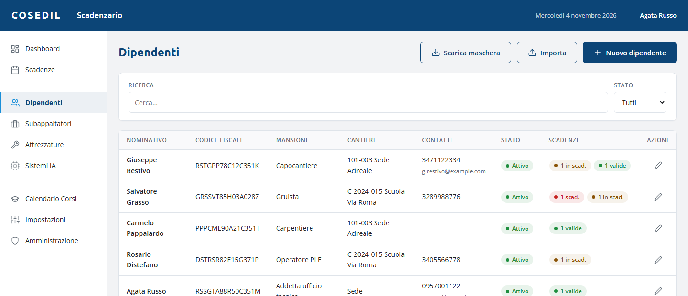
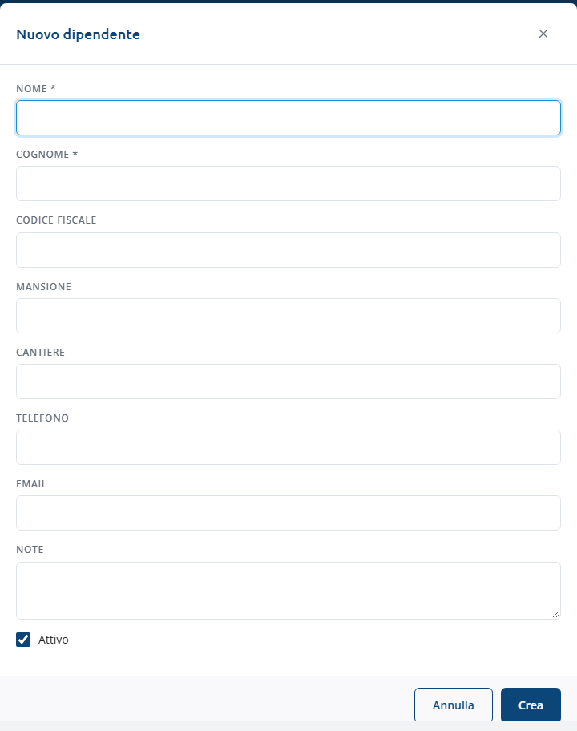
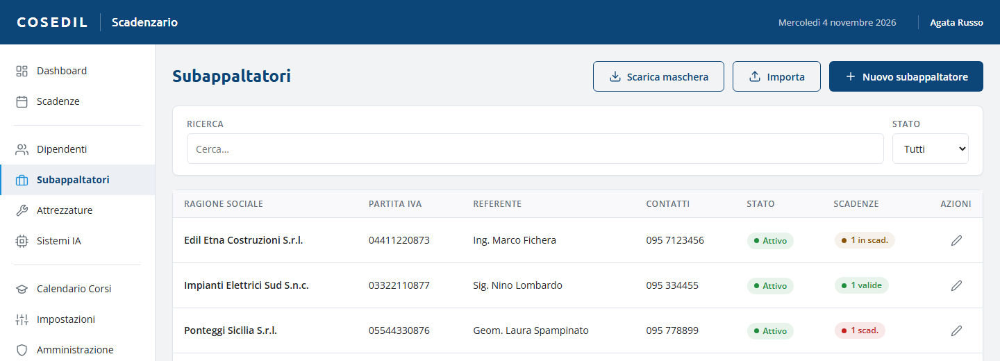
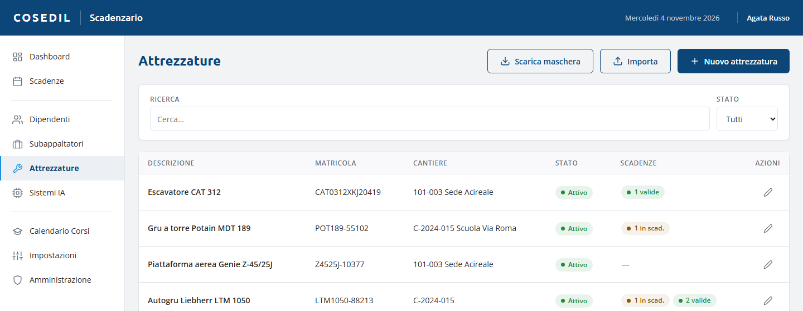
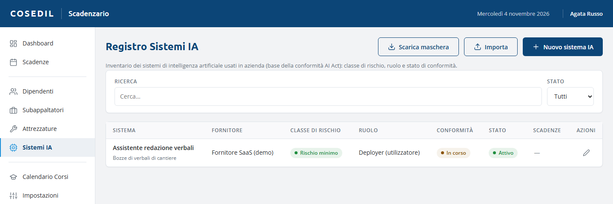

<!-- "><(((º> sabusabu <º)))>< -->
# 3. Anagrafiche

[← Indice](README.md)

Le anagrafiche sono i **soggetti** a cui si agganciano le scadenze: **Dipendenti**,
**Subappaltatori**, **Attrezzature** e **Sistemi IA**. Funzionano tutte allo stesso modo.

## La lista

- **Ricerca** e filtro **Stato** (Tutti, Attivi, Non attivi).
- Colonna **Scadenze**: quante scadenze ha il soggetto per stato (es. "1 scad.",
  "1 in scad.", "2 valide"). Un clic apre la vista Scadenze filtrata su di lui.
- Matita = **Modifica**.

## Aggiungere o modificare

**Nuovo dipendente** (o *subappaltatore*, *attrezzatura*, *sistema IA*) apre la scheda:

| Anagrafica | Campi |
|---|---|
| Dipendenti | **Nome** e **Cognome** (obbligatori), codice fiscale (salvato in maiuscolo, evita i doppioni), mansione, cantiere, telefono, email, note, **Attivo** |
| Subappaltatori | **Ragione sociale** (obbligatoria), partita IVA (evita i doppioni), referente, telefono, email, note, **Attivo** |
| Attrezzature | **Descrizione** (obbligatoria), matricola, cantiere, note, **Attiva** |
| Sistemi IA | **Nome del sistema**, fornitore, finalità, classe di rischio, ruolo dell'azienda, stato di conformità, referente, cantiere/reparto, note, **In uso** |

Premi **Crea** ("Elemento creato in anagrafica.") o **Salva modifiche** ("Anagrafica
aggiornata."). Se il codice fiscale o la partita IVA esistono già compare "Codice
fiscale già presente in anagrafica" / "Partita IVA già presente in anagrafica".

**Togli la spunta Attivo** a chi non lavora più con noi invece di cancellarlo: le sue
scadenze restano nello storico ma **non generano più avvisi**. Cancellare è possibile
solo dalla vista [Amministrazione](07-amministrazione.md).

Nelle Attrezzature compaiono anche i **mezzi a nolo** arrivati da VFP Transfer (vedi
[Mezzi a nolo](04-mezzi-a-nolo.md)).

## Sistemi IA

Il **Registro Sistemi IA** è l'inventario dei programmi di intelligenza artificiale
usati in azienda, con classe di rischio (Da valutare, Vietato, Alto rischio, Rischio
limitato, Rischio minimo, GPAI), ruolo dell'azienda (Deployer, Provider, Importatore,
Distributore) e stato di conformità. Ogni sistema può essere il soggetto di una
scadenza (per esempio una valutazione da rifare). Le scadenze generali dell'AI Act e
della Legge 132/2025 sono già precaricate come scadenze aziendali, categoria *AI Act*.

## Caricare tante righe insieme (Excel)

In ogni anagrafica:

1. **Scarica maschera**: un file Excel con le colonne giuste, una riga d'esempio e le
   istruzioni.
2. Compilalo (o incolla i tuoi dati nelle colonne).
3. **Importa** e scegli il file (.xlsx o .csv). L'esito dice quanti record sono stati
   **aggiunti** e quanti **saltati** perché già presenti; le righe con errori sono
   elencate nella finestra **Righe non importate**.

Le colonne si riconoscono anche senza il suggerimento tra parentesi; i campi a scelta
(es. classe di rischio) accettano sia il codice sia la parola italiana.
