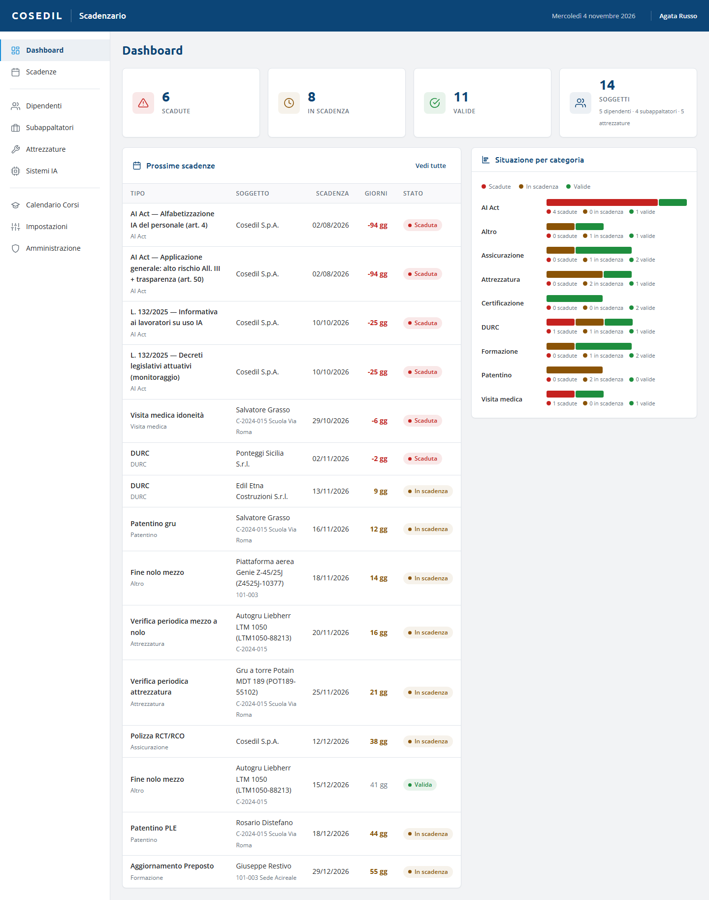

<!-- "><(((º> sabusabu <º)))>< -->
# 4. Mezzi a nolo da VFP Transfer

[← Indice](README.md)

Le pratiche dei **mezzi a nolo** preparate in **VFP Transfer** diventano scadenze da
sole, senza inserirle a mano. Lo Scadenzario le rilegge ogni 15 minuti circa.

Per ogni pratica nascono (o si aggiornano):

| Scadenza | Da dove viene | Soggetto |
|---|---|---|
| **Fine nolo mezzo** | data di fine nolo del contratto | il mezzo (in Attrezzature) |
| **Assicurazione mezzo a nolo** | scadenza del documento di assicurazione allegato | il mezzo |
| **Verifica periodica mezzo a nolo** | scadenza del verbale di verifica allegato | il mezzo |
| **White list antimafia noleggiatore** | data di iscrizione + 12 mesi | il noleggiatore (in Subappaltatori) |

## Come le riconosci

- Il mezzo compare in **Attrezzature** con tipo, marca, modello e matricola (o targa) e
  come cantiere il **codice commessa** del contratto.
- Il noleggiatore compare in **Subappaltatori** (riconosciuto dalla partita IVA).
- Le scadenze hanno come referente "Ufficio mezzi"; la white list è una sola per
  noleggiatore, anche se ha più mezzi in nolo.

## Da sapere

- **Niente doppioni**: se la pratica cambia (per esempio il nolo viene prorogato), la
  data della scadenza si aggiorna da sola.
- Una scadenza **chiusa a mano resta chiusa**: le letture successive non la riaprono.
- I tipi di scadenza mancanti vengono creati da soli e si possono regolare in
  [Impostazioni](06-impostazioni-notifiche.md) (per esempio il preavviso).
- Se una pratica non si riesce a leggere, l'errore arriva agli amministratori nella
  pagina **Avvisi** del Portale; le altre pratiche si importano lo stesso.
- Nello Scadenzario non c'è un pulsante per forzare la lettura: se una pratica appena
  salvata non compare, aspetta il giro successivo (un quarto d'ora) o chiedi
  all'amministratore di sistema.
