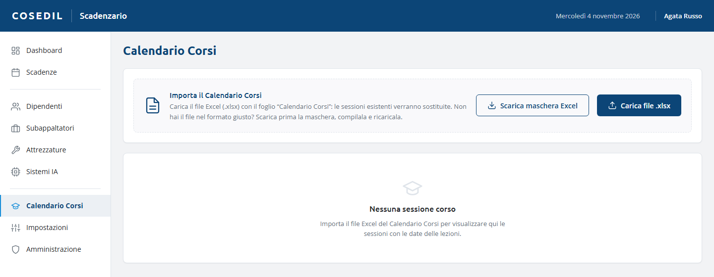

<!-- "><(((º> sabusabu <º)))>< -->
# 5. Calendario Corsi

[← Indice](README.md)

Il menu **Calendario Corsi** mostra le sessioni di formazione programmate dall'ente
formativo, caricate dal loro file Excel.

## Importare il calendario

1. Se non hai il file nel formato giusto premi **Scarica maschera Excel**: ottieni il
   modello del foglio "Calendario Corsi" da compilare.
2. Premi **Carica file .xlsx** e scegli il file. Deve contenere il foglio
   **"Calendario Corsi"** con l'intestazione alla riga 4 (AULA, CICLO, N° PERS., GIORNO,
   LEZ. 1 … LEZ. 6, DOCENTE, SEDE).
3. Messaggio: "Calendario importato: N sessioni."

Vengono lette solo le righe la cui colonna AULA inizia con "AULA"; le righe di
separazione vengono ignorate. La prima e l'ultima lezione diventano le date di inizio e
fine della sessione.

**Attenzione:** ogni importazione **sostituisce** tutte le sessioni precedenti. Ricarica
sempre il file completo e aggiornato, non solo le sessioni nuove.

## La tabella

Per ogni sessione: titolo, aula, ciclo, numero di persone, giorno, docente, sede,
periodo e le date delle singole lezioni. Le sessioni servono a organizzare i corsi; le
**scadenze** della formazione di ogni dipendente si registrano a parte nella vista
[Scadenze](02-scadenze.md) (e si aggiornano con **Rinnova** quando il corso è fatto).
