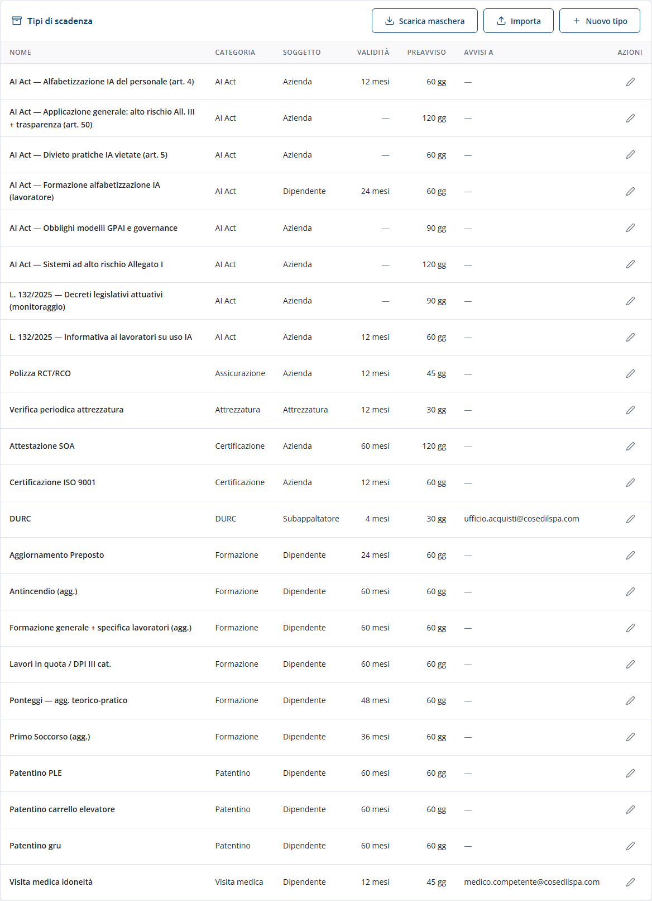
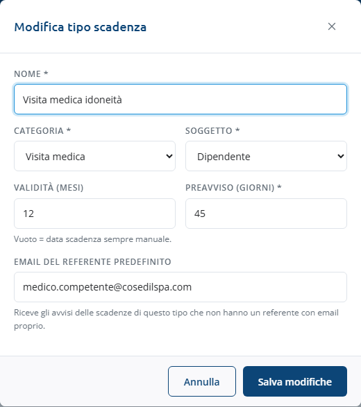
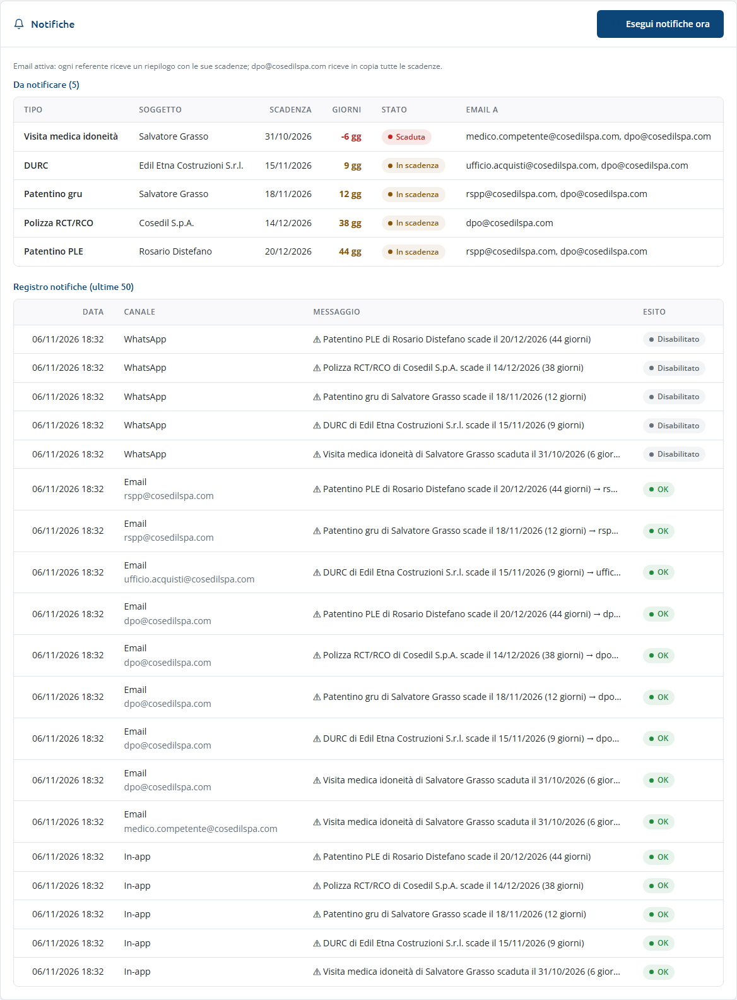

<!-- "><(((º> sabusabu <º)))>< -->
# 6. Impostazioni e notifiche

[← Indice](README.md)

Menu **Impostazioni**: due riquadri, i tipi di scadenza e le notifiche.

## Tipi di scadenza

Ogni tipo ha un **nome**, una **categoria**, il **soggetto** a cui si riferisce
(dipendente, subappaltatore, attrezzatura, sistema IA, azienda), la **validità** in mesi
e il **preavviso** in giorni. Lo Scadenzario arriva con i tipi più comuni già pronti
(formazione, visita medica, patentini, DURC, verifiche, polizze, SOA, ISO, AI Act).

- **Nuovo tipo** o la matita su una riga aprono la scheda:

  

  - **Validità (mesi)**: serve a calcolare da sola la data di scadenza dalla data di
    rilascio. Vuota = la data di scadenza si scrive sempre a mano.
  - **Preavviso (giorni)**: da quanti giorni prima la scadenza diventa **In scadenza**
    (gialla) ed entra negli avvisi.
  - **Email del referente predefinito**: chi riceve gli avvisi delle scadenze di questo
    tipo che non hanno un'email del referente propria (per esempio il medico competente
    per le visite mediche, l'ufficio acquisti per i DURC). Compare nella colonna
    **Avvisi a** della tabella.
  - **Crea tipo** / **Salva modifiche**.
- **Scarica maschera** e **Importa** funzionano come nelle anagrafiche (vedi
  [Anagrafiche](03-anagrafiche.md#caricare-tante-righe-insieme-excel)).
- Eliminare un tipo si fa dalla vista [Amministrazione](07-amministrazione.md).

## Notifiche

- La riga in alto dice se l'**email è attiva** e chi sono i destinatari fissi (in copia a
  tutte le scadenze, oppure solo a quelle senza referente).
- **Da notificare**: tutte le scadenze non chiuse che sono **scadute** o **in
  scadenza**, con i giorni che mancano. La colonna **Email a** mostra in anteprima a chi
  partirà l'email di ciascuna al prossimo giro, senza inviare nulla.
- **Registro notifiche (ultime 50)**: ogni avviso con data, **canale** (In-app, Email,
  WhatsApp; sotto *Email* l'indirizzo a cui è partita), messaggio ed **esito**: **OK**,
  **Errore** oppure **Disabilitato** (canale non attivo).
- **Esegui notifiche ora**: fa subito il giro degli avvisi. Messaggio: "Notifiche
  eseguite: N nuove, E email partite."

### Come funzionano gli avvisi

- Il giro parte da solo **una volta al giorno**, dalle 7 del mattino in poi, mentre lo
  Scadenzario è acceso.
- Gli avvisi non arrivano una volta sola ma a **più soglie**: 180, 90, 60, 30, 14, 7, 1 e
  0 giorni prima; dopo la scadenza, ogni giorno finché resta scaduta. Ogni soglia viene
  avvisata una volta sola per scadenza.
- I soggetti **non attivi** sono esclusi.
- Il canale sempre attivo è quello **in-app** (il registro qui sopra). L'**email** parte
  solo se l'amministratore di sistema l'ha configurata: **ogni referente riceve una sola
  email** con le sue scadenze del giro, i destinatari fissi un riepilogo con il referente
  di ognuna. La stessa scadenza non arriva due volte alla stessa persona nello stesso
  giorno, anche premendo di nuovo *Esegui notifiche ora*. Se un indirizzo viene
  rifiutato, gli altri partono lo stesso e l'errore arriva negli avvisi del Portale. Il
  canale **WhatsApp** è predisposto ma spento: nel registro risulta "Disabilitato".

## "Da fare oggi" nel Portale

Le scadenze aperte entro il preavviso compaiono anche nella home del Portale, nella
sezione **Da fare oggi**: prima le scadute, poi quelle entro 7 giorni, poi le altre in
preavviso. Un clic apre la vista Scadenze dello Scadenzario.
