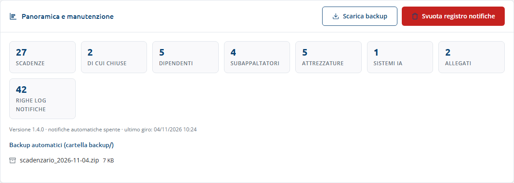
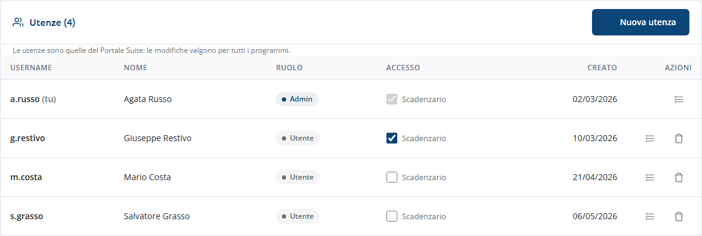
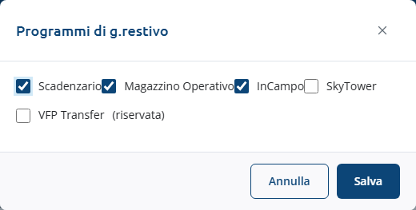
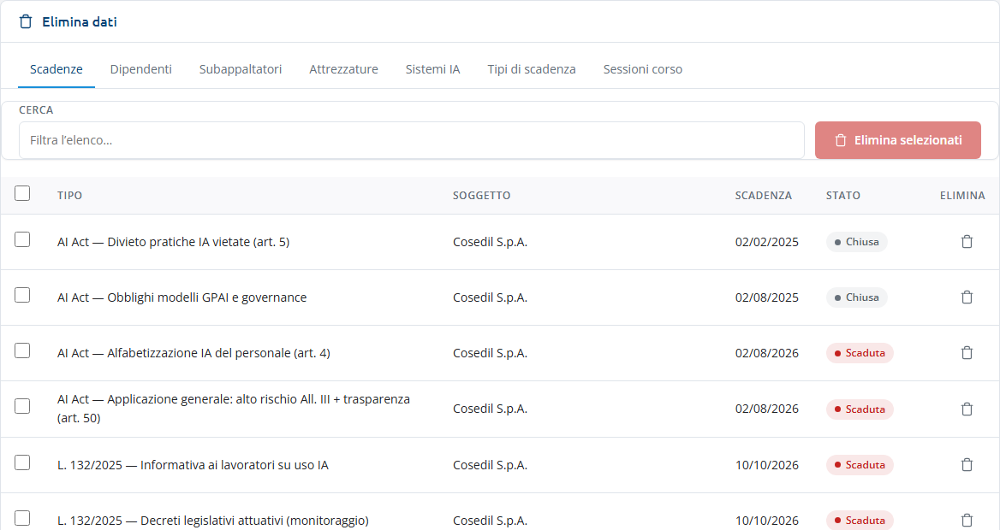

<!-- "><(((º> sabusabu <º)))>< -->
# 7. Amministrazione

[← Indice](README.md)

La vista **Amministrazione** compare nel menu solo agli **amministratori dello
Scadenzario** (chi è admin per lo Scadenzario nel Portale e, se l'amministratore di
sistema ha fissato un elenco, compare in quell'elenco). Contiene tre riquadri.

## Panoramica e manutenzione

- I numeri dell'archivio: scadenze (e quante chiuse), dipendenti, subappaltatori,
  attrezzature, sistemi IA, allegati, righe del registro notifiche.
- Versione, se le notifiche automatiche sono attive e quando è stato fatto l'ultimo giro.
- **Backup automatici**: gli ultimi file di backup (uno al giorno).
- **Scarica backup**: scarica subito uno zip con database e allegati. Conservalo in un
  posto sicuro: contiene dati personali.
- **Svuota registro notifiche**: cancella lo storico degli avvisi dopo la conferma.
  Attenzione: gli avvisi per soglia già inviati potranno ripartire al giro successivo.

## Utenze

Sono le **utenze del Portale**: le modifiche valgono per tutti i programmi della suite.

- **Accesso → Scadenzario**: spunta o togli per abilitare la persona allo Scadenzario.
  Gli admin del Portale entrano comunque (casella grigia).
- Icona a elenco = **Programmi abilitati**: spunta i programmi a cui la persona può
  accedere e **Salva**.

  

- Cestino = elimina l'utenza dopo conferma (non potrà più entrare in nessun programma).
  Non puoi eliminare te stesso.
- **Nuova utenza**: username, nome e cognome, **password provvisoria** (da cambiare al
  primo accesso), ruolo (Utente o Admin del portale) e **Abilita allo Scadenzario**.

Se il riquadro dice "Portale Suite non raggiungibile: riprova tra poco." il Portale è
spento o non risponde. Per tutto il resto sulle utenze vedi la
[guida del Portale](../../../portale/docs/guida/README.md).

## Elimina dati

È l'unico posto in cui si cancella.

1. Scegli la scheda: **Scadenze**, **Dipendenti**, **Subappaltatori**, **Attrezzature**,
   **Sistemi IA**, **Tipi di scadenza**, **Sessioni corso**.
2. Filtra con **Cerca**, spunta le righe (la casella in testa seleziona tutte quelle
   visibili) e premi **Elimina selezionati (N)**, oppure il cestino sulla singola riga.
3. Conferma: "Eliminare definitivamente … L'operazione non è reversibile."

Un soggetto con scadenze collegate **non si elimina**: spunta **Elimina anche le
scadenze collegate** se vuoi cancellare anche quelle. Gli elementi non eliminati sono
elencati con il motivo nella finestra **Elementi non eliminati**.

Prima di eliminare valuta se basta **disattivare** (togliere la spunta Attivo in
anagrafica): lo storico resta e gli avvisi si fermano.
