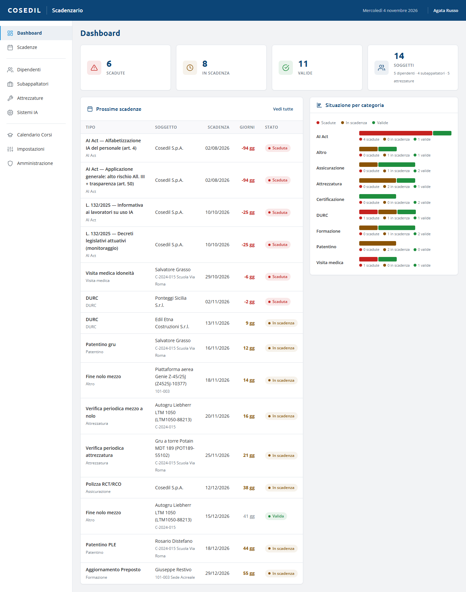

<!-- "><(((º> sabusabu <º)))>< -->
# Scadenzario — guida per chi lo usa

Lo **Scadenzario** tiene sotto controllo le **scadenze di cantiere e dell'azienda**:
formazione sicurezza, visite mediche, patentini, DURC dei subappaltatori, verifiche
periodiche delle attrezzature, polizze e certificazioni, fine nolo dei mezzi e
adempimenti sull'intelligenza artificiale (AI Act). Avvisa prima che una scadenza
arrivi e tiene allegati i documenti che la dimostrano.

Questa guida è per chi lo usa: impiegati amministrativi e dell'ufficio sicurezza,
capicantiere, amministratori. Ogni capitolo spiega dove si clicca, cosa succede e cosa
fare se qualcosa non va.

## Indice

1. [Primi passi](01-primi-passi.md) — come si entra, la pagina, la Dashboard, gli stati
2. [Le scadenze](02-scadenze.md) — elenco e filtri, nuova scadenza, rinnovo, checklist e allegati, esportazioni
3. [Anagrafiche](03-anagrafiche.md) — dipendenti, subappaltatori, attrezzature, sistemi IA, maschere Excel
4. [Mezzi a nolo da VFP Transfer](04-mezzi-a-nolo.md) — le scadenze che arrivano da sole
5. [Calendario Corsi](05-corsi.md) — importare le sessioni dell'ente formativo
6. [Impostazioni e notifiche](06-impostazioni-notifiche.md) — tipi di scadenza, preavvisi, avvisi
7. [Amministrazione](07-amministrazione.md) — backup, utenze, eliminazioni
8. [Se qualcosa non va](08-problemi.md) — messaggi frequenti e cosa fare
9. [Per l'amministratore di sistema](09-amministratore-sistema.md) — avvio, dati, backup

## In due parole

- Ogni scadenza ha un **tipo** (es. "Visita medica idoneità"), un **soggetto** (un
  dipendente, un subappaltatore, un'attrezzatura, un sistema IA o l'azienda) e una
  **data di scadenza**.
- Lo **stato** si calcola da solo ogni giorno: **Scaduta** (rosso), **In scadenza**
  (giallo, dentro il preavviso del tipo), **Valida** (verde), **Chiusa** (grigio).
- Quando si rinnova un documento si usa **Rinnova**: la vecchia scadenza si chiude e ne
  nasce una nuova.
- Si entra **dal Portale** con il proprio utente: login e abilitazioni sono spiegati
  nella [guida del Portale](../../../portale/docs/guida/README.md).

> Le immagini di questa guida sono fatte con dati di prova (persone, ditte e mezzi
> inventati; commesse 101-003 Sede Acireale e C-2024-015 Scuola Via Roma).
