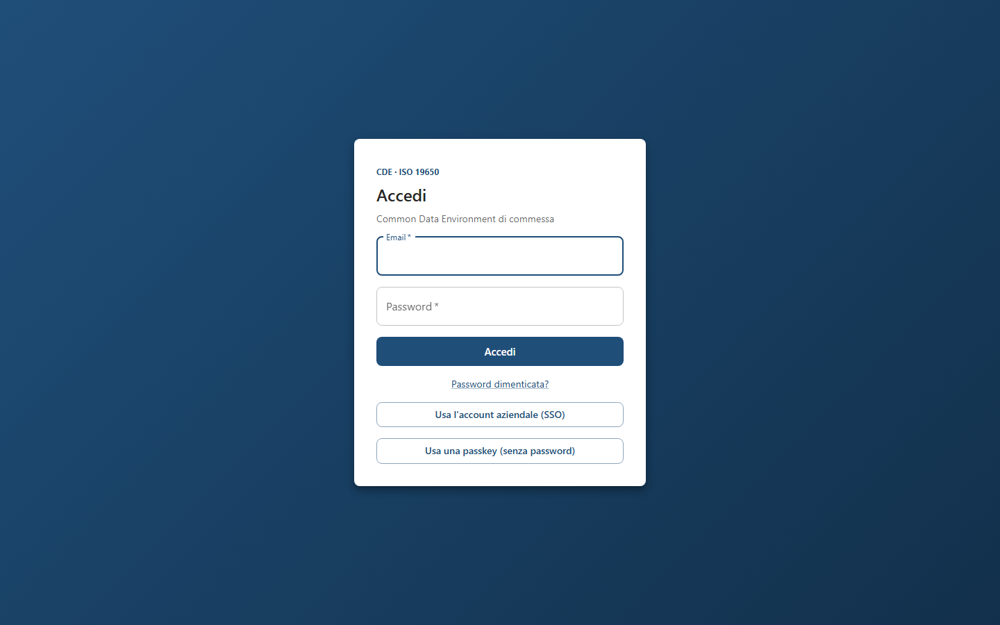
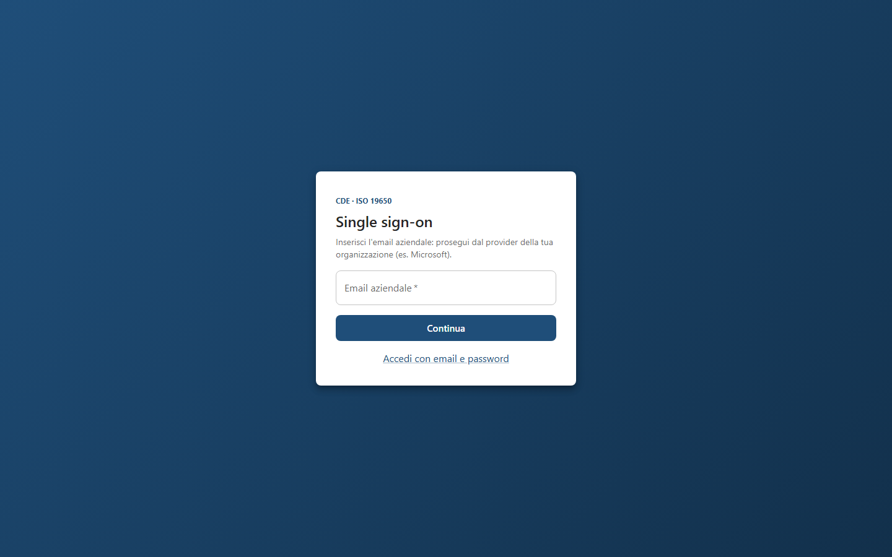
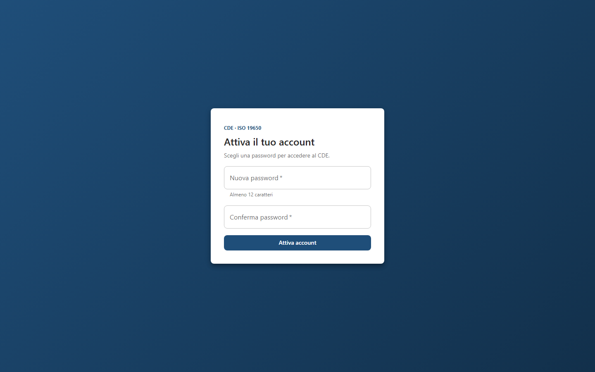
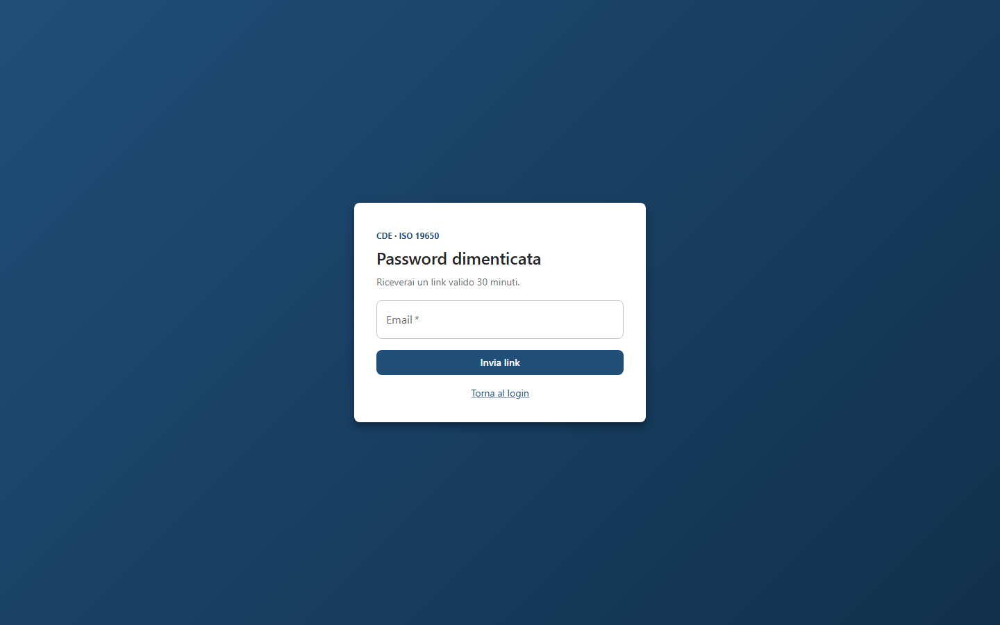
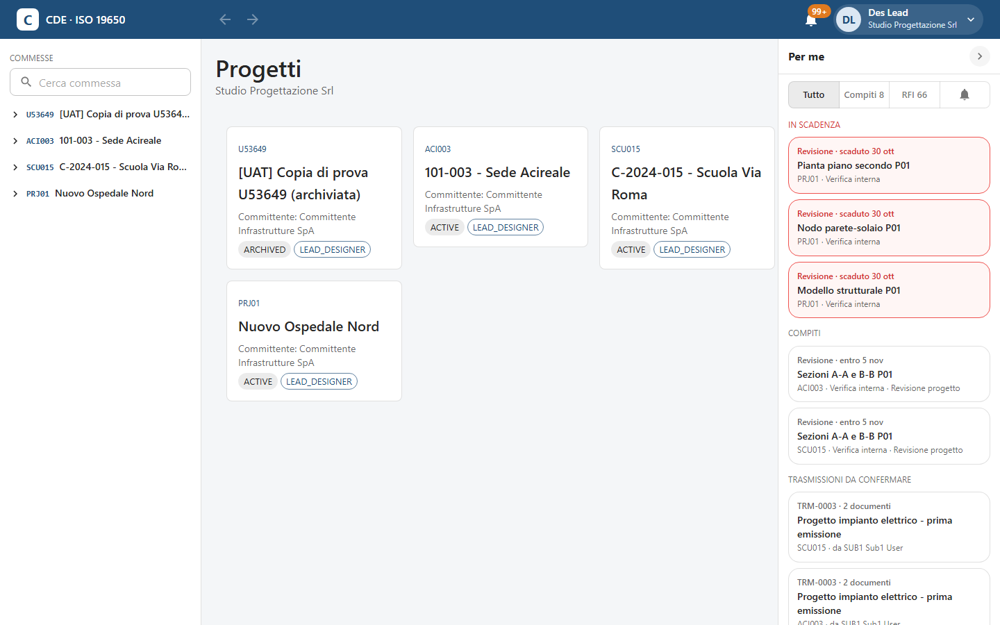
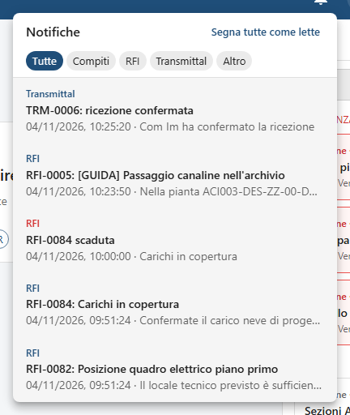
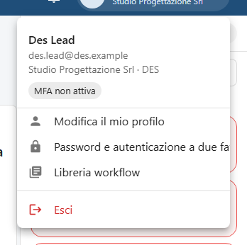
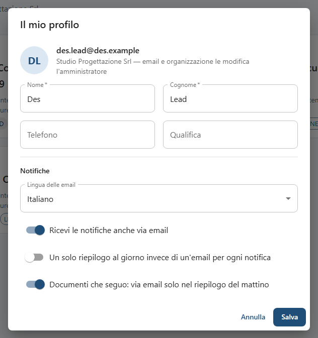

<!-- "><(((º> sabusabu <º)))>< -->
# 1. Accesso e interfaccia

[← Indice](README.md)

## 1.1 Entrare dal Portale della suite

Se lavori nella suite Cosedil, il modo più comodo è aprire il **Portale** e cliccare la tessera di **SkyTower**:
la sessione del Portale vale anche qui e non serve la password. Al primo accesso il tuo utente SkyTower viene
creato da solo e trovi le commesse della tua azienda che hanno un codice commessa aziendale.

Se nel Portale sei **amministratore**, lo sei anche qui (dal 09/11/2026): entrando dal Portale diventi
amministratore della tua organizzazione e **Project Admin** di tutte le commesse della tua azienda, anche se il tuo
utente SkyTower era nato con meno diritti. I ruoli che avevi restano.

Dall'11/11/2026 il tuo **profilo del Portale vale anche qui**, sempre:

- il tuo utente SkyTower resta legato al tuo utente del Portale: se nel Portale cambiano il tuo nome o la tua email,
  al prossimo accesso cambiano anche qui (resta lo stesso utente, con le stesse commesse);
- se nel Portale non sei più amministratore, al prossimo accesso non lo sei più nemmeno qui: perdi l'amministrazione
  dell'organizzazione e il ruolo di Project Admin che ti aveva dato il Portale, mentre i ruoli che avevi nelle
  commesse restano;
- se nel Portale il tuo account è **disattivato**, o SkyTower non è più fra i tuoi programmi, non entri più nemmeno
  con email e password di SkyTower: compare «Il tuo account del Portale è disattivato: rivolgiti a un amministratore»
  (o «SkyTower non è fra i tuoi programmi del Portale»). Se il Portale è spento si entra lo stesso;
- la sessione di SkyTower dura al massimo 14 giorni dall'accesso (12 ore se il server non usa HTTPS): poi, se il
  Portale è aperto, SkyTower ti fa rientrare da solo; altrimenti ti chiede di nuovo email e password.

Gli account con poteri di amministrazione della piattaforma, per sicurezza, non entrano dal Portale: devono
usare password e secondo fattore.

## 1.2 Entrare con email e password

1. Scrivi **Email** e **Password** e premi **Accedi**.
2. Se hai attivato il secondo fattore compare **Verifica in due passaggi**: inserisci il **Codice** a 6 cifre
   dell'app di autenticazione e premi **Verifica**, oppure **Usa la chiave di sicurezza**. Senza telefono:
   **Non hai il telefono? Usa un recovery code**.
3. Se la tua organizzazione **obbliga** il secondo fattore e non l'hai ancora configurato, compare
   **Configura l'MFA**: inquadra il QR con Microsoft o Google Authenticator, scrivi il **Codice a 6 cifre** e
   premi **Attiva** (oppure **Usa invece una chiave di sicurezza o una passkey**). Subito dopo compaiono i
   **recovery code**: salvali in un posto sicuro e premi **Li ho salvati, continua**. Non verranno più mostrati.

Altri modi di entrare, dalla stessa pagina:

- **Usa l'account aziendale (SSO)**: scrivi l'**Email aziendale**, premi **Continua** e prosegui sulla pagina di
  Microsoft (o del provider della tua azienda). Funziona solo se l'amministratore della tua organizzazione l'ha
  configurato ([capitolo 10](10-amministrazione.md#108-single-sign-on)). Se l'obbligo è attivo, anche chi
  prova con la password viene portato al provider aziendale.
- **Usa una passkey (senza password)**: il browser propone le passkey salvate (impronta, PIN del computer,
  telefono). Prima va registrata dal profilo ([capitolo 11](11-sicurezza-e-registro.md)).

### Messaggi che puoi vedere

| Messaggio | Cosa fare |
|---|---|
| **Troppi tentativi: riprovare tra un minuto** | Aspetta un minuto e riprova con calma (protezione contro chi indovina password). |
| **La tua organizzazione non usa il single sign-on: accedi con email e password.** | Torna con **Accedi con email e password**. |
| **Il tuo account aziendale non è abilitato al CDE…** | Chiedi un invito all'amministratore della tua organizzazione. |
| **Il single sign-on della tua organizzazione è stato disattivato: accedi con la password.** | Usa email e password. |

## 1.3 Primo accesso da invito e password dimenticata

Quando un amministratore ti invita ricevi un'email con un link: si apre **Attiva il tuo account**, scegli la
password (**almeno 12 caratteri**), ripetila in **Conferma password** e premi **Attiva account**. Compare
**Password impostata.** e il pulsante **Vai al login**.

Se hai dimenticato la password, nella pagina di accesso clicca **Password dimenticata?**, scrivi l'email e premi
**Invia link**. Il messaggio è sempre lo stesso («Se l'indirizzo è registrato, riceverai un'email con le
istruzioni»), per non rivelare chi è registrato. Il link vale **30 minuti** e porta a **Reimposta password**.

## 1.4 La schermata principale

La schermata ha tre colonne:

- **a sinistra, Commesse**: l'elenco delle commesse a cui partecipi, con il campo **Cerca commessa**. La freccia
  accanto a una commessa apre le sue cartelle: un clic su una cartella la apre al centro.
- **al centro**: la pagina su cui stai lavorando. All'avvio è **Progetti**, con una scheda per commessa: codice,
  nome, committente, stato (`ACTIVE`, `SETUP`, `ARCHIVED`) e il tuo ruolo.
- **a destra, Per me**: compiti, trasmissioni da confermare, RFI e notifiche di tutte le commesse
  ([capitolo 9](09-per-me-compiti-notifiche.md)). La freccia in alto lo chiude in una barra di icone con i
  contatori; il browser ricorda la scelta.

Nella barra blu in alto: il logo **CDE · ISO 19650** (riporta ai Progetti), le **frecce Indietro / Avanti**
(anche con Alt+← e Alt+→), la **campanella** delle notifiche e il tuo nome con il menu del profilo.

Su schermi stretti (tablet) le colonne laterali diventano cassetti: si aprono con l'icona a tre righe a sinistra
(commesse) e con l'icona dei compiti a destra (Per me).

## 1.5 Campanella delle notifiche

Il numero sulla campanella sono le notifiche non lette. Clic: si apre l'elenco, filtrabile per tipo (**Tutte**,
**Compiti**, **RFI**, **Transmittal**, **Documenti seguiti**, **Accessi**, **Altro**). Un clic su una notifica la
segna come letta e ti porta all'oggetto; **Segna tutte come lette** azzera il contatore. Le voci in rosso sono
urgenti (scadenze superate, solleciti, rifiuti). Le notifiche arrivano in tempo reale, senza ricaricare la pagina.

## 1.6 Menu del profilo

Clic sul tuo nome in alto a destra. In testa vedi email, organizzazione e lo stato del secondo fattore
(**MFA attiva**, **MFA richiesta** o **MFA non attiva**). Le voci:

- **Modifica il mio profilo**: nome, cognome, telefono, qualifica e preferenze delle notifiche (sotto).
- **Password e autenticazione a due fattori**: la pagina **Sicurezza** ([capitolo 11](11-sicurezza-e-registro.md)).
- **La mia organizzazione e gli utenti** (solo amministratori dell'organizzazione;
  per l'amministratore della piattaforma **Organizzazioni e utenti**): [capitolo 10](10-amministrazione.md).
- **Libreria workflow**: i modelli di workflow dell'azienda ([capitolo 6](06-workflow-e-processi.md#610-libreria-workflow-dellorganizzazione)).
- **Esci**.

> La voce «Password e autenticazione a due fattori» nel menu è più lunga dello spazio e appare tagliata:
> è la stessa pagina Sicurezza.

## 1.7 Il mio profilo e le preferenze delle notifiche

Puoi cambiare **Nome**, **Cognome**, **Telefono** e **Qualifica**; email e organizzazione le cambia solo
l'amministratore. Nella parte **Notifiche**:

- **Lingua delle email**: Italiano o English;
- **Ricevi le notifiche anche via email**: se spento, le notifiche restano solo in piattaforma;
- **Un solo riepilogo al giorno invece di un'email per ogni notifica**;
- **Documenti che seguo: via email solo nel riepilogo del mattino**: gli avvisi dei documenti che segui
  ([capitolo 3](03-documenti-e-revisioni.md#39-seguire-un-documento)) compaiono subito nel pannello ma per
  email arrivano solo nel riepilogo; i compiti arrivano comunque subito.

Premi **Salva**.
