<!-- "><(((º> sabusabu <º)))>< -->
# 2. Commesse e cartelle

[← Indice](README.md)

## 2.1 L'elenco dei progetti

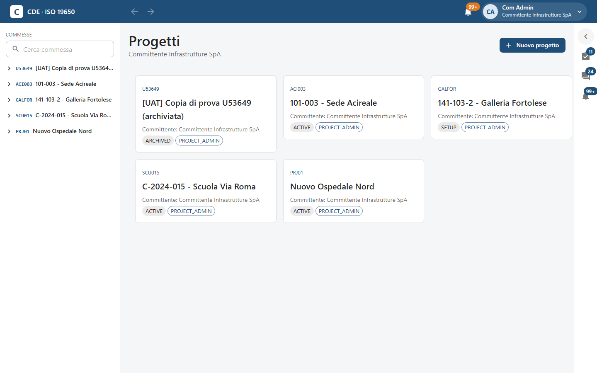

La pagina **Progetti** mostra le commesse a cui partecipi. Clic su una scheda per aprirla. Le stesse commesse
sono nella colonna di sinistra, dove puoi cercarle per codice o nome.

## 2.2 Creare una commessa (amministratore dell'organizzazione)

Il pulsante **Nuovo progetto** compare solo agli amministratori dell'organizzazione.

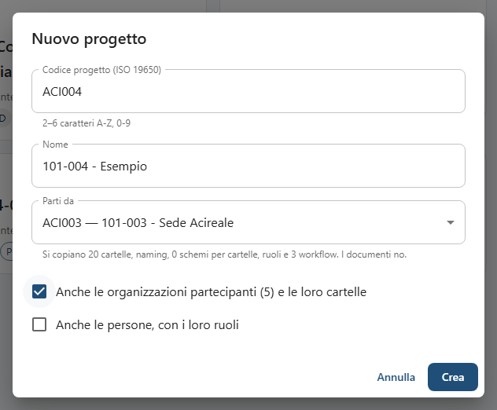

1. **Codice progetto (ISO 19650)**: da 2 a 6 caratteri A-Z e 0-9 (es. `ACI004`). Diventa il primo campo di ogni
   nome di file e **non si cambia più**.
2. **Nome**: il nome per esteso (es. «101-004 - Esempio»).
3. **Parti da**: **Progetto vuoto**, oppure una commessa di cui sei Project Admin da usare come modello. Il testo
   sotto dice cosa si copia: cartelle, naming, schemi per cartelle, ruoli e workflow. **I documenti no.**
4. Con una commessa modello puoi spuntare anche **Anche le organizzazioni partecipanti (…) e le loro cartelle** e
   **Anche le persone, con i loro ruoli**. Senza la prima spunta si copiano solo le cartelle della tua
   organizzazione.
5. **Crea**: si apre la commessa nuova.

## 2.3 Le schede di una commessa

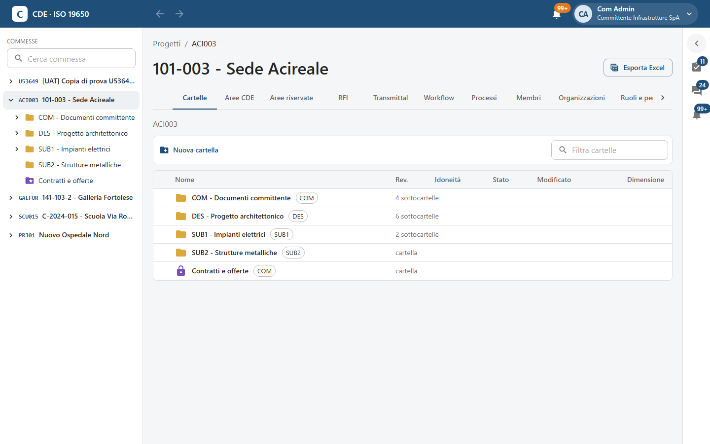

In testa trovi codice, nome e il pulsante **Esporta Excel** ([capitolo 10](10-amministrazione.md#106-esporta-excel)).
Sotto, le schede:

| Scheda | A cosa serve | Capitolo |
|---|---|---|
| **Cartelle** | Navigare cartelle e documenti, caricare, condividere | qui e [3](03-documenti-e-revisioni.md) |
| **Aree CDE** | Tutti i documenti per stato: In lavorazione, Condiviso, Pubblicato, Archiviato | [3](03-documenti-e-revisioni.md#36-le-aree-cde) |
| **Aree riservate** | Cartelle chiuse ad accesso su richiesta | qui sotto |
| **RFI** | Richieste di informazioni | [7](07-rfi.md) |
| **Transmittal** | Trasmissioni ufficiali di documenti | [8](08-transmittal.md) |
| **Workflow** | Modelli di approvazione e di processo | [6](06-workflow-e-processi.md) |
| **Processi** | Processi in corso e conclusi (es. RdA) | [6](06-workflow-e-processi.md#68-processi) |
| **Membri**, **Organizzazioni**, **Ruoli e permessi**, **Naming**, **Suite Cosedil** | Impostazioni della commessa | [4](04-naming.md), [10](10-amministrazione.md) |
| **Timbri** | Firme, loghi e timbri («Approvato DL») da mettere sui PDF dal visualizzatore | [5](05-visualizzatore-e-annotazioni.md#58-timbri-firma-logo-approvato-sui-pdf) |
| **Cruscotto**, **Registro** | Solo per il Project Admin | [10](10-amministrazione.md#105-cruscotto), [11](11-sicurezza-e-registro.md#113-registro-attività) |

Se le schede non stanno tutte nello schermo, usa le frecce ‹ › ai lati della fila.

## 2.4 Le cartelle

Ogni cartella appartiene a un'organizzazione (la sigla accanto al nome, es. `DES`) e di norma **ognuno vede le
cartelle della propria organizzazione** più quelle condivise con lui. Un subappaltatore, per esempio, non vede le
cartelle di lavoro dello studio di progettazione.

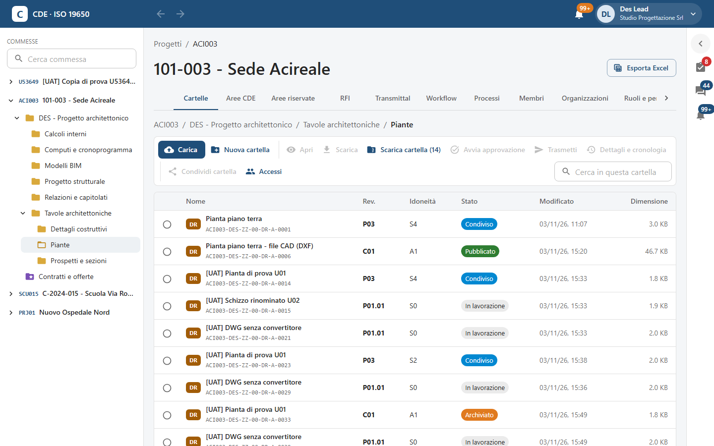

In alto il percorso (clic su un livello per risalire). Sotto, la **barra delle funzioni**:

- **Carica**: carica file nella cartella ([capitolo 3](03-documenti-e-revisioni.md#31-caricare-un-documento));
- **Nuova cartella**: crea una sottocartella;
- **Apri**, **Scarica**, **Avvia approvazione**, **Trasmetti**, **Dettagli e cronologia**: agiscono sul documento
  selezionato con il pallino a sinistra della riga (sono grigi finché non ne scegli uno);
- **Scarica cartella (n)**: uno ZIP con l'ultima revisione verificata di tutti i documenti della cartella;
- **Condividi cartella** e **Accessi**: chi vede la cartella (sotto);
- **Cerca in questa cartella**: filtra per codice o titolo.

Nella tabella: il riquadro colorato è il **tipo** del documento (`DR` disegno, `M3` modello 3D, `RP` relazione…),
poi titolo e identificativo, **Rev.**, **Idoneità**, **Stato**, data e dimensione. Doppio clic su un documento
lo apre nel visualizzatore in una nuova scheda del browser.

### Nuova cartella

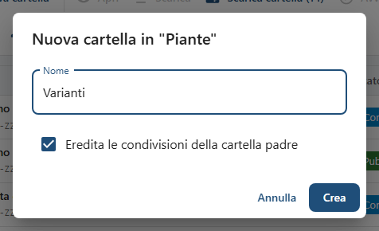

Scrivi il **Nome** e premi **Crea**. La spunta **Eredita le condivisioni della cartella padre** (attiva di norma)
fa vedere la nuova cartella a chi vede già quella superiore; toglila per una sottocartella più chiusa.

## 2.5 Condividere una cartella e vedere chi vi accede

Serve il permesso di amministrazione sulla cartella (di solito l'organizzazione proprietaria o il Project Admin).

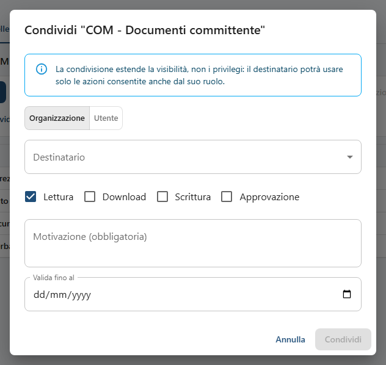

1. **Condividi cartella**.
2. Scegli **Organizzazione** o **Utente** e il **Destinatario**.
3. Spunta le azioni: **Lettura**, **Download**, **Scrittura**, **Approvazione**.
4. Scrivi la **Motivazione (obbligatoria)** e, se serve, **Valida fino al**.
5. **Condividi**.

Come avvisa il riquadro azzurro: la condivisione allarga la *visibilità*, non i *privilegi*. Un utente con ruolo
di sola lettura non potrà caricare anche se la cartella gli è condivisa in scrittura.

**Accessi** mostra il proprietario, le tue azioni sulla cartella e le **Condivisioni attive**, ciascuna con il
cestino per revocarla.

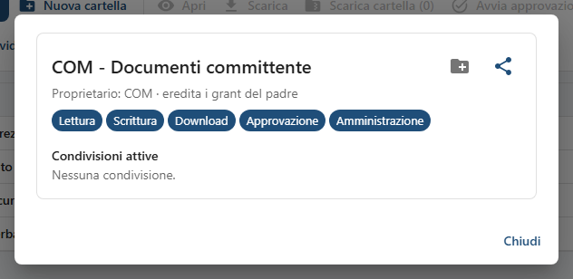

## 2.6 Aree riservate

Le aree riservate sono cartelle chiuse (contratti, offerte, dati economici): le vedono solo gli amministratori e
chi ha ottenuto l'accesso su richiesta. Nell'albero hanno il lucchetto viola.

### Chi chiede l'accesso

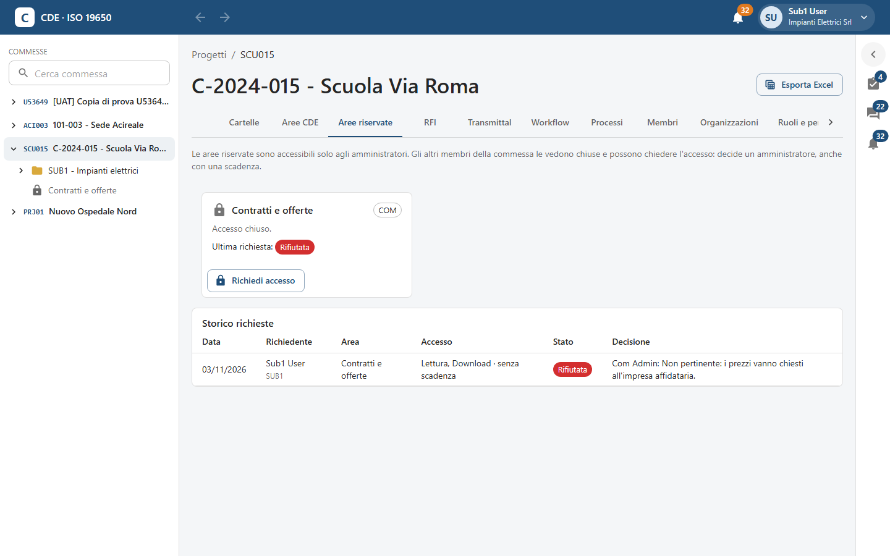

Nella scheda **Aree riservate** l'area compare con **Accesso chiuso.** e il pulsante **Richiedi accesso**. Se una
richiesta precedente è stata rifiutata lo vedi in **Ultima richiesta**, e nello **Storico richieste** leggi la nota
di chi ha deciso.

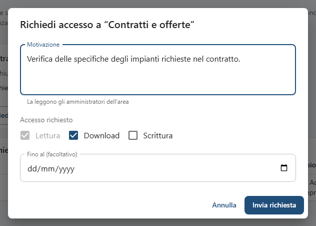

Scrivi la **Motivazione** (la leggono gli amministratori dell'area), scegli l'**Accesso richiesto** (Lettura è
sempre inclusa; puoi aggiungere Download e Scrittura) e, se vuoi, **Fino al (facoltativo)**. **Invia richiesta**:
la card mostra **Richiesta inviata** e il pulsante **Annulla richiesta**. Gli amministratori ricevono una notifica.

### Chi decide

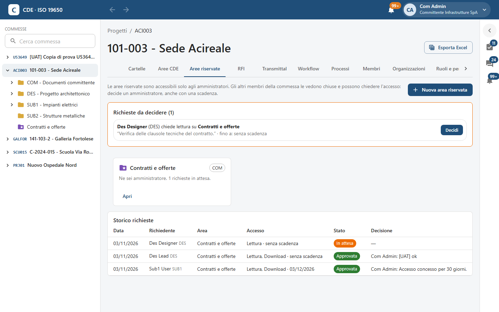

L'amministratore trova in alto **Richieste da decidere** e clicca **Decidi**.

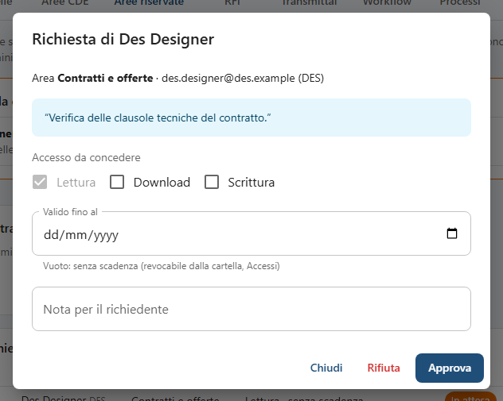

Può ridurre o ampliare l'**Accesso da concedere**, dare una scadenza in **Valido fino al** (vuoto = senza
scadenza, revocabile poi da *Accessi* della cartella), scrivere una **Nota per il richiedente** e premere
**Approva** o **Rifiuta**. Il richiedente riceve la notifica; l'area si apre con **Apri**.

**Nuova area riservata** crea un'area: basta il **Nome**. Le sottocartelle create dentro restano riservate.

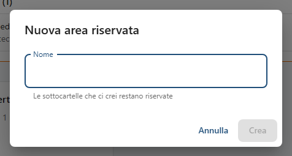
