<!-- "><(((º> sabusabu <º)))>< -->
# 3. Documenti e revisioni

[← Indice](README.md)

Il ciclo di vita di un documento in SkyTower segue la ISO 19650:

```
In lavorazione (WIP)  →  Condiviso (SHARED)  →  Pubblicato (PUBLISHED)  →  Archiviato
  P01.01, P01.02…           P01, P02…               C01, C02…                sola lettura
  solo la tua azienda       team di coordinamento   tutta la commessa
```

Ogni caricamento crea una **revisione nuova e immutabile**: le precedenti non si cancellano e restano scaricabili.

In questo capitolo seguiamo un esempio reale della commessa «101-003 - Sede Acireale»: il progettista dello Studio
Progettazione carica la pianta del piano terra, ne carica una seconda versione, la condivide; poi il committente la
pubblica tramite un workflow ([capitolo 6](06-workflow-e-processi.md)).

## 3.1 Caricare un documento

1. Apri la cartella (es. *DES - Progetto architettonico › Tavole architettoniche › Piante*) e premi **Carica**.

   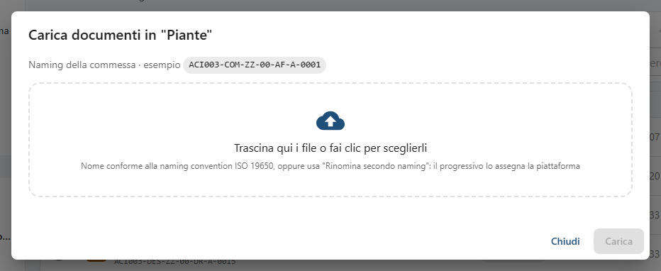

   In alto vedi quale regola dei nomi vale per la cartella («Naming della commessa» o lo schema della cartella)
   con un esempio di nome corretto.
2. Trascina i file nel riquadro o fai clic per sceglierli. Puoi caricarne molti insieme.
3. Per ogni file SkyTower controlla subito il nome:
   - **nome conforme** (es. `ACI003-DES-ZZ-00-DR-A-0043.pdf`): compare un'etichetta come `nuovo → P01.01`
     oppure, se il documento esiste già, `P01.01 → P01.02` (sarà una nuova revisione dello stesso documento);
   - **nome non conforme** (es. `pianta piano terra uffici.pdf`): se la commessa ha la rinomina automatica
     attiva, si accende da sola **Rinomina secondo naming** (vedi sotto); altrimenti compaiono gli errori, campo
     per campo, con dei suggerimenti.
4. Per un documento nuovo scrivi il **Titolo (nuovo documento)**.
5. Premi **Carica N** (N = file pronti). Una barra mostra «Calcolo impronta SHA-256…» e poi «Caricamento…».
   Alla fine: **Revisione P01.01 creata**, oppure con la rinomina **Caricato come … (revisione P01.01); nome
   originale nelle note**.

Un caricamento interrotto (rete che cade, finestra chiusa) **riprende da dove si era fermato** ricaricando lo
stesso file. Con la **X** accanto al file lo togli dall'elenco o interrompi il caricamento.

### Rinomina con progressivo

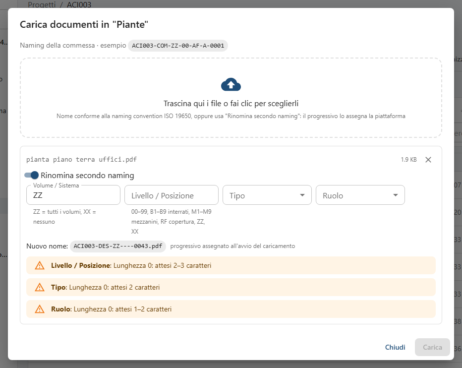

Con **Rinomina secondo naming** acceso scegli solo i campi che hanno senso per il file (qui **Volume / Sistema**,
**Livello / Posizione**, **Tipo**, **Ruolo**): il tuo originatore e il numero progressivo li mette SkyTower. Gli
avvisi gialli dicono cosa manca. Quando i campi sono completi il **Nuovo nome** diventa verde.

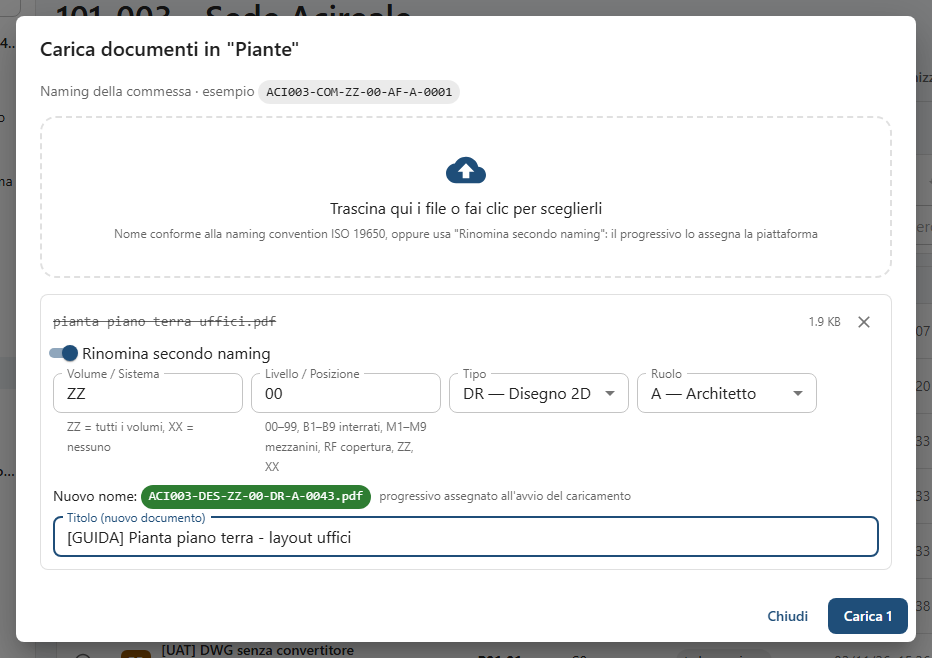

Il progressivo viene **riservato solo quando parte il caricamento** («progressivo assegnato all'avvio del
caricamento»): se due colleghi caricano insieme non prendono lo stesso numero. Con più file, **Applica a tutti
i file** copia i campi sugli altri (ognuno mantiene il suo numero, in ordine).

Se spegni l'interruttore vedi l'errore sul nome originale e il pulsante **Rinomina con progressivo** per
riaccenderlo.

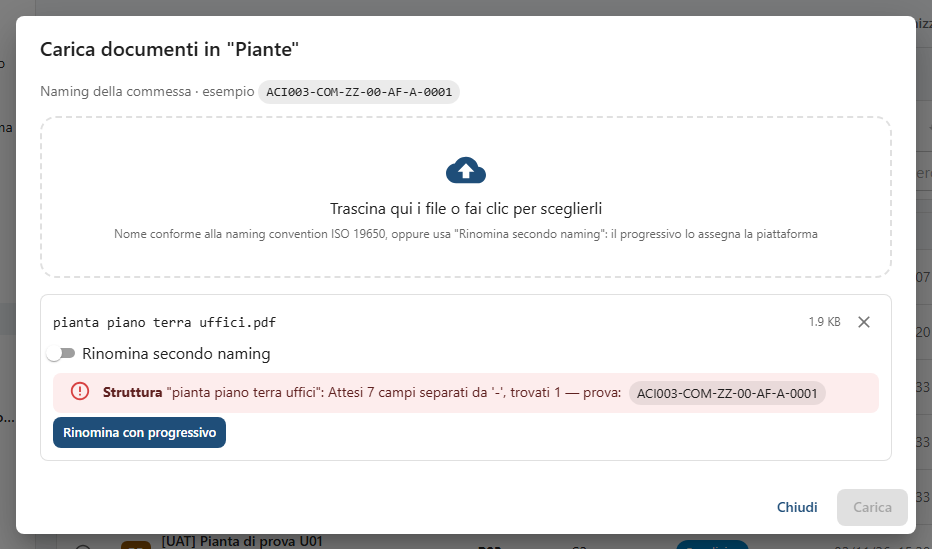

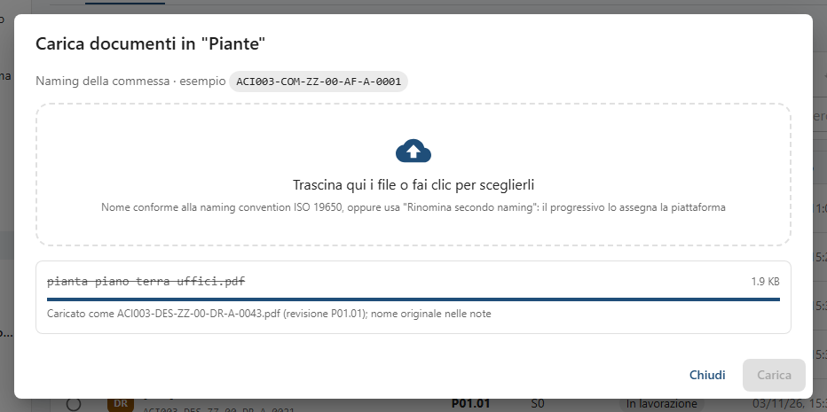

Il nome originale del file resta scritto nelle **Note** della revisione.

### Verifica antivirus e impronta

Subito dopo il caricamento la revisione è **In verifica**: il server ne calcola l'impronta e la controlla con
l'antivirus. Dopo pochi secondi diventa **Verificato**. Finché non è verificata non si apre, non si scarica e non
si condivide. Se risulta infetta va in **Quarantena** e resta bloccata: avvisa l'IT. **Integrità KO** significa
che il file arrivato non corrisponde a quello inviato: ricaricalo.

## 3.2 Caricare una nuova revisione

Carica nella stessa cartella un file con **lo stesso identificativo** (`ACI003-DES-ZZ-00-DR-A-0043.pdf`): SkyTower
riconosce il documento e propone `P01.01 → P01.02`. Il titolo non serve.

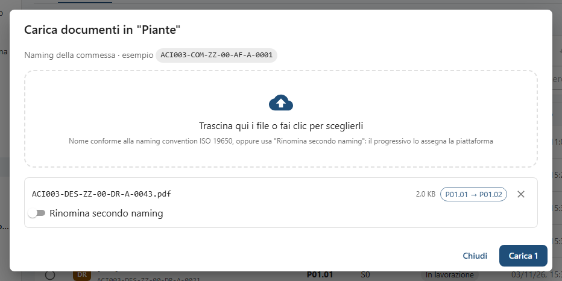

Messaggi possibili:

- **Documento esistente in un altro container**: quell'identificativo vive in un'altra cartella; carica lì.
- **Identificativo prenotato da un'altra organizzazione**: il numero l'ha prenotato un'altra azienda
  ([capitolo 4](04-naming.md#44-prenotare-i-numeri)).
- Un documento **in approvazione** non accetta nuove revisioni finché il workflow non finisce
  ([capitolo 6](06-workflow-e-processi.md)).

## 3.3 Dettagli e cronologia

Seleziona il documento con il pallino a sinistra e premi **Dettagli e cronologia** (oppure clicca la riga nelle
Aree CDE).

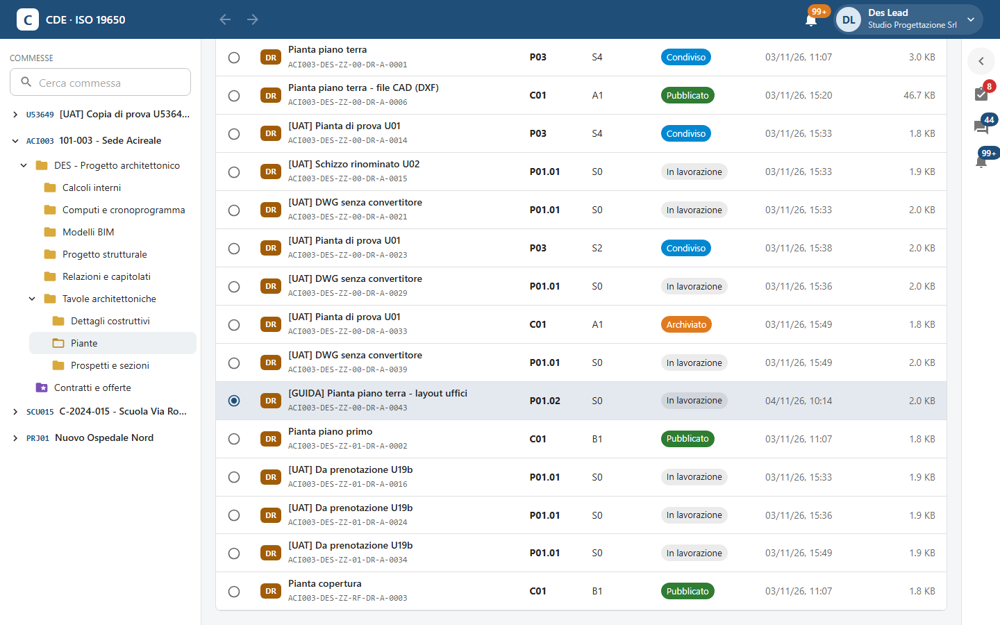

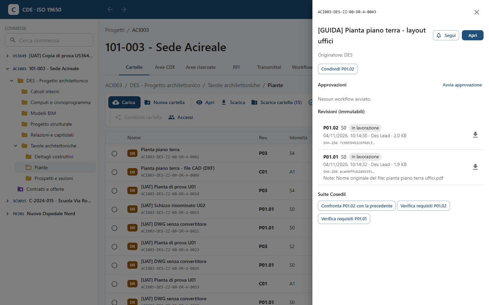

Nel pannello trovi:

- identificativo, titolo, originatore, i pulsanti **Segui** e **Apri** (visualizzatore);
- i **pulsanti di stato** proposti dalle regole della commessa (es. **Condividi P01.02**, **Pubblica P01**,
  **Archivia C01**): compaiono solo quelli che puoi usare;
- **Approvazioni**: i workflow avviati sul documento, con **Avvia approvazione**;
- **Revisioni (immutabili)**: per ognuna codice, idoneità, stato, data, autore, dimensione, impronta SHA-256,
  motivazione e note; l'icona di download a destra;
- **Suite Cosedil**: **Confronta … con la precedente** apre il confronto nell'app *Confronto Documenti*;
  **Verifica requisiti …** controlla la revisione con una checklist dell'app *Verifica Requisiti*. Gli esiti
  restano elencati qui;
- **Storico stati**: ogni passaggio di stato con data, autore e motivazione.

## 3.4 Condividere (WIP → Condiviso)

1. Nel pannello del documento premi **Condividi P01.02** (l'ultima revisione in lavorazione).
2. Scegli il **Codice di idoneità** (`S1 — Coordinamento`, `S2 — Informazione`, `S3 — Revisione e commento`,
   `S4 — Approvazione di fase`) e scrivi la **Motivazione**.

   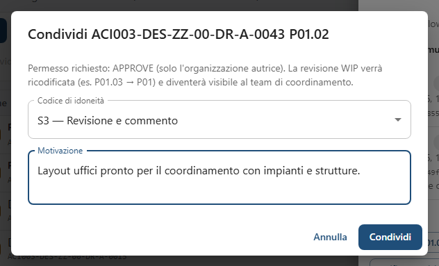
3. Premi **Condividi**. L'esito dice quante operazioni sono riuscite e il nuovo codice (`OK → P01`).

   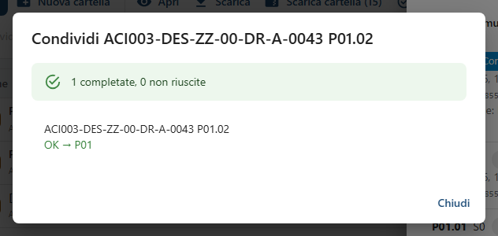

La revisione viene ricodificata (P01.02 → **P01**) e diventa visibile al team di coordinamento, comprese le altre
organizzazioni che hanno accesso alla cartella. Le revisioni WIP restano visibili solo alla tua azienda.

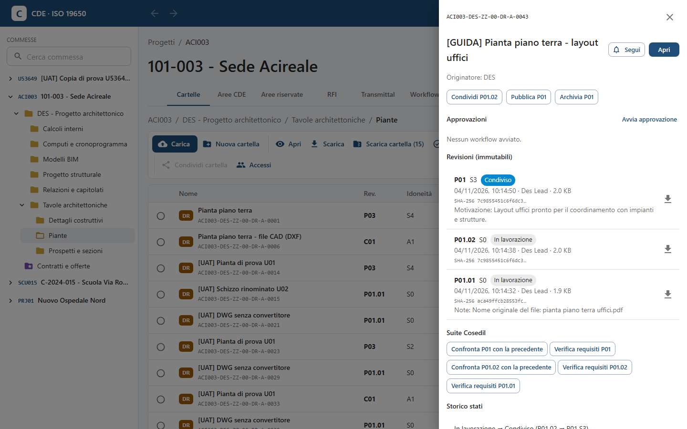

> Dopo la condivisione il pannello continua a proporre **Condividi P01.02**: è la stessa revisione appena
> condivisa, non serve ripetere l'operazione.

## 3.5 Pubblicare e archiviare

La **pubblicazione** (Condiviso → Pubblicato) richiede il permesso di approvazione: di solito la fa il Project
Admin o la fa da sé un workflow alla fine dell'approvazione ([capitolo 6](06-workflow-e-processi.md)).

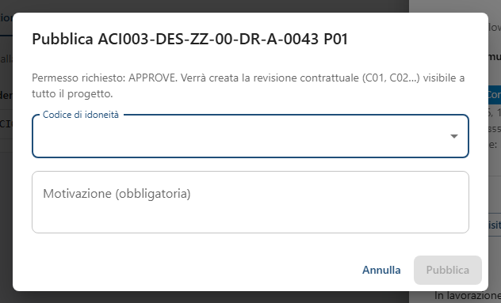

Si sceglie il codice di idoneità di pubblicazione e si scrive la **Motivazione (obbligatoria)**:

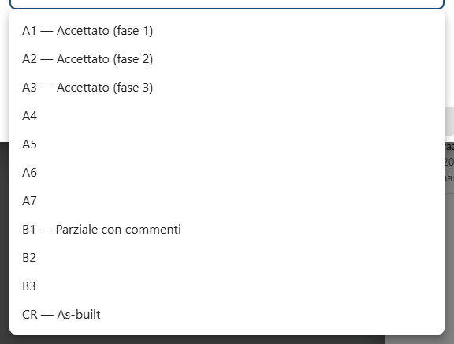

Viene creata la revisione contrattuale **C01** (poi C02…), visibile a **tutti** i membri della commessa,
subappaltatori e direzione lavori compresi.

**Archivia** rende il documento di sola lettura («Il documento diventerà di sola lettura»): non si caricano più
revisioni né si avviano workflow. Nel pannello compare «Archiviato il … : motivo».

Se un'azione non è prevista compare «Transizione … non prevista dalle regole del progetto».

## 3.6 Le Aree CDE

La scheda **Aree CDE** mostra tutti i documenti della commessa divisi per stato, a prescindere dalla cartella:
**In lavorazione** (solo la tua organizzazione), **Condiviso**, **Pubblicato**, **Archiviato**.

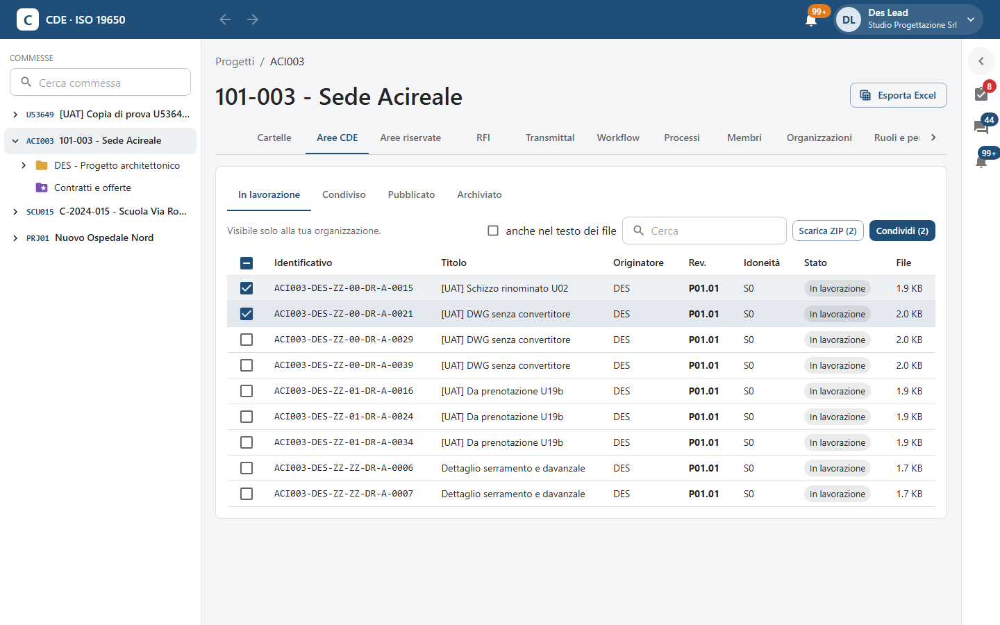

Spunta più documenti per agire insieme: **Scarica ZIP (n)** e i pulsanti di stato con il numero, es.
**Condividi (2)**, **Pubblica**, **Archivia**. Un clic su una riga apre i dettagli del documento.

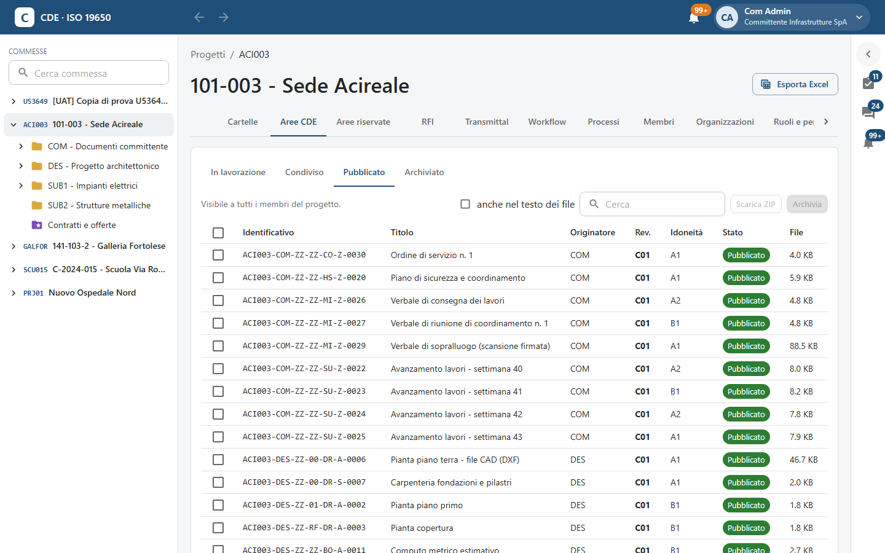

## 3.7 Cercare, anche dentro i file

Nel campo **Cerca** delle Aree CDE scrivi una parola del codice o del titolo. Spuntando **anche nel testo dei file**
la ricerca guarda anche **dentro** PDF, Word e testi, compresi i verbali **scansionati** (il server legge il testo
delle scansioni con l'OCR). Sotto il titolo compare un estratto con la parola evidenziata in giallo.

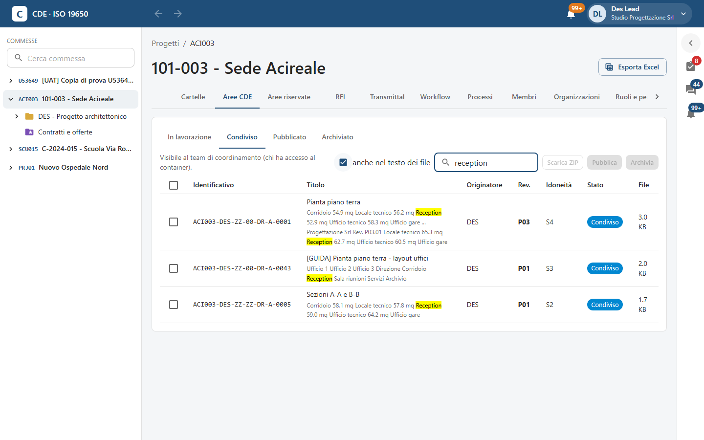

I documenti in lavorazione di un'altra organizzazione non compaiono mai nei risultati.

## 3.8 Scaricare

- **Scarica** (barra della cartella, visualizzatore, icona nella lista delle revisioni): il file originale.
- **Scarica cartella (n)** e **Scarica ZIP (n)**: un unico ZIP con i file e un **elenco.csv** con identificativo,
  revisione e impronta SHA-256 di ogni file.
- Se il Project Admin ha attivato la **filigrana**, i PDF scaricati riportano su ogni pagina il tuo nome, email,
  organizzazione, data e ora, documento e revisione ([capitolo 4](04-naming.md#45-filigrana-sui-pdf)).

## 3.9 Seguire un documento

Nel pannello del documento **Segui** (diventa **Seguito**) ti fa ricevere una notifica a ogni nuova revisione e a
ogni cambio di stato che puoi vedere (la WIP di un'altra organizzazione no). Un clic su **Seguito** smette di
seguirlo.

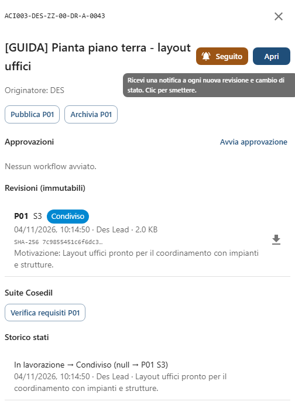

## 3.10 Modificare in piattaforma

- **File di testo** (TXT, CSV…): nel visualizzatore, sull'ultima revisione e con permesso di scrittura, compare
  **Modifica**; scrivi in **Cosa è cambiato (facoltativo)** e premi **Salva come nuova revisione**.
- **Word, Excel, PowerPoint**: se l'installazione ha il server *OnlyOffice*, su una revisione **in lavorazione**
  compare **Modifica con OnlyOffice**: si apre una scheda dove più persone modificano insieme in tempo reale; alla
  chiusura nasce la revisione WIP successiva con la nota «Modificata in piattaforma (OnlyOffice)». Sulle revisioni
  condivise o pubblicate il pulsante non c'è. Nell'ambiente fotografato OnlyOffice non è configurato, per questo il
  pulsante non compare nelle immagini.
