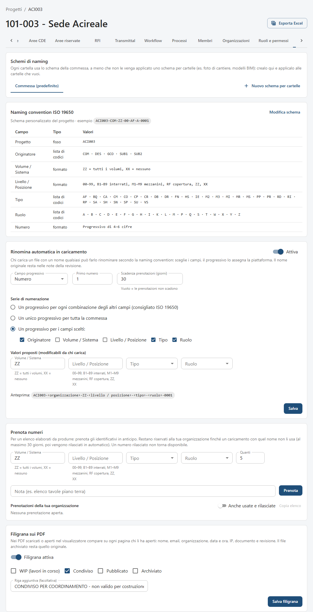
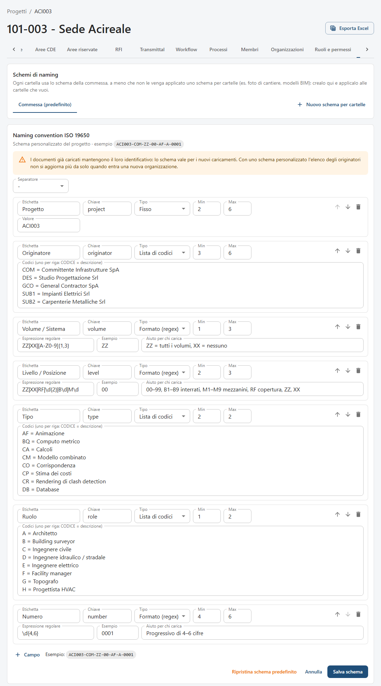
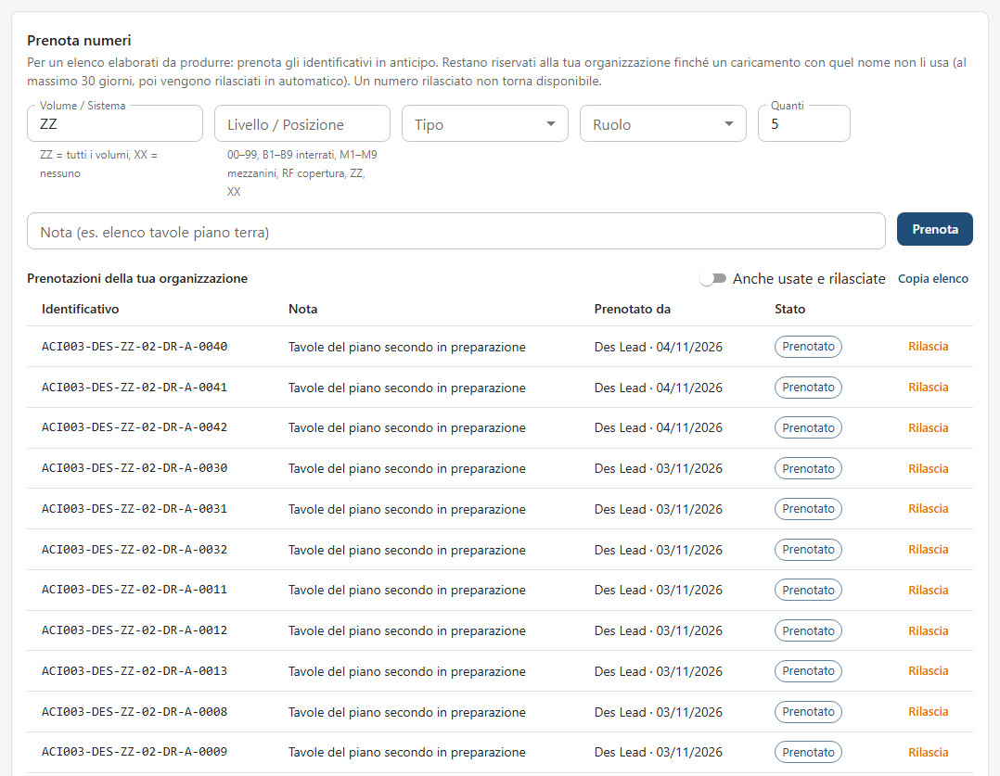
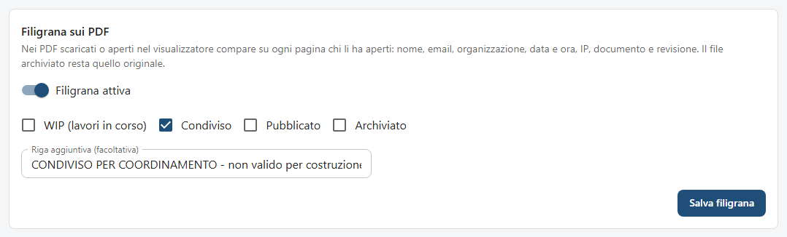

<!-- "><(((º> sabusabu <º)))>< -->
# 4. Naming dei file

[← Indice](README.md)

Ogni documento ha un **identificativo** composto da campi separati da un trattino, secondo la ISO 19650:

```
ACI003 - DES - ZZ - 00 - DR - A - 0043
progetto  originatore  volume  livello  tipo  ruolo  numero
```

| Campo | Esempi |
|---|---|
| Progetto | il codice della commessa, fisso (`ACI003`) |
| Originatore | l'azienda che produce il file (`COM`, `DES`, `SUB1`…) |
| Volume / Sistema | `ZZ` = tutti i volumi, `XX` = nessuno |
| Livello / Posizione | `00`–`99`, `B1`–`B9` interrati, `M1`–`M9` mezzanini, `RF` copertura, `ZZ`, `XX` |
| Tipo | `DR` disegno 2D, `M3` modello 3D, `RP` relazione, `SP` capitolato, `MI` verbale, `SU` rilievo… |
| Ruolo | `A` architetto, `S` strutturista, `E` elettrico, `K` committente, `Z` generale… |
| Numero | progressivo di 4–6 cifre |

Il nome del file caricato deve essere l'identificativo (più l'estensione). Se non lo è, la rinomina automatica lo
costruisce per te ([capitolo 3](03-documenti-e-revisioni.md#rinomina-con-progressivo)).

## 4.1 La scheda Naming

Tutti la vedono; solo il Project Admin la modifica.



Dall'alto:

- **Schemi di naming**: la scheda **Commessa (predefinito)** e gli eventuali schemi per cartelle;
- **Naming convention ISO 19650**: i campi con tipo (fisso, lista di codici, formato) e valori ammessi, con un
  esempio di nome;
- **Rinomina automatica in caricamento**;
- **Prenota numeri**;
- **Filigrana sui PDF**.

## 4.2 Modificare lo schema (Project Admin)

**Modifica schema** apre l'editor dei campi.



Per ogni campo: **Etichetta**, **Chiave**, **Tipo** (*Fisso*, *Lista di codici*, *Formato (regex)*), lunghezza
**Min** e **Max**; per le liste i **Codici (uno per riga: CODICE = descrizione)**, per i formati
**Espressione regolare**, **Esempio** e **Aiuto per chi carica**. Le frecce spostano il campo, il cestino lo
elimina, **Campo** ne aggiunge uno (fino a 12). Sotto si vede l'esempio aggiornato.
**Salva schema**, oppure **Ripristina schema predefinito**.

L'avviso giallo ricorda che **i documenti già caricati mantengono il loro identificativo**: lo schema vale per i
nuovi caricamenti. Con uno schema personalizzato l'elenco degli originatori non si aggiorna più da solo quando
entra una nuova organizzazione: va aggiunta a mano.

## 4.3 Rinomina automatica (Project Admin)

Interruttore **Attiva** / **Disattivata**. Con la rinomina attiva chi carica un file con un nome qualsiasi sceglie
i campi e SkyTower assegna il progressivo.

- **Campo progressivo** (di norma *Numero*) e **Primo numero**;
- **Scadenza prenotazioni (giorni)**: vuoto = le prenotazioni non scadono;
- **Serie di numerazione**: *Un progressivo per ogni combinazione degli altri campi (consigliato ISO 19650)*,
  *Un unico progressivo per tutta la commessa*, oppure *Un progressivo per i campi scelti* (es. originatore, tipo,
  ruolo: le tavole architettoniche DES hanno una numerazione, le relazioni un'altra);
- **Valori proposti (modificabili da chi carica)**: per esempio `ZZ` per il volume;
- **Anteprima** del nome; poi **Salva** («Impostazioni salvate»).

Se la rinomina è spenta, chi carica un nome sbagliato legge: «Rinomina automatica non attiva: il Project Admin può
attivare il progressivo nella scheda "Naming"».

## 4.4 Prenotare i numeri

Serve quando prepari un elenco elaborati prima di avere i file: prenoti gli identificativi in anticipo e restano
riservati alla tua organizzazione finché un caricamento con quel nome non li usa (al massimo per i giorni impostati,
poi vengono rilasciati in automatico). Un numero rilasciato non torna disponibile.



1. Scegli i campi (volume, livello, tipo, ruolo) e **Quanti** numeri (fino a 50).
2. Scrivi una **Nota** (es. «elenco tavole piano terra») e premi **Prenota**.
3. Nella tabella **Prenotazioni della tua organizzazione** ogni identificativo è **Prenotato**; quando carichi un
   file con quel nome diventa **Usato**; **Rilascia** lo libera. **Copia elenco** copia gli identificativi aperti
   (da incollare nell'elenco elaborati); **Anche usate e rilasciate** mostra lo storico.

Nel caricamento, un file con un nome prenotato dalla tua organizzazione ha l'etichetta **Prenotato**. L'elenco si
esporta anche da **Esporta Excel → Numeri prenotati**.

## 4.5 Filigrana sui PDF



Con **Filigrana attiva** i PDF negli stati spuntati (**WIP (lavori in corso)**, **Condiviso**, **Pubblicato**,
**Archiviato**) riportano su ogni pagina — nel visualizzatore e nel file scaricato — chi li ha aperti: nome, email,
organizzazione, data e ora, IP, documento e revisione. La **Riga aggiuntiva (facoltativa)** aggiunge un testo, es.
«CONDIVISO PER COORDINAMENTO - non valido per costruzione». Il file archiviato nel CDE resta l'originale.
**Salva filigrana** («Filigrana salvata»).

Nel visualizzatore un PDF filigranato ha l'etichetta arancione **Filigranato**
([capitolo 5](05-visualizzatore-e-annotazioni.md)).

## 4.6 Schemi per cartelle

Alcune cartelle hanno file con una logica diversa (foto di cantiere, modelli BIM). Il Project Admin crea uno schema
apposito con **Nuovo schema per cartelle** (nome, es. «Foto di cantiere»), lo modifica come sopra e lo collega con
**Applica a cartelle…**: si apre l'albero delle cartelle da spuntare (con **Spuntando una cartella, spunta anche le
sottocartelle**); una cartella che ha già un altro schema lo indica. **Applica**.

La spunta **Vale anche per le sottocartelle create dopo in queste cartelle** fa ereditare lo schema alle
sottocartelle create in seguito (es. «Ottobre» dentro le foto). **Elimina schema** riporta quelle cartelle allo
schema della commessa. Chi carica in una cartella con schema proprio lo vede in cima alla finestra di caricamento
(«Naming della cartella: …»).

Nella commessa fotografata non ci sono schemi per cartelle, per questo la finestra *Applica a cartelle…* non è
illustrata.
