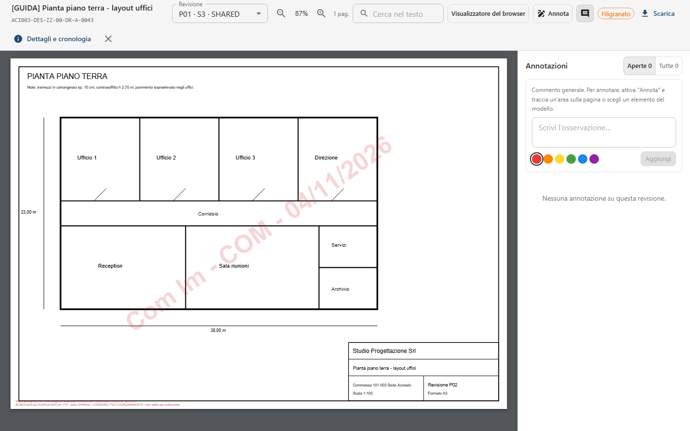
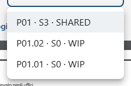
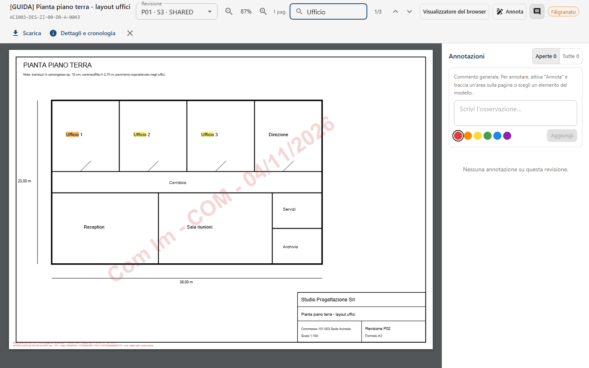
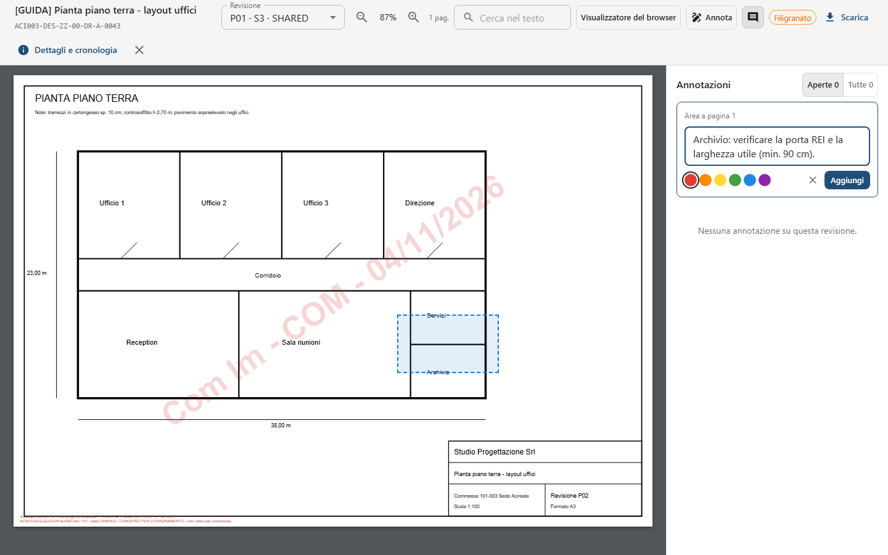
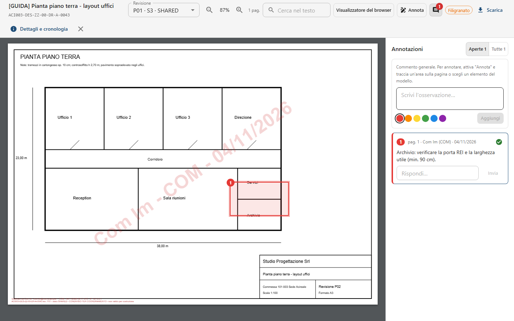
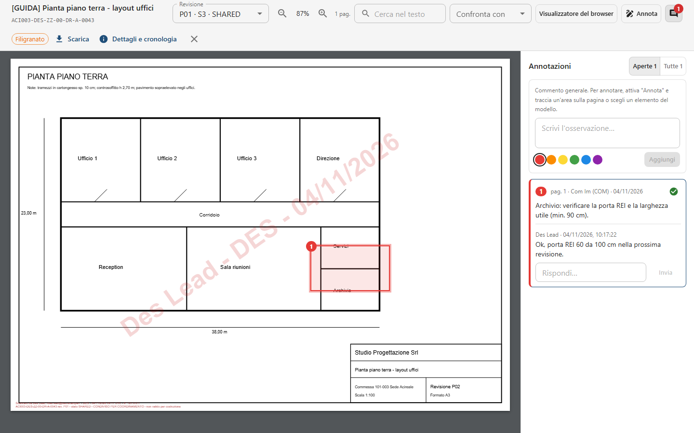
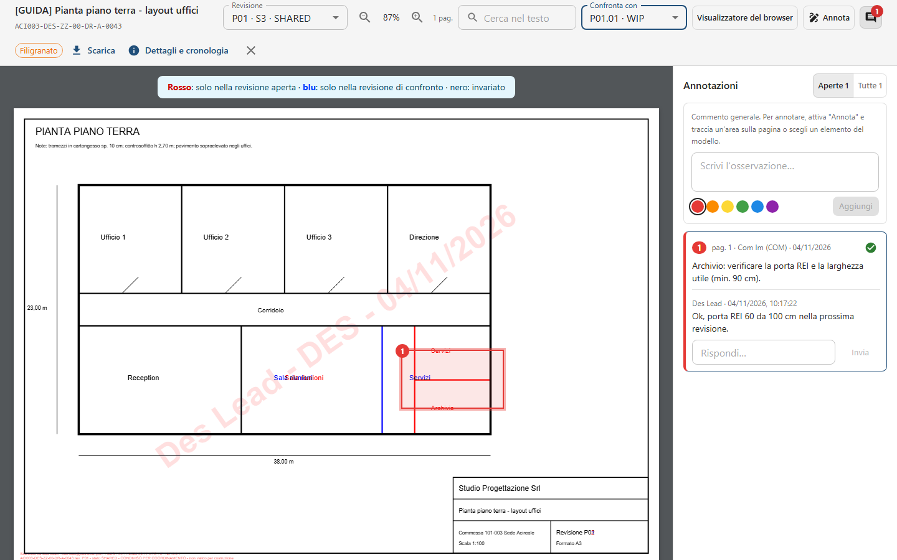
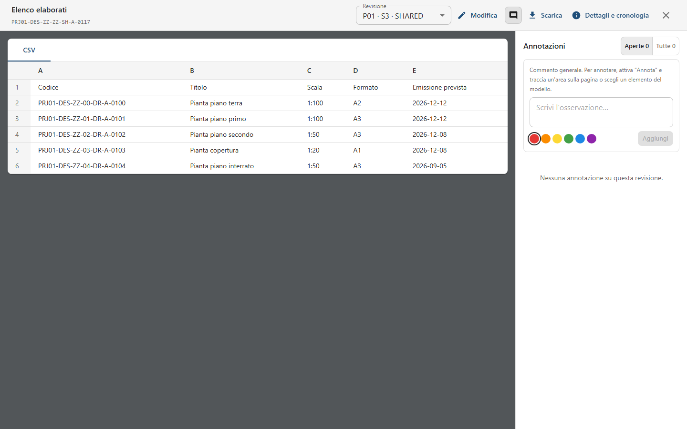
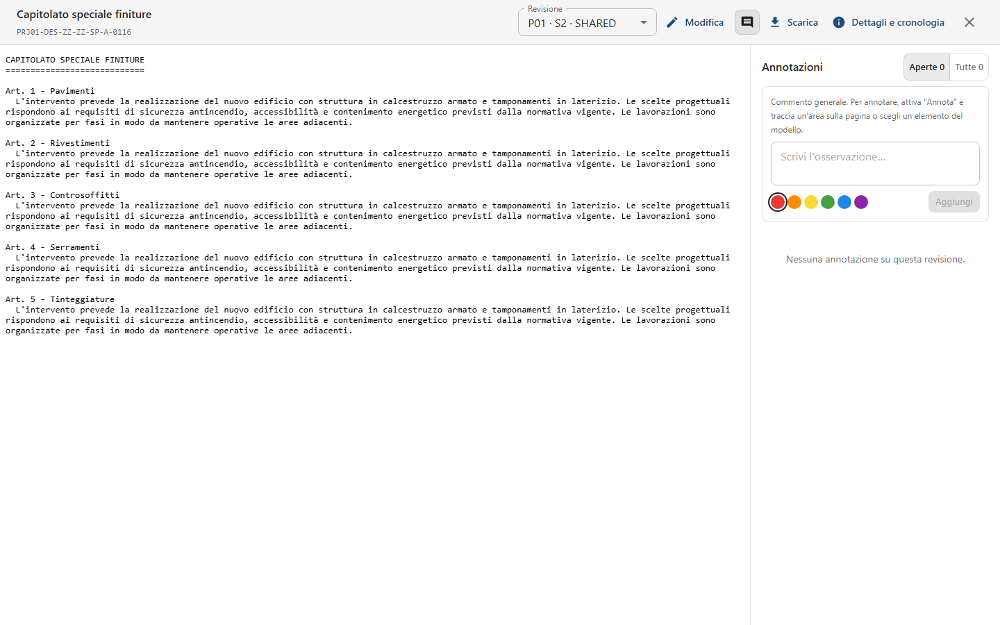
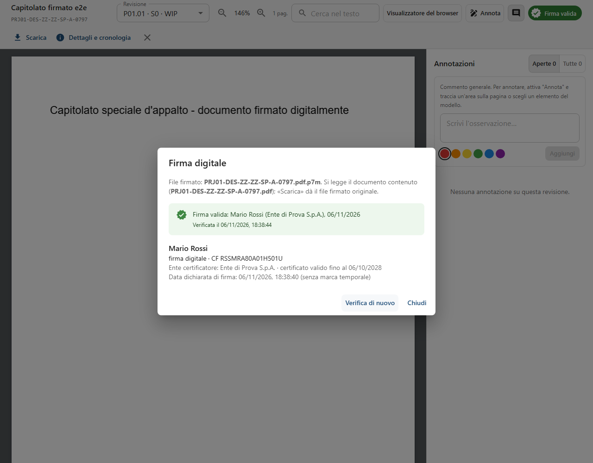

<!-- "><(((º> sabusabu <º)))>< -->
# 5. Visualizzatore e annotazioni

[← Indice](README.md)

Ogni documento si apre **in una nuova scheda del browser** (doppio clic sulla riga, oppure **Apri**): puoi tenere
aperte più tavole e tornare alla commessa nella scheda di prima. Chiudendo il visualizzatore (la **X** in alto a
destra) si chiude la scheda.

## 5.1 Il visualizzatore dei PDF

Nella barra in alto, da sinistra:

- titolo e identificativo del documento;
- **Revisione**: la revisione aperta, con idoneità e stato; dal menu ne apri un'altra;

  
- lente **–** / **+** e percentuale di zoom, numero di pagine;
- **Cerca nel testo**;
- **Confronta con** (se il documento ha più revisioni);
- **Visualizzatore del browser**: apre il PDF con il lettore del browser, utile per **stampare** (senza
  annotazioni);
- **Annota** e l'icona del fumetto (pannello delle annotazioni, con il numero di quelle aperte);
- **Filigranato** (arancione) se il Project Admin ha attivato la filigrana: il tuo nome e la data compaiono sulla
  pagina, anche nel file scaricato;
- **Scarica**, **Dettagli e cronologia**, **X** per chiudere.

Se la revisione non è ancora verificata compare «Verifica antivirus in corso: riprova tra poco.»; un file in
quarantena non si apre. I file oltre i 25 MB non hanno l'anteprima: c'è il pulsante **Scarica il file**.

## 5.2 Cercare nel testo

Scrivi almeno due lettere in **Cerca nel testo** e premi Invio: le occorrenze si evidenziano, il contatore mostra
«1/5» e le frecce ↑ ↓ (o Invio / Maiusc+Invio) passano alla successiva o alla precedente. Se il contatore è rosso
con «0» la parola non c'è.

Aprendo un documento da un risultato di ricerca o dal modello BIM ([capitolo 12](12-bim-ifc-dwg.md)) la parola
è già cercata.

## 5.3 Annotare

1. Premi **Annota**.
2. Trascina sulla pagina un rettangolo attorno al punto da segnalare (un clic senza trascinare segna un punto).
3. Nel pannello a destra compare «Area a pagina 1»: scrivi l'osservazione in **Scrivi l'osservazione…** e scegli un
   colore.

   
4. Premi **Aggiungi**.

Senza tracciare nulla l'annotazione è un **Commento generale** sul documento.

Ogni annotazione ha un numero (lo stesso sulla pagina e nel pannello), l'autore con l'organizzazione, la data, e
resta legata **a quella revisione**. Un clic sulla card porta al punto della pagina. Gli altri possono rispondere
in **Rispondi…** (**Invia**). L'icona di spunta verde **Risolvi** chiude l'annotazione, **Riapri** la riapre: il
filtro **Aperte / Tutte** in alto mostra solo quelle ancora da gestire.

Le annotazioni fatte da un compito di revisione (pulsante **Apri e annota**, [capitolo 6](06-workflow-e-processi.md))
sono collegate al compito.

## 5.4 Confrontare due revisioni

Scegli in **Confronta con** un'altra revisione dello stesso PDF. Le due si sovrappongono con questi colori:

- **rosso**: c'è solo nella revisione aperta (aggiunto);
- **blu**: c'è solo nella revisione di confronto (tolto);
- **nero**: invariato.

Nell'esempio il tramezzo della sala riunioni è stato spostato (blu → rosso) ed è nato l'archivio. Per tornare
alla vista normale scegli **Nessun confronto**.

## 5.5 Altri tipi di file

- **Immagini** (PNG, JPG): si vedono e si annotano come i PDF.
- **Excel e CSV**: tabella con i fogli in schede.

  
- **Word**: anteprima del testo.
- **Testo** (TXT): con il permesso di scrittura, sull'ultima revisione, c'è **Modifica**
  ([capitolo 3](03-documenti-e-revisioni.md#310-modificare-in-piattaforma)).

  
- **Modelli BIM** (IFC, GLB) e **disegni CAD** (DWG, DXF): [capitolo 12](12-bim-ifc-dwg.md).
- **Documenti firmati digitalmente** (`.p7m`): il PDF contenuto, vedi [5.7](#57-documenti-firmati-digitalmente).
- Formati senza anteprima: «Puoi comunque lasciare commenti generali nel pannello a destra» e **Scarica il file**.

## 5.6 Da tablet in cantiere

Su tablet il visualizzatore occupa tutto lo schermo; il pannello delle annotazioni si apre e chiude con l'icona del
fumetto per lasciare spazio alla tavola. Zoom con le lenti o con due dita.

## 5.7 Documenti firmati digitalmente

Un file firmato con firma digitale (`.pdf.p7m`) si apre come un PDF: SkyTower mostra il **documento contenuto**
nella busta, con zoom, ricerca, annotazioni e confronto. In alto a destra c'è l'esito della verifica della firma:

| Etichetta | Significato |
|---|---|
| **Firma valida** (verde) | Documento integro, certificato qualificato di un ente riconosciuto (elenchi ufficiali europei e di AgID), non revocato e valido alla data della firma |
| **Firma NON valida** (rossa) | Documento modificato dopo la firma, certificato revocato o scaduto senza marca temporale, oppure busta rovinata |
| **Firma da verificare** (gialla) | La firma è integra ma qualcosa non si è potuto controllare: stato di revoca (rete o ente che non risponde), ente non presente negli elenchi, certificato non qualificato |

Cliccando l'etichetta si apre **Firma digitale** con, per ogni firmatario, nome, tipo di firma, codice fiscale,
ente certificatore, scadenza del certificato, data della firma (o della **marca temporale**, se c'è) e i motivi
di un esito non verde. **Verifica di nuovo** rifà il controllo con l'esito di oggi: utile se al caricamento
la revoca non si era potuta controllare.

Mentre il server apre la busta compare «Il server sta aprendo la busta firmata e verificando la firma»; se la
busta non si apre (file rovinato, componente della firma non installato sul server) il messaggio dice perché e
**Scarica il file firmato** resta disponibile. **Scarica** dà sempre il `.p7m` originale con la firma.
