<!-- "><(((º> sabusabu <º)))>< -->
# 6. Workflow e processi

[← Indice](README.md)

Un **workflow** descrive *chi* deve verificare o decidere, *con quali esiti* e *dove porta* ogni esito. In
SkyTower si disegna come uno **schema a grafo** su un foglio a scacchiera: si possono avere rami in parallelo che
poi si riuniscono, ritorni a un passo precedente, più stati finali.

Due tipi di workflow:

- **Documenti**: parte su una revisione di un documento con **Avvia approvazione**. Durante l'approvazione il
  documento è bloccato (non accetta nuove revisioni); alla fine positiva può essere condiviso o pubblicato da solo.
- **Processi**: parte senza documento dalla scheda **Processi** (es. Richiesta d'Acquisto → gara → affidamento),
  eventualmente con documenti allegati.

## 6.1 La scheda Workflow

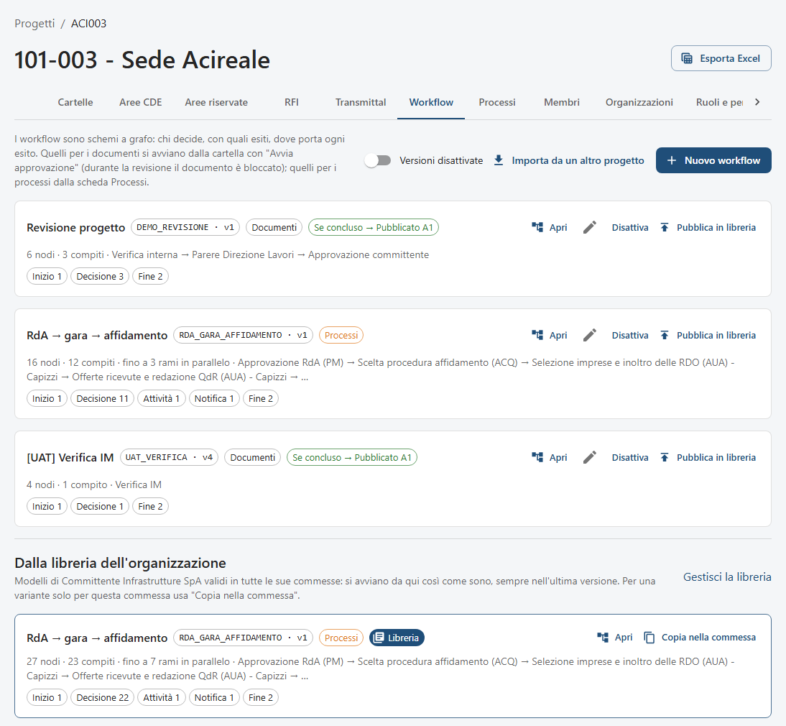

Ogni modello è una scheda con: nome, codice e versione (`DEMO_REVISIONE · v1`), il tipo (**Documenti** o
**Processi**), per i documenti cosa succede alla fine (**Se concluso → Pubblicato A1**), il numero di nodi e di
compiti, il percorso principale e il conteggio dei nodi per tipo. Le azioni:

- **Apri**: vede lo schema in sola lettura;
- matita **Nuova versione**: apre l'editor per salvare la versione successiva;
- **Disattiva** / **Riattiva**: un modello disattivato non si può più avviare (i workflow già partiti
  continuano); **Versioni disattivate** in alto mostra anche quelle;
- **Pubblica in libreria** (solo amministratori dell'organizzazione): vedi [6.10](#610-libreria-workflow-dellorganizzazione).

In alto **Importa da un altro progetto** e **Nuovo workflow** (Project Admin). Sotto, la sezione **Dalla libreria
dell'organizzazione** con i modelli validi in tutte le commesse dell'azienda (bollino **Libreria**).

## 6.2 L'editor a scacchiera

**Apri** su un modello mostra il grafo; un clic su un nodo apre le sue proprietà a destra.

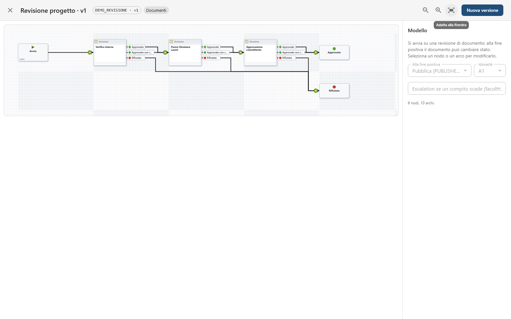

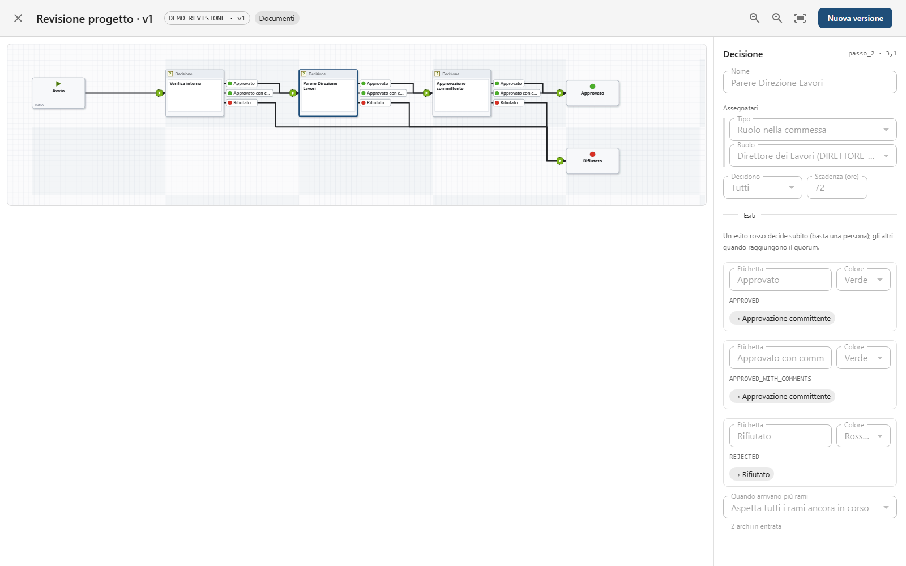

### I tipi di nodo

| Nodo | Cosa fa |
|---|---|
| **Inizio** | Punto di partenza, uno solo. |
| **Decisione** | Compito: gli assegnatari scelgono un esito (es. *Approvato*, *Respinto*). |
| **Attività** | Compito operativo (es. conformità, filigrana); di norma ha l'esito *Fatto*. |
| **Notifica** | Avviso automatico ai destinatari, poi prosegue da solo. |
| **Fine** | Stato finale: **Concluso (OK)** o **Fallito (KO)**. Il primo raggiunto chiude il workflow. |

### Disegnare un workflow nuovo

**Nuovo workflow** apre un foglio già impostato con *Inizio → Nuova decisione → Concluso / Fallito*.

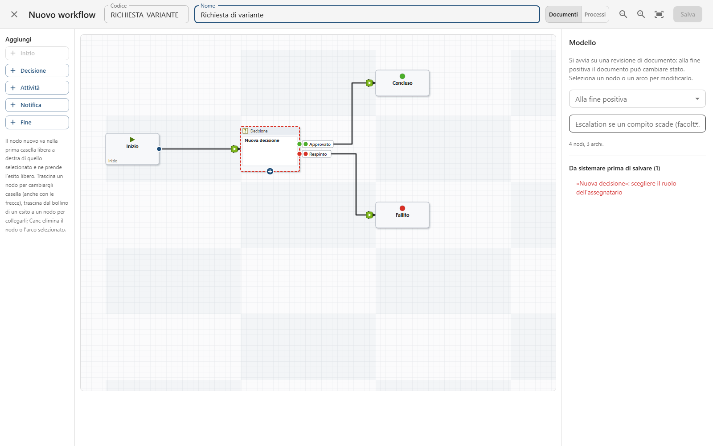

1. In alto **Codice** (maiuscole, cifre e trattino basso, es. `RICHIESTA_VARIANTE`), **Nome** e se si avvia su
   **Documenti** o **Processi**.
2. Nella colonna **Aggiungi** scegli il tipo di nodo: il nodo nuovo va nella prima casella libera a destra di quello
   selezionato e ne prende l'esito ancora libero.
3. **Spostare**: trascina un nodo su un'altra casella (o usa le frecce della tastiera); si aggancia alla griglia.
4. **Collegare**: trascina dal bollino colorato di un esito al nodo di arrivo, oppure usa la tendina **Collega a…**
   nel pannello. Più archi dallo stesso esito = **rami in parallelo**; un arco verso un nodo già passato = **ritorno
   indietro** (il nodo si riattiva in un nuovo «giro»).
5. **Canc** elimina il nodo o l'arco selezionato; nel pannello ci sono **Elimina nodo** ed **Elimina arco**.
6. Le lenti e **Adatta alla finestra** regolano lo zoom.

Nel pannello **Proprietà** di una decisione o attività:

- **Nome**;
- **Assegnatari**: per **Ruolo nella commessa** (es. *Direttore dei Lavori*), per **Ruolo nell'organizzazione
  autrice** (es. il capo progettista dell'azienda che ha caricato il documento) o per **Persona**; **Assegnatario**
  ne aggiunge un altro;
- **Decidono**: **Tutti**, **Uno qualsiasi** o **Almeno N**; **Scadenza (ore)**;
- **Esiti**: **Etichetta** e **Colore** (*Verde*, *Giallo*, *Rosso (decide subito)*) e dove porta ciascuno;
  **Aggiungi esito**. Un esito **rosso decide subito** (basta una persona, come un rifiuto); gli altri decidono quando
  raggiungono il quorum. Se tutti hanno votato senza quorum vince l'esito più votato;
- **Quando arrivano più rami** (nodi con più frecce in entrata): **Aspetta tutti i rami ancora in corso** oppure
  **Parte al primo arrivo**.

Per una **Notifica**: **Destinatari** e **Messaggio** (si possono usare `{titolo}`, `{progetto}`, `{documento}`).
Per una **Fine**: **Concluso (OK)** o **Fallito (KO)**.

Con nessun nodo selezionato il pannello mostra il **Modello**: per i workflow su documenti **Alla fine positiva**
(*Nessun cambio di stato*, *Condividi (SHARED)*, *Pubblica (PUBLISHED)* con l'**Idoneità**) ed **Escalation se un
compito scade (facoltativo)**: la persona da avvisare oltre ai Project Admin.

### Gli errori prima di salvare

SkyTower controlla lo schema mentre lo disegni. Gli errori sono elencati in **Da sistemare prima di salvare (N)** e
il nodo con problemi è bordato di rosso tratteggiato; un clic sull'errore porta al nodo.

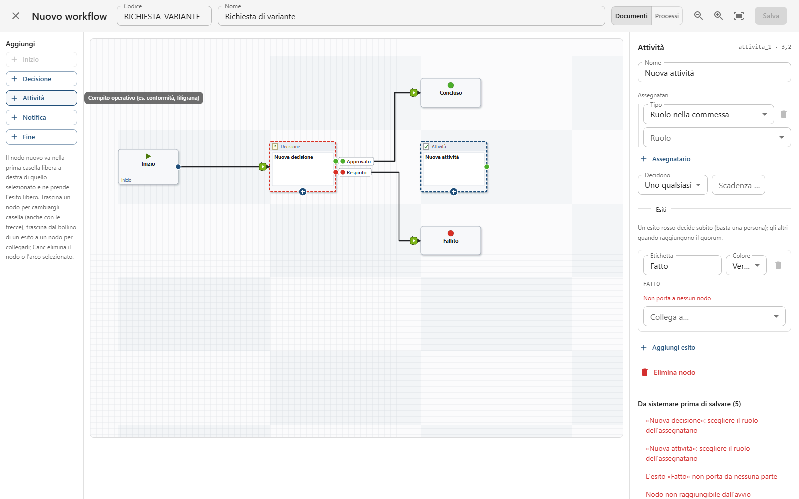

Esempi: «…: scegliere il ruolo dell'assegnatario», «L'esito «Fatto» non porta da nessuna parte», «Nodo non
raggiungibile dall'avvio». Con zero errori compare «Nessun errore: si può salvare» e si attiva **Salva** (per una
nuova versione **Salva come vN**). Ogni salvataggio crea una **versione nuova**: i workflow già partiti restano
sulla versione con cui sono partiti.

## 6.3 Avviare l'approvazione di un documento

Dalla cartella (documento selezionato → **Avvia approvazione**) o dal pannello del documento
(**Approvazioni** → **Avvia approvazione**).

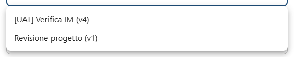

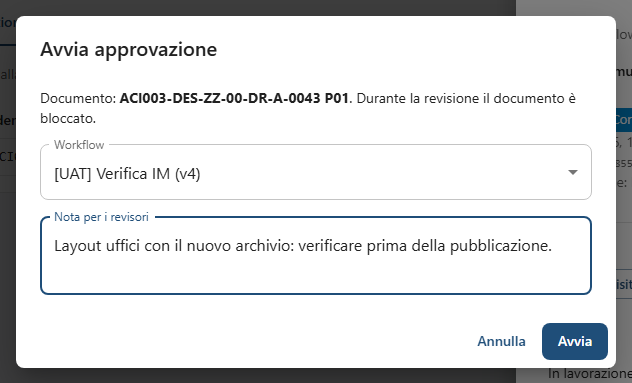

Scegli il **Workflow** (i modelli di libreria hanno il bollino **Libreria**), scrivi una **Nota per i revisori** e
premi **Avvia**. Da quel momento il documento è bloccato e i primi assegnatari ricevono il compito nel pannello
**Per me** e per notifica. Se non ci sono modelli: «Nessun workflow configurato per la commessa: lo crea il Project
Admin nella scheda Workflow.»

## 6.4 Svolgere un compito

Il revisore apre il compito da **Per me** o dalla notifica: si apre **I miei compiti** con la finestra del compito.

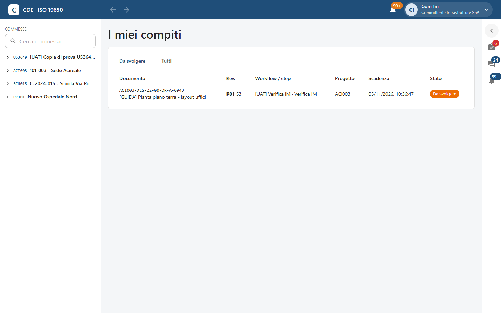

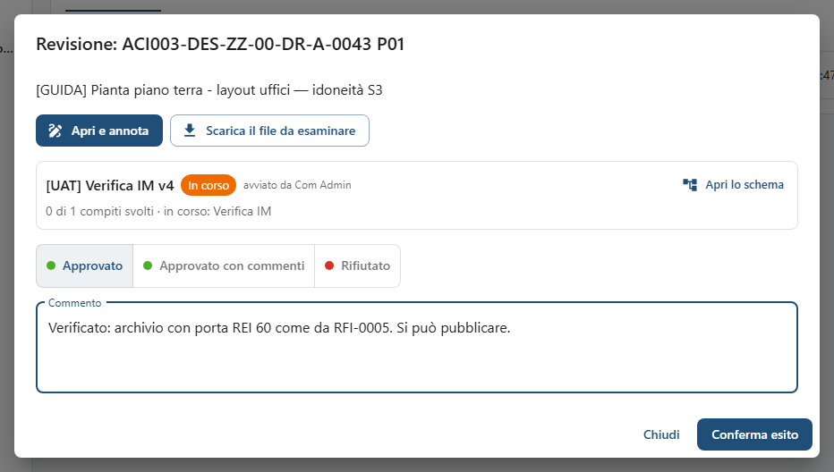

- **Apri e annota**: apre la revisione nel visualizzatore; le annotazioni restano collegate al compito
  ([capitolo 5](05-visualizzatore-e-annotazioni.md#53-annotare));
- **Scarica il file da esaminare**;
- il riquadro del workflow con lo stato e **Apri lo schema**;
- i pulsanti degli **esiti** del nodo, con il loro colore (qui *Approvato*, *Approvato con commenti*,
  *Rifiutato*);
- **Commento**: obbligatorio per gli esiti rossi e per «Approvato con commenti».

**Conferma esito**. Il workflow prosegue verso il nodo indicato da quell'esito; al nodo Fine si chiude. Nel nostro
esempio l'Information Manager approva e il documento viene **pubblicato da solo come C01**, con la motivazione
«Approvato con workflow …».

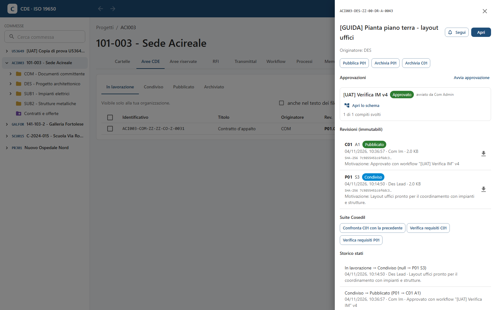

Se un esito rifiuta, chi ha caricato il documento riceve la notifica e il documento torna modificabile: si carica
una nuova revisione e si riavvia l'approvazione.

## 6.5 La vista finale

**Apri lo schema** (dal documento, dal compito o dalla notifica) mostra lo stesso foglio in sola lettura con i
colori dello stato:

- **verde** = fatto, **giallo** = in corso, **grigio** = non raggiunto, **rosso** = finito male;
- sugli archi percorsi l'etichetta dell'esito scelto con il **segno di spunta**;
- se un nodo è stato rifatto più volte lo dice («2 giri»).

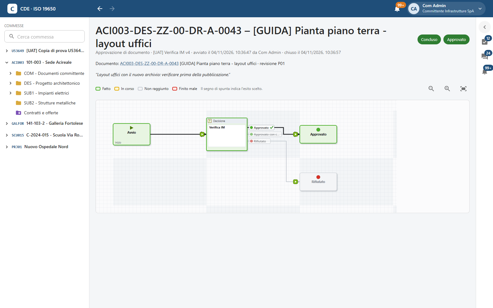

In testa: tipo, modello e versione, chi l'ha avviato e quando, la nota (in corsivo), il documento con la revisione, lo
stato (**In corso**, **Concluso**, **Annullato**) e l'esito finale. Se tocca a te compare **Svolgi il tuo compito**.

## 6.6 Scadenze ed escalation

Ogni decisione o attività può avere una **Scadenza (ore)**. Prima della scadenza l'assegnatario riceve un
promemoria; alla scadenza riceve «Scadenza superata» e i responsabili (Project Admin o la persona indicata nel
modello) ricevono l'**Escalation**; dopo 72 ore un secondo sollecito. Vedi
[capitolo 9](09-per-me-compiti-notifiche.md#93-notifiche-e-solleciti) e il **Cruscotto** nel
[capitolo 10](10-amministrazione.md#105-cruscotto).

## 6.7 Importare un workflow da un'altra commessa

**Importa da un altro progetto** (Project Admin): scegli il **Workflow** fra quelli attivi delle altre commesse di
cui sei Project Admin e, se vuoi, il **Codice in questo progetto**. Le persone e le organizzazioni che qui non
partecipano vengono tolte e i ruoli personalizzati mancanti creati uguali; l'avviso elenca cosa è stato adattato.
Con un codice già presente l'import diventa la nuova versione di quel modello.

## 6.8 Processi

La scheda **Processi** elenca i workflow partiti senza documento, filtrabili per **In corso**, **Conclusi**,
**Annullati**, **Tutti**: processo, modello, stato, esito (**Concluso** / **Fallito**), data e chi l'ha avviato.
Un clic apre la vista finale.

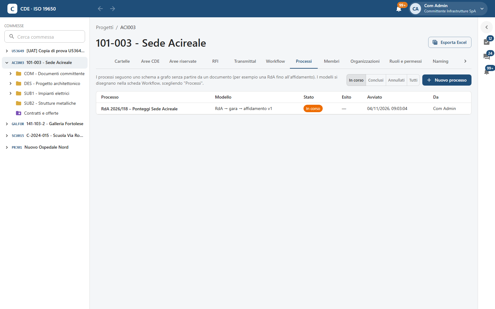

**Nuovo processo**:

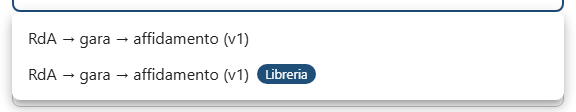

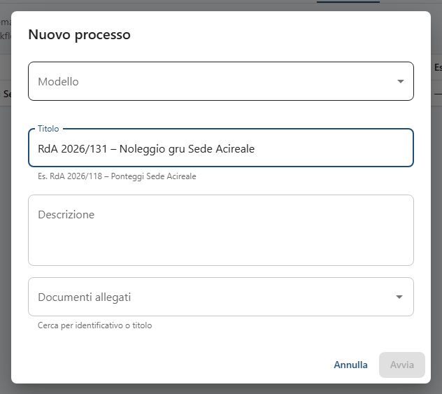

1. **Modello**: solo quelli di tipo *Processi*, anche dalla libreria (bollino **Libreria**);
2. **Titolo** (es. «RdA 2026/131 – Noleggio gru Sede Acireale») e **Descrizione**;
3. **Documenti allegati** (facoltativo): documenti della commessa, visibili a chi può vederli;
4. **Avvia**.

Se nessuno ha un modello di processo: «Nessun modello di tipo Processi: lo disegna il Project Admin nella scheda
Workflow, oppure l'amministratore dell'organizzazione nella libreria.»

I compiti dei processi arrivano come quelli dei documenti, con «Processo» al posto del documento:

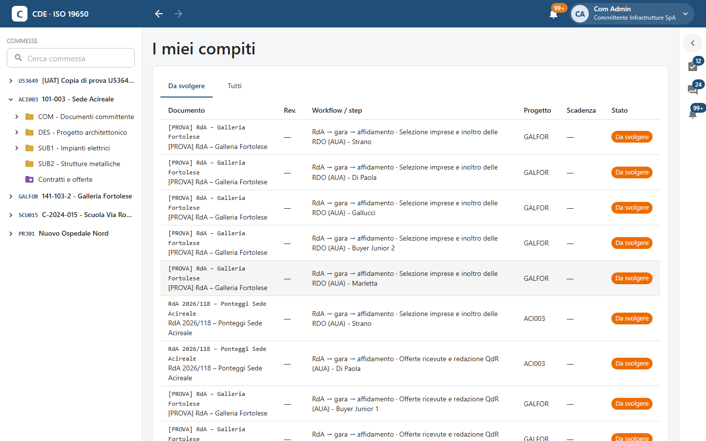

## 6.9 Esempio: RdA → gara → affidamento

Il modello **RdA → gara → affidamento** riproduce il processo di acquisto: approvazione della RdA del PM, scelta
della procedura (ACQ), poi **fino a 7 rami in parallelo** — uno per buyer — con selezione delle imprese e inoltro
delle RDO, offerte ricevute e quadro di raffronto, autorizzazioni, fino ad *Affidamento concluso* o *Fallito*;
con un ramo di conformità (filigrana RIFIUTATO sulla RdA) in caso di respingimento.

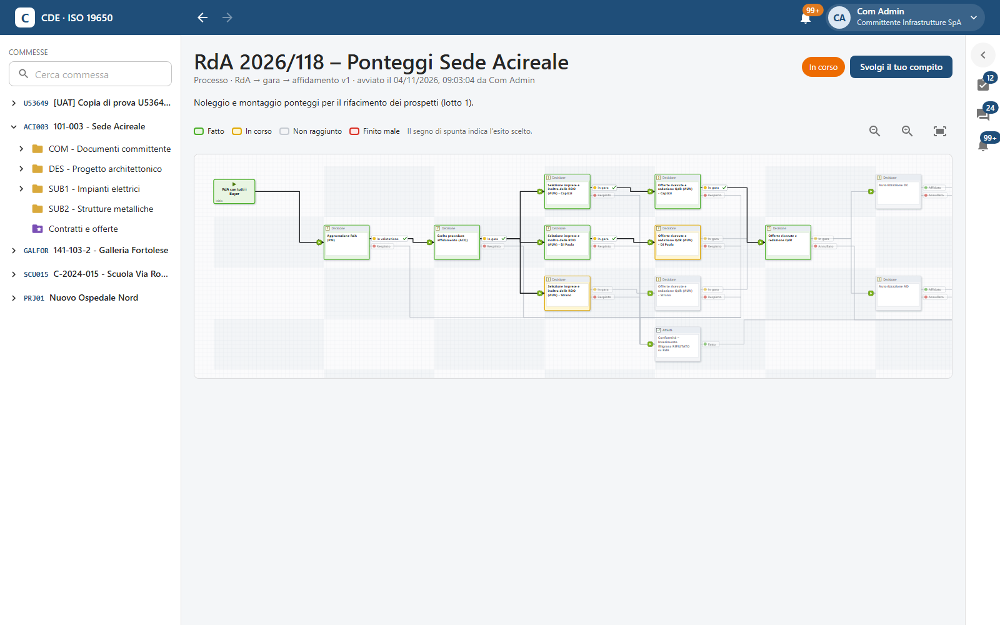

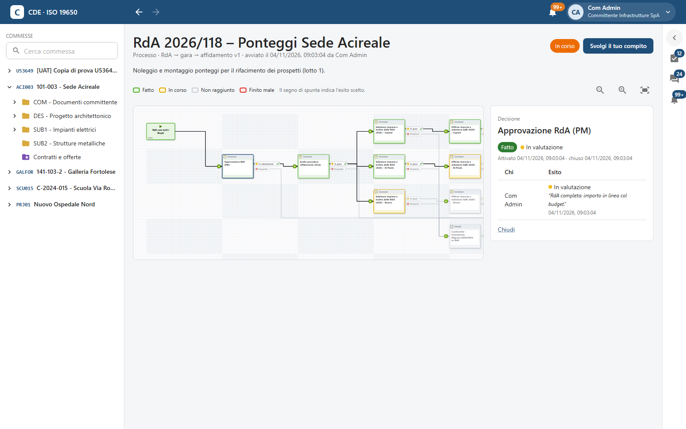

Cliccando un nodo si apre il **dettaglio**: tipo e nome, lo stato del giro (**Fatto**, **In corso**), l'esito scelto,
le date di attivazione e chiusura, la tabella **Chi / Esito** con i commenti. **Chiudi** torna alla vista intera.

Nella commessa «141-103-2 - Galleria Fortolese» il processo di prova **[PROVA] RdA – Galleria Fortolese** mostra lo
schema completo (27 nodi) a metà strada: approvazione PM e scelta procedura verdi con «In valutazione ✓» e «In gara
✓», alcune selezioni fatte, le altre gialle, offerte e autorizzazioni ancora grigie.

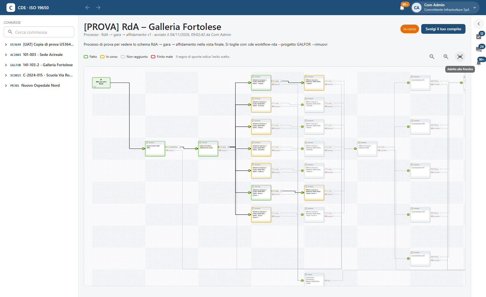

## 6.10 Libreria workflow dell'organizzazione

I modelli si possono disegnare **una volta sola per tutta l'azienda**: la **Libreria workflow** (menu del profilo,
oppure il link in alto nella pagina Organizzazione) contiene i modelli validi in tutte le commesse di cui
l'organizzazione è proprietaria.

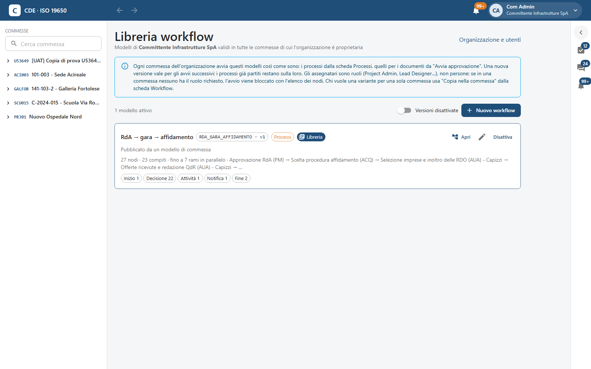

- La gestisce l'**amministratore dell'organizzazione** (**Nuovo workflow**, nuova versione, **Disattiva**); gli altri
  colleghi la consultano.
- **Collegamento vivo**: le commesse avviano i modelli di libreria così come sono, sempre nell'ultima versione
  attiva. Una nuova versione vale per gli avvii successivi; i processi già partiti restano sulla loro. Disattivare un
  modello lo toglie da tutte le commesse insieme.
- **Solo ruoli**: in libreria gli assegnatari si scelgono per ruolo (Project Admin, Lead Designer…), mai per persona,
  perché in ogni commessa le persone cambiano. Se un compito scade sono avvisati i Project Admin della commessa.
- Se in una commessa nessuno ha un ruolo richiesto dal modello, l'**avvio viene bloccato** con l'elenco dei nodi
  scoperti: si aggiunge la persona con quel ruolo ([capitolo 10](10-amministrazione.md#101-membri-della-commessa)) e
  si riprova.

**Apri** mostra il modello nell'editor, con il bollino **Libreria** e il riquadro che ricorda le regole della
libreria.

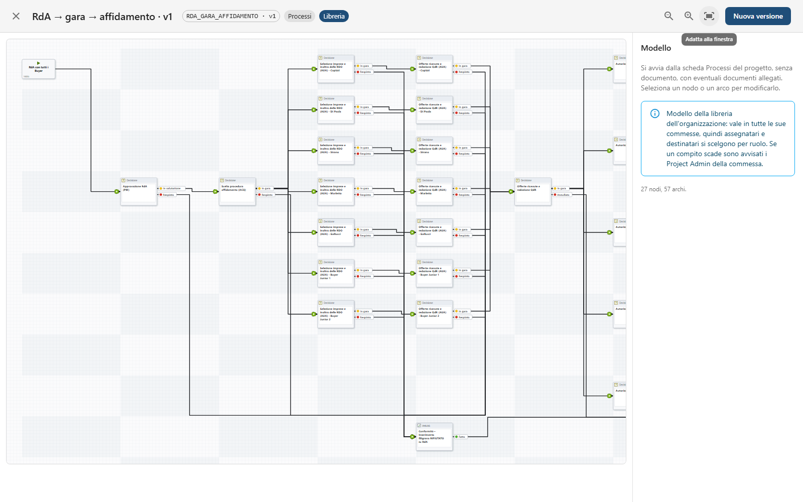

Dalla scheda **Workflow** di una commessa:

- **Copia nella commessa** (Project Admin) crea una copia locale, modificabile, che **non segue più** le nuove
  versioni della libreria; i ruoli che nella commessa non esistono vengono segnalati. Con lo stesso codice di un
  modello già presente la copia ne diventa la nuova versione.

  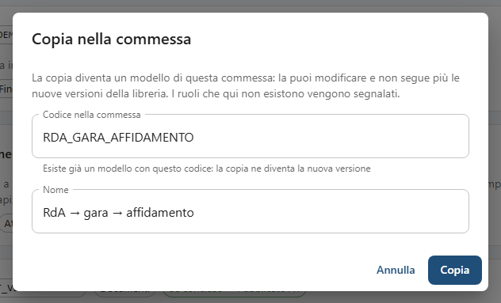
- **Pubblica in libreria** (amministratore dell'organizzazione) porta in libreria la copia di un modello della
  commessa: le persone indicate nel modello vengono tolte e segnalate; il modello della commessa resta com'è.

  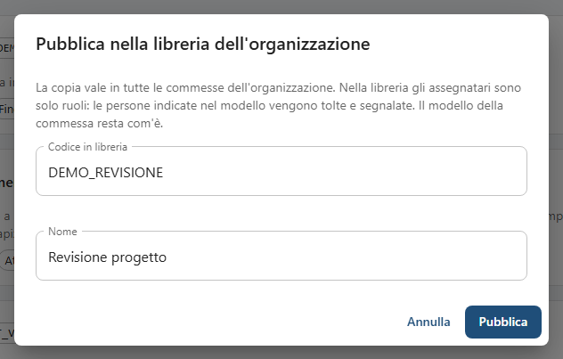

## 6.11 Tornare indietro: chiarimenti e richieste di modifiche

Da ogni compito di **decisione** o di **attività** (pagina **I miei compiti**) si può tornare indietro. In basso
nel compito ci sono due pulsanti, accanto a **Conferma esito**.

### Chiedi chiarimento

Serve quando ti manca un'informazione ma non c'è niente da rifare.

1. Premi **Chiedi chiarimento**.
2. In **Dove rimandare** scegli a chi chiedere. È proposto il passo subito prima; puoi scegliere un altro passo
   già fatto del tuo ramo oppure **Chi ha avviato** il processo o il documento.
3. Scrivi la domanda (obbligatoria) e premi **Invia la domanda**.

Il tuo compito resta **in attesa di chiarimento**: non lo puoi completare e la scadenza è sospesa. Quando arriva
la risposta, la scadenza si sposta avanti del tempo che hai aspettato.

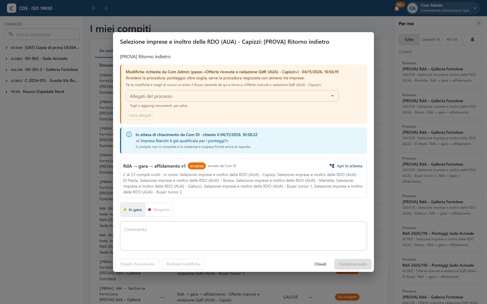

La persona interpellata riceve un compito **Chiarimento da dare**, legge la domanda e risponde con un commento.
La risposta compare nel tuo compito, che torna attivo. Il flusso non si sposta.

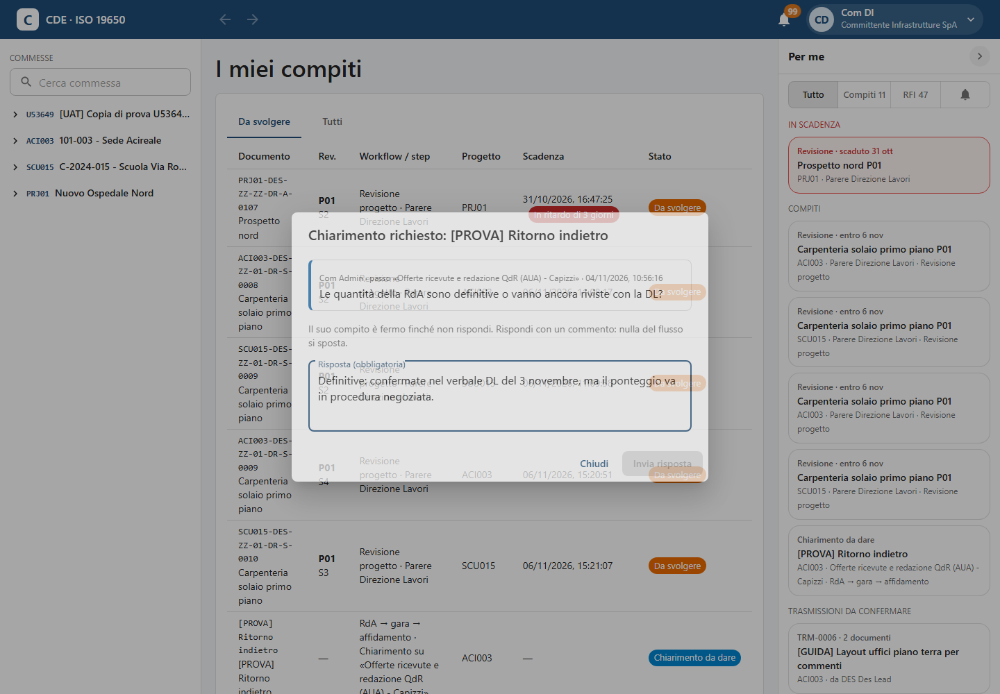

### Richiedi modifiche

Serve quando un passo precedente va rifatto, per esempio perché un file va corretto.

1. Premi **Richiedi modifiche**.
2. In **Dove rimandare** scegli il passo da rifare (o **Chi ha avviato**) e scrivi cosa va modificato.
3. Premi **Rimanda indietro**.

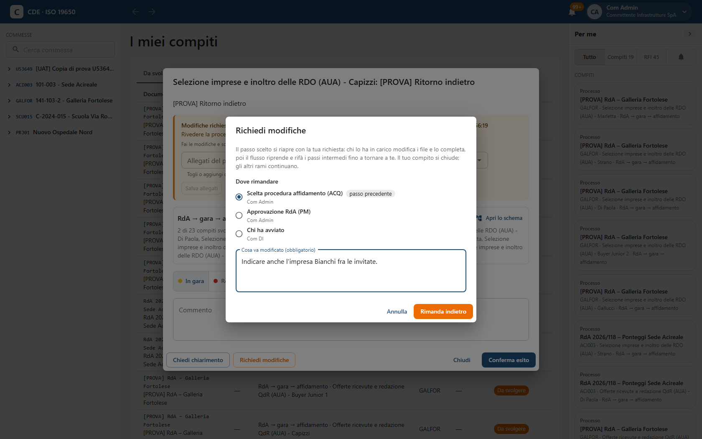

Il passo scelto si riapre per chi lo aveva in carico, con la tua richiesta in evidenza:

- in un'**approvazione di documento** usa **Carica nuova revisione** (stesso nome del file): il workflow
  continua sulla revisione nuova, la vecchia resta nello storico;
- in un **processo** cambia gli **Allegati del processo** e premi **Salva allegati**.

Poi sceglie di nuovo l'esito. Il flusso riparte da lì, rifà i passi intermedi e torna a te. Il tuo compito di
prima si chiude e ne riceverai uno nuovo.

**Rami paralleli**: torna indietro solo il tuo ramo. Se per esempio un buyer su sette rimanda indietro la scelta
della procedura, gli altri sei continuano il loro lavoro; la riunione che li raccoglie aspetta anche il ramo
tornato indietro.

### Nella vista finale

Nello schema del processo le frecce tratteggiate mostrano i ritorni: **arancio** per le modifiche, **blu** per i
chiarimenti. L'elenco **Chiarimenti e modifiche** riporta domande, risposte e revisioni caricate.

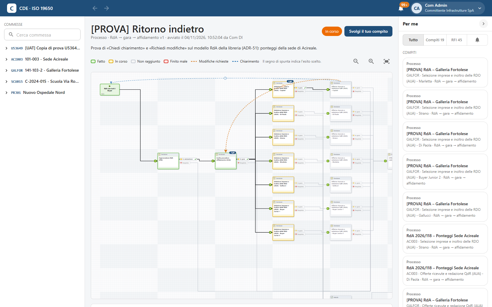

Cliccando un passo vedi, giro per giro, chi ha chiesto cosa e quando.

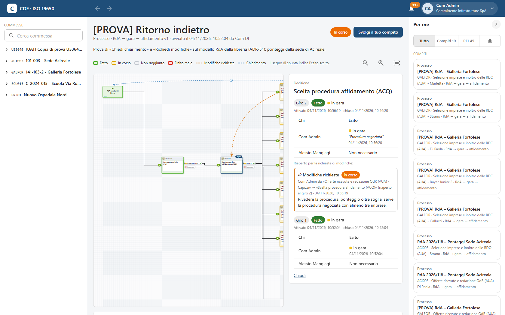

Un passo può essere rifatto al massimo 20 volte nello stesso processo: oltre, il processo si ferma e chi l'ha
avviato riceve un avviso.
