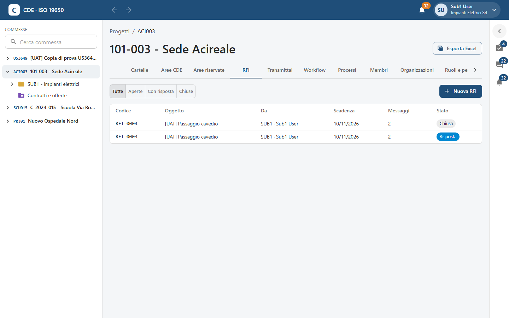
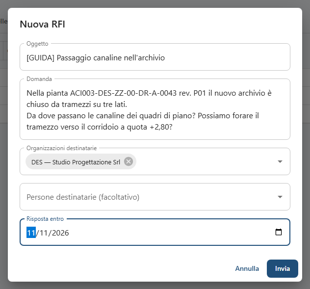
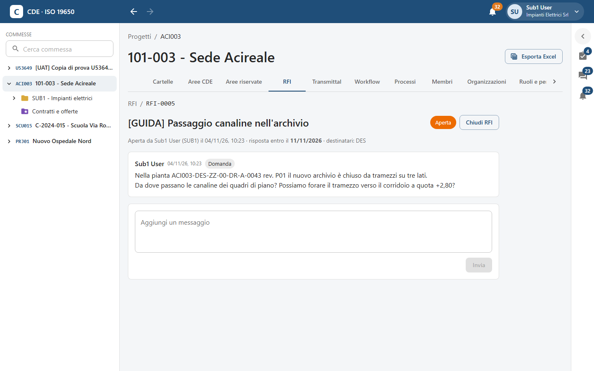
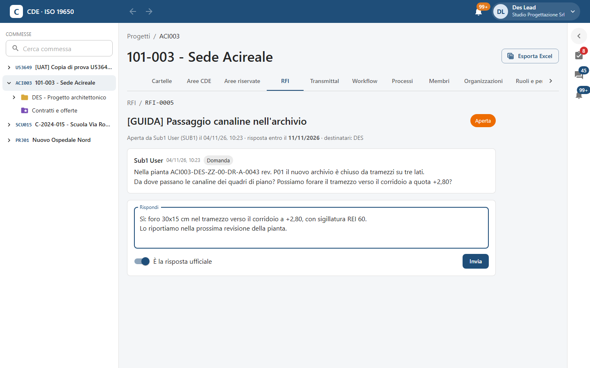
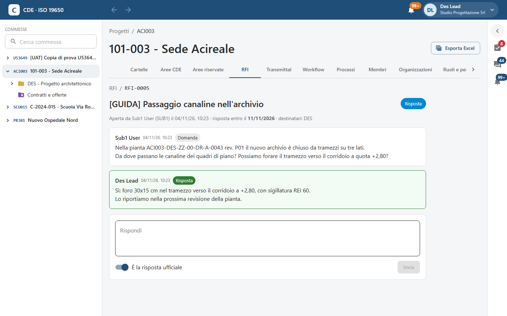
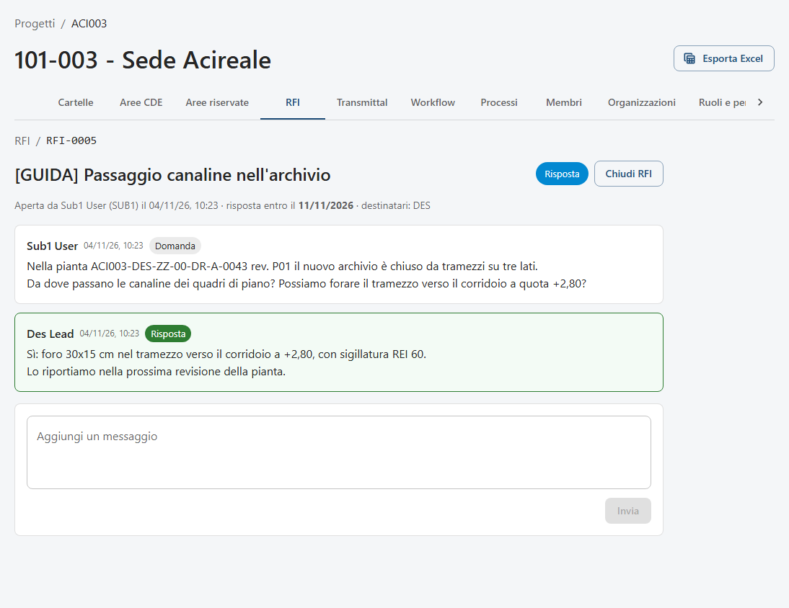
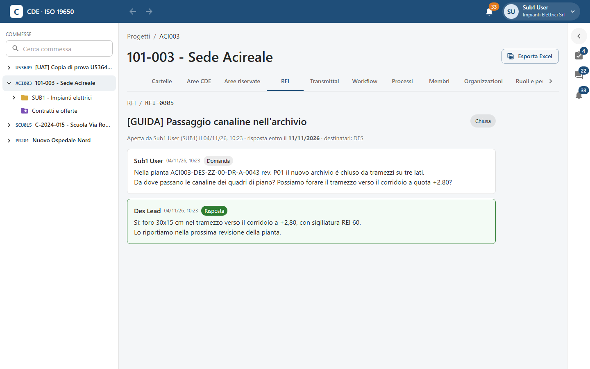

<!-- "><(((º> sabusabu <º)))>< -->
# 7. RFI — richieste di informazioni

[← Indice](README.md)

Una **RFI** è una domanda formale a un'altra organizzazione della commessa (es. l'impresa chiede al progettista
come passano le canaline): ha un numero progressivo, destinatari, una scadenza, un thread di messaggi e una
**risposta ufficiale**. Tutto resta nel registro della commessa.

Esempio in queste pagine: il subappaltatore degli impianti elettrici (Sub1 User) chiede allo Studio Progettazione
(Des Lead) come far passare le canaline nel nuovo archivio della pianta ACI003-DES-ZZ-00-DR-A-0043.

## 7.1 L'elenco

Scheda **RFI** della commessa. I filtri **Tutte**, **Aperte**, **Con risposta**, **Chiuse**; per ogni RFI codice,
oggetto, chi l'ha aperta, scadenza, numero di messaggi e stato (**Aperta** arancione, **Risposta** azzurro,
**Chiusa** grigio). Vedi le RFI che hai aperto, quelle indirizzate a te o alla tua organizzazione e quelle della tua
organizzazione.

## 7.2 Aprire una RFI

1. **Nuova RFI**.
2. **Oggetto** (almeno 3 caratteri) e **Domanda**. Cita gli identificativi dei documenti di cui parli.
3. **Organizzazioni destinatarie** e/o **Persone destinatarie (facoltativo)**: almeno uno dei due.
4. **Risposta entro**: la scadenza.
5. **Invia**.

La RFI prende il numero successivo (es. **RFI-0005**) e i destinatari ricevono subito una notifica; la trovano nel
pannello **Per me** fra le **RFI da rispondere**.

In testa: chi l'ha aperta e quando, la data di risposta (in rosso se superata), i destinatari. La prima scheda è
la **Domanda**. Sotto, il riquadro per **Aggiungi un messaggio** (per precisare) e **Invia**.

> La finestra della RFI non permette di allegare file: per indicare un documento scrivi il suo identificativo nel
> testo. Gli allegati già presenti in RFI importate o create da altri canali compaiono come etichette sotto il
> messaggio.

## 7.3 Rispondere (destinatario)

Apri la RFI dal pannello **Per me**, dalla notifica o dall'elenco. Scrivi in **Rispondi** e, se è la risposta
definitiva, accendi **È la risposta ufficiale**. **Invia**.

La risposta ufficiale ha il bordo verde e l'etichetta **Risposta**; la RFI passa allo stato **Risposta** e chi
l'ha aperta riceve la notifica «risposta ricevuta».

## 7.4 Chiudere (richiedente)

Solo **chi ha aperto la RFI** può chiuderla, con **Chiudi RFI** in alto. Al destinatario il pulsante non compare.

Una RFI chiusa resta consultabile con tutto il thread, ma non accetta più messaggi.

## 7.5 Scadenze e solleciti

All'avvicinarsi della scadenza e quando è superata, i destinatari ricevono un promemoria e la RFI compare in rosso
nel pannello **Per me** («scaduta …»). Il Project Admin vede le RFI scadute nel **Cruscotto** e può esportare
l'elenco con **Esporta Excel → RFI** ([capitolo 10](10-amministrazione.md)).
