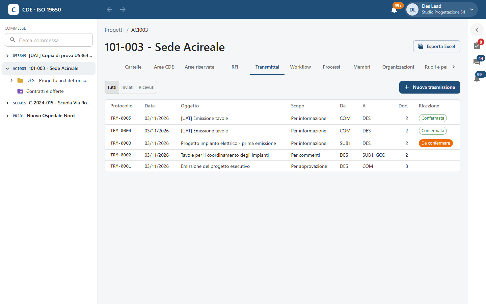
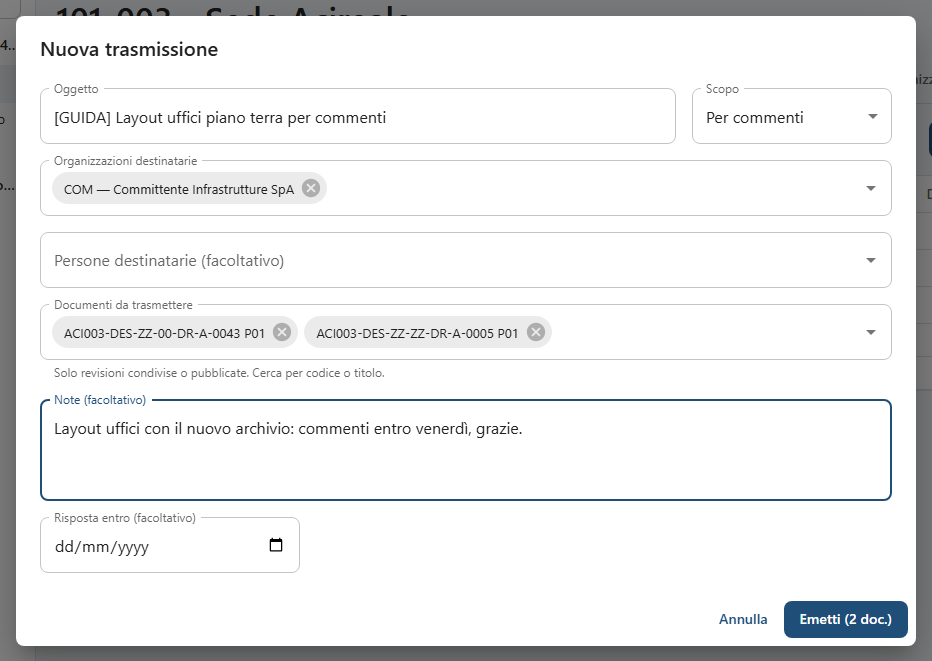
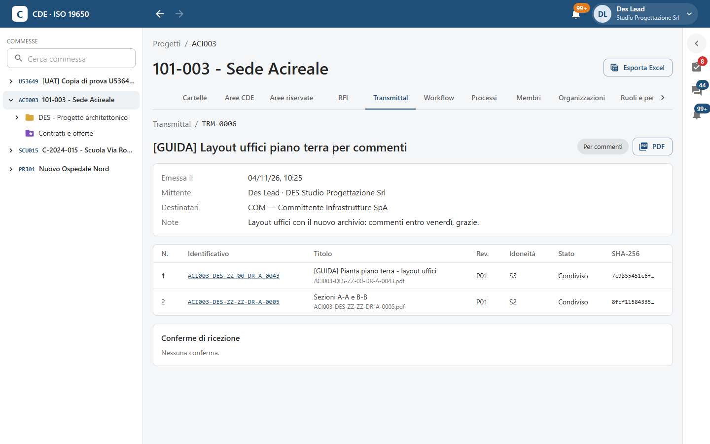
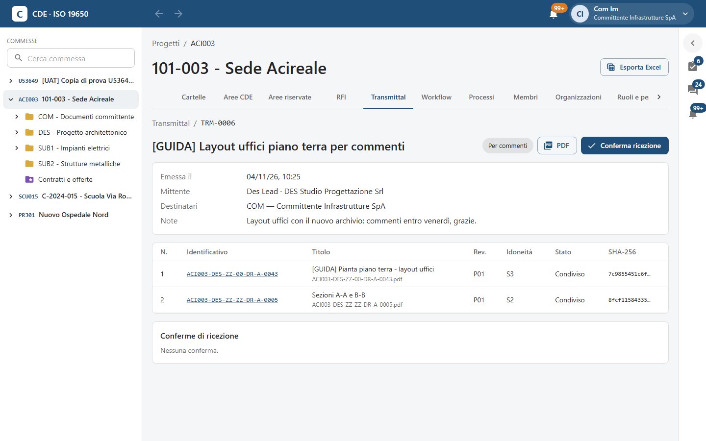
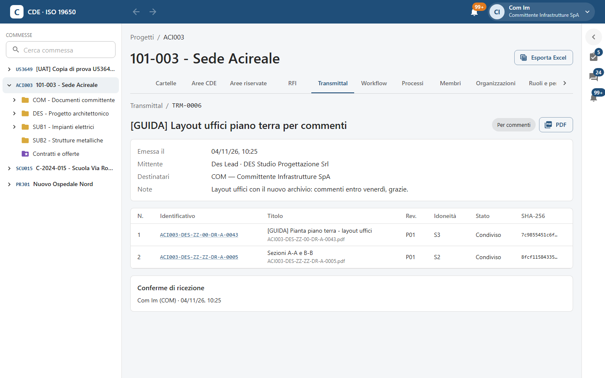

<!-- "><(((º> sabusabu <º)))>< -->
# 8. Transmittal — trasmissioni ufficiali

[← Indice](README.md)

Un **transmittal** è l'invio ufficiale di un pacchetto di documenti ad altre organizzazioni: ha un numero di
protocollo (**TRM-0006**…), uno scopo, un PDF di accompagnamento con l'elenco dei documenti e le loro impronte, e
le **conferme di ricezione** dei destinatari. Si possono trasmettere solo revisioni **condivise** o **pubblicate**
e già verificate.

## 8.1 L'elenco

Scheda **Transmittal**, con i filtri **Tutti**, **Inviati**, **Ricevuti**. Colonne: protocollo, data, oggetto, scopo,
mittente (**Da**), destinatari (**A**), numero di documenti e **Ricezione** (**Confermata** o **Da confermare**).

## 8.2 Emettere una trasmissione

Si parte dalla scheda Transmittal con **Nuova trasmissione**, oppure da una cartella selezionando un documento e
premendo **Trasmetti** (il documento è già nell'elenco).

1. **Oggetto** e **Scopo**: *Per informazione*, *Per commenti*, *Per approvazione*, *Per costruzione*, *Per gara*,
   *Per archivio*.
2. **Organizzazioni destinatarie** e/o **Persone destinatarie (facoltativo)**.
3. **Documenti da trasmettere**: cerca per codice o titolo; compaiono solo revisioni condivise o pubblicate.
4. **Note (facoltativo)** e **Risposta entro (facoltativo)**.
5. **Emetti (n doc.)**.

La pagina del transmittal mostra protocollo e scopo, data di emissione, mittente, destinatari, note, la tabella dei
documenti (identificativo, titolo, revisione, idoneità, stato e impronta **SHA-256**) e le **Conferme di
ricezione**. Il pulsante **PDF** scarica il documento di trasmissione con l'elenco e le impronte, da allegare alla
corrispondenza ufficiale.

## 8.3 Ricevere e confermare

I destinatari ricevono la notifica e trovano il transmittal nel pannello **Per me** fra le **Trasmissioni da
confermare**. Aprendolo vedono il pulsante **Conferma ricezione**.

Dopo il clic la conferma compare con nome, organizzazione e ora, e il mittente riceve l'avviso.

Un clic sull'identificativo di un documento apre i suoi dettagli nelle Aree CDE (se il documento ti è visibile;
altrimenti l'identificativo non è cliccabile).
