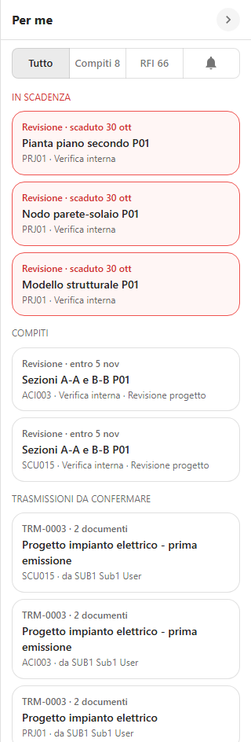
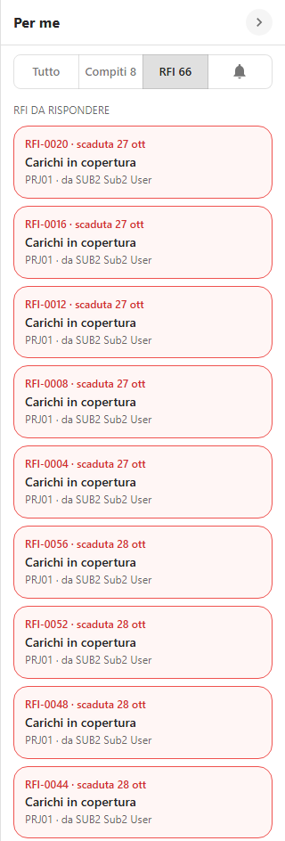
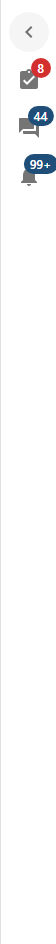
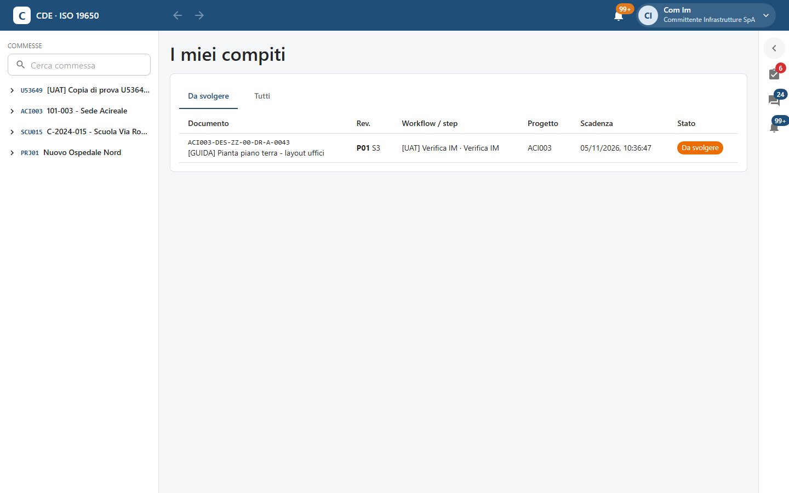
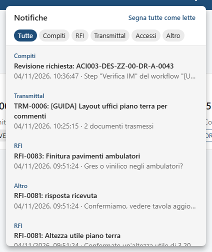

<!-- "><(((º> sabusabu <º)))>< -->
# 9. Per me, compiti e notifiche

[← Indice](README.md)

SkyTower raccoglie in un posto solo tutto ciò che aspetta **te**, su tutte le commesse: il pannello **Per me** a
destra. Le notifiche arrivano anche dalla campanella e, se vuoi, per email.

## 9.1 Il pannello Per me

In alto i filtri **Tutto**, **Compiti** (con il numero), **RFI** (con il numero) e la campanella (solo notifiche).
Le sezioni:

- **In scadenza** (in rosso): compiti scaduti o che scadono entro un giorno, con «scaduto …» o «scade …»;
- **Compiti**: revisioni da fare sui documenti («Revisione») e nodi dei processi («Processo»), con commessa, nome
  del passo e scadenza («entro …»);
- **Trasmissioni da confermare**: transmittal ricevuti, con protocollo e numero di documenti;
- **RFI da rispondere** e **RFI che ho aperto** («risposta ricevuta» / «in attesa di risposta»);
- **Notifiche**: le ultime cinque (con il filtro della campanella tutte).

Un clic su una voce porta all'oggetto: un compito apre la pagina **I miei compiti** con la finestra del compito già
aperta ([capitolo 6](06-workflow-e-processi.md#64-svolgere-un-compito)), un transmittal la sua pagina, una RFI il
suo thread. Quando non c'è nulla: «Niente da fare. Ottimo lavoro.»

La freccia **›** in alto chiude il pannello in una barra di icone con i contatori (compiti e trasmissioni, RFI,
notifiche); il contatore dei compiti diventa rosso se qualcosa è in scadenza. Un clic su un'icona riapre il pannello
già filtrato. Il browser ricorda se lo tieni aperto o chiuso.

## 9.2 I miei compiti

La pagina **I miei compiti** si apre cliccando un compito nel pannello Per me o il link di una notifica.

Le schede **Da svolgere** e **Tutti**. Per ogni compito: documento (o «Processo» con il titolo), revisione e
idoneità, workflow e passo, commessa, scadenza e stato. Un compito scaduto ha l'etichetta rossa **In ritardo di N
giorni** e, se i responsabili sono già stati avvisati, «Responsabili avvisati il … (sollecito n. 2)». Un clic su un
compito da svolgere apre la finestra per decidere.

## 9.3 Notifiche e solleciti

Ricevi una notifica, fra l'altro, quando:

- ti viene assegnato un compito, quando sta per scadere, quando è scaduto («Scadenza superata»);
- un workflow che riguarda un tuo documento è approvato o rifiutato;
- ricevi una RFI, una risposta, un promemoria di scadenza;
- ricevi un transmittal o qualcuno conferma la ricezione del tuo;
- cambia un documento che segui;
- qualcuno chiede l'accesso a un'area riservata che amministri.

**Escalation**: se un compito scade, oltre all'assegnatario vengono avvisati i responsabili (il Project Admin della
commessa o la persona indicata nel modello di workflow) con nome del revisore, passo, documento e giorni di
ritardo; dopo 72 ore parte un secondo sollecito. Nel Portale della suite queste voci salgono in cima con priorità
alta.

Le preferenze (email sì/no, un solo riepilogo al giorno, documenti seguiti solo nel riepilogo del mattino, lingua)
si cambiano da **Modifica il mio profilo** ([capitolo 1](01-accesso-e-interfaccia.md#17-il-mio-profilo-e-le-preferenze-delle-notifiche)).
