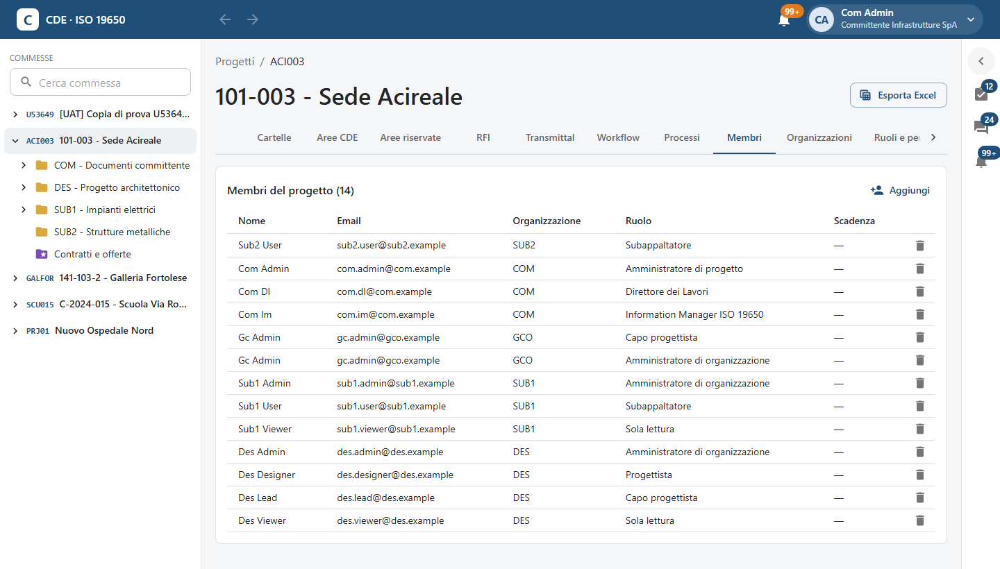
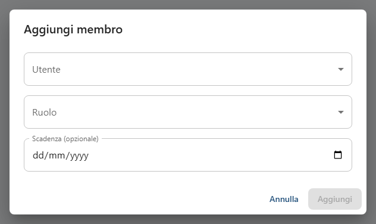
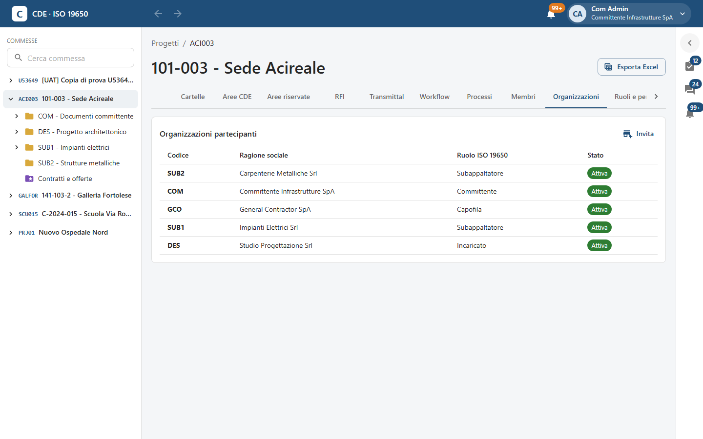
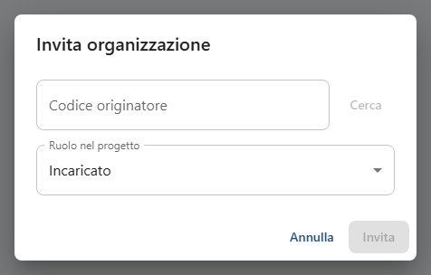
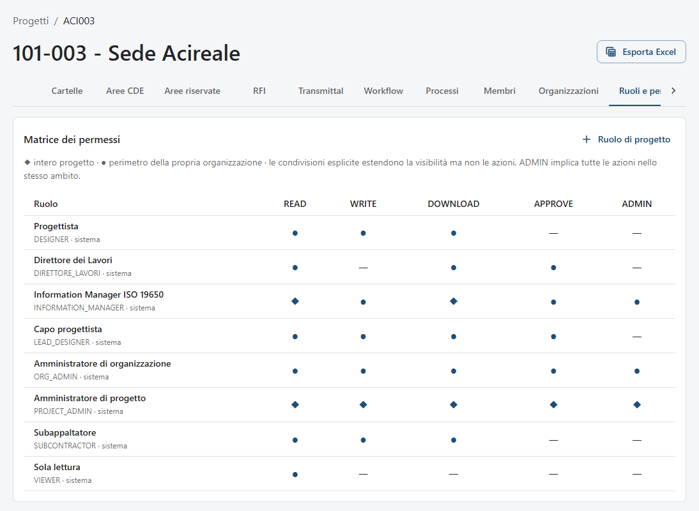
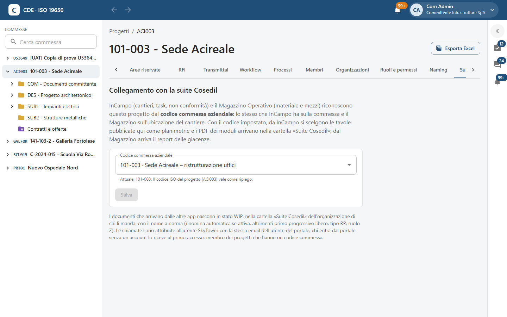
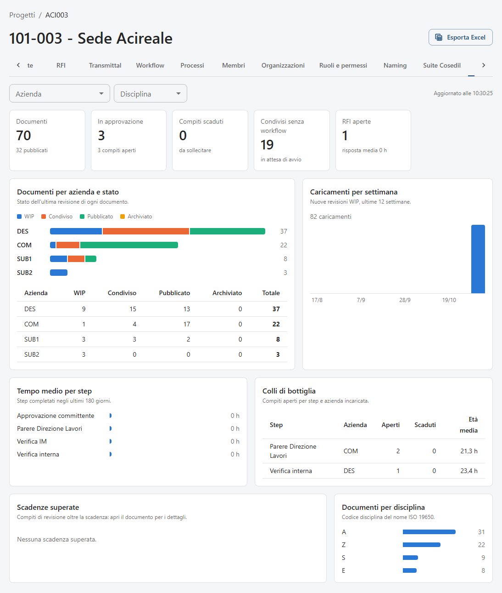
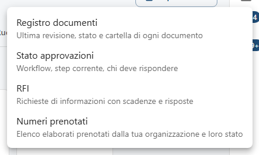
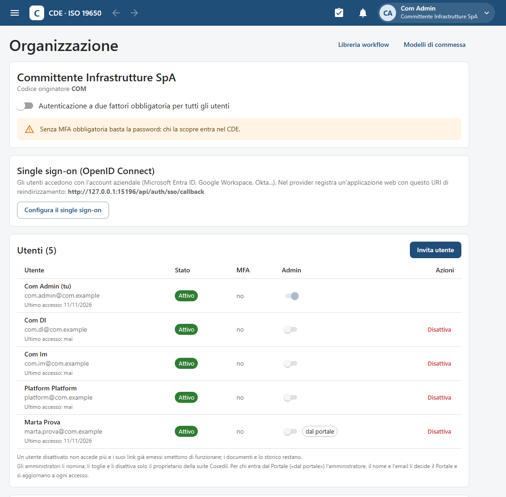
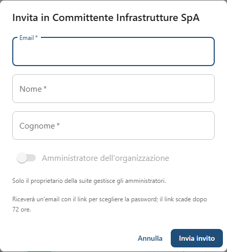

<!-- "><(((º> sabusabu <º)))>< -->
# 10. Amministrazione della commessa e dell'organizzazione

[← Indice](README.md)

Due livelli di amministrazione:

- **Project Admin** (amministratore di progetto): governa *una commessa* — membri, organizzazioni partecipanti,
  ruoli, naming, workflow, cruscotto, registro;
- **amministratore dell'organizzazione**: governa *la propria azienda* — colleghi, inviti, secondo fattore
  obbligatorio, single sign-on, libreria dei workflow, creazione di commesse nuove.

## 10.1 Membri della commessa

Scheda **Membri**: nome, email, organizzazione, ruolo e scadenza di ogni persona (una persona può comparire più
volte se ha più ruoli). Gli amministratori vedono **Aggiungi** e il cestino per togliere un ruolo.

**Aggiungi** → scegli l'**Utente** (fra le persone delle organizzazioni partecipanti), il **Ruolo** e, se serve,
una **Scadenza (opzionale)**: un consulente a tempo, per esempio, perde l'accesso da solo. **Aggiungi**.

Per far entrare una persona che non ha ancora un account, l'amministratore della *sua* organizzazione la invita
([10.7](#107-la-mia-organizzazione-e-gli-utenti)); poi il Project Admin la aggiunge alla commessa.

## 10.2 Organizzazioni partecipanti

Scheda **Organizzazioni**: codice, ragione sociale, **Ruolo ISO 19650** (*Committente*, *Capofila*, *Incaricato*,
*Subappaltatore*, *Consulente*, *Osservatore*) e stato (**Attiva** / **Sospesa**; il Project Admin la cambia con un
clic sull'etichetta). Sospendere un'organizzazione toglie l'accesso a tutte le sue persone senza cancellare nulla.

**Invita**: scrivi il **Codice originatore** dell'azienda (es. `SUB2`) e premi **Cerca**; se esiste ed è attiva
scegli il **Ruolo nel progetto** e premi **Invita**. Se non esiste: «Nessuna organizzazione attiva con questo
codice» (va prima registrata dall'amministratore della piattaforma).

## 10.3 Ruoli e permessi

La **Matrice dei permessi** mostra per ogni ruolo le azioni **READ** (leggere), **WRITE** (caricare),
**DOWNLOAD** (scaricare), **APPROVE** (approvare / pubblicare), **ADMIN** (amministrare):

- ◆ = su **tutto il progetto**;
- ● = solo nel **perimetro della propria organizzazione**;
- — = nessun permesso.

Le condivisioni di cartella allargano la visibilità ma non le azioni; ADMIN implica tutte le azioni nello stesso
ambito. I ruoli «di sistema» valgono in tutte le commesse. Con **Ruolo di progetto** il Project Admin crea un ruolo
solo per questa commessa (**Codice**, es. `BIM_COORDINATOR`, **Nome**, e per ogni azione *Nessuno*,
*● Propria organizzazione* o *◆ Intero progetto*) e lo può poi modificare.

## 10.4 Collegamento con la suite Cosedil

Scheda **Suite Cosedil**: il **Codice commessa aziendale** collega la commessa SkyTower alle altre app della suite.

- **InCampo** (cantieri, task, non conformità) sceglie le tavole pubblicate qui come planimetrie e manda i PDF dei
  suoi moduli nella cartella «Suite Cosedil»;
- il **Magazzino Operativo** (materiali e mezzi) manda il report delle giacenze.

I documenti che arrivano dalle altre app nascono **in lavorazione** nella cartella «Suite Cosedil»
dell'organizzazione che li manda, già con il nome a norma. Chi entra dal Portale senza un account SkyTower lo
riceve al primo accesso, membro delle commesse della sua azienda che hanno un codice commessa. Un
**amministratore del Portale** diventa a ogni ingresso amministratore dell'organizzazione e Project Admin di tutte
le commesse dell'azienda (ADR-57); dall'11/11/2026 vale anche il contrario: chi nel Portale non è più
amministratore, al prossimo accesso perde qui l'amministrazione e i Project Admin che il Portale gli aveva dato
(ADR-58). Gli amministratori si decidono nel Portale. Se il codice non è
impostato vale come ripiego il codice ISO del progetto. **Salva**.

## 10.5 Cruscotto

Solo per il Project Admin.

In alto i filtri **Azienda** e **Disciplina** e l'ora dell'ultimo aggiornamento. I riquadri: **Documenti** (e
quanti pubblicati), **In approvazione** (workflow e compiti aperti), **Compiti scaduti** (rosso se ce ne sono),
**Condivisi senza workflow** (in attesa di avvio), **RFI aperte**. Poi i grafici:

- **Documenti per azienda e stato**, con la tabella;
- **Caricamenti per settimana** (ultime 12 settimane);
- **Tempo medio per step** dei workflow (ultimi 180 giorni);
- **Colli di bottiglia**: compiti aperti per passo e azienda incaricata, scaduti ed età media;
- **Scadenze superate**: compiti oltre la scadenza con incaricato e colonna **Sollecito**; le RFI scadute;
- **Documenti per disciplina** (il campo ruolo del nome).

Passando il mouse sui grafici compaiono i numeri esatti.

## 10.6 Esporta Excel

Il pulsante **Esporta Excel** in testa a ogni commessa scarica un foglio con ciò che **tu** puoi vedere:

- **Registro documenti**: ultima revisione, stato e cartella di ogni documento;
- **Stato approvazioni**: workflow, passo corrente, chi deve rispondere;
- **RFI**: richieste con scadenze e risposte;
- **Numeri prenotati**: gli identificativi prenotati dalla tua organizzazione e il loro stato.

## 10.7 La mia organizzazione e gli utenti

Dal menu del profilo → **La mia organizzazione e gli utenti** (solo amministratori dell'organizzazione).

- **Autenticazione a due fattori obbligatoria per tutti gli utenti**: accesa, chi entra senza secondo fattore deve
  configurarlo al login. Spenta compare l'avviso «Senza MFA obbligatoria basta la password: chi la scopre entra nel
  CDE.»
- **Single sign-on (OpenID Connect)**: sotto.
- **Utenti (n)**: nome, email, ultimo accesso, stato (**Invitato**, **Attivo**, **Bloccato**, **Disattivato**),
  metodi di secondo fattore (**App**, **Chiave**), interruttore **Admin**, azioni.

Azioni sugli utenti:

- **Invita utente** → **Email**, **Nome**, **Cognome**, eventuale **Amministratore dell'organizzazione** →
  **Invia invito**. Per sicurezza il messaggio di conferma è sempre «invito inviato», anche se l'email appartiene
  già a un'altra azienda (in quel caso non parte nulla e il tentativo resta nel registro).

  
- **Reinvia invito** per chi non ha ancora attivato l'account;
- **Disattiva** / **Riattiva**: un utente disattivato non entra più e i link che aveva emesso smettono di
  funzionare; documenti e storico restano;
- **Azzera MFA** per chi ha perso telefono o chiave: verifica prima l'identità della persona per telefono al numero
  noto. L'azzeramento chiude anche le sue sessioni e resta nel registro;
- interruttore **Admin** per nominare altri amministratori. L'ultimo amministratore non si può togliere.

**Chi decide gli amministratori** (dall'11/11/2026, ADR-58). Nominare, togliere, disattivare o riattivare un
amministratore può solo il **proprietario della suite Cosedil**, cioè chi il Portale indica come proprietario, entrato
in SkyTower dal Portale; SkyTower lo chiede al Portale ogni volta. Per tutti gli altri amministratori l'interruttore
**Admin**, l'opzione **Amministratore dell'organizzazione** dell'invito e **Disattiva** / **Riattiva** sugli
amministratori sono spenti, con la scritta «Solo il proprietario della suite gestisce gli amministratori». Accanto a
chi entra dal Portale c'è **dal portale**: per queste persone l'amministratore, il nome e l'email li decide il Portale
e si aggiornano a ogni loro accesso, quindi l'interruttore resta spento anche per il proprietario (si cambia nel
Portale). Se il Portale non risponde, nessuno può dare o togliere amministratori finché non torna.

Il link **Libreria workflow** in alto porta ai modelli dell'organizzazione
([capitolo 6](06-workflow-e-processi.md#610-libreria-workflow-dellorganizzazione)).

## 10.8 Single sign-on

Con il single sign-on i colleghi entrano con l'account aziendale (Microsoft Entra ID, Google Workspace, Okta…).

1. L'IT registra un'applicazione web nel provider con l'**URI di reindirizzamento** mostrato nella pagina.
2. **Configura il single sign-on**: **Issuer** (per Microsoft `https://login.microsoftonline.com/<tenant-id>/v2.0`),
   **Client ID**, **Client secret**, **Domini email** (separati da virgola; si accettano solo domini di cui
   l'organizzazione ha già almeno un utente attivo), **Attivo**, **Il provider impone già l'autenticazione a due
   fattori**, **Salva**.
3. **Prova la connessione**, poi un accesso di prova con **Usa l'account aziendale (SSO)**.
4. Solo dopo, se si vuole, **Obbligatorio: disattiva l'accesso con password per gli utenti dell'organizzazione**.

**Rimuovi** toglie il single sign-on («si accede con email e password»). Nell'ambiente fotografato il single sign-on
non è configurato.

## 10.9 Accessi e sicurezza dell'organizzazione

In fondo alla pagina Organizzazione, **Accessi e sicurezza** elenca gli eventi di sicurezza dei colleghi: accessi,
accessi falliti o bloccati, secondo fattore, cambi password, sessioni chiuse, inviti, configurazioni del single
sign-on. Il filtro **Evento** restringe l'elenco. In arancione gli eventi da guardare, come **Riuso di una sessione
(possibile furto)** o **Accesso bloccato (troppi tentativi)**: se non li spiega un uso normale (per esempio la stessa
persona su due dispositivi), chiedi alla persona di cambiare password e chiudere le altre sessioni.
Le attività dentro le commesse sono invece nel **Registro** di ciascuna commessa ([capitolo 11](11-sicurezza-e-registro.md)).
