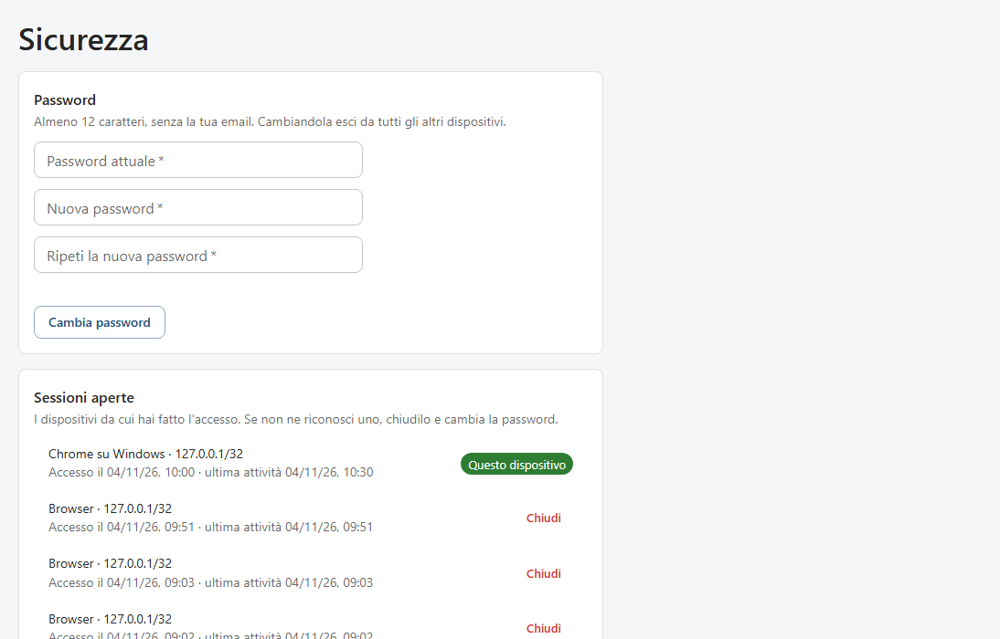
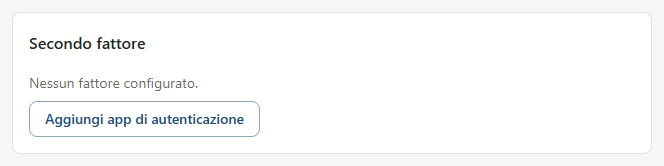
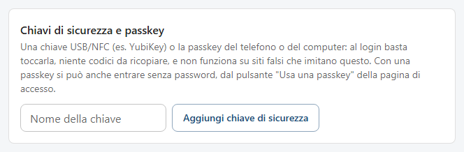
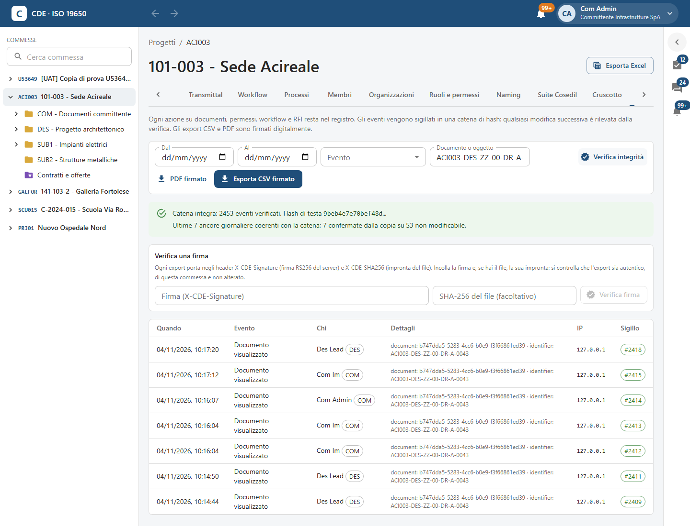
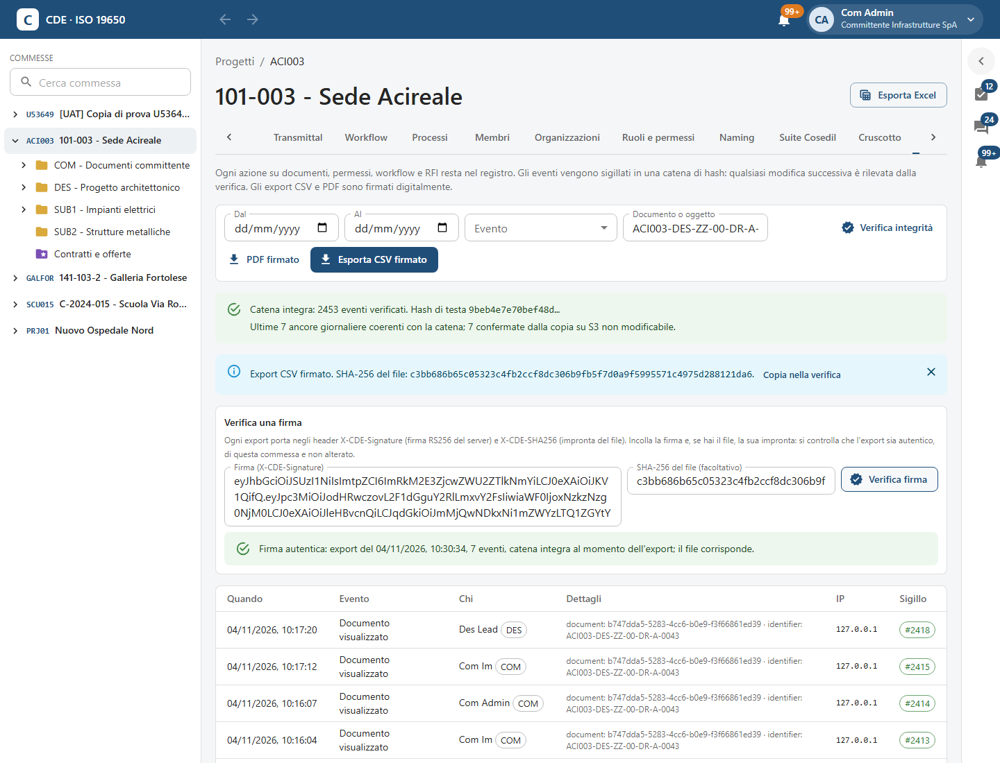

<!-- "><(((º> sabusabu <º)))>< -->
# 11. Sicurezza dell'account e registro attività

[← Indice](README.md)

## 11.1 La pagina Sicurezza

Menu del profilo → **Password e autenticazione a due fattori**.

### Password

Scrivi **Password attuale**, **Nuova password** e **Ripeti la nuova password** (almeno 12 caratteri, senza la tua
email) e premi **Cambia password**. Se le due nuove non coincidono compare «Le due password non coincidono».
**Cambiando la password esci da tutti gli altri dispositivi.**

### Sessioni aperte

L'elenco dei dispositivi da cui hai fatto l'accesso (browser e sistema, indirizzo, primo accesso e ultima attività).
Il tuo è marcato **Questo dispositivo**. **Chiudi** disconnette un dispositivo (per esempio il tablet lasciato in
cantiere): alla prossima azione quel dispositivo torna alla pagina di accesso. Se vedi un dispositivo che non
riconosci, chiudilo e cambia la password.

## 11.2 Secondo fattore, chiavi e passkey

**Secondo fattore** — **Aggiungi app di autenticazione**: compare un QR da inquadrare con Microsoft o Google
Authenticator; scrivi il **Codice a 6 cifre** e premi **Conferma**. Alla prima attivazione compaiono i
**recovery code**: salvali subito («Nuovi recovery code — salvali ora», poi **Fatto**). I fattori configurati sono
elencati con **Rimuovi**.

**Chiavi di sicurezza e passkey** — una chiave USB/NFC (es. YubiKey) o la passkey del telefono o del computer: al
login basta toccarla, niente codici da ricopiare, e non funziona sui siti falsi che imitano SkyTower. Dai un
**Nome della chiave** (es. «YubiKey ufficio») e premi **Aggiungi chiave di sicurezza**: il browser chiede di
toccare la chiave o di usare impronta/PIN. Una passkey vale anche per **entrare senza password** con **Usa una
passkey (senza password)** nella pagina di accesso.

**Recovery code** — **Rigenera** crea nuovi codici e annulla i vecchi (serve aver fatto l'accesso con il secondo
fattore).

Hai perso telefono e codici? Chiedi all'amministratore della tua organizzazione di **azzerare l'MFA**
([capitolo 10](10-amministrazione.md#107-la-mia-organizzazione-e-gli-utenti)).

## 11.3 Registro attività

Scheda **Registro** della commessa, solo per il Project Admin. Ogni azione su documenti, permessi, workflow e RFI
resta qui. Gli eventi sono **sigillati in una catena**: ognuno porta l'impronta del precedente, per cui qualsiasi
ritocco successivo viene scoperto dalla verifica. Ogni giorno la catena è ancorata anche a una copia non
modificabile. Per questo il registro ha valore probatorio.

- Filtri: **Dal**, **Al**, **Evento**, **Documento o oggetto** (identificativo o codice).
- **Verifica integrità**: esito in verde «Catena integra: N eventi verificati…» con lo stato delle ancore
  giornaliere. Un esito rosso («Catena interrotta all'evento n. …» oppure «La catena non corrisponde alle ancore
  giornaliere») significa che il registro è stato alterato: avvisa subito l'IT.
- **PDF firmato** ed **Esporta CSV firmato**: scaricano gli eventi filtrati, firmati digitalmente dal server.
  Dopo l'export compare l'impronta SHA-256 del file e il pulsante **Copia nella verifica**.
- Nella tabella: **Quando**, **Evento**, **Chi** (con l'organizzazione), **Dettagli**, **IP**, **Sigillo** (`#2418`
  = posizione nella catena; «in attesa» per gli eventi appena registrati, sigillati entro pochi istanti).

### Verificare un export

Chi riceve un CSV o un PDF del registro (un legale, un collaudatore) può controllare che sia autentico:

1. Nel riquadro **Verifica una firma** incolla la **Firma (X-CDE-Signature)** e, se hai il file, la sua impronta in
   **SHA-256 del file (facoltativo)**. Subito dopo un export basta **Copia nella verifica**.
2. **Verifica firma**.

Esiti possibili:

| Messaggio | Significato |
|---|---|
| **Firma autentica: export del …, N eventi, catena integra al momento dell'export; il file corrisponde.** | Tutto in regola. |
| **Il file non corrisponde a quello firmato: è stato modificato o è un altro export.** | Impronta sbagliata: il file è stato toccato. |
| **La firma è autentica ma riguarda un'altra commessa.** | Export vero, ma di un'altra commessa. |
| **Firma non valida: non è un export emesso da questo server.** | Firma falsa o danneggiata. |

Il PDF firmato riporta nel riquadro iniziale dove trovare firma e impronta.
