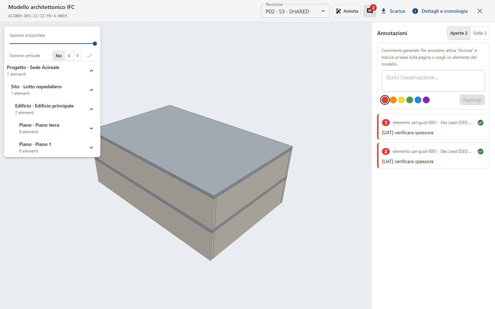
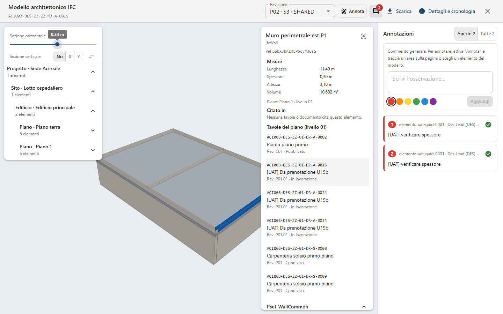
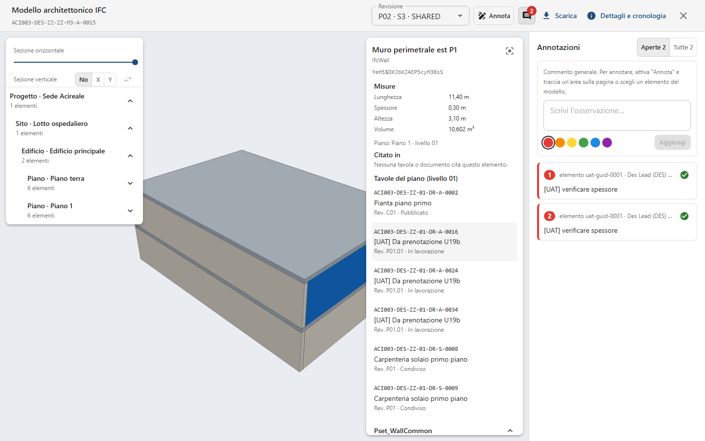
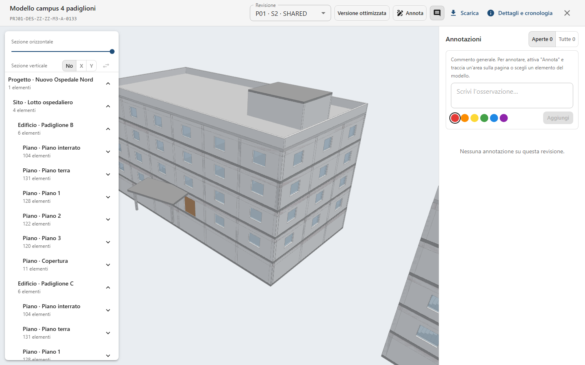
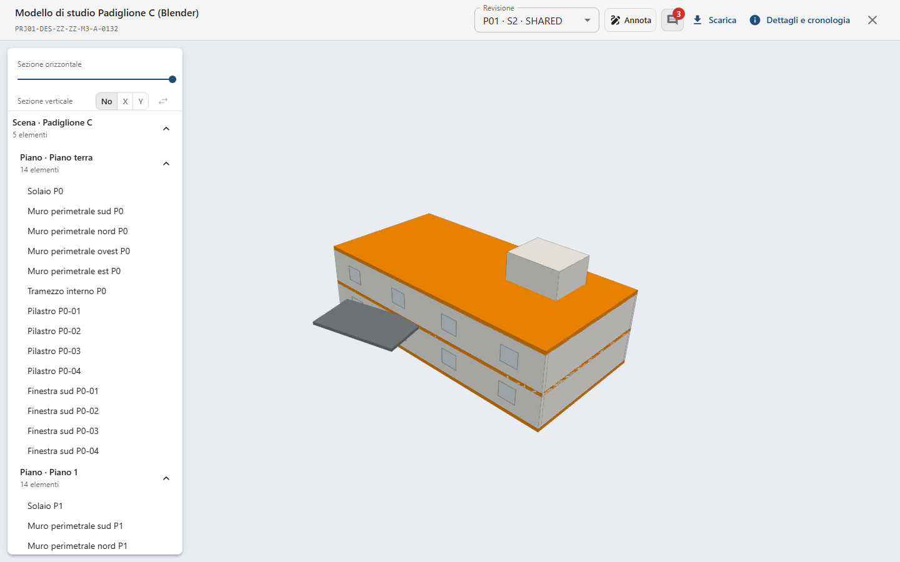
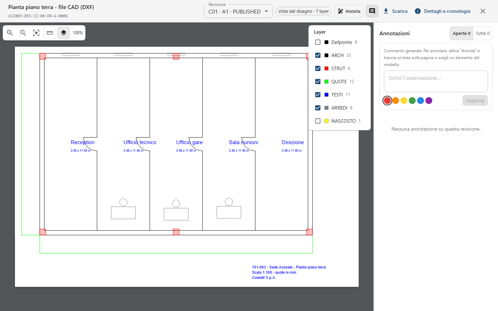
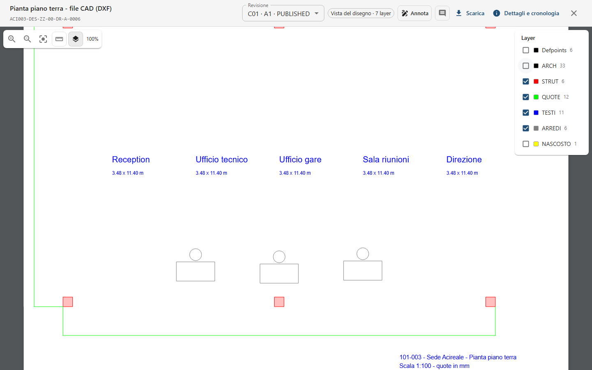
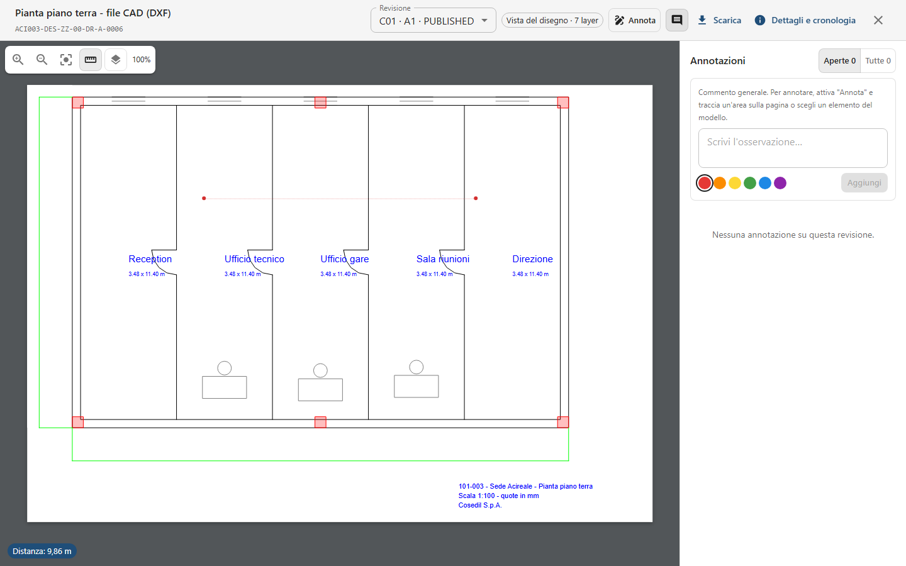

<!-- "><(((º> sabusabu <º)))>< -->
# 12. Modelli BIM, IFC e disegni DWG/DXF

[← Indice](README.md)

Modelli e disegni si caricano come qualsiasi documento ([capitolo 3](03-documenti-e-revisioni.md)) e si aprono con
doppio clic: SkyTower li mostra nel browser, senza programmi da installare.

## 12.1 Il modello IFC

- **Muovere la vista**: trascina con il tasto sinistro per ruotare, con il destro (o due dita) per spostare, rotella
  per lo zoom.
- **Albero spaziale** (riquadro a sinistra): Progetto › Sito › Edificio › Piano › elementi, con il numero di
  elementi; le frecce aprono e chiudono i livelli. Un clic su un elemento lo seleziona e lo inquadra.
- **Sezione orizzontale**: il cursore taglia il modello a una quota (in metri) per guardare dentro un piano.
- **Sezione verticale**: **X** o **Y** scelgono il piano di taglio, il cursore lo sposta, ⇄ mostra l'altra metà;
  **No** la toglie.

### Selezionare un elemento

Clic su un elemento nel modello o nell'albero: a destra compare la sua scheda.

- nome, classe IFC (es. `IfcWall`) e codice univoco; l'icona del mirino **Inquadra** lo centra;
- **Misure**: per un muro lunghezza, spessore, altezza e volume; per solai e coperture lunghezza, larghezza,
  spessore e superficie;
- il **Piano** a cui appartiene con il livello ISO 19650 (es. «Piano 1 · livello 01»);
- **Citato in**: le tavole e i documenti il cui testo nomina questo elemento, con l'estratto («Nessuna tavola o
  documento cita questo elemento» se non ce ne sono);
- **Tavole del piano (livello 01)**: i documenti con quel livello nel nome;
- in fondo i gruppi di proprietà del file (es. `Pset_WallCommon`), apribili.

Un clic su una tavola la apre in una nuova scheda con il nome dell'elemento già cercato nel testo.

### Annotare un elemento

Premi **Annota** e clicca un elemento: nel pannello delle annotazioni compare «Elemento: …». Scrivi l'osservazione e
premi **Aggiungi**. Gli elementi con annotazioni aperte si colorano nel modello con il colore dell'annotazione.

## 12.2 Modelli pesanti: la versione ottimizzata

Per gli IFC molto grandi il server prepara una **versione ottimizzata** dopo la verifica antivirus («Versione
ottimizzata in preparazione»: intanto si legge l'IFC originale). Quando è pronta il modello si apre in pochi secondi:
il piano più basso compare per primo e si può già ruotare, gli altri piani si aggiungono uno alla volta con
l'avanzamento in basso («Piani caricati: 3 di 24…»).

Il pulsante **Versione ottimizzata** / **IFC originale** nella barra passa dall'una all'altro: stessi elementi,
piani e proprietà; l'originale è solo più lento.

## 12.3 Modelli da Blender (GLB)

I modelli esportati da Blender in **glTF Binary (.glb)** si aprono come gli IFC: piani (le collezioni), oggetti,
misure e proprietà personalizzate.

Un file `.blend` non si apre nel browser: il visualizzatore spiega come esportarlo («da Blender: File → Esporta →
glTF 2.0, formato «glTF Binary (.glb)», e carica il .glb») e offre **Scarica il file**.

## 12.4 Disegni CAD (DXF e DWG)

Dopo la verifica il server converte il disegno per il browser (etichetta **Vista del disegno · N layer**).

In alto a sinistra: **Ingrandisci**, **Riduci**, **Adatta**, **Misura**, **Layer** e lo zoom in percentuale.
Trascina per spostarti, rotella per lo zoom.

- **Layer**: l'elenco dei layer con colore e numero di oggetti. Quelli spenti nel CAD arrivano non spuntati;
  togliendo la spunta un layer sparisce (qui è spento `ARCH` e spariscono i muri).

  
- **Misura**: due clic sul disegno; in basso compare **Distanza: …** nelle unità del file (millimetri convertiti in
  metri). Mentre muovi il mouse vedi le coordinate.

  
- **Annota**: come sui PDF, l'annotazione resta sul punto anche cambiando lo zoom.

I **DWG** richiedono un convertitore installato sul server. Se manca, il visualizzatore dice «Il disegno non si è
potuto convertire per la visualizzazione. I DWG richiedono ODA File Converter sul server; un DXF si vede sempre. Il
file originale resta scaricabile.» con **Scarica il file**. Soluzione immediata: esporta anche un DXF dal CAD e
caricalo.
