<!-- "><(((º> sabusabu <º)))>< -->
# 14. Modelli di commessa

Un **modello di commessa** è la struttura pronta per aprire una commessa nuova della tua azienda senza rifare
tutto a mano. Contiene:

- cartelle e aree riservate;
- regola dei nomi (naming), metadati, filigrana;
- ruoli con i loro permessi e workflow della commessa;
- le imprese partecipanti e le persone con il loro ruolo;
- i **documenti di modello**, per esempio il capitolato tipo o i moduli che servono in ogni cantiere.

I documenti normali non entrano mai in un modello. I workflow della **Libreria workflow** non servono: sono già
disponibili in tutte le commesse dell'azienda (vedi [capitolo 6](06-workflow-e-processi.md)).

Modelli e file dei modelli li gestiscono solo gli **amministratori dell'organizzazione**. Tutti gli
amministratori dell'organizzazione possono usarli per aprire commesse nuove; le altre imprese non li vedono.

> Le schermate di questo capitolo vengono da una commessa di prova: i nomi che vedi ("Modello e2e…") cambiano,
> i pulsanti e i passaggi sono quelli veri.

## 14.1 Salvare una commessa come modello

1. Apri una commessa impostata bene.
2. In alto a destra premi **Modello** → **Salva come modello**.

   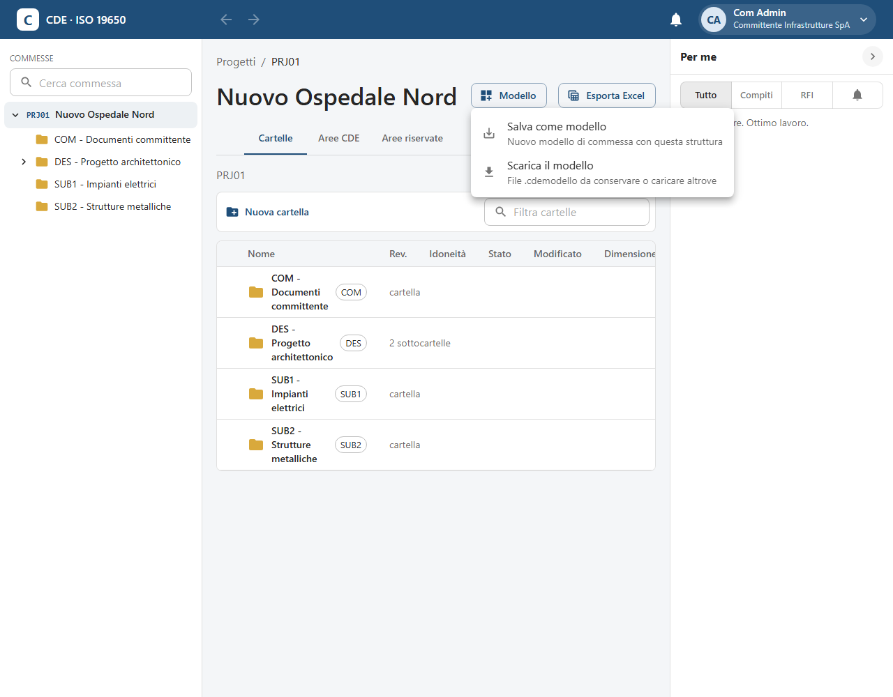

3. Dai un nome al modello (per esempio "Modello – Infrastrutture") e una descrizione, poi salva.

   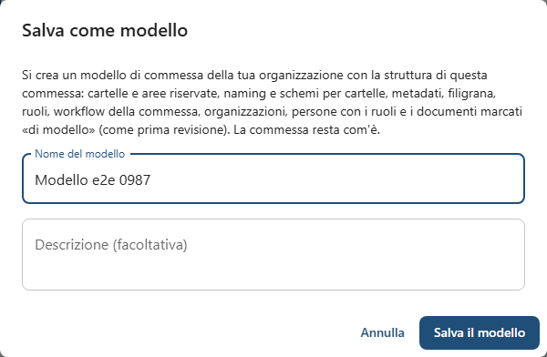

4. SkyTower conferma e indica cosa è entrato nel modello. La commessa di partenza resta com'è: puoi continuare
   a lavorarci.

   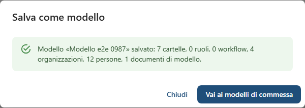

### Documenti di modello

Perché un documento venga copiato nelle commesse nuove, aprilo e attiva **Documento di modello** nel pannello
del documento. Nella commessa nuova arriverà come prima revisione (P01.01, "In lavorazione"), con il nome
rifatto secondo il codice della commessa nuova.

## 14.2 Trovare e ritoccare i modelli

Dal menu del profilo apri **Modelli di commessa**: c'è l'elenco dei modelli dell'azienda, con quante cartelle,
ruoli, workflow, imprese, persone e documenti contengono.

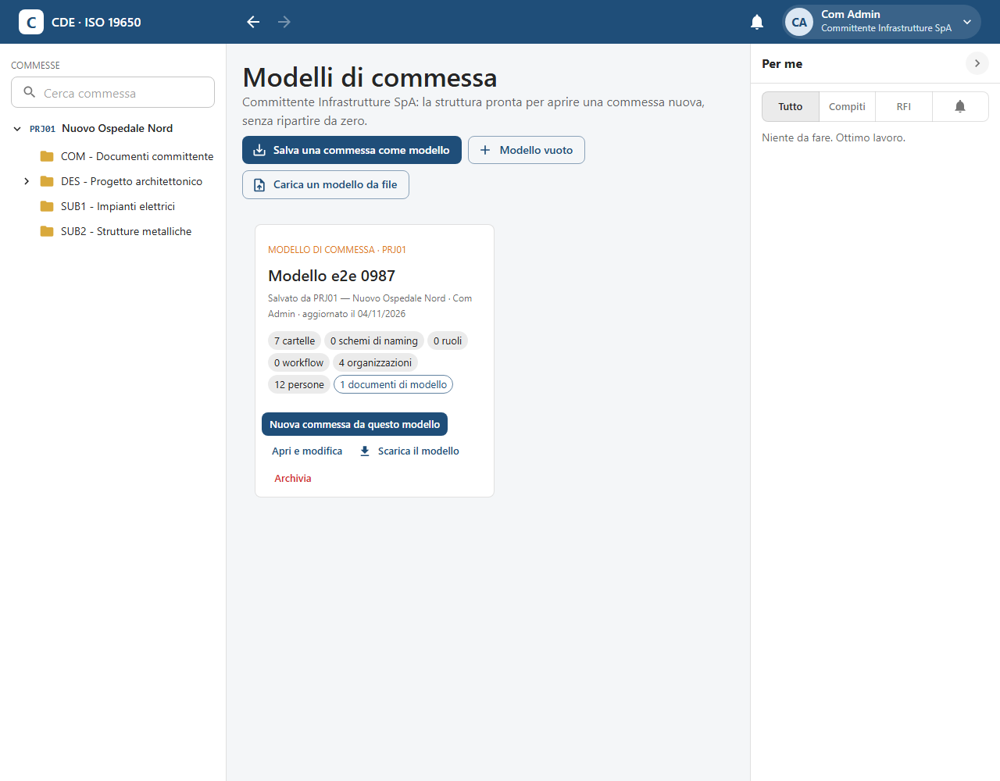

Con **Apri e modifica** il modello si apre come una commessa, con una barra in alto che ricorda che è un
modello. Mancano le funzioni operative (RFI, transmittal, processi, cruscotto): un modello non lavora, prepara.

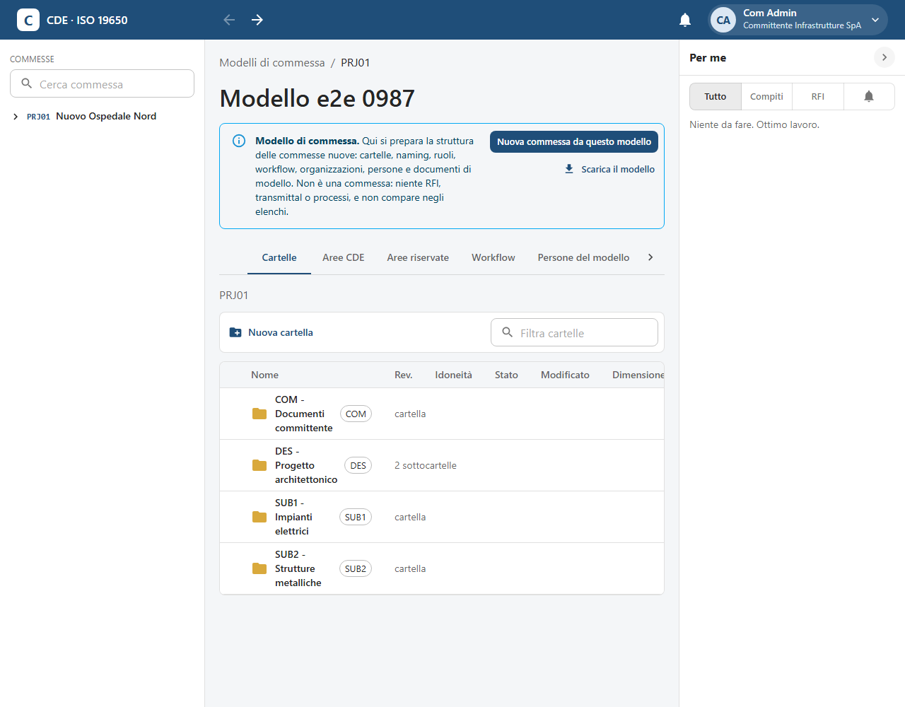

Nella scheda **Persone del modello** scegli chi entrerà nelle commesse nuove e con quale ruolo. Queste persone
non vedono il modello: entrano solo nelle commesse che ne nascono.

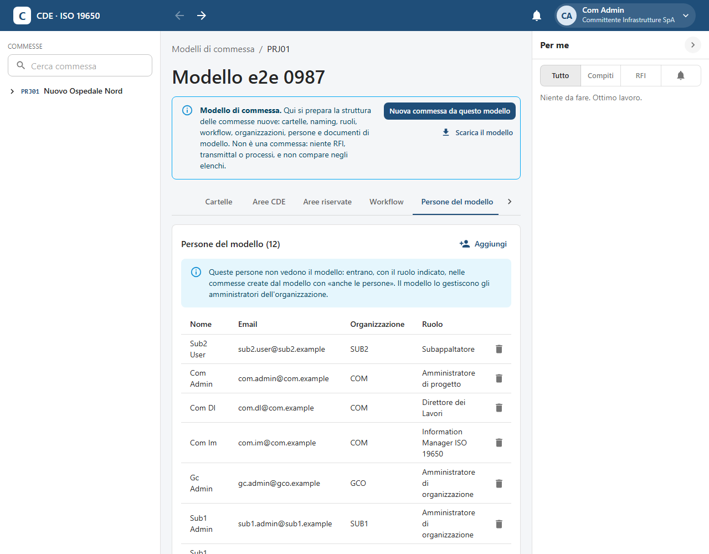

## 14.3 Aprire una commessa da un modello

1. Premi **Nuovo progetto**.
2. In **Parti da** scegli il modello: i modelli dell'azienda sono in cima all'elenco, sotto ci sono le commesse
   di cui sei Project Admin.

   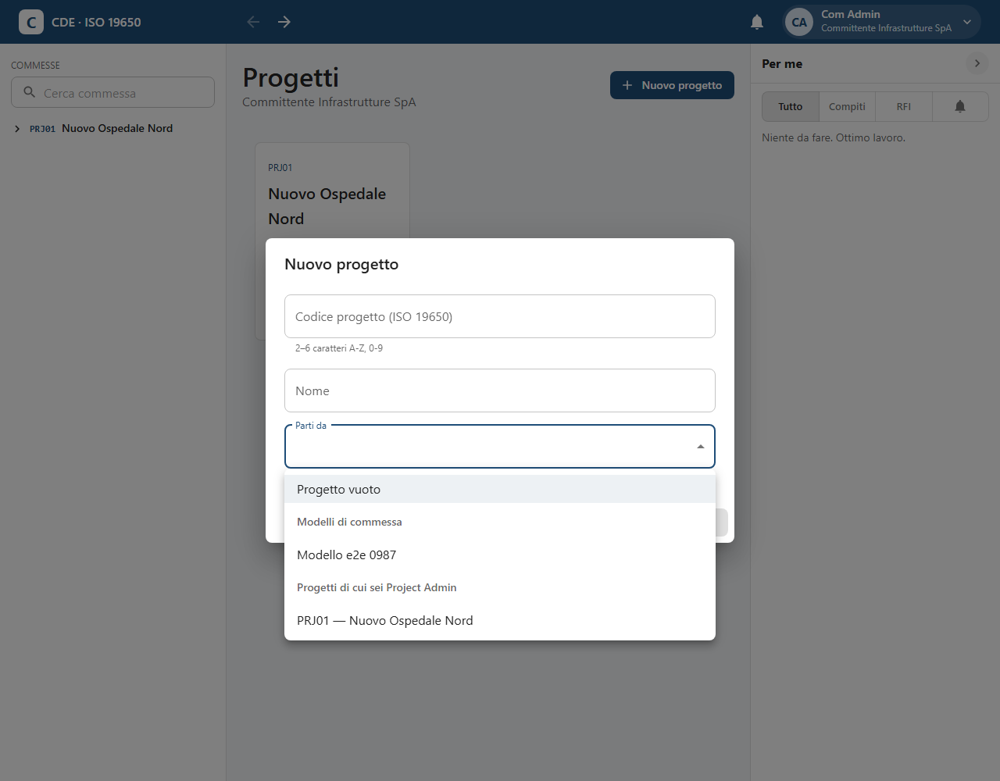

3. Scegli se copiare anche le imprese partecipanti, le persone del modello e i documenti di modello, poi premi
   **Crea**.

   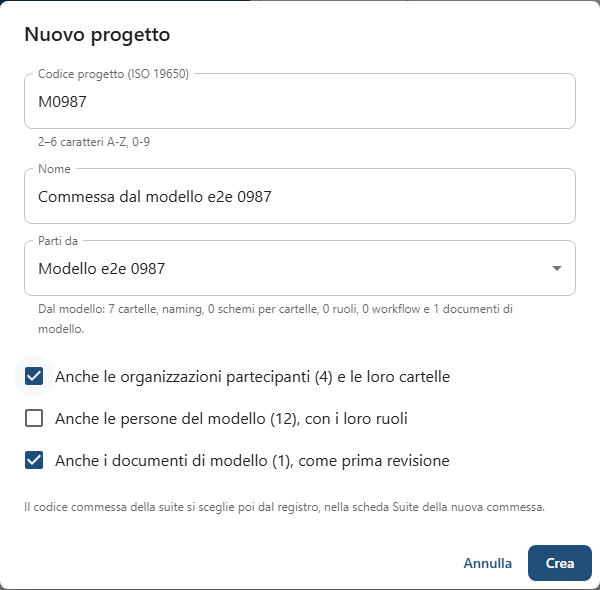

4. La commessa nasce con la struttura pronta e i documenti di modello come prima revisione.

   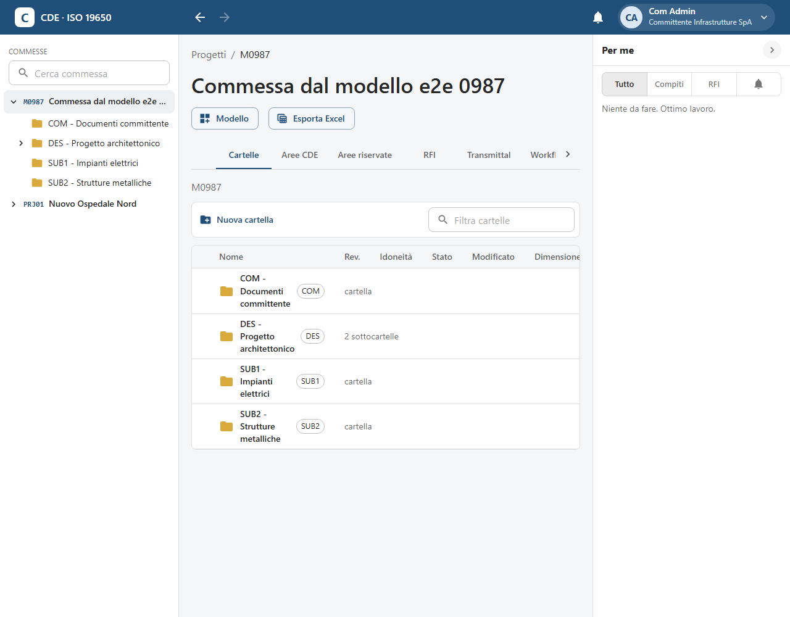

Il **codice commessa della suite** si sceglie dopo, dal registro, nella scheda **Suite** della commessa nuova.

## 14.4 Il file del modello, per sicurezza

**Scarica il modello** (nel menu **Modello** di una commessa o di un modello) salva un file `.cdemodello` con
tutto ciò che serve a ricostruire struttura e workflow, compresi i documenti di modello. Conservalo come una
copia di sicurezza.

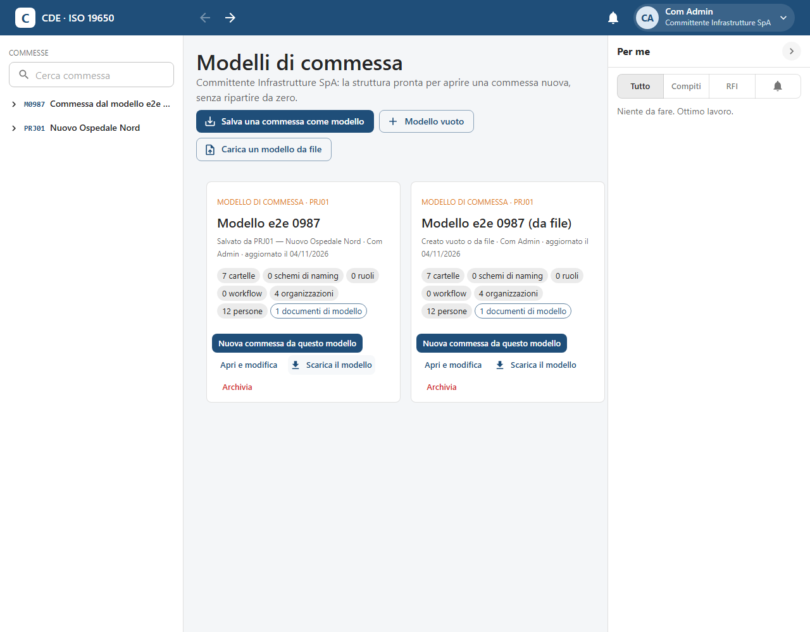

Per ricostruire un modello dal file vai in **Modelli di commessa** → **Carica un modello da file**. Funziona
anche su un'altra installazione di SkyTower.

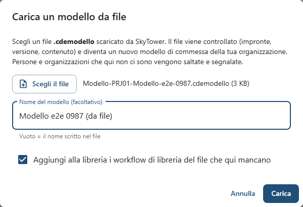

SkyTower controlla che il file sia integro: se è rovinato o modificato a mano lo rifiuta. Poi mostra l'elenco
delle cose adattate, per esempio persone che in questa installazione non esistono e quindi non sono state
aggiunte. Se il file torna nella stessa organizzazione da cui è uscito, l'elenco dice "Nessun adattamento".

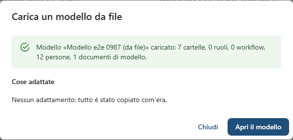

> Il file contiene nomi ed email delle persone del modello: trattalo come un documento riservato.

## Se qualcosa non va

- **Non vedo "Modelli di commessa" o "Salva come modello"**: servono i permessi di amministratore
  dell'organizzazione. Chiedili all'amministratore della tua impresa.
- **"File non valido" al caricamento**: il file è stato aperto e modificato, oppure si è rovinato nella copia.
  Usa una copia scaricata di nuovo da SkyTower.
- **Una persona non è entrata nella commessa nuova**: non era nell'organizzazione o nelle imprese del modello
  (vedi l'elenco degli adattamenti). Aggiungila dalla scheda **Membri**.
