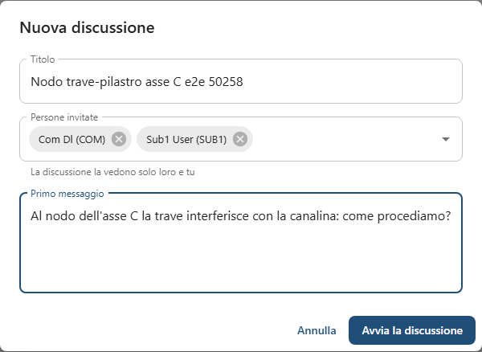
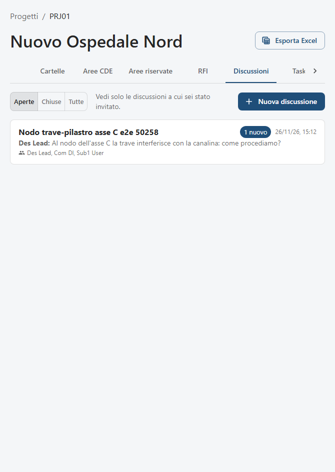
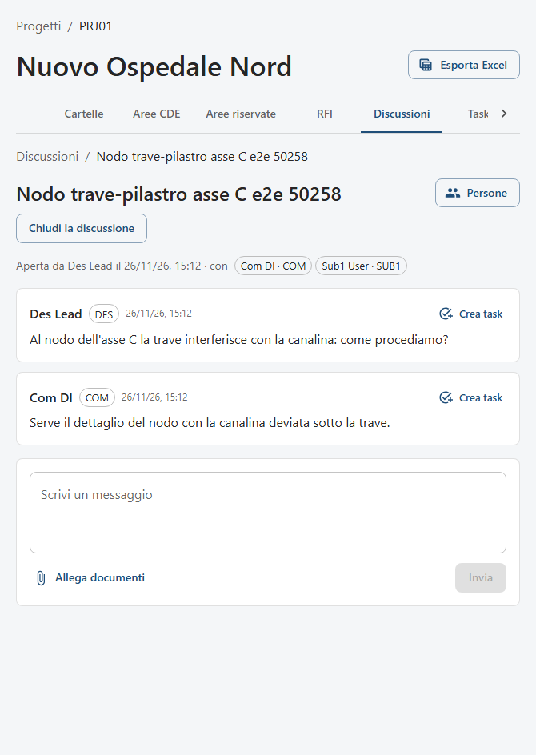
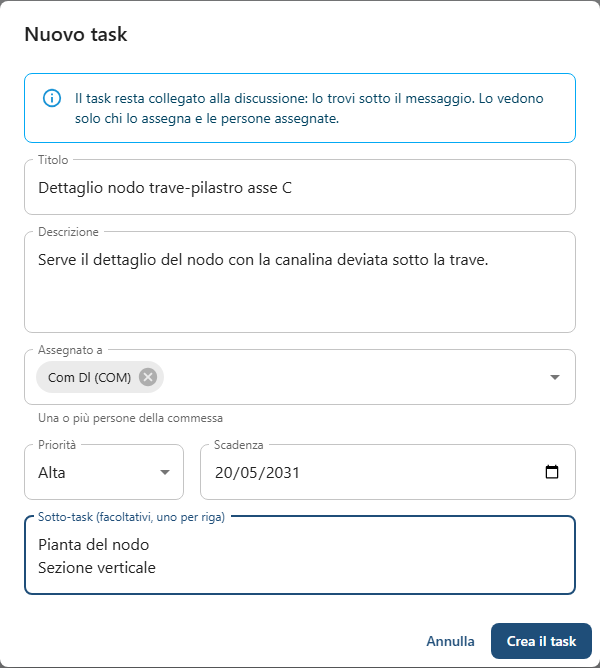
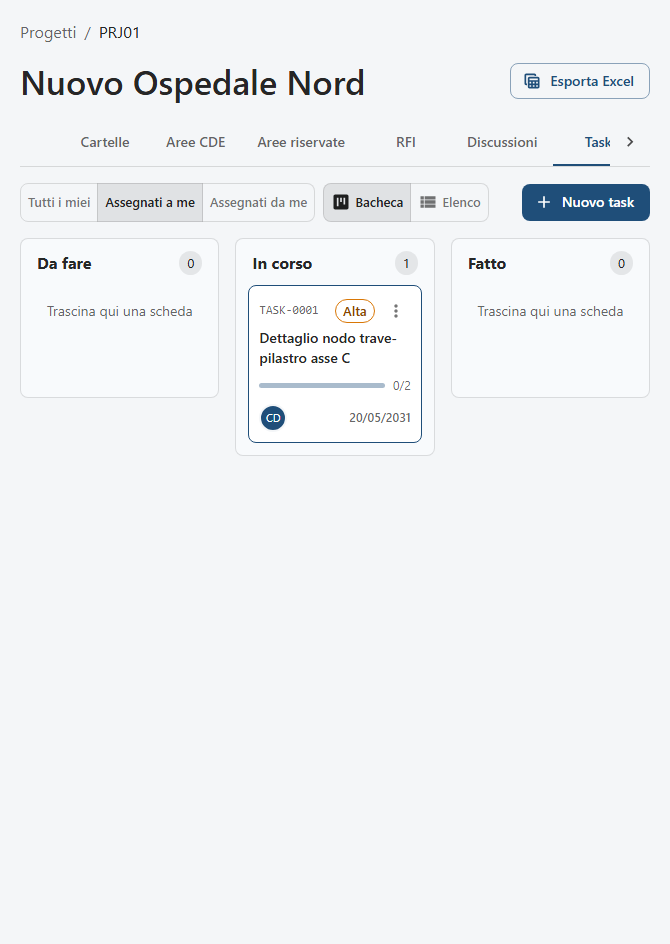
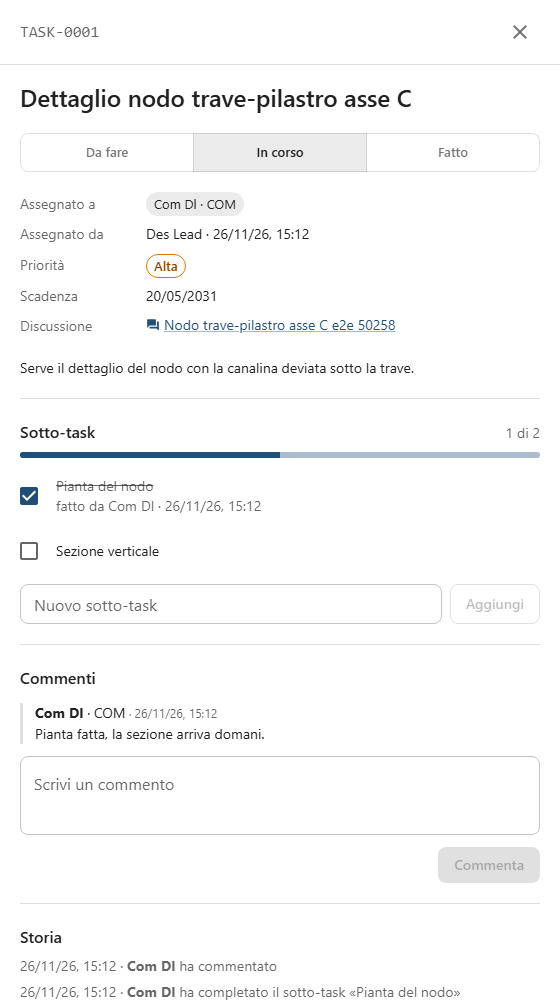

<!-- "><(((º> sabusabu <º)))>< -->
# 15. Discussioni e task

[← Indice](README.md)

Due strumenti per lavorare insieme dentro una commessa, oltre a RFI e workflow:

- una **discussione** è una conversazione fra le persone che inviti, per chiarire o decidere qualcosa senza aprire
  una RFI formale. **La vedono solo gli invitati**, nemmeno il Project Admin se non è fra loro;
- un **task** è un lavoro da fare assegnato a una o più persone, con priorità, scadenza, sotto-task da spuntare e
  commenti. Si segue in una **bacheca** a tre colonne: **Da fare**, **In corso**, **Fatto**. Lo vedono chi l'ha
  assegnato e le persone assegnate.

Un task può nascere da un messaggio di una discussione e resta collegato a lei.

Esempio in queste pagine: il progettista (Des Lead) apre una discussione sul nodo trave-pilastro dell'asse C con il
direttore dei lavori (Com Dl) e l'impiantista (Sub1 User). Dalla risposta del DL crea un task per lui, e il DL lo porta
a termine dalla bacheca.

## 15.1 Aprire una discussione

Scheda **Discussioni** della commessa → **Nuova discussione**.

1. **Titolo** (almeno 3 caratteri).
2. **Persone invitate**: una o più persone della commessa, anche di altre organizzazioni.
3. **Primo messaggio**.
4. **Avvia la discussione**.

Gli invitati ricevono subito un avviso e un'email «Discussione: …».

## 15.2 L'elenco

Ci sono solo le discussioni in cui sei invitato. Per ognuna vedi il titolo, l'ultimo messaggio con chi l'ha scritto,
le persone e l'ora dell'ultimo messaggio. Quelle con messaggi che non hai ancora letto hanno il titolo in grassetto e
l'etichetta **1 nuovo** / **N nuovi**. I filtri sono **Aperte**, **Chiuse** e **Tutte**. Le discussioni con messaggi
nuovi compaiono anche nel pannello **Per me**, sotto **Messaggi** ([capitolo 9](09-per-me-compiti-notifiche.md)).

## 15.3 Scrivere, allegare, creare un task

I messaggi sono in ordine di tempo, con autore, organizzazione e ora. Sotto c'è il riquadro **Scrivi un messaggio**
con **Invia**. I messaggi non si modificano e non si cancellano.

- **Allega documenti**: cerca un documento della commessa per identificativo o titolo (almeno 2 lettere). Si allega
  la sua revisione corrente. I file stanno nelle cartelle del CDE e la discussione li cita: un invitato che non può
  vedere quel documento non lo vede nemmeno qui, e al suo posto legge «1 allegato che non puoi vedere».
- **Crea task** (su ogni messaggio): apre la finestra del task già compilata con il testo del messaggio. Il task
  compare sotto il messaggio e nel riquadro **Task nati da questa discussione** in alto.

Quando apri una discussione, i suoi messaggi risultano letti e i relativi avvisi spariscono dalla campanella.

**Avvisi senza raffiche**: se arrivano dieci messaggi di fila ricevi un solo avviso (e una sola email), finché non apri
la discussione. Al messaggio dopo ricevi di nuovo un avviso.

## 15.4 Persone, chiusura, uscita

Solo **chi ha aperto la discussione** ha i pulsanti:

- **Persone**: cambia il titolo e l'elenco degli invitati. Chi aggiungi vede tutta la discussione, anche i messaggi di
  prima, e riceve un avviso. Chi togli non la vede più.
- **Chiudi la discussione** / **Riapri la discussione**: una discussione chiusa si legge ma non si scrive.

Gli altri invitati hanno **Esci dalla discussione**. Dopo non la vedono più, e per rientrare devono essere invitati di
nuovo.

## 15.5 Creare un task

Scheda **Task** → **Nuovo task**, oppure **Crea task** da un messaggio.

- **Titolo** e **Descrizione**.
- **Assegnato a**: una o più persone della commessa. Puoi assegnarlo anche a te.
- **Priorità**: Bassa, Normale, Alta, Urgente.
- **Scadenza** (facoltativa).
- **Sotto-task (facoltativi, uno per riga)**: i passi del lavoro, da spuntare.

**Crea il task**: le persone assegnate ricevono un avviso e un'email con chi lo assegna e la scadenza.

## 15.6 La bacheca

In alto scegli quali task vedere:

- **Tutti i miei**: quelli che hai assegnato e quelli che ti hanno assegnato;
- **Assegnati a me**;
- **Assegnati da me**.

Con **Bacheca** / **Elenco** cambi la vista: tre colonne oppure una tabella. Il browser ricorda la scelta.

Ogni scheda mostra codice (**TASK-0001**), priorità (se non è normale), titolo, barra dei sotto-task fatti, iniziali
delle persone assegnate, numero di commenti e scadenza. Se la scadenza è passata, la scheda ha il bordo rosso e la
scritta «in ritardo». Le schede più urgenti stanno in cima.

**Per cambiare lo stato trascina la scheda** in un'altra colonna. Puoi farlo anche dai tre puntini della scheda →
**Sposta in «…»**, che funziona pure da tastiera. Lo stato lo cambiano sia chi ha assegnato il task sia le persone
assegnate.

## 15.7 La scheda del task

Un clic su una scheda la apre a destra. Il suo indirizzo (…/task/…) si può mandare a un collega coinvolto.

- **Da fare / In corso / Fatto**: lo stato, cambiabile anche da qui.
- **Assegnato a**, **Assegnato da**, **Priorità**, **Scadenza** e, se c'è, la **Discussione** di origine (la vede solo
  chi vi partecipa).
- **Sotto-task**: la barra «1 di 2». Spunta le voci fatte (resta scritto chi e quando), aggiungine con **Nuovo
  sotto-task** e **Aggiungi**. Una voce la toglie chi ha assegnato il task o chi l'ha scritta.
- **Commenti**: chi ha assegnato il task e le persone assegnate ricevono un avviso (uno solo finché non aprono il task).
- **Storia**: chi ha fatto cosa e quando (spostamenti, sotto-task, commenti, cambi di scadenza e persone).

Chi ha assegnato il task ha in alto anche la **matita** per modificare titolo, descrizione, persone, priorità e
scadenza, e il **cestino** per eliminarlo. Le persone assegnate non possono cambiare questi campi.

## 15.8 Avvisi, scadenze e riepilogo di chi supervisiona

Gli avvisi arrivano nella campanella e, se hai le email attive, anche per posta:

| Quando | Chi riceve l'avviso |
|---|---|
| Ti invitano in una discussione o ti aggiungono | tu |
| Messaggio nuovo in una discussione | gli invitati, tranne chi scrive (uno solo finché non apri la discussione) |
| Ti assegnano un task, o ti aggiungono a un task | tu |
| Commento a un task | chi l'ha assegnato e le persone assegnate, tranne chi scrive |
| Una persona assegnata segna il task **Fatto** | chi l'ha assegnato, subito |
| Chi l'ha assegnato lo riapre o ne cambia la scadenza | le persone assegnate |
| Il task scade oggi o domani | le persone assegnate |
| Il task è in ritardo (scadenza passata e non fatto) | le persone assegnate e chi l'ha assegnato |

I task assegnati a te compaiono anche nel pannello **Per me** (sezione **Task assegnati a me**) e nel **Da fare oggi**
del Portale della suite: in cima se sono in ritardo o urgenti.

**Riepilogo del mattino per chi assegna i task.** Ogni mattina dei giorni feriali (alle 7:10), chi ha dato task ad
altri riceve l'email «Avanzamento dei task che hai assegnato». È divisa per commessa e, dentro, in **Completati**, **In
ritardo**, **In corso** e **Da fare**. Per ogni task trovi le persone assegnate, i sotto-task fatti, la scadenza e la
priorità. Sotto ogni task c'è **cosa è cambiato dall'ultimo riepilogo** (il lunedì comprende il fine settimana), per
esempio «Com Dl ha completato il sotto-task «Pianta del nodo»» o «2 commenti di Com Dl», con il link al task. I task
che hai assegnato solo a te stesso non ci sono. Le persone assegnate non ricevono questo riepilogo.

Il riepilogo si spegne da **Modifica il mio profilo** → **Notifiche** → «Task che assegno: riepilogo dell'avanzamento
ogni mattina».

## 15.9 Chi vede cosa

| | Discussione | Task |
|---|---|---|
| Lo vede | chi l'ha aperta e gli invitati | chi l'ha assegnato e le persone assegnate |
| Il Project Admin, se non coinvolto | no | no |
| Chi esce dalla commessa | non vede più nulla | non vede più nulla |
| Nel registro attività della commessa | che è stata aperta, chiusa, riaperta, che sono cambiate le persone (non il contenuto) | che è stato assegnato, modificato (quali campi) o eliminato |
