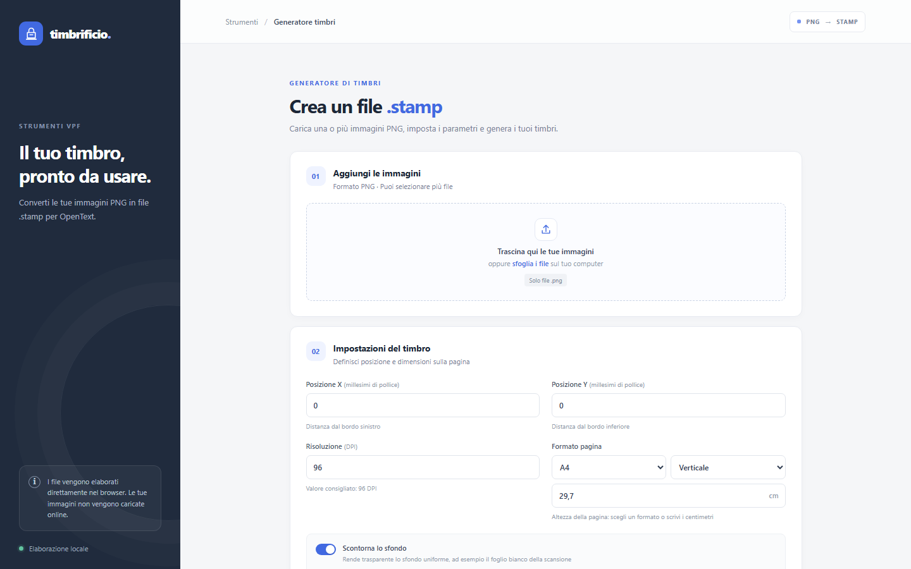

<!-- "><(((º> sabusabu <º)))><" -->
# Timbri per VFP

Crea file `.stamp` (OpenText IGCMarkupStamp, i timbri delle annotazioni in VFP) da immagini PNG.
Tutto in JavaScript, nessuna dipendenza: la pagina elabora i file nel browser e non li manda in rete.

Arrivato nella suite il 06/11/2026 dal repository `timbri-per-vpf` (GitHub), dove resta la storia
precedente.

## Nella suite Cosedil

- **Scheda nel portale**: *Timbri per VFP*, programma **riservato**. Lo vedono gli amministratori e gli
  utenti con la spunta in **Gestione › Abilitazioni** (o nella finestra *Programmi* della pagina Utenti).
- **Porta**: `5205`. Avvio: `avvia.vbs` (invisibile, è quello che usa il portale) o `avvia.bat` (con log).
  Si ferma dal pulsante *Ferma* della plancia o chiudendo la finestra di `avvia.bat`.
- **`server.js`**: mini server Node senza dipendenze. Serve solo `index.html`, `script.js`, `stamp.js` e
  `style.css`, dietro il login del portale (gate SSO di `shared/sso`, id app `timbri`). `/health` risponde
  senza login. Variabili: `PORT` (default 5205), `HOST` (default `127.0.0.1`, il portale passa il suo) e
  quelle del gate (`COSEDIL_PORTAL`, `COSEDIL_SSO`, `COSEDIL_SSO_FAIL`).
- **Test**: `npm test` (`node --test`, nessuna dipendenza).

## Come si usa (guida per chi lo usa)



1. Dal portale clicca la scheda **Creare un timbro per VFP**. Se il programma è spento parte da solo in
   qualche secondo.
2. **Aggiungi le immagini**: trascina uno o più PNG (la firma, il logo, il timbro scansionato) in
   *Trascina qui le tue immagini*, oppure *sfoglia i file*. *Rimuovi tutte* svuota l'elenco.
3. **Impostazioni del timbro**:
   - *Posizione X* e *Posizione Y* (millesimi di pollice): distanza dal bordo sinistro e da quello
     inferiore della pagina;
   - *Risoluzione* (DPI): lascia 96 se non sai che valore ha l'immagine;
   - *Formato pagina* (A0…A6, Letter, Legal o *Personalizzato* in centimetri) e orientamento
     *Verticale/Orizzontale*;
   - *Scontorna lo sfondo* rende trasparente lo sfondo uniforme (il foglio bianco della scansione): la *Tolleranza*
     va alzata se restano aloni chiari, abbassata se il timbro perde dettagli. L'anteprima nell'elenco
     delle immagini mostra il risultato;
   - *Nome del file di uscita*: facoltativo, solo con una immagine; vuoto = nome dell'immagine.
4. **Genera i file .stamp**: per ogni immagine ottieni un file `.stamp`. Se il browser lo permette puoi
   scegliere prima la cartella di destinazione, altrimenti ogni file si scarica.
5. In VFP importa il `.stamp` tra i timbri delle annotazioni.

Le immagini restano sul tuo PC: nessun file viene caricato sul server.

## Riga di comando (Node.js)

```
node timbro.js firma.png                      -> firma.stamp
node timbro.js firma.png -o Timbro.stamp --x 2138 --y 1528 --dpi 96
node timbro.js a.png b.png                    -> a.stamp, b.stamp
node timbro.js --help
```

`stamp.js` contiene la logica comune a pagina web e riga di comando.
