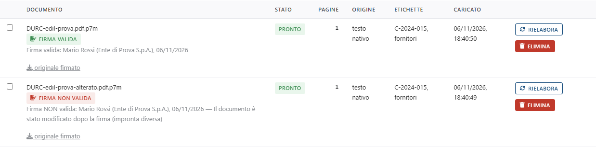

<!-- "><(((º> sabusabu <º)))>< -->
# 1. Caricare i documenti

[← Indice](README.md)

Apri la scheda **📥 Documenti**.

## 1.1 Caricare

1. Premi il pulsante di scelta file e seleziona uno o più documenti (fino a 20
   per volta): **PDF** o immagini **PNG, JPG, TIFF**, al massimo **50 MB** per file.
   Vanno bene anche i **PDF firmati digitalmente** (file `.p7m`, per esempio
   `contratto.pdf.p7m`): vedi il paragrafo 1.4.
2. Nel campo **Etichette** scrivi, separate da virgola, le parole che ti
   serviranno per ritrovarli: codice commessa, fornitore, tipo di documento.
   Esempio: `C-2024-015, fornitori`.
3. Premi **Carica**.

In alto a destra compare un messaggio, ad esempio *«Caricati 4 file. Estrazione
in corso (4 in coda).»*. Se un file era già stato caricato, il messaggio dice
*«…, 1 già in archivio»*: lo stesso file non viene mai duplicato.

## 1.2 L'archivio e lo stato di lavorazione

Ogni documento passa per questi stati:

| Stato | Significato |
|---|---|
| **in-coda** | aspetta il suo turno |
| **in-lavorazione** | il programma sta leggendo il testo |
| **pronto** | si può cercare e verificare |
| **errore** | la lettura non è riuscita: il motivo è scritto sotto lo stato |

La tabella si aggiorna da sola ogni 5 secondi finché c'è qualcosa in lavorazione;
**Aggiorna** la ricarica subito.

La colonna **Origine** dice come è stato letto il testo:

- **testo nativo**: PDF "nato al computer", letto direttamente, in un attimo;
- **OCR tesseract**: scansione o fotografia, letta con l'OCR (qualche secondo per pagina).

Un PDF con pochissimo testo (meno di circa 200 caratteri) viene trattato come
scansione e passa dall'OCR.

## 1.3 Azioni sulla riga

- **casella a sinistra**: seleziona il documento per la verifica (si attiva
  solo quando è *pronto*). La scelta vale anche nella scheda **Verifiche**;
- **Rielabora**: rilegge il documento da capo (utile dopo un errore);
- **Elimina**: chiede conferma (*«Eliminare "…" e le sue verifiche?»*) e
  cancella il documento **insieme alle sue verifiche**.

## 1.4 PDF firmati digitalmente (.p7m)

Un documento firmato con la firma digitale arriva spesso come file `.p7m`: una
"busta" che contiene il PDF e la firma. Caricalo come un PDF qualunque. Durante
la lettura il programma:

1. apre la busta e legge il PDF che c'è dentro (testo nativo o OCR, come sempre);
2. **verifica la firma**: che il documento non sia stato modificato dopo la
   firma, che il certificato sia di un ente certificatore riconosciuto (elenchi
   ufficiali europei e di AgID), che non sia revocato o scaduto, e l'eventuale
   marca temporale.

Accanto al nome compare un bollino:

| Bollino | Significato |
|---|---|
| **Firma valida** (verde) | tutto in regola |
| **Firma NON valida** (rosso) | documento modificato dopo la firma, certificato revocato, scaduto senza marca temporale… il motivo è scritto sotto |
| **Firma da verificare** (giallo) | il programma non ha potuto completare il controllo (per esempio manca la rete per sapere se il certificato è revocato, o l'ente non è negli elenchi): **Rielabora** ripete la verifica |

Sotto il bollino una riga dice chi ha firmato, con quale ente e quando (per
esempio *«Firma valida: Mario Rossi (InfoCert S.p.A.), 12/03/2024»*). Una firma
non valida **non blocca** la lettura: il documento si cerca e si verifica lo
stesso. Il link **originale firmato** scarica il `.p7m` così come è arrivato.

Se compare l'errore *«Componente firma digitale non installato»*, chiedi
all'amministratore di lanciare `shared\firma\installa.bat` (lo fa da solo
`avvia.bat` al primo avvio), poi premi **Rielabora**.

Per controllare la firma dentro una checklist c'è la regola `firma`
([capitolo 3](03-checklist.md)).

[Avanti: Cercare nei documenti →](02-ricerca.md)
