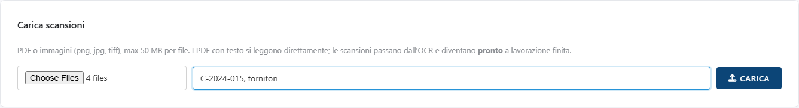
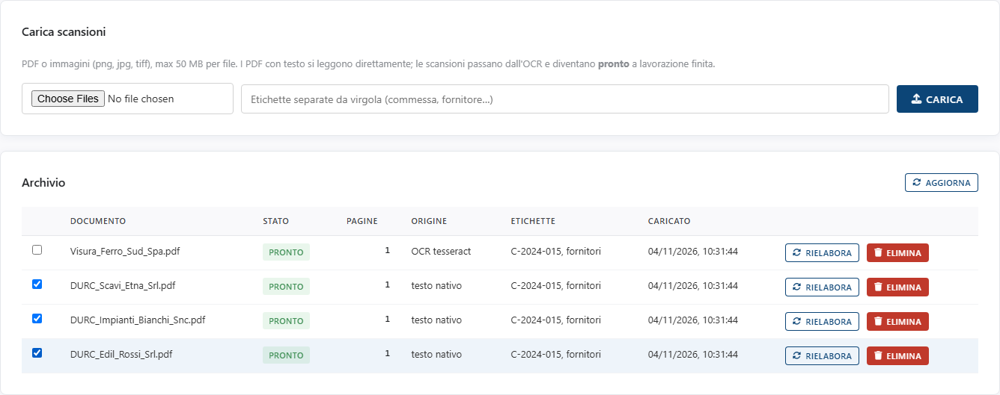

<!-- "><(((º> sabusabu <º)))>< -->
# 1. Caricare i documenti

[← Indice](README.md)

Apri la scheda **📥 Documenti**.

## 1.1 Caricare

1. Premi il pulsante di scelta file e seleziona uno o più documenti (fino a 20
   per volta): **PDF** o immagini **PNG, JPG, TIFF**, al massimo **50 MB** per file.
2. Nel campo **Etichette** scrivi, separate da virgola, le parole che ti
   serviranno per ritrovarli: codice commessa, fornitore, tipo di documento.
   Esempio: `C-2024-015, fornitori`.
3. Premi **Carica**.

In alto a destra compare un messaggio, ad esempio *«Caricati 4 file. Estrazione
in corso (4 in coda).»*. Se un file era già stato caricato, il messaggio dice
*«…, 1 già in archivio»*: lo stesso file non viene mai duplicato.

## 1.2 L'archivio e lo stato di lavorazione

Ogni documento passa per questi stati:

| Stato | Significato |
|---|---|
| **in-coda** | aspetta il suo turno |
| **in-lavorazione** | il programma sta leggendo il testo |
| **pronto** | si può cercare e verificare |
| **errore** | la lettura non è riuscita: il motivo è scritto sotto lo stato |

La tabella si aggiorna da sola ogni 5 secondi finché c'è qualcosa in lavorazione;
**Aggiorna** la ricarica subito.

La colonna **Origine** dice come è stato letto il testo:

- **testo nativo**: PDF "nato al computer", letto direttamente, in un attimo;
- **OCR tesseract**: scansione o fotografia, letta con l'OCR (qualche secondo per pagina).

Un PDF con pochissimo testo (meno di circa 200 caratteri) viene trattato come
scansione e passa dall'OCR.

## 1.3 Azioni sulla riga

- **casella a sinistra**: seleziona il documento per la verifica (si attiva
  solo quando è *pronto*). La scelta vale anche nella scheda **Verifiche**;
- **Rielabora**: rilegge il documento da capo (utile dopo un errore);
- **Elimina**: chiede conferma (*«Eliminare "…" e le sue verifiche?»*) e
  cancella il documento **insieme alle sue verifiche**.

[Avanti: Cercare nei documenti →](02-ricerca.md)
