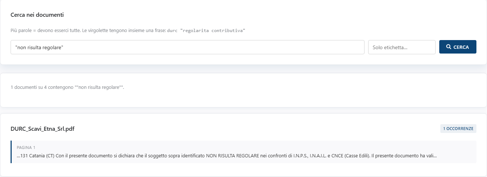

<!-- "><(((º> sabusabu <º)))>< -->
# 2. Cercare nei documenti

[← Indice](README.md)

La scheda **🔍 Ricerca** cerca nel testo di **tutti** i documenti pronti,
scansioni comprese.

1. Scrivi nel campo **Cosa cerchi?**;
2. se vuoi limitarti a un gruppo di documenti, scrivi un'etichetta in
   **Solo etichetta…** (es. `C-2024-015`);
3. premi **Cerca** (o Invio).

Come si scrive la ricerca:

| Scrivo | Trova |
|---|---|
| `durc scadenza` | i documenti che contengono **entrambe** le parole, anche lontane |
| `"non risulta regolare"` | la **frase esatta**, parole attaccate in quell'ordine |
| `durc "regolarita contributiva"` | i due criteri insieme |

Maiuscole, minuscole e accenti non contano (`regolarita` trova anche *Regolarità*).

Il risultato dice quanti documenti contengono la ricerca (*«1 documenti su 4
contengono…»*); per ognuno mostra il numero di **occorrenze** e, pagina per
pagina, le righe attorno al punto trovato.

[← Caricare i documenti](01-documenti.md) · [Avanti: Le checklist →](03-checklist.md)
