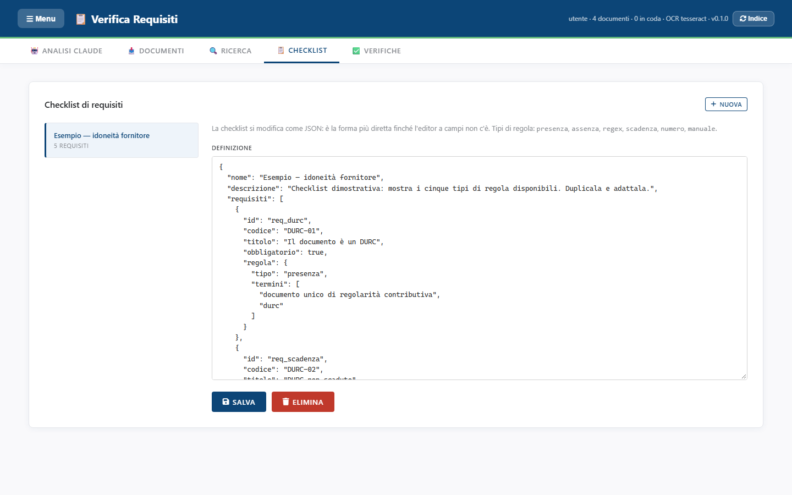

<!-- "><(((º> sabusabu <º)))>< -->
# 3. Le checklist

[← Indice](README.md)

Una **checklist** è l'elenco dei requisiti da controllare su un tipo di
documento (es. "Idoneità fornitore", "Documenti di cantiere"). Si scrive una
volta e si riusa su tutti i documenti.

Apri la scheda **📋 Checklist**: a sinistra l'elenco con il numero di requisiti,
a destra la **Definizione** della checklist scelta.

Al primo avvio c'è la checklist **"Esempio — idoneità fornitore"**: mostra
come si scrivono le regole. Si può copiare, modificare o eliminare.

## 3.1 Come è fatta una checklist

Per ora la checklist si scrive in un formato di testo strutturato (JSON) — in
futuro ci sarà un modulo a campi. Ogni requisito ha:

| Campo | Cosa contiene |
|---|---|
| `codice` | codice breve stampato nei report, es. `DURC-02` |
| `titolo` | la domanda in chiaro, es. "DURC non scaduto" |
| `obbligatorio` | `true` = se manca è **Non conforme**; `false` = se manca è solo **Da controllare** |
| `regola` | come controllarlo (vedi sotto) |

I sette tipi di regola:

| Tipo | Controlla che… | Esempio |
|---|---|---|
| `presenza` | compaia almeno una delle parole indicate | "documento unico di regolarità contributiva" oppure "durc" |
| `assenza` | **non** compaia nessuna delle parole indicate | "non risulta regolare", "irregolare" |
| `regex` | ci sia un dato con una certa forma, e lo riporta | una partita IVA di 11 cifre |
| `scadenza` | una data trovata sia nel futuro; con *preavviso* (es. 30 giorni) una data vicina dà **Da controllare** | "Scadenza validità 30/01/2027" |
| `numero` | un numero trovato stia fra un minimo e un massimo | un importo, una percentuale |
| `manuale` | nessun controllo automatico: l'esito è sempre **Da controllare**, decide una persona | firma autografa leggibile, timbro |
| `firma` | il documento sia **firmato digitalmente** (caricato come `.p7m`) con firma valida; nelle parole, facoltative, i nomi o i codici fiscali dei firmatari attesi (ne basta uno) | `{"tipo": "firma", "termini": ["RSSMRA80A01H501U"]}` |

La regola `firma` non guarda il testo ma l'esito della verifica della firma
([paragrafo 1.4](01-documenti.md)): firma valida = **OK**; da verificare =
**Da controllare**; non valida, documento non firmato o firmato da un altro =
**Non conforme** (o **Da controllare** se il requisito non è obbligatorio).

Le regole `regex`, `scadenza` e `numero` usano un modello di ricerca tecnico
(espressione regolare): per scriverne una nuova conviene partire da quelle
dell'esempio o farsi aiutare (vedi anche il pulsante **Estrai requisiti** in
[Analisi con Claude](05-analisi-claude.md), che ricava una checklist da un capitolato).

## 3.2 Creare, modificare, eliminare

- **+ Nuova**: chiede il nome e crea una checklist vuota;
- clic sul nome a sinistra: la carica nella **Definizione**;
- modifica il testo e premi **Salva** → *«Checklist salvata.»*. Se il testo non
  è scritto bene compare un errore rosso e niente viene salvato;
- **Elimina**: chiede conferma. Le verifiche già fatte con quella checklist restano.

Consiglio pratico: per creare una checklist simile a una esistente, copia tutto
il testo della **Definizione**, premi **+ Nuova**, incolla, cambia il nome e salva.

[← Cercare nei documenti](02-ricerca.md) · [Avanti: Verificare i documenti →](04-verifiche.md)
