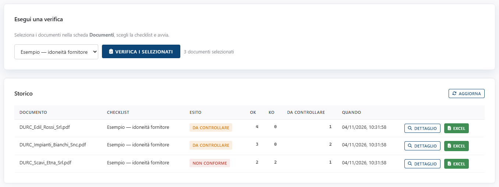
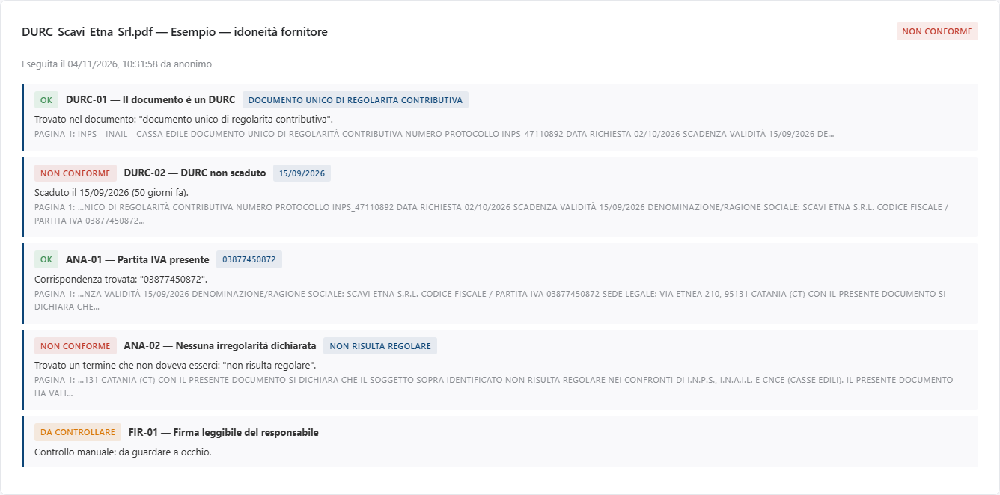
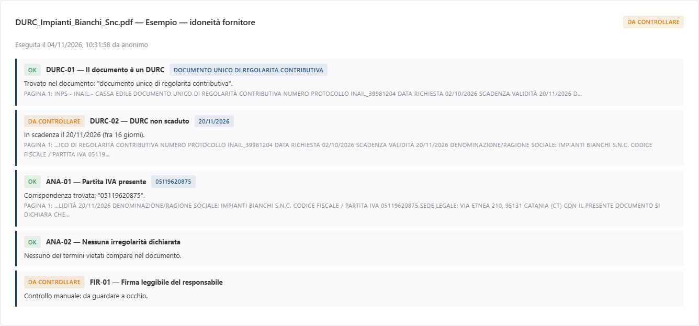

<!-- "><(((º> sabusabu <º)))>< -->
# 4. Verificare i documenti

[← Indice](README.md)

## 4.1 Lanciare la verifica

1. Nella scheda **Documenti** spunta i documenti da controllare (devono essere *pronto*).
2. Apri la scheda **✅ Verifiche**: accanto al pulsante leggi quanti documenti
   sono selezionati (es. *3 documenti selezionati*).
3. Scegli la checklist nel menu a tendina.
4. Premi **Verifica i selezionati**.

Il messaggio *«Eseguite 3 verifiche.»* conferma; i documenti saltati (es. non
ancora pronti) sono elencati con il motivo. Se non hai spuntato niente compare
*«Nessun documento selezionato nella scheda "Documenti".»*.

## 4.2 Lo Storico e gli esiti

Ogni riga dello **Storico** è un documento controllato con una checklist:

| Colonna | Significato |
|---|---|
| **Esito** | il risultato complessivo |
| **OK** / **KO** / **Da controllare** | quanti requisiti in ciascuno stato |
| **Quando** | data e ora della verifica |
| **Dettaglio** | apre l'elenco dei requisiti sotto la tabella |
| **Excel** | scarica il report della verifica |

Gli esiti:

| Esito | Significato |
|---|---|
| **OK** (verde) | requisito soddisfatto |
| **Non conforme** (rosso) | requisito obbligatorio non soddisfatto. Basta un requisito *Non conforme* e l'intero documento è *Non conforme* |
| **Da controllare** (giallo) | serve l'occhio di una persona: requisito facoltativo mancante, data in scadenza entro il preavviso, scansione letta male, oppure regola *manuale* |
| **N/A** | la regola della checklist è scritta male: va corretta |

> **Attenzione.** Se la checklist contiene anche un solo requisito di tipo
> *manuale* (come "Firma leggibile" nell'esempio), l'esito complessivo resta
> **Da controllare** anche quando tutto il resto è OK: il programma non può
> sapere se la persona ha controllato. Guarda il **Dettaglio**: se gli unici
> gialli sono i controlli manuali e li hai fatti, il documento è a posto.

## 4.3 Il dettaglio

**Dettaglio** mostra, per ogni requisito: l'esito, il valore trovato (in azzurro,
es. la data o la partita IVA), **il perché** in una riga e il pezzo di documento
che lo dimostra, con il numero di pagina.

Esempio di DURC **non conforme**: scaduto da 50 giorni e con la dicitura
"non risulta regolare".

Esempio di DURC **da controllare**: regolare, ma scade entro il preavviso di 30 giorni.

Le scansioni vanno sempre ricontrollate sul file: un "Da controllare" su una
scansione storta è voluto, per non respingere un fornitore in regola per un
errore di lettura.

## 4.4 Il report Excel

Il pulsante **Excel** dello Storico scarica il report della verifica (documento,
checklist, esito per requisito, valore, motivo e riscontri): è quello da
allegare alla pratica.

[← Le checklist](03-checklist.md) · [Avanti: Analisi con Claude →](05-analisi-claude.md)
