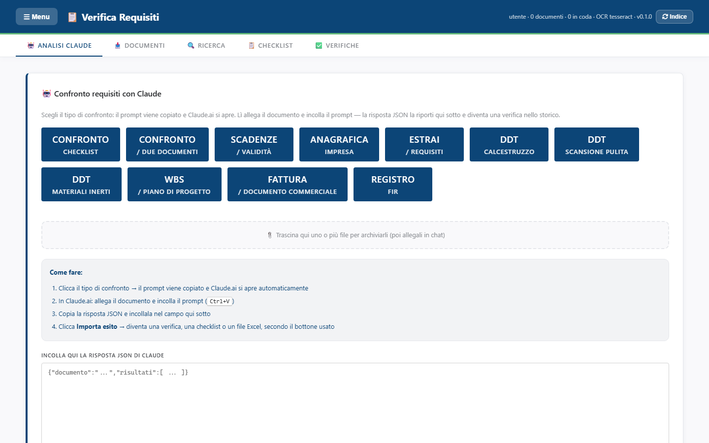
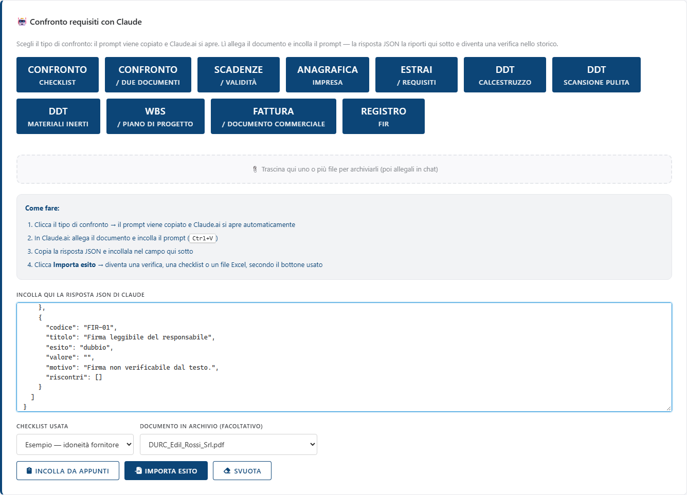
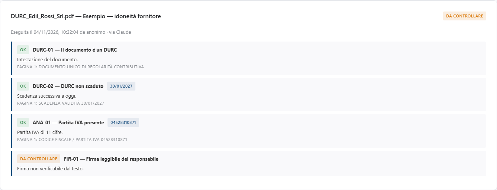

<!-- "><(((º> sabusabu <º)))>< -->
# 5. Analisi con Claude

[← Indice](README.md)

La scheda **🤖 Analisi Claude** (quella che si apre all'avvio) serve quando il
controllo automatico non basta: documenti complessi, confronti fra due file,
estrazione di tabelle. Il documento lo legge **Claude** nel sito
**claude.ai**, con l'account dell'utente; Verifica requisiti prepara la
richiesta e poi trasforma la risposta in una verifica, una checklist o un file Excel.

> Il programma **non** manda niente da solo a Claude: sei tu ad allegare il
> documento nella chat. Usa questa funzione solo con documenti che è lecito
> caricare su claude.ai secondo le regole aziendali.

## 5.1 I pulsanti

| Pulsante | Cosa chiede a Claude | Cosa torna |
|---|---|---|
| **Confronto checklist** | confronta il documento con i requisiti della checklist scelta più sotto | una verifica |
| **Confronto / due documenti** | due file allegati (offerta e capitolato, due revisioni): le differenze che contano | una verifica |
| **Scadenze / validità** | tutte le date di validità e scadenza, quali sono scadute o in scadenza | una verifica |
| **Anagrafica impresa** | ragione sociale, P.IVA, sede, iscrizioni: mancanti o incoerenti | una verifica |
| **Estrai / requisiti** | da un capitolato o una procedura ricava una checklist | una checklist |
| **DDT calcestruzzo**, **DDT scansione pulita**, **DDT materiali inerti** | i dati dei DDT nella struttura a fogli | un file Excel |
| **WBS / piano di progetto** | struttura WBS, attività, responsabili, costi | un file Excel |
| **Fattura / documento commerciale** | righe, totali e dati fiscali | un file Excel |
| **Registro FIR** | i formulari rifiuti nel formato del Registro FIR | un file Excel |

## 5.2 Passo per passo

1. **Prima** scegli in basso la **Checklist usata** (serve per *Confronto checklist*).
2. Clic sul pulsante del tipo di analisi: la richiesta viene **copiata negli
   appunti** e si apre una finestra su claude.ai. Compare il messaggio
   *«📋 Prompt copiato. In Claude.ai allega il documento e incolla (Ctrl+V).»*
3. In claude.ai: allega il documento, incolla con **Ctrl+V**, invia.
4. Copia la risposta di Claude (un blocco di testo che inizia con `{`).
5. Torna in Verifica requisiti e incollala nel campo **Incolla qui la risposta
   JSON di Claude** (oppure premi **Incolla da appunti**).
6. Se vuoi collegare l'esito a un file dell'archivio, sceglilo in
   **Documento in archivio (facoltativo)**.
7. Premi **Importa esito**.

Cosa succede dopo **Importa esito** dipende dal pulsante usato:

- **verifica** → *«Esito importato: N requisiti.»*, si apre la scheda Verifiche
  con il dettaglio; nella riga c'è la dicitura **via Claude**. Da lì vale tutto
  quanto detto nel [capitolo 4](04-verifiche.md), Excel compreso;
- **checklist** → *«Checklist "…" creata da N requisiti.»* e si apre la scheda Checklist;
- **file Excel** → il file `.xlsx` viene scaricato (*«Excel scaricato: …»*).

**Svuota** cancella il campo della risposta.

Il riquadro tratteggiato **📎 Trascina qui uno o più file per archiviarli**
mette i file nell'archivio (come la scheda Documenti) senza uscire da questa scheda.

## 5.3 Messaggi frequenti

| Messaggio | Cosa fare |
|---|---|
| *Prompt non copiabile dal browser: lo trovi nel campo qui sotto, copialo a mano.* | Succede quando il programma è aperto in rete senza HTTPS. Seleziona il testo comparso nel campo, copialo (Ctrl+C) e incollalo in claude.ai; poi svuota il campo prima di incollare la risposta. |
| *Il browser non dà accesso agli appunti: incolla con Ctrl+V nel campo.* | Clicca nel campo e premi Ctrl+V. |
| *Incolla prima la risposta di Claude.* | Il campo è vuoto. |
| *Nella risposta incollata non c'è un oggetto JSON.* / *JSON non valido…* | Hai copiato solo una parte della risposta: ricopiala tutta, dalla prima `{` all'ultima `}`. Le frasi di cortesia prima e dopo non danno fastidio. |

[← Verificare i documenti](04-verifiche.md) · [Avanti: Se qualcosa non va →](06-problemi.md)
