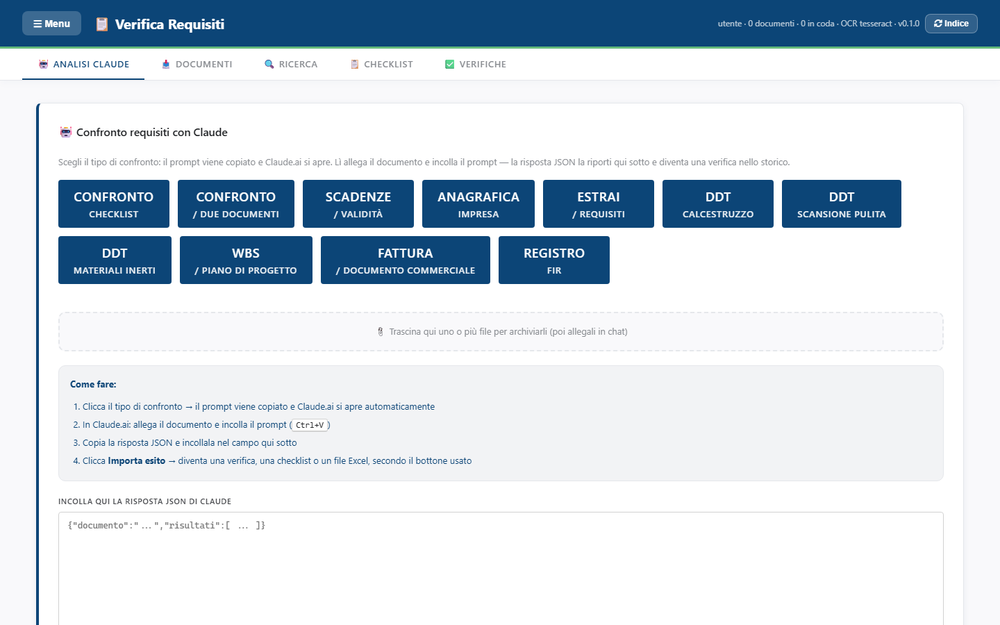

<!-- "><(((º> sabusabu <º)))>< -->
# Verifica requisiti — Guida utente

Verifica requisiti controlla i **documenti dei fornitori e delle gare** (DURC,
visure, certificati, dichiarazioni…) contro una **checklist** di requisiti e dà
un esito per ognuno: *OK*, *Non conforme* o *Da controllare*, con la frase del
documento che lo dimostra e un report Excel. Permette anche di **cercare parole
e frasi** dentro tutti i documenti caricati, comprese le scansioni.

È pensato per l'ufficio gare, l'amministrazione e chi qualifica i fornitori.

## Come si entra

Si apre dal **Portale** della suite Cosedil, scheda *Verifica Requisiti* (per
il Portale vedi la [guida del Portale](../../../portale/docs/guida/README.md)).
È un **programma riservato**: lo vedono gli amministratori e gli utenti abilitati
dall'amministratore. Se la scheda non c'è, chiedi l'abilitazione.

Da **SkyTower**, nel dettaglio di un documento, c'è anche il pulsante per
mandare un file a Verifica requisiti con una checklist: l'esito torna in SkyTower.

## Le cinque schede

In alto ci sono cinque schede (le stesse si trovano in **☰ Menu**):

| Scheda | A cosa serve |
|---|---|
| **Analisi Claude** | far controllare un documento a Claude (claude.ai) e riportare qui la risposta |
| **Documenti** | caricare i file e vedere l'archivio |
| **Ricerca** | cercare parole o frasi in tutti i documenti |
| **Checklist** | le liste di requisiti da controllare |
| **Verifiche** | lanciare i controlli automatici e vederne gli esiti |

In alto a destra c'è una riga di stato: utente, numero di documenti, quanti
sono **in coda** per la lettura, motore OCR in uso e versione.

## Capitoli

1. [Caricare i documenti](01-documenti.md)
2. [Cercare nei documenti](02-ricerca.md)
3. [Le checklist](03-checklist.md)
4. [Verificare i documenti](04-verifiche.md)
5. [Analisi con Claude](05-analisi-claude.md)
6. [Se qualcosa non va](06-problemi.md)
7. [Per l'amministratore di sistema](07-amministratore.md)

## Il giro tipico in quattro passi

1. **Documenti** → scegli i file, scrivi le etichette (commessa, fornitore) → **Carica**; aspetta lo stato *pronto*.
2. Spunta i documenti da controllare.
3. **Verifiche** → scegli la checklist → **Verifica i selezionati**.
4. Leggi gli esiti, apri **Dettaglio**, scarica l'**Excel**.
