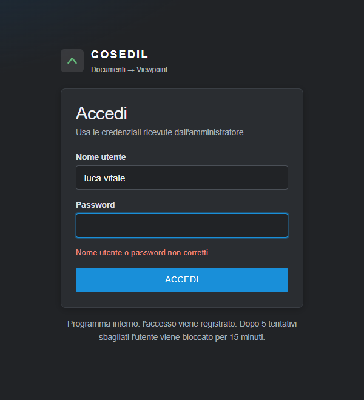
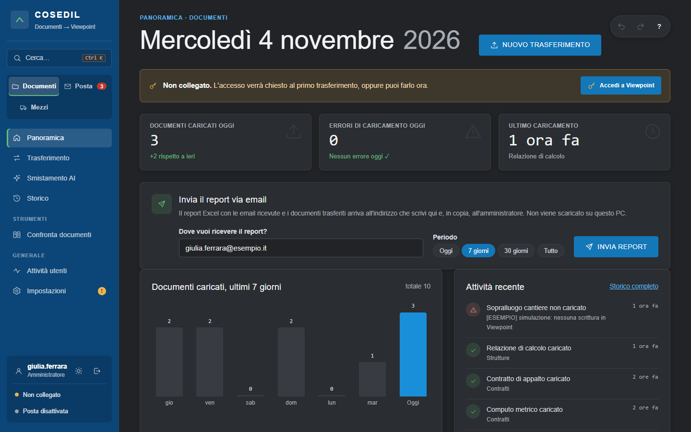
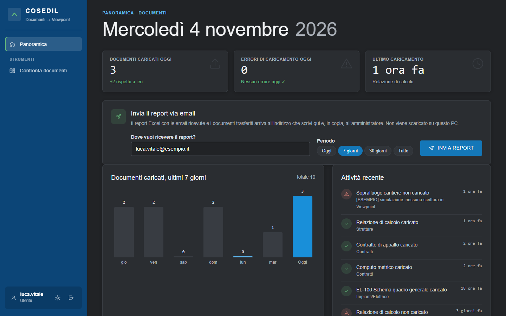
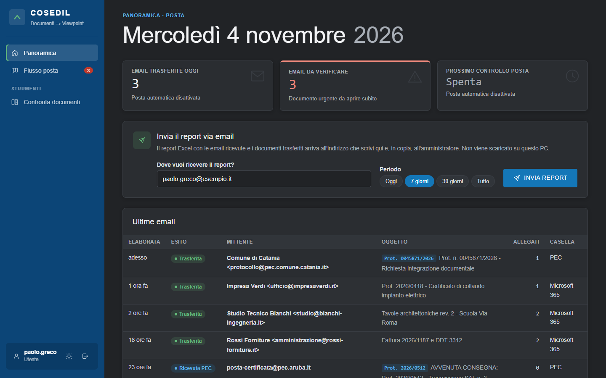
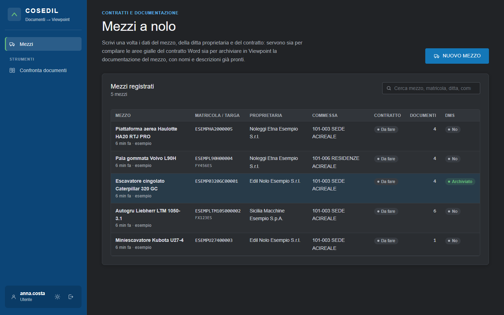
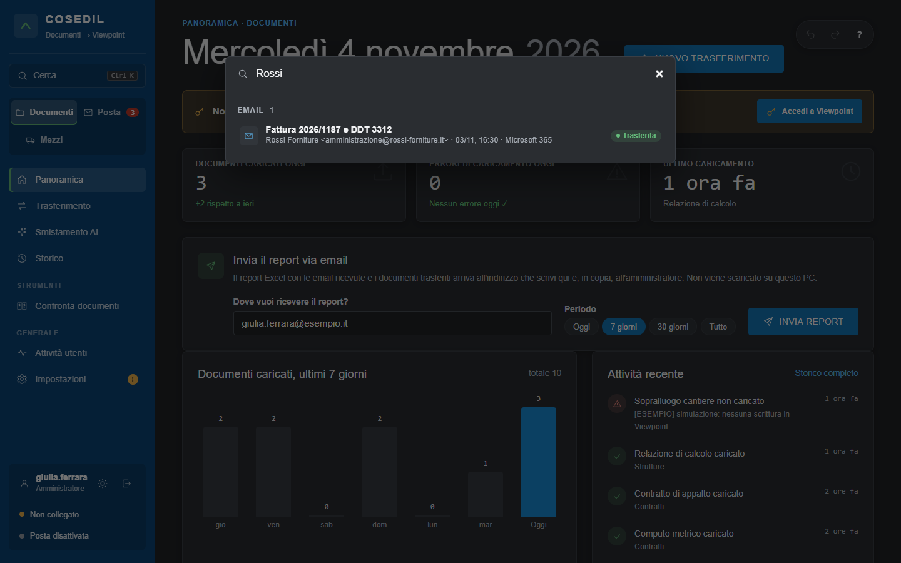
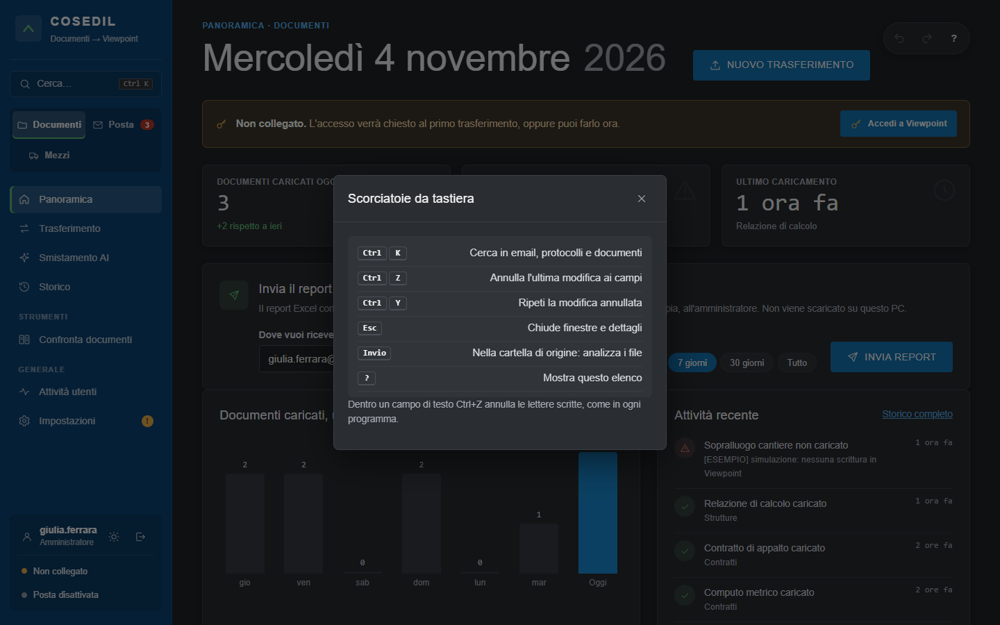

<!-- "><(((º> sabusabu <º)))>< -->
# 1. Entrare e muoversi nel programma

[← Indice](README.md)

## Aprire VFP Transfer

VFP Transfer gira sul PC (o server) dove è installato ed è sempre acceso. Lo si apre nel browser:

- **sul PC del programma**: doppio clic su **`avvia_interfaccia.bat`** (se è già acceso si apre solo la pagina);
- **da un altro PC dell'ufficio**: con l'indirizzo `https://…` che ti dà l'amministratore. Funziona solo se
  l'amministratore ha attivato l'accesso dalla rete (con certificato HTTPS); altrimenti il programma si apre
  solo dal suo PC.

## Accedere

Se sul browser sei già entrato nel **Portale Suite Cosedil**, VFP Transfer ti fa entrare da solo, senza
password: basta aprirlo. Vale per chi ha un utente di VFP Transfer collegato al Portale (stesso nome utente o
stessa email). Un **amministratore del Portale** entra sempre come **amministratore** anche qui, con tutte le
aree: se non ha ancora un utente di VFP Transfer viene creato da solo. Dopo **Esci** il programma non ti fa
rientrare da solo: resta la pagina di accesso, così puoi entrare con un altro utente.

Altrimenti scrivi **Nome utente** e **Password** (te li dà l'amministratore; vale anche la password del Portale)
e clicca **ACCEDI**.

- Nome o password sbagliati: compare **"Nome utente o password non corretti"**.
- Dopo **5 tentativi sbagliati** l'utente viene bloccato per **15 minuti**.
- La sessione si chiude dopo **un'ora senza attività** (e comunque dopo 12 ore): si rientra con la password.
- Ogni accesso viene registrato (lo dice anche la pagina di login).

## La schermata

A sinistra c'è la barra con:

- **Cerca… (Ctrl K)** — ricerca unica (solo amministratori, vedi sotto);
- il **selettore di area** — **Documenti**, **Posta** (col numero delle email da verificare), **Mezzi**. Lo
  vedono solo gli amministratori; gli altri utenti lavorano solo nella loro area;
- le **voci di menu** dell'area scelta, poi **Strumenti** (Confronta documenti) e **Generale** (Attività
  utenti, Impostazioni). Un **!** giallo su Impostazioni indica impostazioni da completare;
- in fondo il **tuo nome**, il pulsante **sole/luna** (tema chiaro o scuro), il pulsante **Esci** e, per gli
  amministratori, lo stato dell'**accesso a Viewpoint** e della **posta automatica**.

La **Panoramica** dei documenti mostra i documenti caricati oggi, gli errori di oggi, l'ultimo caricamento,
il grafico degli ultimi 7 giorni e l'attività recente. Il riquadro giallo **"Non collegato"** con **Accedi a
Viewpoint** compare quando l'accesso a Viewpoint va fatto o rifatto (vedi il [capitolo 6](06-impostazioni.md)).

## Cosa vede un utente non amministratore

Area **Documenti** — Panoramica e Confronta documenti:

Area **Posta** — Panoramica della posta, Flusso posta e Confronta documenti:

Area **Mezzi** — la pagina Mezzi e Confronta documenti:

## Ricerca unica (amministratori)

Clicca **Cerca…** o premi **Ctrl+K** e scrivi: il programma cerca nelle email ricevute (mittente, oggetto,
protocollo, allegati, identificativo PEC) e nei documenti trasferiti (nome, cartella, ID). Clic su un risultato
per aprirlo.

## Annulla, ripeti e scorciatoie (amministratori)

In alto a destra ci sono le frecce **annulla** / **ripeti** (anche **Ctrl+Z** / **Ctrl+Y**): tornano indietro
o avanti tra le modifiche ai campi delle Impostazioni e del Trasferimento, portandoti al campo modificato. Le
modifiche annullate vanno poi salvate come sempre. Il pulsante **?** (o il tasto **?**) mostra le scorciatoie:

## Uscire

Pulsante **Esci** (la freccia accanto al tuo nome, in basso a sinistra). Su un PC condiviso esci sempre.

[Avanti: Documenti →](02-documenti.md)
