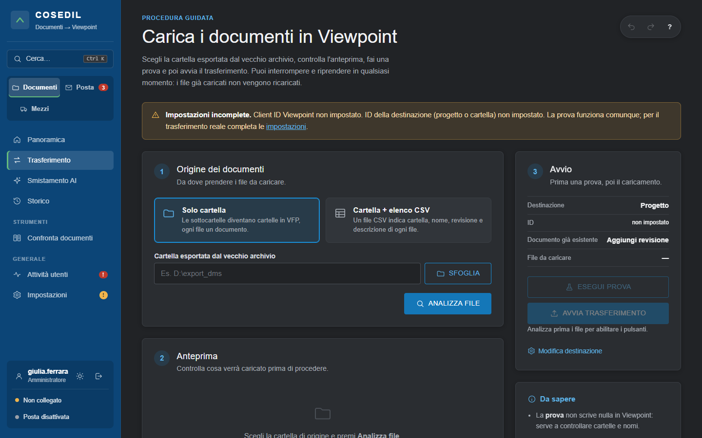
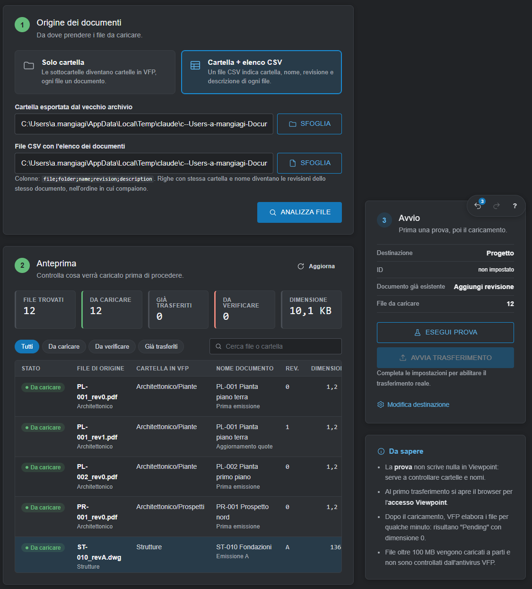
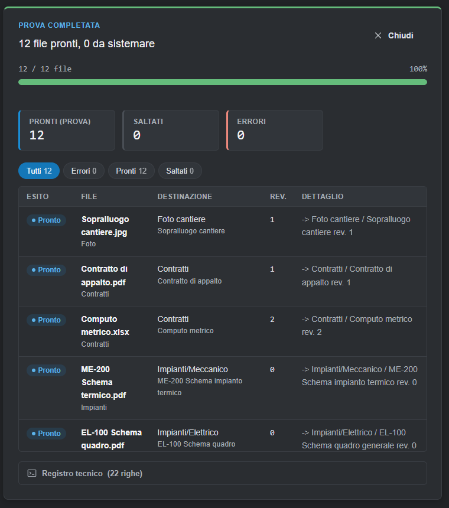
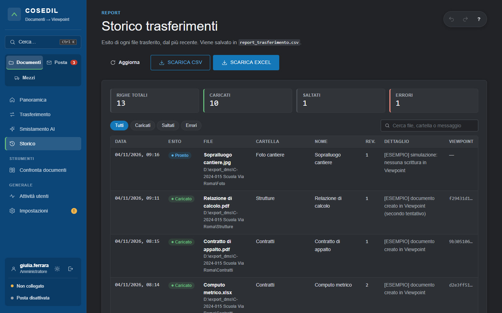
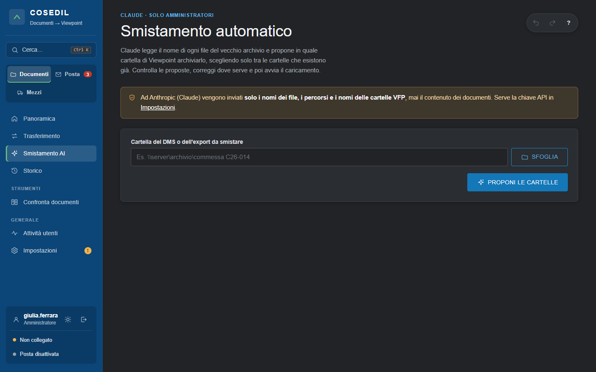

<!-- "><(((º> sabusabu <º)))>< -->
# 2. Documenti: caricare un archivio in Viewpoint

[← Indice](README.md)

## Ricevere il report via email (tutti)

Nella **Panoramica** c'è il riquadro **Invia il report via email**:

1. in **Dove vuoi ricevere il report?** c'è già la tua email (puoi cambiarla);
2. scegli il **Periodo**: *Oggi*, *7 giorni*, *30 giorni*, *Tutto*;
3. clicca **INVIA REPORT**.

Il report Excel (email ricevute e documenti trasferiti, solo della tua area) arriva a quell'indirizzo e, in
copia, all'amministratore. Non viene scaricato sul PC. Se compare *"Invio non ancora configurato
dall'amministratore"*, l'invio email non è ancora impostato: avvisa l'amministratore. Dopo troppi invii
ravvicinati compare *"Troppi invii ravvicinati: riprovare tra qualche minuto"*.

Gli amministratori hanno anche **Scarica il report** (in fondo alla Panoramica), che scarica l'Excel subito.

## Trasferimento (amministratori)

Menu **Trasferimento** (oppure **NUOVO TRASFERIMENTO** nella Panoramica). È una procedura in tre passi.

Se in alto compare il riquadro giallo **"Impostazioni incomplete"**, mancano dati di Viewpoint (Client ID,
destinazione): la **prova** funziona lo stesso, il caricamento vero no. Completa le
[Impostazioni](06-impostazioni.md).

### 1 — Origine dei documenti

Scegli come è fatto l'export del vecchio archivio:

- **Solo cartella**: le sottocartelle diventano cartelle in Viewpoint, ogni file diventa un documento con il
  nome del file;
- **Cartella + elenco CSV**: un file CSV (colonne `file;folder;name;revision;description`) dice per ogni file
  cartella, nome, revisione e descrizione. Più righe con stessa cartella e stesso nome diventano **le revisioni**
  dello stesso documento, nell'ordine in cui compaiono.

Scrivi il percorso in **Cartella esportata dal vecchio archivio** (o usa **SFOGLIA**) e, se serve, il **File
CSV**, poi clicca **ANALIZZA FILE** (o premi **Invio**).

### 2 — Anteprima

L'anteprima dice cosa succederà: **File trovati**, **Da caricare**, **Già trasferiti**, **Da verificare**,
**Dimensione**. Per ogni file: stato, file di origine, cartella in VFP, nome del documento, revisione,
dimensione. I filtri (*Da caricare*, *Da verificare*, *Già trasferiti*) e la ricerca aiutano sulle liste lunghe.

Controlla soprattutto i **Da verificare**: per esempio file nella radice dell'export (in Viewpoint un documento
deve stare in una cartella) o file non trovati.

### 3 — Avvio: prima la prova, poi il caricamento

Nel riquadro **Avvio** a destra vedi la destinazione (progetto o cartella), cosa fare se il documento esiste
già (*Aggiungi revisione* oppure *Salta*) e quanti file verranno caricati.

1. Clicca **ESEGUI PROVA**: il programma simula tutto **senza scrivere niente in Viewpoint** e mostra per ogni
   file dove finirebbe.

   

2. Se la prova è pulita (*"12 file pronti, 0 da sistemare"*), clicca **AVVIA TRASFERIMENTO**. Se l'accesso a
   Viewpoint non è ancora fatto, si apre la pagina di login di Viewpoint.

Durante il caricamento vedi barra di avanzamento, file in corso e contatori (caricati, saltati, errori). Puoi
**interrompere**: il programma si ferma dopo il file in corso. Rilanciando riparte da dove si era fermato e **non
ricarica** i file già caricati. Se una revisione di un documento fallisce, le revisioni successive dello stesso
documento non vengono caricate (verrebbero nell'ordine sbagliato).

> Dopo il caricamento Viewpoint elabora i file per qualche minuto: lì per lì risultano *"Pending"* con
> dimensione 0. I file oltre 100 MB vengono caricati a pezzi e Viewpoint non li controlla con l'antivirus.

## Storico (amministratori)

Menu **Storico**: l'esito di ogni file trasferito (dall'interfaccia e dalla posta), dal più recente.

Contatori in alto (righe, caricati, saltati, errori), filtri *Caricati / Saltati / Errori*, ricerca per file,
cartella o messaggio, **SCARICA CSV** e **SCARICA EXCEL**. La colonna *Viewpoint* riporta l'ID del documento creato.

## Smistamento AI (amministratori)

Quando l'export del vecchio archivio non ha cartelle ordinate, **Smistamento AI** chiede a **Claude** di proporre,
per ogni file, la cartella di Viewpoint giusta.

1. Indica la **Cartella del DMS o dell'export da smistare** e clicca **PROPONI LE CARTELLE**.
2. Claude legge **solo il nome e il percorso** di ogni file (mai il contenuto) e sceglie **solo tra le cartelle
   che esistono già** in Viewpoint, oppure "Da smistare". Per ogni file indica quanto è sicuro e perché.
3. Rivedi le proposte (filtri *Da controllare* e *Da smistare*), correggi la cartella dove serve, togli i file
   da escludere.
4. **Esegui prova**, poi **Trasferisci selezionati** (stesso avanzamento del Trasferimento).

Serve la chiave dell'API di Claude (Impostazioni › *Smistamento con Claude*). Massimo 2.000 file per analisi.
*La schermata delle proposte non è fotografata: nella copia di prova non c'erano né Claude né Viewpoint.*

## Estrarre dal vecchio DMS

L'estrazione dei documenti direttamente dal vecchio DMS (o da SkyTower) si fa da riga di comando con
`estrai_dms.py`, a cura dell'amministratore di sistema: produce una cartella con il file CSV da usare qui sopra
con **Cartella + elenco CSV**. Vedi l'[appendice](08-amministratore-di-sistema.md).

[← Accesso](01-accesso-e-schermata.md) · [Avanti: Posta →](03-posta.md)
