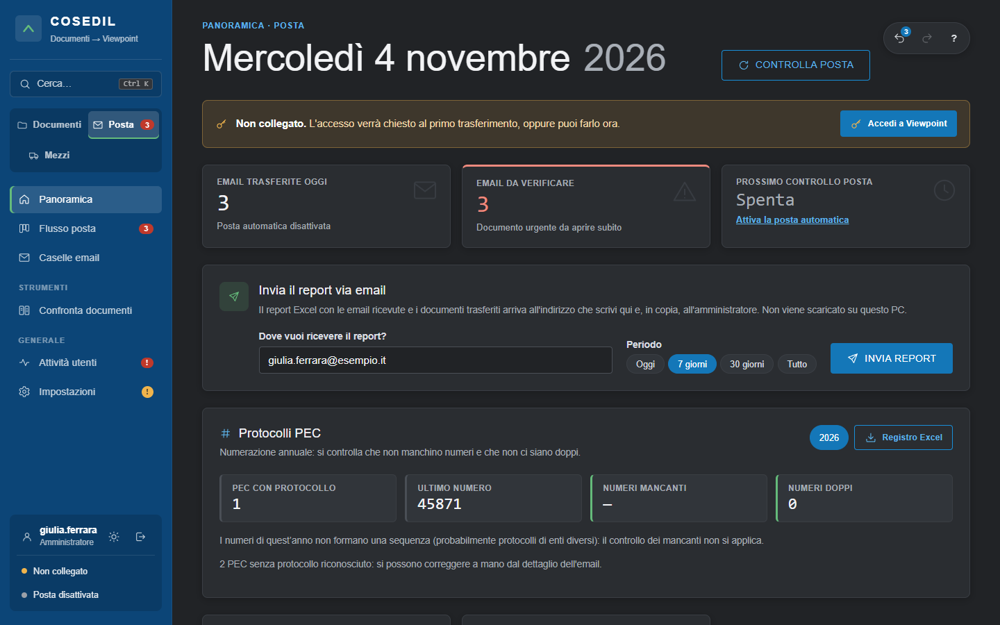
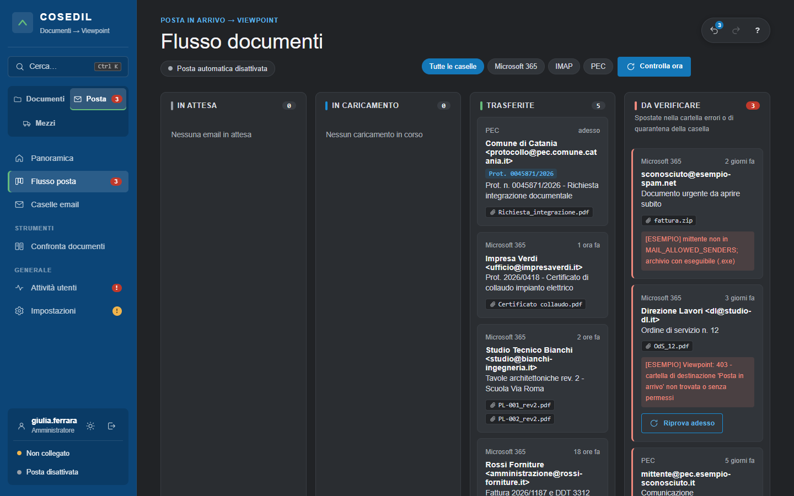
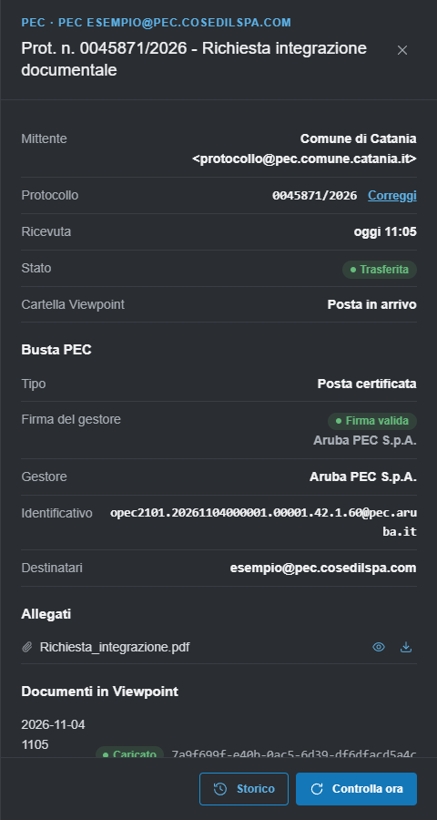
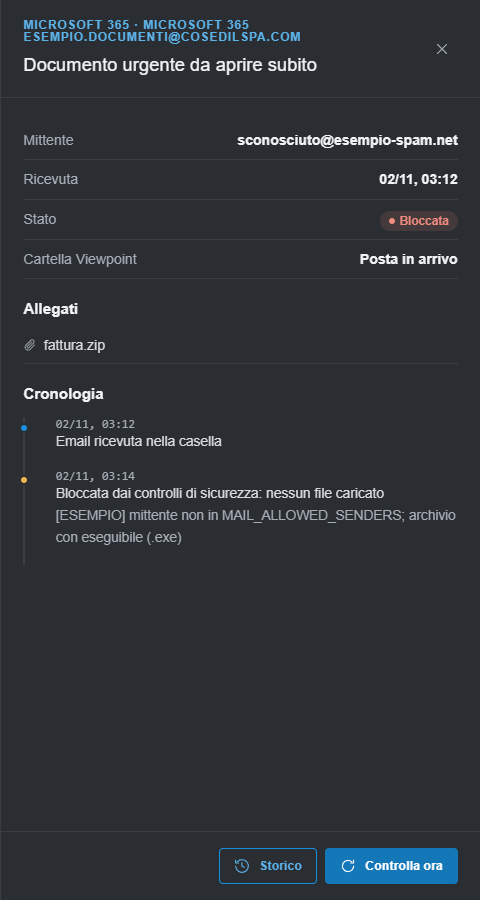
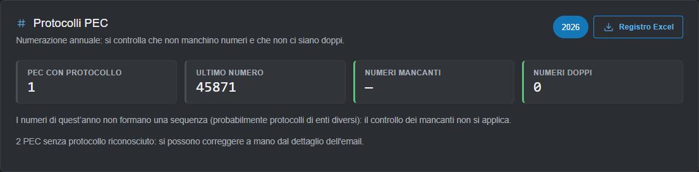
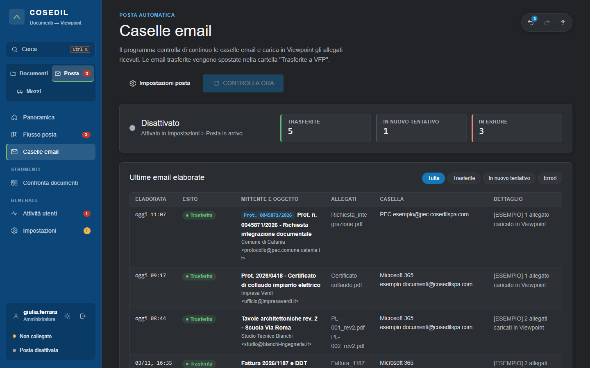

<!-- "><(((º> sabusabu <º)))>< -->
# 3. Posta: dalle caselle email a Viewpoint

[← Indice](README.md)

Quando la **posta automatica** è attiva, VFP Transfer controlla le caselle (Microsoft 365, IMAP, PEC) ogni
pochi minuti. Per ogni email con allegati:

1. la **controlla** (mittente autorizzato, mittente non falsificato, allegati ammessi, antivirus, firma della PEC);
2. salva una copia degli allegati e li **carica in Viewpoint** nella cartella della posta, con nome
   `AAAA-MM-GG HHMM nomefile` e descrizione "Email da …: oggetto";
3. sposta l'email nella cartella **"Trasferite a VFP"** della casella.

Se il caricamento non riesce l'email viene ritentata ai giri successivi; dopo alcuni tentativi finisce nella
cartella **"Errori VFP"**. Se non supera i controlli finisce in **"Bloccate VFP"** (quarantena) e **nessun
file entra in Viewpoint**.

## Panoramica della posta

Nell'area **Posta** la Panoramica mostra le email trasferite oggi, le **email da verificare** e il prossimo
controllo della posta, poi il riquadro del report (vedi [capitolo 2](02-documenti.md#ricevere-il-report-via-email-tutti)),
i **Protocolli PEC** (amministratori) e le ultime email.

Gli esiti delle email: **Trasferita**, **Ricevuta PEC** (ricevute di accettazione e consegna: non contengono
documenti, restano in casella), **Senza allegati**, **Bloccata**, **In errore**.

## Flusso posta

Menu **Flusso posta**: una bacheca a quattro colonne.

- **In attesa** — email che verranno ritentate;
- **In caricamento** — in corso adesso;
- **Trasferite** — andate a buon fine (le ultime 10, *Mostra tutte* per le altre);
- **Da verificare** — spostate nella cartella errori o nella quarantena della casella: vanno guardate a mano.

I pulsanti in alto filtrano per casella (*Microsoft 365*, *IMAP*, *PEC*). **Controlla ora** fa un giro di
controllo subito. Sulle email in errore, l'amministratore ha **Riprova adesso**: l'email torna nella casella
controllata e viene ricaricata.

## Dettaglio di un'email

Clic su una scheda: a destra si apre il dettaglio.

Trovi mittente, **protocollo**, data di ricezione, stato, cartella di Viewpoint e:

- per le PEC, la **busta**: tipo, **firma del gestore** (*Firma valida* = busta integra), gestore,
  identificativo, destinatari;
- gli **allegati**, con anteprima (occhio) e download (freccia). I PDF arrivati per posta si scaricano invece di
  aprirsi nel browser;
- i **documenti creati in Viewpoint**;
- la **cronologia** di ogni passaggio.

Per un'email **bloccata** la cronologia spiega il motivo, per esempio mittente non autorizzato o allegato
pericoloso:

Un'email bloccata va controllata a mano nella cartella "Bloccate VFP" della casella: se è legittima, chiedi
all'amministratore di aggiungere il mittente tra gli autorizzati.

> **Allegati non ammessi** (dal 4 novembre 2026): archivi (**zip, 7z, rar**) e documenti Office del vecchio
> formato (**doc, xls, ppt**) non vengono più importati, come eseguibili, script, pagine web e file con macro.
> Chiedi al mittente un PDF o un file `.docx` / `.xlsx`.

## Protocolli PEC (amministratori)

Il numero di protocollo si legge dall'oggetto delle PEC ("Prot. n. 0012345/2026", "001 - …", "PG/2026/123"…);
se manca l'anno si aggiunge quello di arrivo. Compare in tutte le pagine, è cercabile e finisce nella
descrizione del documento in Viewpoint.

Il riquadro **Protocolli PEC** della Panoramica controlla, per anno, **numeri mancanti** e **numeri doppi**
(se i numeri sono di enti diversi e non formano una sequenza, il controllo dei mancanti non si applica).
**Registro Excel** scarica il registro dei protocolli. Un protocollo letto male si corregge dal dettaglio
dell'email con **Correggi**.

## Caselle email (amministratori)

Menu **Caselle email**: stato della posta automatica (*Attivo* / *Disattivato*), contatori (trasferite, in
nuovo tentativo, in errore) e le ultime email elaborate, con filtri.

**Impostazioni posta** porta alle impostazioni; **CONTROLLA ORA** fa un giro subito.

> Dal 4 novembre 2026, con la posta attiva, l'elenco dei **mittenti autorizzati** è **obbligatorio**: se è
> vuoto il controllo della posta resta fermo e le Impostazioni non si salvano finché non lo compili.

[← Documenti](02-documenti.md) · [Avanti: Mezzi →](04-mezzi.md)
