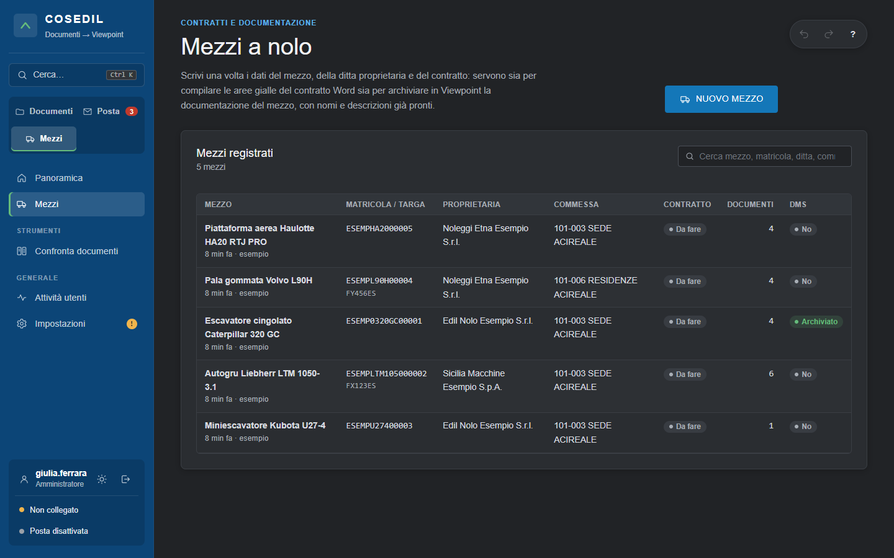
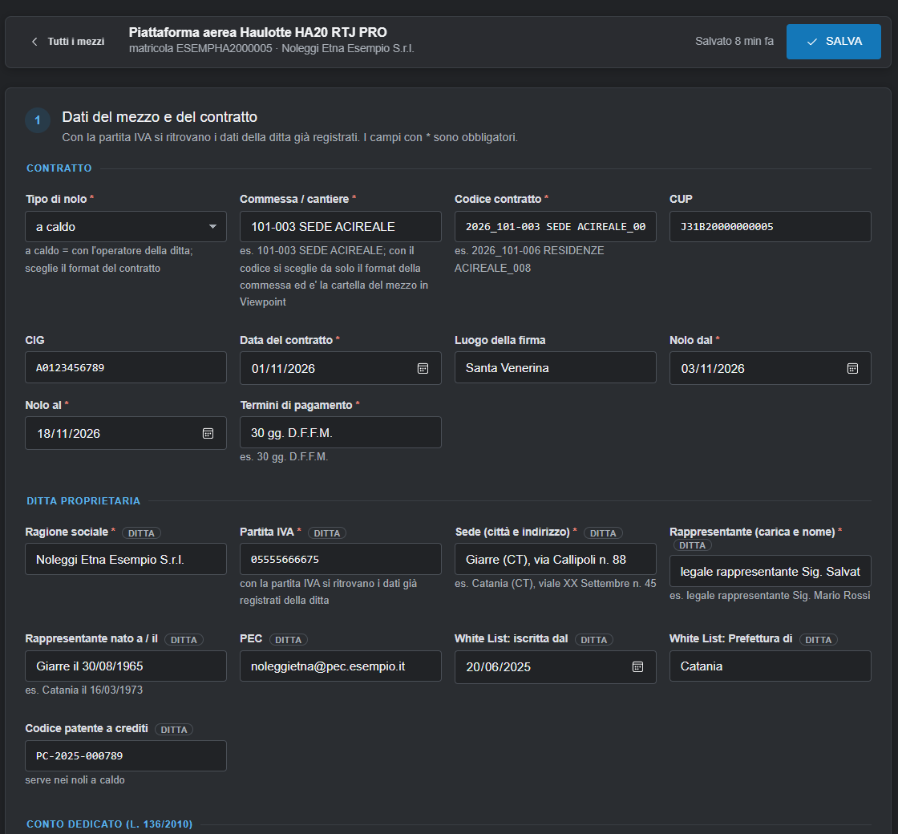
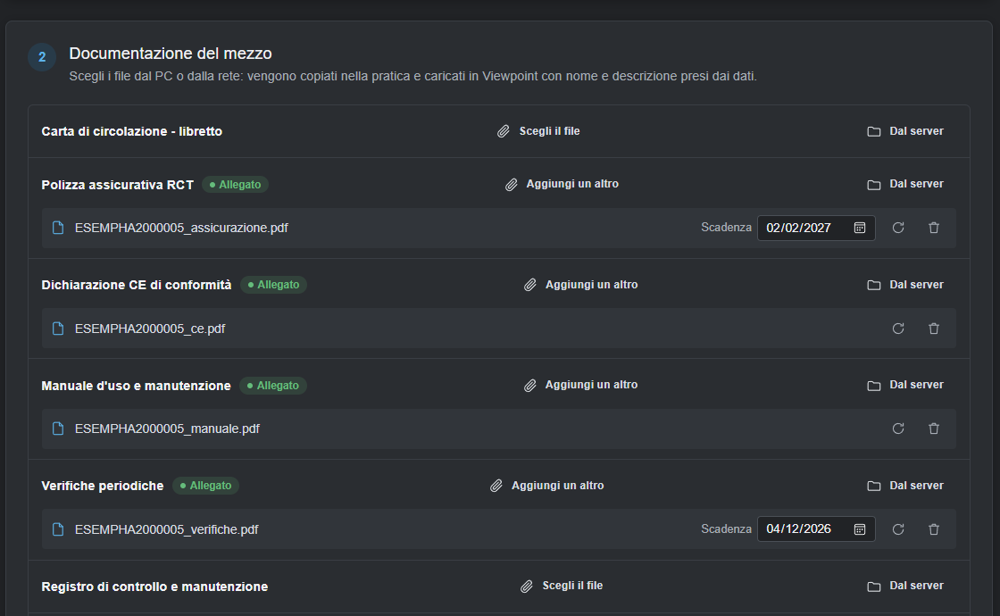
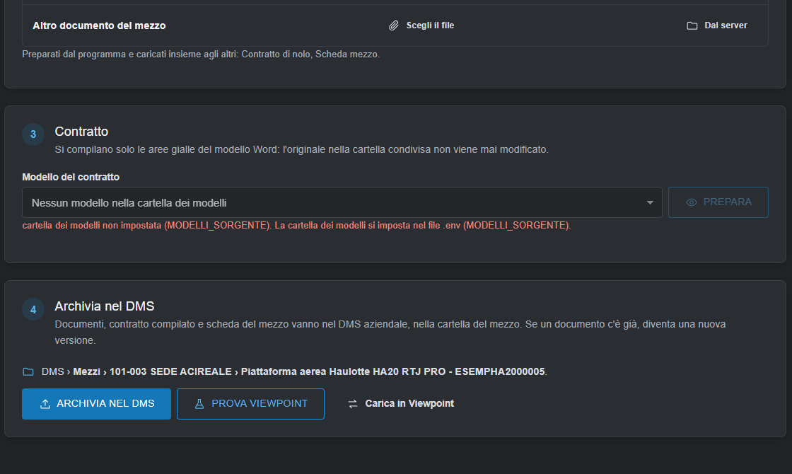

<!-- "><(((º> sabusabu <º)))>< -->
# 4. Mezzi a nolo

[← Indice](README.md)

La pagina **Mezzi** (area Mezzi) raccoglie in una sola scheda i dati di un mezzo a nolo, della ditta
proprietaria e del contratto. I dati si scrivono **una volta** e servono a due cose:

1. compilare le **aree gialle del contratto Word** di nolo (a freddo o a caldo);
2. archiviare la **documentazione del mezzo** (libretto, polizza, dichiarazione CE, verifiche…) nel DMS aziendale
   e in Viewpoint, con nomi e descrizioni già pronti.

La usano gli amministratori e gli utenti dell'area **Mezzi**. Le scadenze (fine nolo, polizza, verifiche)
finiscono da sole nello **Scadenzario**.

## Elenco dei mezzi

Per ogni mezzo: matricola o targa, ditta proprietaria, commessa, stato del contratto (*Da fare* / compilato),
numero di documenti e stato nel DMS (*No* / *Archiviato*). La casella in alto cerca per mezzo, matricola,
ditta o commessa. **NUOVO MEZZO** apre una scheda vuota; un clic su una riga apre quella esistente.

## 1 — Dati del mezzo e del contratto

La scheda è divisa in sezioni: **Contratto** (tipo di nolo, commessa, codice contratto, CUP, CIG, date,
pagamento), **Ditta proprietaria**, **Conto dedicato (L. 136/2010)**, **Mezzo**, **Prezzi**, **Utilizzatrice e
appalto principale**, **Oneri e allegati**. I campi con **\*** sono obbligatori; quelli con l'etichetta
**DITTA** appartengono alla ditta e si ricordano per le volte successive.

- Scrivi la **Partita IVA** della ditta: se è già registrata, i suoi dati si compilano da soli (*"Ditta già
  registrata: …"*); se il programma è collegato ai gestionali CPM o Alyante, i campi vuoti si compilano da lì
  (*"Ditta trovata in …"*). Se un gestionale non risponde compare *"Gestionale non raggiungibile"* e la scheda
  funziona lo stesso.
- Scrivi o scegli la **Commessa** (es. *101-003 SEDE ACIREALE*): CUP, CIG, committente e oggetto dell'appalto
  si compilano dai gestionali, se collegati.
- Clicca **SALVA** in alto a destra (*"Mezzo salvato."*).

> **Attenzione all'IBAN e ai dati della ditta.** Se scrivi un dato diverso da quello già registrato (per esempio
> un IBAN nuovo, tipico delle truffe), il programma **non lo sostituisce**: si ferma con un messaggio che inizia
> con **"ANAGRAFICA"**. Il cambio lo conferma solo un **amministratore**, dopo aver verificato direttamente con la
> ditta (per telefono, non rispondendo all'email). Il cambio resta nello storico.

## 2 — Documentazione del mezzo

Per ogni tipo di documento (carta di circolazione, polizza RCT, dichiarazione CE, manuale, verifiche
periodiche, registro di controllo…) clicca **Scegli il file** (o **Aggiungi un altro**) e scegli il file dal tuo
PC; dove c'è, compila la **Scadenza**. L'amministratore può prendere i file anche **Dal server**. I file vengono
copiati nella pratica quando salvi (massimo 200 MB per file). Contratto di nolo e scheda del mezzo li prepara
il programma.

## 3 — Contratto

Scegli il **Modello del contratto** (i format stanno nella cartella dei modelli, una sottocartella per
commessa: di solito il modello giusto si sceglie da solo da commessa e tipo di nolo) e clicca **PREPARA**.
Il programma mostra ogni area gialla del contratto con i dati al posto dei puntini (gli importi anche in
lettere). Correggi dove serve, togli la spunta alle aree da lasciare com'erano e clicca **COMPILA CONTRATTO**
(*"Contratto compilato."*), poi scarica la copia compilata.

Si scrive **solo nelle aree gialle**: fuori il testo resta identico (il programma lo controlla) e l'originale non
viene mai toccato.

*Nella copia di prova la cartella dei modelli non era impostata, per questo compare il messaggio rosso
"cartella dei modelli non impostata (MODELLI_SORGENTE)" e la preparazione del contratto non è fotografata. Se lo
vedi anche tu, avvisa l'amministratore di sistema.*

## 4 — Archivia nel DMS

La riga con la cartella mostra dove finiranno i file (es. *DMS › Mezzi › 101-003 SEDE ACIREALE › Piattaforma
aerea … - matricola*). **ARCHIVIA NEL DMS** carica documenti, contratto compilato e scheda del mezzo; un
documento già presente diventa una nuova versione, un file identico non viene ricaricato. Se l'azienda usa
**SkyTower** come DMS, i file diventano documenti della commessa in SkyTower.

L'amministratore ha anche **PROVA VIEWPOINT** (simulazione) e **Carica in Viewpoint**.

[← Posta](03-posta.md) · [Avanti: Confronta documenti e Attività →](05-confronto-e-attivita.md)
