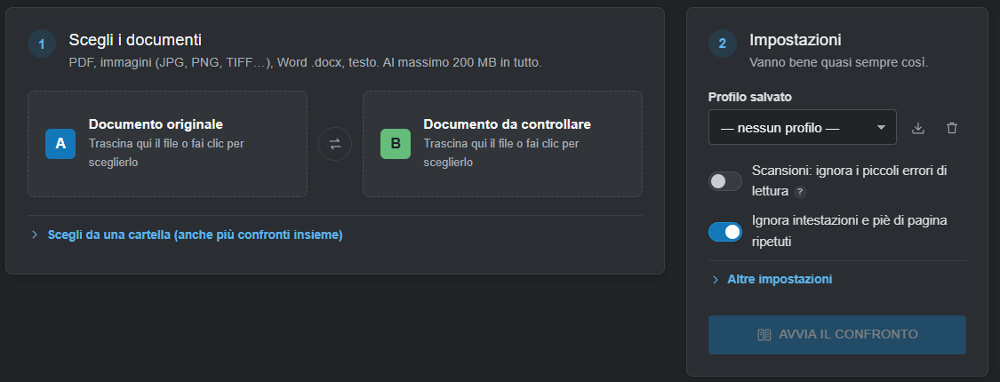
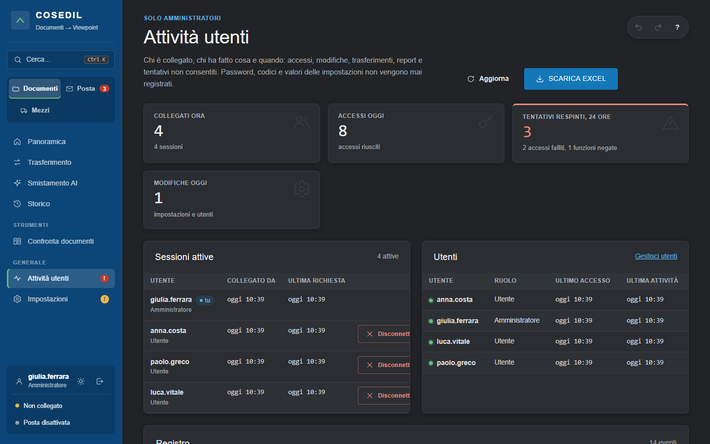

<!-- "><(((º> sabusabu <º)))>< -->
# 5. Confronta documenti e Attività utenti

[← Indice](README.md)

## Confronta documenti (tutti)

Menu **Strumenti › Confronta documenti**, per tutti gli utenti. Mette a confronto due versioni dello stesso
documento (PDF, scansioni, immagini, Word `.docx`, testo) e mostra pagina per pagina cosa è cambiato, con
**numeri e date modificati** in evidenza.

1. **Scegli i documenti**: trascina il file originale nel riquadro **A** e quello da controllare nel riquadro
   **B** (o clicca per sceglierli). Con **Scegli da una cartella** puoi avviare più confronti insieme.
2. **Impostazioni**: di solito vanno bene così. *Scansioni: ignora i piccoli errori di lettura* aiuta con i
   documenti scansionati; *Ignora intestazioni e piè di pagina ripetuti* è attivo di serie. Le scelte si possono
   salvare come **profilo**.
3. Clicca **AVVIA IL CONFRONTO**.

Nel risultato ti sposti tra le differenze con i pulsanti o con i tasti **N** / **P**, puoi vedere solo *numeri e
date*, guardare le pagine affiancate o sovrapposte e segnare ogni differenza come *vista*, *accettata* o *da
chiarire*. Si scarica il report in **PDF** o **Word** e l'elenco delle differenze in **Excel**.

**I MIEI CONFRONTI**: restano 30 giorni. Ognuno vede solo i suoi; l'amministratore li vede tutti.

Se in alto compare il riquadro rosso **"Confronto non disponibile"**, il motore del confronto non è partito:
clicca **Riprova** e, se non basta, avvisa l'amministratore di sistema.

*Nella copia usata per le immagini il motore del confronto non era installato: per questo sono fotografate solo
la scelta dei documenti e le impostazioni. Il funzionamento dettagliato è lo stesso del programma Confronto
Documenti della suite.*

## Attività utenti (amministratori)

Menu **Generale › Attività utenti**: chi è collegato, chi ha fatto cosa e quando.

- **Contatori**: collegati ora, accessi di oggi, tentativi respinti nelle ultime 24 ore (password sbagliate e
  funzioni riservate tentate da chi non è amministratore), modifiche di oggi.
- **Sessioni attive**: chi è collegato, da quando, ultima richiesta; si può **disconnettere** un altro utente.
- **Utenti**: ruolo, ultimo accesso, ultima attività; **Gestisci utenti** porta alle Impostazioni.
- **Registro**: accessi, uscite, modifiche alle impostazioni e agli utenti (solo i nomi dei campi, mai i valori),
  trasferimenti, report, confronti, tentativi negati. Filtri per categoria, periodo, utente, esito e testo;
  **SCARICA EXCEL**.

Le righe del registro sono concatenate: se qualcuno modifica o toglie righe in mezzo, la pagina mostra un avviso
rosso. Il personale va informato che l'uso del programma viene registrato.

[← Mezzi](04-mezzi.md) · [Avanti: Impostazioni →](06-impostazioni.md)
