<!-- "><(((º> sabusabu <º)))>< -->
# 6. Impostazioni (amministratori)

[← Indice](README.md)

Menu **Generale › Impostazioni**. Di solito si compilano una volta sola, con l'ufficio IT. In alto un indice
porta ai settori (**Viewpoint**, **Posta**, **Report e smistamento**, **Utenti e manutenzione**); il riquadro
rosso **Sicurezza da completare** elenca cosa manca, con il link **Vai al campo**.

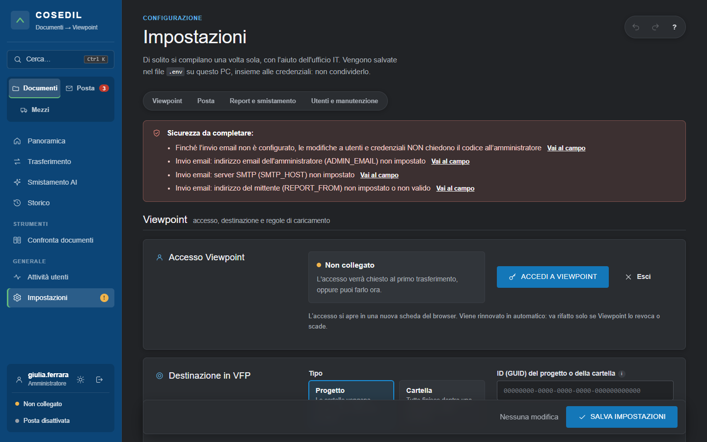

Come si lavora:

- i campi modificati e non ancora salvati sono segnati in giallo; quelli sbagliati (email, server, porte) sono
  segnalati mentre scrivi; la **i** accanto alle parole tecniche spiega cosa sono;
- in basso la barra con **SALVA IMPOSTAZIONI** (*"Nessuna modifica"* se non c'è niente da salvare);
- password e chiavi non vengono mai rimostrate: un campo password vuoto significa "lascia quella salvata".
  Se cambi l'indirizzo di un server, la sua password va reinserita.

> **Codice di autorizzazione.** Quando l'invio email è configurato, le modifiche a utenti, password,
> credenziali e impostazioni di sicurezza chiedono un **codice monouso** che arriva **solo all'email
> dell'amministratore**: vale 10 minuti, solo per quella modifica. Finché l'invio email non è configurato questa
> protezione non è attiva (il riquadro rosso lo ricorda).

## Viewpoint

**Accesso Viewpoint** — stato del collegamento e pulsante **ACCEDI A VIEWPOINT**: si apre una scheda con il
login di Viewpoint; poi l'accesso si rinnova da solo e va rifatto solo se Viewpoint lo revoca o scade
(lo segnalano il riquadro giallo in Panoramica e la scritta in basso a sinistra). **Esci** scollega.

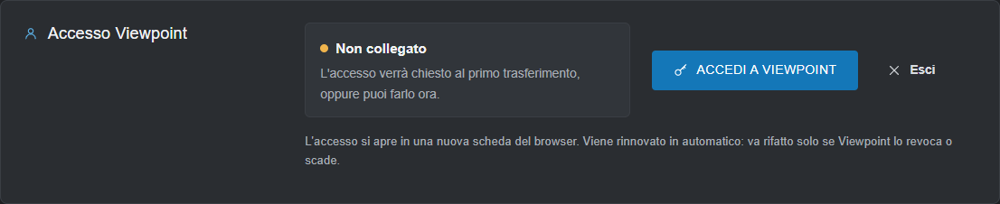

**Destinazione in VFP** — dove vanno i documenti: un **Progetto** (le cartelle vengono create sotto) o una
**Cartella**, con il suo ID (GUID).

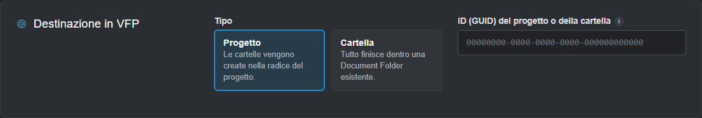

**Documenti** — revisione predefinita, cosa fare **se il documento esiste già** (*Aggiungi revisione* o
*Salta*), notifica via email ai destinatari, indirizzo web dei documenti (per avere il link diretto nello Storico
e nel Flusso posta).

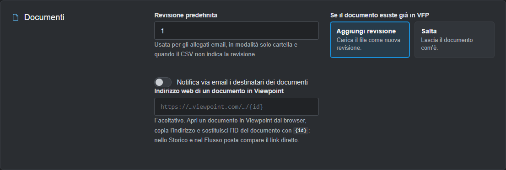

**Credenziali API Viewpoint** — Client ID e Client secret forniti da Trimble/Viewpoint.

## Posta

**Caselle email** — attiva una o più caselle: **Microsoft 365 / Outlook**, **IMAP** (Aruba, Gmail con password
per app…), **PEC**. Dopo aver salvato usa **Prova connessione**. Meglio una casella dedicata (es.
documenti@…): vengono elaborate tutte le email con allegati.

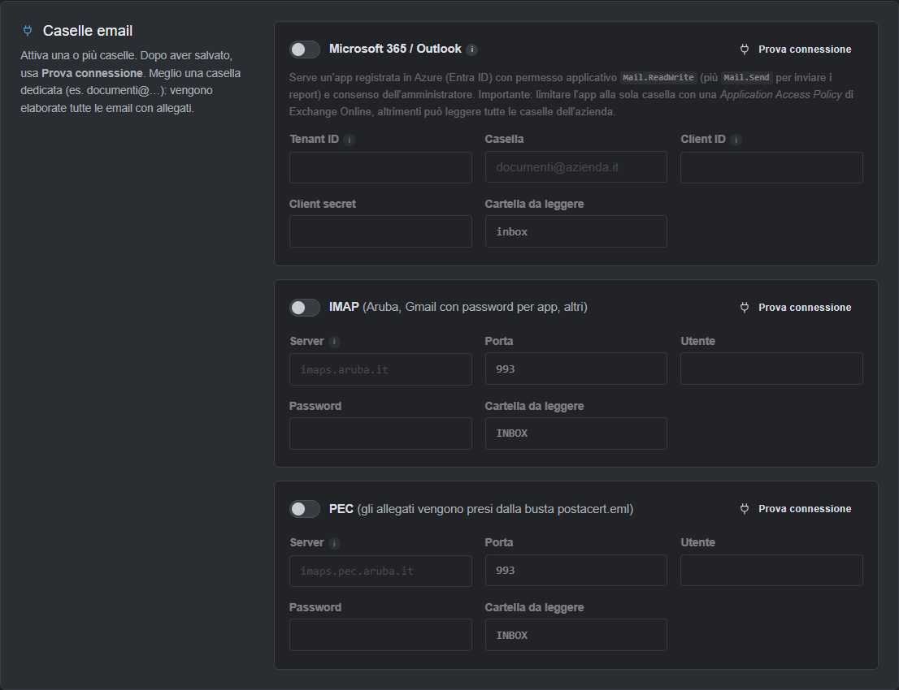

**Posta in arrivo** — attiva il caricamento automatico, la cartella di Viewpoint per gli allegati, ogni quanti
secondi controllare, le cartelle della casella per le email trasferite e in errore, i tentativi, le opzioni
(ignorare le immagini della firma, aggiungere data e ora al nome).

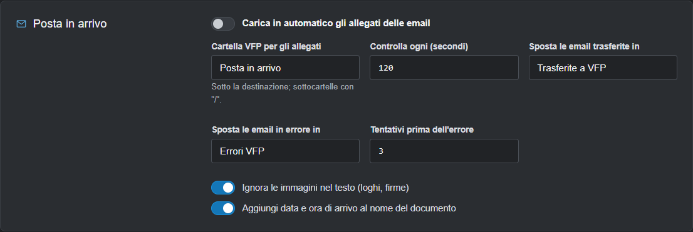

**Sicurezza della posta** — le email che non passano questi controlli finiscono in quarantena, senza caricare
niente:

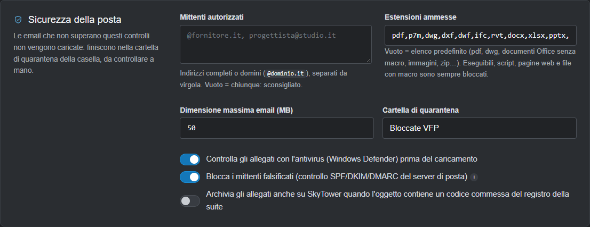

- **Mittenti autorizzati**: indirizzi completi o domini (`@fornitore.it`), separati da virgola. **Dal 4 novembre
  2026 è obbligatorio** con la posta attiva: vuoto, il controllo della posta non parte e il salvataggio viene
  rifiutato con *"con la posta attiva serve l'elenco dei mittenti autorizzati"*, come ricorda anche la nota sotto il
  campo;
- **Estensioni ammesse**: archivi (zip, 7z, rar), Office binario (doc, xls, ppt), eseguibili, script, pagine web e
  file con macro sono **sempre** bloccati, qualunque cosa ci sia scritto qui;
- dimensione massima, cartella di quarantena, antivirus (Windows Defender), blocco dei mittenti falsificati
  (SPF/DKIM/DMARC), archiviazione degli allegati anche in **SkyTower** quando l'oggetto contiene il codice di una
  commessa della suite.

**Protocollo PEC** — una regola personalizzata per leggere il protocollo dall'oggetto; **Prova** mostra come
cambierebbero le ultime PEC prima di salvarla.

**Caselle collegate e posta ricevuta** — per ogni casella i conteggi e l'elenco delle email arrivate, con filtri
per casella, periodo e ricerca; **SCARICA REPORT EXCEL**. Clic su una riga per il dettaglio.

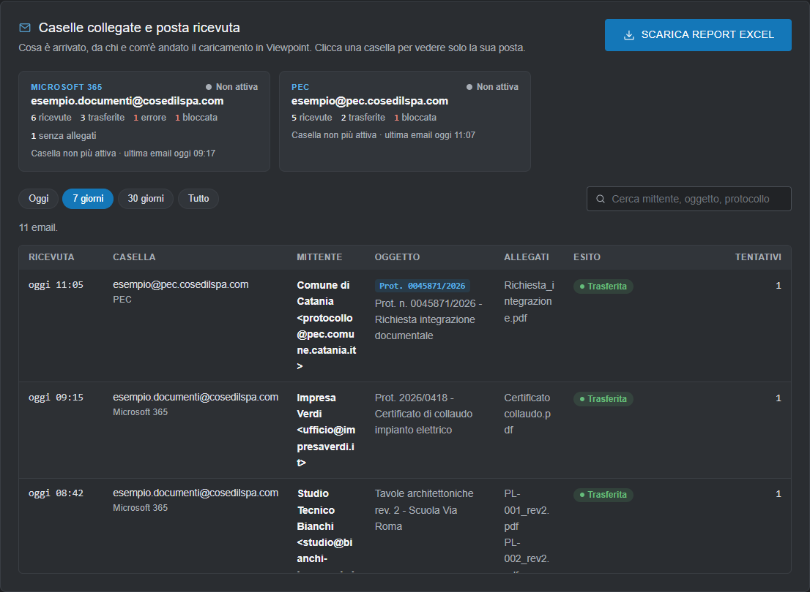

## Report e smistamento

**Invio del report via email** — email dell'amministratore (riceve tutti i report in copia e i codici di
autorizzazione), mittente, domini ammessi per i destinatari (consigliato il solo dominio aziendale), invio con
server SMTP o Microsoft 365. **Invia email di prova** per controllare.

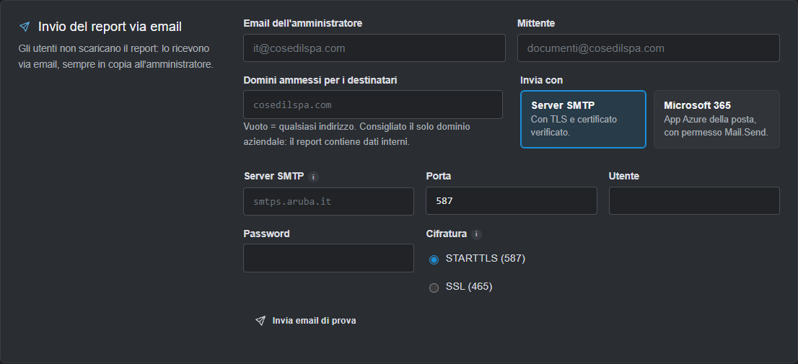

**Smistamento con Claude** — chiave API di Anthropic e modello, per lo Smistamento AI. Vengono inviati solo nomi
di file e cartelle.

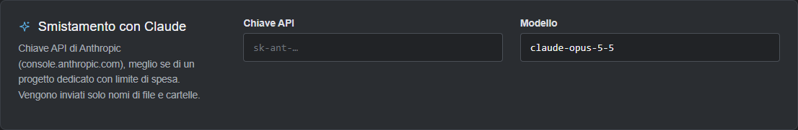

## Utenti e manutenzione

**Utenti** — per ogni utente ruolo, **area** (Documenti, Posta o Mezzi), email, ultimo accesso; **Password**
per impostarne una nuova, **Elimina**. In fondo si aggiunge un **Nuovo utente** (nome.cognome, ruolo, area, email,
password iniziale di almeno 8 caratteri) con **AGGIUNGI**. Chi cambia ruolo o password deve rientrare.

Gli utenti segnati **«dal Portale»** (sotto c'è il nome e cognome del Portale) sono collegati al loro account del
Portale Suite Cosedil: il **ruolo** lo decide il Portale (la tendina è spenta), nome ed email si aggiornano da
soli a ogni ingresso; l'**area** invece la scegli qui.

Gli **amministratori** li crea, modifica ed elimina **solo il proprietario della suite**: creare un
amministratore, dare o togliere il ruolo, eliminare un amministratore o cambiargli la password è riservato a lui,
riconosciuto dal Portale (deve essere entrato dal Portale o con la password del Portale). Agli altri
amministratori quei comandi restano spenti (nell'immagine *marco.rinaldi* è il proprietario e chi guarda è
*giulia.ferrara*) e il suggerimento in fondo lo spiega. Gli utenti normali li gestisce ogni amministratore.

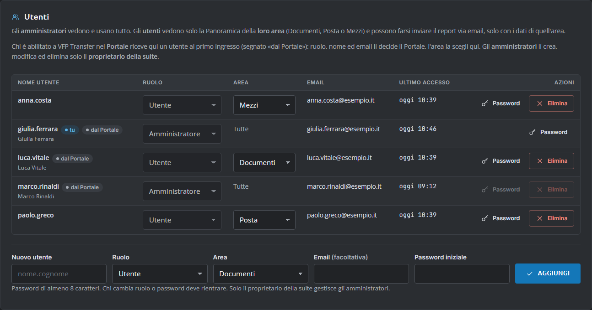

Nel modulo *Nuovo utente* la tendina **Area** offre **Documenti**, **Posta** e **Mezzi** (per l'amministratore
l'area non conta: vede tutto).

**Stato del programma** — *Tutto regolare* oppure l'elenco dei problemi; stato del controllo posta, ultimo giro,
trasferimento in corso, versione. **Aggiorna** per ricontrollare. Se il controllo della posta si blocca, il
programma si riavvia da solo.

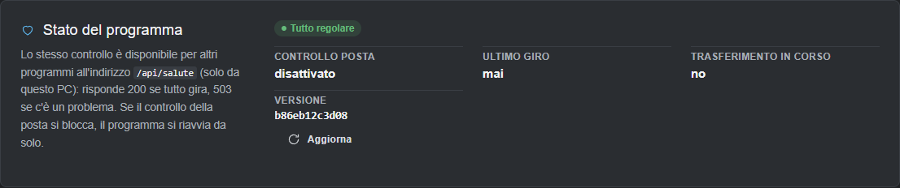

**Accesso dalla rete** — per aprire VFP Transfer dagli altri PC dell'ufficio: indirizzo di ascolto, nome del
server, certificato HTTPS e chiave (li dà l'IT). Vale dal riavvio del programma.

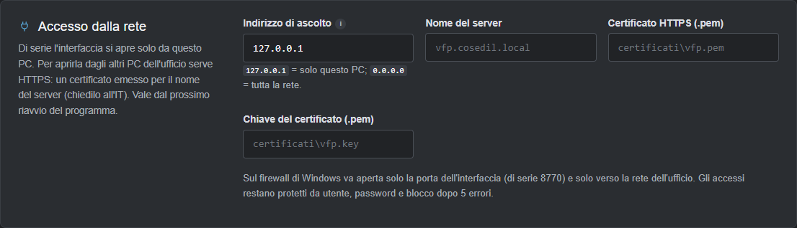

**Ripresa trasferimenti** — quanti file risultano già caricati e quanti in attesa di completare l'upload.
**Azzera ripresa** fa dimenticare al programma cosa ha già caricato: da usare solo per ricaricare tutto da capo
(per esempio su un altro progetto). Viene conservata una copia di sicurezza.

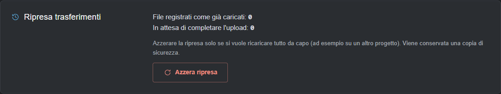

[← Confronta documenti e Attività](05-confronto-e-attivita.md) · [Avanti: Problemi frequenti →](07-problemi-frequenti.md)
