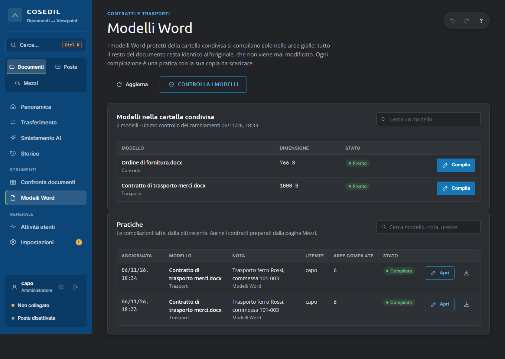
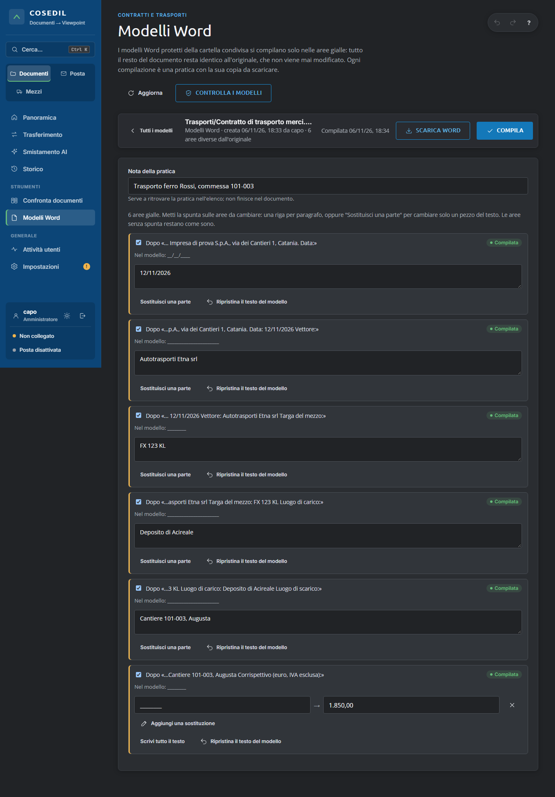

<!-- "><(((º> sabusabu <º)))>< -->
# 9. Modelli Word (amministratori)

[← Indice](README.md)

La pagina **Modelli Word** (menu *Strumenti*, solo amministratori) compila i **modelli Word protetti** della
cartella condivisa: contratti di trasporto, ordini, format contrattuali. In Word questi documenti sono bloccati
("Limita modifica") tranne le **aree gialle**: il programma scrive solo lì e controlla che tutto il resto del
documento resti identico all'originale. L'originale nella cartella condivisa non viene **mai** modificato: ogni
compilazione è una **pratica** con una copia interna del modello e la copia compilata da scaricare.

La cartella dei modelli la imposta chi installa il programma (vedi il
[capitolo 8](08-amministratore-di-sistema.md)): dalla pagina non si cambia. Se non è impostata, la pagina lo dice
con un riquadro rosso.

## Modelli nella cartella condivisa

L'elenco mostra ogni modello con la sottocartella (per esempio *Trasporti*, *Contratti*) e lo stato:

| Stato | Cosa vuol dire |
|---|---|
| **Pronto** | documento Word (.docx): si compila |
| **.doc, convertito** | vecchio formato Word 97-2003: il programma lo converte da solo mantenendo le aree gialle |
| **.doc: salvarlo come .docx** | vecchio formato e sul server manca il convertitore: aprirlo in Word e salvarlo come .docx |

**Controlla i modelli** confronta subito i modelli con il controllo precedente, senza aspettare quello automatico
di inizio mese: se qualcuno ha modificato, aggiunto o tolto un modello compare l'avviso in Panoramica (e nella
pagina Avvisi del Portale). Il primo controllo prende solo la "fotografia" della cartella.

## Compilare un modello

1. Premi **Compila** accanto al modello. Una finestra dice quante aree gialle ha; scrivi una **nota** per
   ritrovare la pratica (per esempio *Trasporto ferro Rossi, commessa 101-003*) e premi **Crea la pratica**.
2. Per ogni area gialla vedi il testo che la precede («Dopo «… Targa del mezzo:»») e il testo attuale.
   **Metti la spunta** sulle aree da cambiare e scrivi il testo nuovo:
   - **una riga per paragrafo**: se l'area occupa due paragrafi, servono due righe;
   - oppure **Sostituisci una parte**: scrivi il testo da cercare (per esempio `________`) e il testo nuovo
     (`1.850,00`); serve per le aree lunghe di cui va cambiato solo un pezzo. *Aggiungi una sostituzione* per
     più pezzi.
3. Premi **Compila**. Le aree cambiate diventano verdi (*Compilata*) e sotto compare il testo del modello
   («Nel modello: …»).
4. Premi **Scarica Word** per avere il documento compilato, con la protezione del modello.

**Ripristina il testo del modello** rimette nell'area il testo originale: alla compilazione successiva l'area torna
com'era. Le aree senza spunta restano come sono. Se esci senza compilare, il programma chiede conferma.

## Pratiche

Sotto i modelli ci sono le **pratiche**, dalla più recente: data, modello, nota, chi l'ha compilata, quante aree
sono diverse dall'originale e lo stato (*Da compilare* / *Compilata*). **Apri** riprende la pratica, l'icona di
scaricamento dà subito la copia compilata. Nell'elenco ci sono anche i **contratti preparati dalla pagina Mezzi**
(sotto la nota c'è scritto *Mezzi a nolo*): si possono aprire, ma di solito si compilano dalla pagina Mezzi, che
li rifà con i dati del mezzo.

## Messaggi

| Messaggio | Cosa fare |
|---|---|
| *Un'area ha 2 paragrafi ma il testo 1 riga* | Scrivi una riga per paragrafo, oppure usa *Sostituisci una parte* |
| *testo da sostituire non trovato* | Il testo da cercare non c'è nell'area: copialo esattamente com'è (spazi e trattini compresi) |
| *Il modello non ha aree gialle da compilare* | Il documento va preparato in Word con "Limita modifica" e le eccezioni gialle |
| *la compilazione cambierebbe testo fuori dalle aree consentite* | Il programma si è fermato per non toccare il resto del documento: compila quell'area in Word |
| *la copia dell'originale è stata modificata* | Crea una nuova pratica dallo stesso modello |

Ogni pratica creata, compilata o scaricata resta nel registro **Attività utenti**.
